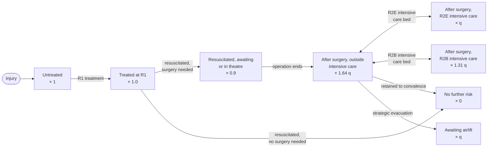
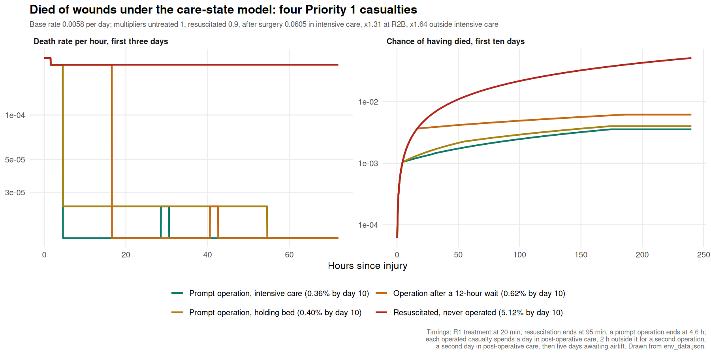
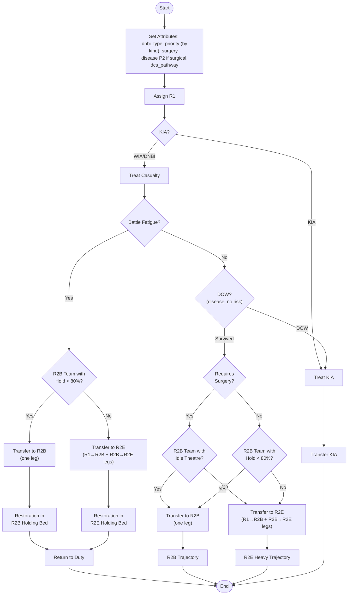
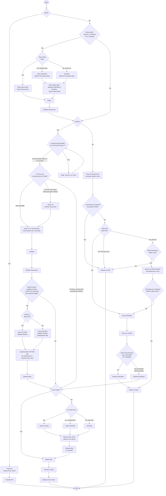

# Battlefield Casualty Handling

## Abstract

This repository contains a Discrete Event Simulation (DES) framework, written in R using the `simmer` package, developed to evaluate resource utilisation and casualty processing within a deployed battlefield medical system under Large Scale Combat Operations (LSCO). Providing baseline parameterised inputs derived from open-access literature, the simulation models per-minute casualty arrivals, triage, and surgical throughput across Role 1 (R1), Role 2 Basic (R2B), and Role 2 Enhanced – Heavy (R2E Heavy) treatment nodes, embedding a three-stage damage control surgery model to reflect treatment pathways and operational constraints.

This document is the project's **system reference**: it describes the codebase structure, the literature and doctrinal basis for every modelled algorithm and parameter, the resource and trajectory model (including the R1/R2B/R2E Heavy trajectory flowcharts), the model's known limitations, and the development environment. It does not present simulation results — those are published as three companion analysis documents:

- **[docs/Results.md](docs/Results.md)** — every measurement of the replicated experiments and the verification of one seed-42, 360-day campaign, generated from the tracked evidence without interpretation or recommendation.
- **[docs/Planning_Implications.md](docs/Planning_Implications.md)** — the planning paper, which reads those measurements as options for a planner: where the system fails first, every lever the model can evaluate with its evidence label, recommendations in priority order, the effects left unresolved and the research agenda. It quotes every figure from the results paper and states no measurement of its own.
- **[docs/Methods.md](docs/Methods.md)** — the standalone companion paper to the results and planning papers, holding the full experimental design of every replicated experiment, the replication framework and interval derivations they rest on, and the force regeneration comparison.

Readers wanting to run the simulation rather than read about it should start at [Development Environment](#development-environment), which covers the Dev Container setup, dependency restoration, and how to launch a run.

This tool supports iterative refinement and stakeholder engagement, offering a transparent, modular platform for testing health system resilience. With further development and testing against high-intensity casualty models, the simulation can inform doctrinal updates and guide medical planning for future operational environments.

## Contents

<small>[Return to Top](#contents)</small>

<!-- TOC START -->
- [Abstract](#abstract)
- [Contents](#contents)
- [Introduction](#introduction)
- [Literature Review](#literature-review)
  - [Methodology](#methodology)
  - [Findings](#findings)
    - [Battlefield Casualty Rates and Estimation Models](#battlefield-casualty-rates-and-estimation-models)
    - [Casualty Simulation and DES](#casualty-simulation-and-des)
    - [Statistical Distributions and Modelling Algorithms](#statistical-distributions-and-modelling-algorithms)
    - [Military Doctrine and Operational Health Support Policy](#military-doctrine-and-operational-health-support-policy)
    - [Damage Control Surgery and Post-Operative Critical Care](#damage-control-surgery-and-post-operative-critical-care)
    - [Preventable Death and Time-Dependent Mortality](#preventable-death-and-time-dependent-mortality)
    - [Strategic Aeromedical Evacuation (AME) and Role 4 Doctrine](#strategic-aeromedical-evacuation-ame-and-role-4-doctrine)
    - [Casualty Surge Event Simulation](#casualty-surge-event-simulation)
    - [Statistical Methods for Simulation Verification, Replication, and Sensitivity Analysis](#statistical-methods-for-simulation-verification-replication-and-sensitivity-analysis)
    - [Disease and Non-Battle Injury Evidence](#disease-and-non-battle-injury-evidence)
- [Scenario Context](#scenario-context)
- [Simulation Framework](#simulation-framework)
- [Resource Descriptions](#resource-descriptions)
  - [Health Teams](#health-teams)
    - [Role 1 (R1) Treatment Team](#role-1-r1-treatment-team)
    - [Role 2 Basic (R2B)](#role-2-basic-r2b)
    - [Role 2 Enhanced Heavy (R2E Heavy)](#role-2-enhanced-heavy-r2e-heavy)
  - [Bed Types](#bed-types)
    - [Operating Theatre (OT)](#operating-theatre-ot)
    - [Resuscitation (Resus) (alternatively Emergency)](#resuscitation-resus-alternatively-emergency)
    - [Intensive Care Unit (ICU)](#intensive-care-unit-icu)
    - [Holding (Hold)](#holding-hold)
  - [Transport Assets](#transport-assets)
    - [Protected Mobility Vehicle Ambulance (PMV Ambulance)](#protected-mobility-vehicle-ambulance-pmv-ambulance)
    - [HX2 40M](#hx2-40m)
    - [Dead-Heading Return Legs](#dead-heading-return-legs)
- [Model Parameters and Model Configuration](#model-parameters-and-model-configuration)
  - [Force Size](#force-size)
    - [Population](#population)
    - [Reinforcement Demand & Fulfillment](#reinforcement-demand--fulfillment)
  - [Health System Architecture](#health-system-architecture)
    - [Surgical Shift Roster](#surgical-shift-roster)
  - [Medevac — Transport Fleet](#medevac--transport-fleet)
  - [Schedules and Rosters](#schedules-and-rosters)
  - [Casualty Generation](#casualty-generation)
    - [1. Distribution Parameterisation](#1-distribution-parameterisation)
    - [2. Daily Rate Sampling and Scaling](#2-daily-rate-sampling-and-scaling)
    - [3. Arrival Time Sampling by Thinning](#3-arrival-time-sampling-by-thinning)
    - [4. Realised Daily Mean and Variance](#4-realised-daily-mean-and-variance)
    - [5. Casualty Surge Event Injection](#5-casualty-surge-event-injection)
    - [6. Force Regeneration and the Endogenous Feedback Loop](#6-force-regeneration-and-the-endogenous-feedback-loop)
  - [Casualty Generation Rates](#casualty-generation-rates)
    - [WIA — Combat](#wia--combat)
    - [KIA — Combat](#kia--combat)
    - [DNBI — Combat](#dnbi--combat)
    - [WIA — Support](#wia--support)
    - [KIA — Support](#kia--support)
    - [DNBI — Support](#dnbi--support)
  - [DNBI Sub-Type Split](#dnbi-sub-type-split)
  - [Parameters Not Scenario-Eligible](#parameters-not-scenario-eligible)
- [Casualty Priorities](#casualty-priorities)
- [Return to Duty](#return-to-duty)
- [Died of Wounds](#died-of-wounds)
  - [How Risk Accrues](#how-risk-accrues)
  - [Care States and Multipliers](#care-states-and-multipliers)
  - [Worked Example](#worked-example)
  - [Checkpoints](#checkpoints)
  - [Post-Operative Intensive Care Gate](#post-operative-intensive-care-gate)
  - [Calibration](#calibration)
  - [Calibrating to a New Scenario](#calibrating-to-a-new-scenario)
  - [The Earlier Model](#the-earlier-model)
- [Scenario Profiles](#scenario-profiles)
  - [Mechanism](#mechanism)
  - [Parameter classification](#parameter-classification)
  - [Moderate Intensity configuration (Falklands 1982 exemplar)](#moderate-intensity-configuration-falklands-1982-exemplar)
  - [High Intensity profile (Okinawa exemplar)](#high-intensity-profile-okinawa-exemplar)
- [Development Environment](#development-environment)
  - [Prerequisites](#prerequisites)
  - [First-time setup](#first-time-setup)
  - [Restoring dependencies](#restoring-dependencies)
  - [RStudio Server configuration](#rstudio-server-configuration)
  - [Running in the Container](#running-in-the-container)
  - [Git workflow](#git-workflow)
- [Simulation Design](#simulation-design)
  - [Codebase Structure](#codebase-structure)
    - [Running the simulation](#running-the-simulation)
    - [Reproducing the Published Results](#reproducing-the-published-results)
    - [Shiny Console Structure](#shiny-console-structure)
    - [Analysis Pipeline Structure](#analysis-pipeline-structure)
    - [Verification and Continuous Integration](#verification-and-continuous-integration)
    - [Multi-run Replication Framework](#multi-run-replication-framework)
    - [Warm-up Period Analysis](#warm-up-period-analysis)
    - [Sensitivity Analysis](#sensitivity-analysis)
    - [Comparative Scenario Runner](#comparative-scenario-runner)
    - [Shiny Application](#shiny-application)
  - [Simulation Environment Setup](#simulation-environment-setup)
  - [Core Trajectory](#core-trajectory)
    - [Surgical Pathway](#surgical-pathway)
  - [R2B Trajectory](#r2b-trajectory)
    - [Post-Operative Stabilisation](#post-operative-stabilisation)
  - [R2E Heavy Trajectory](#r2e-heavy-trajectory)
  - [Role 4 (National Support Base) Demand Modelling](#role-4-national-support-base-demand-modelling)
    - [Operating Theatre Demand](#operating-theatre-demand)
      - [Staged Reconstruction](#staged-reconstruction)
    - [Length of Stay](#length-of-stay)
- [Model Outputs](#model-outputs)
  - [Domain 1 — Mortality and Preventable Death](#domain-1--mortality-and-preventable-death)
  - [Domain 2 — Time-to-Care from R1 Arrival](#domain-2--time-to-care-from-r1-arrival)
  - [Domain 3 — Surgical Throughput](#domain-3--surgical-throughput)
  - [Domain 4 — Echelon Load and Capacity](#domain-4--echelon-load-and-capacity)
  - [Domain 5 — Flow and Disposition](#domain-5--flow-and-disposition)
  - [Domain 6 — Combat Power](#domain-6--combat-power)
  - [Domain 7 — Strategic Evacuation and National Support Base Demand](#domain-7--strategic-evacuation-and-national-support-base-demand)
  - [Output Variable Register cross-reference](#output-variable-register-cross-reference)
- [Further Development](#further-development)
  - [High Impact](#high-impact)
  - [Medium Impact](#medium-impact)
  - [Low Impact](#low-impact)
- [Conclusion](#conclusion)
- [References](#references)
  <!-- TOC END -->

---

## Introduction

<small>[Return to Top](#contents)</small>

Large‑scale combat operations (LSCO) represent the most demanding form of conventional warfare, characterised by high‑tempo, multi‑domain action against peer or near‑peer adversaries. LSCO require the orchestration of manoeuvre, fires, logistics, intelligence, and command across vast, often nonlinear battlespaces [[1]](#references), [[2]](#references). Unlike the western experience in Middle-East conflicts, forces in LSCO will not have guaranteed air superiority, uncontested lines of communication, and predictable casualty flows. LSCO is expected to unfold in contested, degraded, and dynamic operational conditions [[1]](#references), [[2]](#references), [[3]](#references). Historical and contemporary case studies - from the industrial battlefields of the Second World War to recent fighting in Ukraine - demonstrate that such operations generate high casualty densities, impose unprecedented logistical demands, and challenge even the most sophisticated forces’ ability to sustain tempo over time [[2]](#references), [[4]](#references).

The medical implications of LSCO are profound. Estimates consistently project casualty high casualty rates, recent literature suggests that a significant amount of those potentially could and should be able to return to duty (potentially without evacuation from theatre) if treated effectively and without delay [[5]](#references). The deployed health system is therefore not a peripheral service but a critical combat enabler. Its capacity to preserve fighting strength underpins the force’s ability to seize, retain, and exploit the initiative. In LSCO, battlefield clearance must be achieved despite contested airspace and disrupted communications, injury patterns will reflect the lethality of modern munitions, and medical logistics must adapt to disrupted supply chains and fluid front lines.

Yet, existing medical doctrine and force design have evolved largely from counterinsurgency campaigns where operational conditions were comparatively permissive [[5]](#references). In a peer‑conflict LSCO scenario, planners must expect prolonged field care and delays in evacuation [[2]](#references), [[5]](#references), and surgical teams mobile enough to manoeuvre with the force they support [[2]](#references), although [[5]](#references) cautions that a few forward surgical teams may achieve less than the same assets consolidated at higher levels of care. A resilient and agile, deployed health system serves not only to save lives, but to sustain operational momentum and, ultimately, to enable the successful prosecution of the campaign.

This research looks to explore the performance of the deployed health system through simulation with an eye to understanding its implications for participation in LSCO. The simulation approach allows for the exploration of scenarios that are difficult to replicate in live exercises, offering evidence‑based insights to refine doctrine, optimise medical force posture, and ensure that health support is adequate for LSCO. In doing so, it contributes to the broader imperative of preparing the force for the realities of high‑intensity warfare in an era of renewed great‑power competition [[6]](#references), [[7]](#references).

---

## Literature Review

<small>[Return to Top](#contents)</small>

### Methodology

To inform the design and implementation of the battlefield casualty simulation, a structured literature review was conducted in two phases.

The initial phase used a multi-pronged methodology. First, open-access academic literature and publicly available internet-based resources on battlefield casualty modelling, discrete event simulation (DES), and casualty rate estimation were surveyed. This was complemented by a snowballing technique, recursively exploring the references cited within key papers to identify additional relevant sources. Large language models (LLMs) were then engaged to identify supplementary resources. This surfaced publications, technical reports, and grey literature that conventional search techniques did not. Finally, this academic and technical review was supplemented by a survey of publicly available military publications, providing context for force structure, casualty flow assumptions, and the operational constraints that shape operational medical planning. This initial phase established the foundational casualty-rate, DES, distributional, and doctrinal basis.

In the second phase the simulation was extended feature by feature, each addition triggered its own deliberate, LLM-assisted search for open-access sources addressing that specific enhancement. These features included the three-stage damage control surgery (DCS) model and its treatment-duration and post-operative recovery parameters, the died-of-wounds model, the strategic aeromedical evacuation (AME) and Role 4 demand model, the compound Poisson casualty surge event mechanism, and the statistical framework underpinning multi-run replication, warm-up analysis, and Morris/Sobol sensitivity screening. This iterative extension is summarised in the further thematic domains that follow the initial four, each tied to the design or parameterisation requirement of a specific subsequent Issue.

### Findings

In total, 54 resources have been reviewed and incorporated into the simulation framework as of the current codebase, spanning peer-reviewed journals, technical reports, doctrinal publications, and internet publications. The review covers ten thematic domains.

#### Battlefield Casualty Rates and Estimation Models

Historical and predictive models of casualty rates were central to the review. The FORECAS system [[8]](#references) provided a statistically grounded approach to projecting wounded-in-action (WIA), killed-in-action (KIA), and disease/non-battle injury (DNBI) rates using empirical data from past conflicts. Complementary studies examined the operational implications of casualty rates in LSCO, emphasising the disproportionate impact of DNBI on lost duty days [[9]](#references), and casualty estimation in modern warfare [[10]](#references); [[11]](#references) standardised the definitions behind combat casualty statistics, and [[12]](#references) assessed the US military trauma system across the Afghanistan and Iraq conflicts. The Falklands War 1982 (Operation CORPORATE) serves as this project's principal historical validation exemplar for a moderate-intensity casualty rate. Field-surgical mortality outcomes are reported from two overlapping vantage points: four Army Field Surgical Teams operated on 233 casualties across the Ajax Bay Advanced Surgical Centre and the forward stations at Teal Inlet and Fitzroy, recording three deaths [[13]](#references), while an obituary of the field hospital's commanding officer records that over 650 combat casualties from both sides passed through the hands of the team at Ajax Bay and its forward stations at Teal Inlet and Fitzroy, of whom three died of wounds [[14]](#references). Campaign-level totals of 255 killed and 777 injured are recorded in the parliamentary record [[15]](#references), [[16]](#references). These are the figures the died-of-wounds calibration is validated against (see [Calibration](#calibration)).

#### Casualty Simulation and DES

Simulation methodologies were explored through both military-specific and general DES literature. The simmer package for R [[17]](#references) was identified as a suitable framework for implementing modular, auditable, and event-driven logic. Studies such as [[18]](#references) demonstrated DES applications in healthcare contexts, while [[19]](#references) and [[4]](#references) provided high-level casualty rate numbers that allowed the evaluation of the performance of DES models and [[2]](#references) provided insights into trauma system design under combat conditions. These sources informed the architectural decisions for the simulation engine, including event scheduling, resource constraints, and patient flow logic.

#### Statistical Distributions and Modelling Algorithms

The review examined statistical distributions suitable for modelling casualty arrival rates and treatment durations. FORECAS [[8]](#references) employed lognormal and exponential distributions based on battle intensity and troop type, validated through historical data. Additional studies [[20]](#references), [[11]](#references) and [[18]](#references) provided statistics, explored distribution models measures, and described other approaches using DES in medical care contexts.
These findings guided the selection of distribution functions for stochastic modelling, ensuring that simulated outputs reflect doctrinally plausible variability and temporal clustering.

#### Military Doctrine and Operational Health Support Policy

Doctrinal and policy publications such as [[1]](#references), [[3]](#references), [[6]](#references) and [[7]](#references) established the current geostrategic context and outlined the imperative for militaries to be able to provide force options for LSCO. 
Recent doctrinal analyses [[9]](#references), [[2]](#references) and [[5]](#references) emphasised the shift toward prolonged casualty care and contested evacuation, and [[2]](#references) the need to disperse medical capability. A related analysis [[9]](#references) frames return-to-duty as a direct force-sustainment lever rather than a purely clinical outcome and is implemented in the model directly ([Force Regeneration and the Endogenous Feedback Loop](#6-force-regeneration-and-the-endogenous-feedback-loop)), coupling casualty production to a live, time-varying effective force size. These insights were incorporated into the simulation design to ensure alignment with contemporary operational realities.

#### Damage Control Surgery and Post-Operative Critical Care

A systematic review [[21]](#references) and an account of damage control technique in abdominal surgery [[22]](#references) establish the three-phase structure that this project's R2B and R2E Heavy trajectories implement. The surgery duration distribution is derived from a US Department of Defense Trauma Registry sample of operative time by injury severity [[23]](#references), with its minimum taken from the shortest damage control operation within [[21]](#references), read against the sub-90-minute operative target of damage control technique [[24]](#references), a single-centre trauma DCS series [[25]](#references) and abdominal-trauma DCS practice [[26]](#references). Post-operative critical care requirements are established by [[27]](#references), [[24]](#references), [[26]](#references) and [[28]](#references); descriptions of post-DCS stabilisation timeframes [[21]](#references), [[29]](#references), [[26]](#references) informed the ICU length-of-stay parameters at both echelons. Task-time estimation for the R2B/R2E resuscitation phase, where no single published source tabulates an end-to-end duration, drew on the treatment-process optimisation methodology of [[30]](#references), constructing an estimate from collated task-duration components rather than a single reported figure.

#### Preventable Death and Time-Dependent Mortality

An analysis of 4,596 battlefield deaths during Operations Enduring Freedom and Iraqi Freedom [[31]](#references) found that 87.3% occurred before the casualty reached a medical treatment facility and that 90.9% of the potentially survivable pre-hospital deaths were associated with haemorrhage, and an assessment of the US military trauma system across the same conflicts associated prehospital transport to a surgical facility within 60 minutes with part of the fall in case fatality [[12]](#references). Together these establish the link between time to care and survivability that motivates modelling died of wounds as a rate that every hour of delay adds to; neither reports a death rate per hour, so the base rates are fitted rather than sourced (see [Calibration](#calibration)). The multipliers that lower the rate as care is received draw on the same literature, a review of damage control resuscitation reporting laparotomy mortality falling from 22% to 13% after its adoption [[32]](#references), and the post-operative multipliers on studies of degraded post-operative care (see [Care States and Multipliers](#care-states-and-multipliers)).

#### Strategic Aeromedical Evacuation (AME) and Role 4 Doctrine

The strategic AME and Role 4 demand model draws on [[33]](#references), which establishes the triage framework, echelon functions, and the Casualty Staging Unit/CCATT-CCAST acuity concepts underpinning the model's critical/standard AME pool split. Role 4 ward assignment and length-of-stay parameters are informed estimates: [[34]](#references) documents the evacuation chain they sit in, with Landstuhl as the common evacuation node and an average stay there of under four days, but no open-access source tabulates Role 4 length of stay by injury severity.

#### Casualty Surge Event Simulation

The compound Poisson construction of the casualty surge event mechanism, incident inter-arrival times with a per-incident casualty count, follows the one a medical evacuation wargame uses for routine casualty generation [[35]](#references), which injects its own mass casualty events by hand; the mechanism complements the discrete-event casualty-surge-incident stress-testing precedent of SIMEDIS [[36]](#references), which injects a fixed, deterministic victim count rather than a stochastically varying one. An account of aligning field hospital training with LSCO reality [[37]](#references) gives a representative 70% blast and fragmentation share of injuries in contemporary LSCO, the context for the blast-dominant triage priority distribution applied to casualty-surge-derived casualties, which is itself an informed estimate. The term is used here for an exogenous burst of casualties injected at a configured size, and not in its doctrinal sense: NATO defines a mass casualty (MASCAL) situation by capacity, as a major incident that overwhelms the available medical capabilities or capacities despite extraordinary measures, declared by the Theatre Medical Commander, and applicable to any number of casualties produced in a relatively short period [[38]](#references). Whether an injected burst amounts to a MASCAL is therefore a property of the system's response to it, not of its headcount.

#### Statistical Methods for Simulation Verification, Replication, and Sensitivity Analysis

Moving from a single illustrative run to a defensible multi-run analytical framework required its own literature base. Verification and validation followed the framework in [[39]](#references) and the general DES methodology in [[40]](#references). Warm-up classification used Welch's graphical procedure and the treatment of initialisation bias in [[41]](#references), which places warm-up deletion within infinite-horizon steady-state analysis, together with the terminating-versus-steady-state classification in [[42]](#references); a campaign with a defined finite horizon falls on the terminating side of that division. Multi-run replication runs under the L'Ecuyer-CMRG generator, demonstrated for parallel use in R in [[43]](#references) and documented in [[44]](#references), with the conditions a variance reduction scheme must meet taken from a treatment of antithetic variates [[40]](#references) and the choice of unit of analysis and replication count from a review of simulation output analysis [[42]](#references). Global sensitivity screening used Morris Elementary Effects [[45]](#references), implemented via R's `sensitivity` package [[46]](#references) following the method description in [[47]](#references), and Sobol variance-based decomposition [[48]](#references). A critical-care DES study [[49]](#references) informed reporting results as means across replications, with intervals constructed over independent replications as in [[42]](#references).

#### Disease and Non-Battle Injury Evidence

Disease DNBI sub-categorisation and its emergency surgical candidacy rate draw on documented evidence of acute surgical disease conditions occurring in deployed populations. Acute appendicitis incidence among Japanese soldiers in Burma, set against general-population rates, is reported in [[50]](#references), and US military treatment facilities in Afghanistan performed appendectomies and gallbladder procedures among their non-trauma workload, though for local national civilians rather than the deployed force [[51]](#references). Together these support the inclusion of conditions such as appendicitis, cholecystitis, and perforated peptic ulcer within the disease DNBI pathway's surgical candidacy branch, distinct from the battle fatigue and NBI sub-types that do not carry the same surgical risk profile.

The convalescence of minor casualties is anchored on Second World War Army Service Forces health reports [[52]](#references), [[53]](#references) and the history of medical support in Vietnam [[54]](#references), [[55]](#references); the share of disease that is a medical emergency on Vietnam malaria complications [[56]](#references) and a review of deployed critical care [[57]](#references); and battle fatigue restoration on Canadian Armed Forces guidance [[58]](#references).

Because no open-access source was identified that tabulates the specific quantity required, several parameters in this project remain informed estimates rather than directly sourced values, described in detail in the [Further Development](#further-development) section.

This literature review enabled the design of a model suitable to support the assessment of the deployed health system capacity within LSCO.

---

## Scenario Context

<small>[Return to Top](#contents)</small>

The health system establishment — the number of Role 1 (R1) treatment teams, Role 2 Basic (R2B) facilities, and Role 2 Enhanced Heavy (R2E Heavy) hospitals, and each element's internal team and bed composition — is a configurable input to the simulation, defined in `env_data.json`'s `elms` structure and editable directly or via the Shiny Configure panel (`app.R`).

The shipped default configuration models the land combat health system anticipated for a representative combat brigade: three battlegroups, each allocated one R1 treatment team tasked with providing immediate clinical intervention and stabilisation in proximity to combat operations (three R1 teams in total); two R2B facilities conducting damage control resuscitation and surgery before onward evacuation to higher-level care; and one R2E Heavy hospital sited to the rear for complex surgical procedures, extended post-operative care, and advanced diagnostic support. This default configuration underpins the diagram below, the seed-42 verification in [docs/Results.md](docs/Results.md#annex-a-model-verification-of-one-seed-42-campaign), and the replicated experiments in [docs/Results.md](docs/Results.md).

Part of the establishment rests on published Australian descriptions. Each R1 treatment team is one medical officer, one nursing officer and three medical technicians, the doctrinal composition of the Australian treatment team [[59]](#references). Each R2B facility fields one operating theatre and two resuscitation, two intensive care and five holding beds, matching the Australian Role 2 Basic, which resuscitates two Priority 1 casualties, operates on one patient at a time, and holds two patients in intensive care and five in low-dependency beds [[60]](#references). A Danish Role 2E has double the operating room and intensive care capacity of its Role 2B [[61]](#references), consistent with the R2E Heavy's two theatres and four intensive care beds against the R2B's one and two, although that source describes a national procurement rather than doctrine.

The rest is an informed estimate of a representative brigade, no open-access source stating an Australian brigade health establishment: one R1 team per battlegroup, the staffing of each R2B section and its 12 hours of surgery a day, the R2E Heavy's four resuscitation and thirty holding beds, its three surgical sections and their staffing, the population of 2,500 combat and 1,250 support personnel, and the transport fleet of three PMV ambulances and four HX2 40M trucks. What an error would change differs by element. Every casualty volume, and so every load figure, scales with the population, which no experiment varies, so uncertainty there is high and carries into every finding. The R2E intensive care beds, surgical sections and holding beds and the transport fleet are each swept, so what a different value buys is measured ([R2E Intensive Care Bed Establishment](docs/Results.md#r2e-intensive-care-bed-establishment), [Surgical Team Establishment](docs/Results.md#surgical-team-establishment), [R2E Holding Establishment](docs/Results.md#r2e-holding-establishment), [Transport Fleet Size](docs/Results.md#transport-fleet-size)). The staffing of a section sets which roles a procedure seizes together rather than how many procedures run at once, so its effect is small. Further Development L38 records the gap.


The three R1 teams sit forward with their battlegroups, each connected by a road evacuation route to one of the two R2B facilities, and both R2B facilities route rearward to the single R2E Heavy hospital sited near the main supply route.

An [Interactive Diagram](https://www.map.army/?ShareID=1041883&UserType=RO-xOMjf7j6) allows further exploration of the default model configuration being simulated.

The diagram is hand-authored and no code produces it. The symbols and routes were drawn in the map.army web tool, which stores them as a MilX layer; `images/tactical_diagram.milxlyz` is that layer and `images/tactical_diagram.kmz` its KML export, and either reopens the symbols in the tool or in a KML viewer for editing. `images/tactical_diagram.png` is a screen export over the tool's satellite basemap. The two source files carry the symbols and routes only, with no basemap imagery. The imagery in the PNG belongs to the tool's basemap provider and is shown here for illustration under that provider's terms, which this repository does not restate, so check them before reusing the image elsewhere.

---

## Simulation Framework

<small>[Return to Top](#contents)</small>

The simulation models casualty handling across echelons of care in a battlefield environment, structured around modular trajectories and dynamic resource availability. It operates within a discrete-event simulation framework using `simmer`, and is driven by probabilistic rates, conditional branching, and resource interactions across Role 1 (R1), Role 2 Basic (R2B), and Role 2 Enhanced Heavy (R2E) facilities.

The simulation was designed around the general functions of each role of health element as outlined in the diagram below. Where roles overlap they are able to provide the same functions to varying degree. The diagram below provides an outline of the role and function design applied for this simulation using the three-stage Damage Control Surgery (DCS) model of care described in [[21]](#references) and [[22]](#references).

```mermaid
block-beta
  columns 13

  a["Casualty Care"]:13
  b["R1"]:3
  c["R2B"]:4 space:9
  e["R2E"]:7 space:6
  f["R4"]:10

  g["Triage"]
  h["POI Care"]
  i["MEDIVAC"]
  j["Resus/Emergency"]
  k["Abbreviated Surgery"]
  l["ICU Stabilisation"]
  m["MEDIVAC"]
  n["Definitive Surgery"]
  o["Recovery"]
  p["MEDIVAC"]
  q["Reconstructive Surgery"]
  r["Rehabilitation"]
  s["Long Term Recovery"]

  %% Role 1 — Deep Navy
  style b fill:#336699,stroke:#003366,color:#ffffff
  style g fill:#336699,stroke:#003366,color:#ffffff
  style h fill:#336699,stroke:#003366,color:#ffffff
  style i fill:#336699,stroke:#003366,color:#ffffff

  %% Role 2B — Dark Sea Green
  style c fill:#2e8b57,stroke:#14532d,color:#ffffff
  style j fill:#2e8b57,stroke:#14532d,color:#ffffff
  style k fill:#2e8b57,stroke:#14532d,color:#ffffff
  style l fill:#2e8b57,stroke:#14532d,color:#ffffff
  style m fill:#2e8b57,stroke:#14532d,color:#ffffff

  %% Role 2E — Olive Gold
  style e fill:#b5a900,stroke:#665c00,color:#ffffff
  style n fill:#b5a900,stroke:#665c00,color:#ffffff
  style o fill:#b5a900,stroke:#665c00,color:#ffffff
  style p fill:#b5a900,stroke:#665c00,color:#ffffff

  %% Role 4 — Burnt Amber
  style f fill:#cc6600,stroke:#663300,color:#ffffff
  style q fill:#cc6600,stroke:#663300,color:#ffffff
  style r fill:#cc6600,stroke:#663300,color:#ffffff
  style s fill:#cc6600,stroke:#663300,color:#ffffff
```



---

## Resource Descriptions

<small>[Return to Top](#contents)</small>

### Health Teams

#### Role 1 (R1) Treatment Team

A role 1 treatment team provides the first line of medical care. It is designed to deliver immediate lifesaving measures, perform triage and stabilization, and manage minor injuries and illnesses close to the point of injury or unit location. These teams also prepare casualties for evacuation to higher levels of care if needed.

#### Role 2 Basic (R2B)

A Role 2 Basic (R2B) medical treatment facility provides forward surgical and resuscitative care close to the battlefield. Its purpose is to deliver damage-control surgery, critical care, and short-term patient holding in austere environments where rapid intervention can save lives.

It’s designed to be mobile, logistically lean, and capable of stabilizing casualties before evacuation to higher-level care. With ICU beds, low-dependency holding, and a surgical team, R2B bridges the gap between frontline treatment and more comprehensive facilities like Role 2 Enhanced or Role 3.

#### Role 2 Enhanced Heavy (R2E Heavy)

A R2E Heavy facility delivers advanced surgical and critical care capabilities in forward-deployed military operations. Its purpose is to provide damage-control surgery, intensive care, inpatient services, and scalable resuscitation for casualties who require more than basic stabilization but are not yet ready for strategic evacuation.

The R2E Heavy is a static field hospital designed to handle complex trauma, prolonged care, and high casualty volumes.

### Bed Types

#### Operating Theatre (OT)

OT beds are specialized surgical stations designed to support damage-control surgery and life-saving interventions. These beds are part of a sterile operating suite and are equipped to handle:

- Emergency trauma procedures.
- Advanced surgical care including orthopedic, abdominal, and thoracic operations.
- Integrated anesthesia and monitoring systems for patient stability.
- Rapid turnover and sterilization protocols to manage high casualty volumes.

#### Resuscitation (Resus) (alternatively Emergency)

Emergency beds are designed for rapid stabilization and life-saving interventions immediately after casualty arrival. These beds support:

- Advanced trauma management including airway control, hemorrhage control, and shock treatment.
- Critical monitoring and resuscitation equipment such as defibrillators, oxygen delivery systems, and IV access.
- Quick turnover and accessibility to facilitate high casualty throughput during casualty surge events.
- Integration with surgical and evacuation pathways, ensuring seamless transition to operating theatres or higher echelons of care.

These beds serve as the first stop for severely injured personnel.

#### Intensive Care Unit (ICU)

Intensive Care Unit (ICU) beds are designed to deliver advanced life-support and continuous monitoring for critically injured or ill personnel. These beds serve as the backbone of forward-deployed critical care, enabling:

- Resuscitation and stabilization of casualties with multi-system trauma.
- Mechanical ventilation, invasive monitoring, and medication infusions.
- Postoperative care following damage-control surgery.
- Support for prolonged field care when evacuation is delayed.

#### Holding (Hold)

Holding beds are designated for short-term patient care and observation, typically for those who are awaiting evacuation, recovering from minor procedures, or expected to return to duty soon. These beds serve as a transitional space between acute treatment zones (like ICU or OT) and final disposition, whether that’s evacuation to higher care or reintegration into the force.

They’re often used for:

- Postoperative recovery after damage-control surgery.
- Monitoring stable patients who don’t require intensive care.
- Staging casualties for medical evacuation.
- Low-dependency care such as hydration, pain management, or wound dressing.

Holding beds help to maintain patient flow and prevent bottlenecks in critical care areas.

### Transport Assets

#### Protected Mobility Vehicle Ambulance (PMV Ambulance)

The PMV Ambulance (Protected Mobility Vehicle – Ambulance) is a blast-resistant, armored medical transport designed to safely evacuate casualties from combat zones. Based on the Bushmaster, it combines mobility, protection, and medical capability, allowing medics to deliver care en route while shielding patients from small arms fire, IEDs, and mines.

#### HX2 40M

The HX2 40M is a 4×4 tactical military truck developed by Rheinmetall MAN Military Vehicles (RMMV) as part of the HX2 series. Designed for high mobility and rugged performance, it serves as a versatile logistics platform for transporting troops, equipment, and supplies in demanding operational environments. In this simulation the HX2 40M is used for the transport of KIA and casualties that have DOW.

#### Dead-Heading Return Legs

PMV Ambulance and HX2 40M transport assets are held for a return leg after casualty drop-off, rather than becoming available for the next pickup immediately. This reflects the real-world requirement for a vehicle to travel back to the originating echelon before it can be tasked again.

Dead-heading is implemented for all four WIA/KIA transport legs using simmer's `clone()`/`synchronize()` activities. After the outbound timeout, the entity is cloned into two parallel branches: a vehicle (or, for the R2B→R2E WIA leg, escort-team) branch that runs an unladen return-leg timeout before releasing the asset, and a casualty branch with no further activity. `synchronize(wait = FALSE)` then lets the casualty branch continue immediately into the rest of the trajectory (it is always the first of the two clones to reach that point), while the vehicle/escort branch is discarded once it later arrives there having completed the return leg and released the resource. The resource therefore remains occupied for the full round trip, while the casualty's own care pathway is unaffected by the return travel time. The two pooled, brigade-level PMV Ambulance/HX2 40M fleets (R1→R2B WIA, R1→mortuary KIA) and the R2B→R2E mortuary road move (HX2 40M) share fleet capacity; the R2B→R2E WIA leg draws on a separate, R2B-team-organic resource not shared with any pooled fleet. R2E's own local mortuary transfer (`r2e_transport_kia()`) is the one remaining leg with no vehicle asset and no return leg, based on the design assumption that the mortuary is collocated with R2E itself. Return leg duration for all four legs is modelled as a fresh, unconditional triangular draw from the same outbound distribution.

A casualty sent from R1 directly to R2E, because no R2B team qualifies to receive it ([Core Trajectory](#core-trajectory)), travels the R1 to R2B leg (`r1.wia_transport`) and the R2B to R2E leg (`r2b.wia_transport`) without stopping, on the PMV Ambulance, and the unladen return takes two fresh draws of the same legs before the vehicle is released. The bypass time is an informed estimate resting on the geography of [Scenario Context](#scenario-context), in which R2E lies behind the R2B facilities on the same evacuation axis; no source gives the distance directly.

---

## Model Parameters and Model Configuration

<small>[Return to Top](#contents)</small>

The population sizes, health system establishment, transport fleet, and casualty generation rates described in this section are the simulation's shipped defaults. Each is derived from the open-access research and analysis cited alongside it; each value is a configurable input, editable directly in `env_data.json` or via the Shiny Configure panel (`app.R`).

The simulation heavily uses triangular distributions to model the duration of activities undertaken in the model (treatment, transport and other handling tasks). Triangular distributions were employed as they are generally used when the underlying distribution is unknown, but a minimal value, some maximal value, and a most likely value are available [[20]](#references). This approach is similar to other applications of DES in clinical settings, as shown in [[18]](#references).

<!-- ENV SUMMARY START -->
<!-- This section is auto-generated. Do not edit manually. -->

### Force Size

#### Population

The following population groups are defined in the simulation environment:

| Population | Count |
|------------|-------|
| Combat | 2500 |
| Support | 1250 |

#### Reinforcement Demand & Fulfillment

A demand submission cycle of 0 days disables reinforcement, and the fulfillment lag and fill distribution parameters are then unused. The shipped default is 7 days, matching the strategic aeromedical evacuation sortie interval.

| Parameter | Variable | Value |
|-----------|----------|-------|
| Demand Submission Cycle (days) | — | 7 |
| Fulfillment Lag (days) | — | 7 |
| Fill Distribution — Minimum (fraction of demand) | a | 0.2 |
| Fill Distribution — Mode (fraction of demand) | c | 0.85 |
| Fill Distribution — Maximum (fraction of demand) | b | 1.1 |

Each reinforcement cycle computes a pool's demand as its shortfall against initial establishment strength, net of any shortfall an earlier, still-pending cycle has already claimed (`initial − current − pending`, floored at 0) — this prevents overlapping cycles from independently re-claiming the same shortfall when the demand submission cycle is shorter than the fulfillment lag. The amount actually delivered is drawn, at submission time rather than at fulfillment, as a fraction of that demand from a Triangular(*a*, *b*, *c*) distribution parameterised by the three fill values above, then credited to the pool in full once the fulfillment lag elapses. Reinforcement joins the population on arrival, so a fill fraction above 1 delivers more than the shortfall it was requested against and carries the pool over establishment strength until casualties bring it back down. The model has no sortie-failure rate or binary success/failure roll for reinforcement.

The fraction of demand *x* actually delivered in a single cycle is drawn from the following probability density function:

$$
f(x) =
\begin{cases}
\dfrac{2(x-a)}{(b-a)(c-a)} & a \le x < c \\[4pt]
\dfrac{2}{b-a} & x = c \\[4pt]
\dfrac{2(b-x)}{(b-a)(b-c)} & c < x \le b
\end{cases}
$$

Where *a*, *b*, and *c* are the Fill Distribution Minimum, Maximum, and Mode values in the table above respectively.

### Health System Architecture

The following table summarises the medical elements configured in `env_data.json`, including team types, personnel, and beds. `Quantity` (team counts) and `Beds` (bed counts per team) are editable directly in `env_data.json` or via the Shiny Configure panel's Health System Architecture group (`app.R`); the personnel/team composition columns (`Base`/`Surg`/`Emerg`/`Icu`/`Evac`) are a fixed part of the establishment definition and are not independently configurable.

| Element | Quantity | Beds | Base | Surg | Emerg | Icu | Evac |
| --- | --- | --- | --- | --- | --- | --- | --- |
| R1 | 3 | NA | Medic (3), Nurse (1), Doctor (1) | NA | NA | NA | NA |
| R2B | 2 | OT (1); Resus (2); ICU (2); Hold (5) | NA | Anesthetist (1), Surgeon (2), Medic (1) | Facem (1), Nurse (3), Medic (1) | Nurse (2), Medic (2) | Medic (2) |
| R2EHEAVY | 1 | OT (2); Resus (4); ICU (4); Hold (30) | NA | Anesthetist (1), Surgeon (2), Nurse (4) | Facem (1), Nurse (3), Medic (1) | Intensivist (1), Nurse (4) | Medic (2) |

#### Surgical Shift Roster

One shift length rosters every surgical section in the theatre, at R2B and R2E alike. It sets the first shift's length; the second covers the remainder of the 24-hour day. See [Schedules and Rosters](#schedules-and-rosters) for how the sections alternate across the two shifts.

| Parameter | Value |
|-----------|-------|
| OT Shift Length (hours per shift) | 12 |

### Medevac — Transport Fleet

These are the available transport platforms and their characteristics:

| Platform | Quantity | Capacity |
|----------|----------|----------|
| PMVAMB | 3 | 4 |
| HX240M | 4 | 50 |

<!-- ENV SUMMARY END -->

An intensive care stay at R2E seizes the bed alone: the stabilisation, post-operative and pre-flight stays take no member of the intensive care section, so the pool is limited by `elms.r2eheavy.beds.icu.qty` and not by the section's staff, and the nurses per bed the establishment implies is a cost the model does not charge. The [results paper](docs/Results.md#r2e-intensive-care-bed-establishment) reports what additional beds buy.

### Schedules and Rosters

Some resources carry a roster. Surgical sections work 12-hour shifts, alternating across successive sections so cover is staggered rather than simultaneous. Each R2B facility has one section by default, giving 12 hours of cover a day; a facility configured with a second takes the opposite shift, covering its one theatre around the clock, and takes for each casualty the first of its sections to come free while on shift, as R2E does (`seize_first_free_section()`, `R/trajectories_common.R`). R2E has three by default, two on the first shift and one on the second, giving 36 section-hours a day across its two theatres. The section counts are `elms.r2b.sub_elms.surg.qty` and `elms.r2eheavy.sub_elms.surg.qty` in `env_data.json`, and the [results paper](docs/Results.md#surgical-team-establishment) reports what additional sections buy. Because a procedure holds the section as well as the theatre, these hours cap surgical throughput: two concurrent operations at R2E by day and one by night.

| Resource | Roster applied | Configurable variable | Default | Where configured |
|---|---|---|---|---|
| R1 Treatment Team | No — no shift schedule; available continuously | — | — | — |
| R2B Surgical Section | Yes — alternating two-shift roster across successive R2B surgical sections (`build_env()`, `R/environment.R`) | `ot_hours` | 12 (hours) | `env_data.json` (`vars.surgical_roster.shift.ot_hours`), or the Shiny Configure panel's Health System Architecture group |
| R2E Surgical Section | Yes — alternating two-shift roster across R2E's three surgical sections, two on the first shift and one on the second (`build_env()`, `R/environment.R`) | `ot_hours` | 12 (hours) | `env_data.json` (`vars.surgical_roster.shift.ot_hours`), or the Shiny Configure panel's Health System Architecture group |
| R2B / R2E Operating Theatre beds | No — the physical OT bed is available 24 hours per day; only the surgical section carries the shift schedule | — | — | — |

`ot_hours` is a single shared parameter: it sets the first shift's length (the second shift covers the remainder of the 24-hour day) identically at both R2B and R2E, not independently per echelon. Its configured value lives at `vars.surgical_roster.shift.ot_hours` in `env_data.json` and is read from there by `get_ot_hours()` (`R/environment.R`), so a change to that one field reaches every entry point at once: `build_env()`, `run_once()`, `run_replications()`, the scenario runner, the Shiny console and the sensitivity screen. Each of those also accepts an explicit `ot_hours` argument overriding the configured value for that call alone, which programmatic callers use to sweep the shift length without rewriting the configuration; The Shiny console offers no separate run-time control for it, since a shift length is a property of the health system being simulated rather than of one execution, and a control outside the configuration would govern a run without appearing in the configuration that run is saved and reproduced from. The 12-hour default is a rostering assumption rather than a sourced quantity, no open-access source prescribing a deployed surgical shift length; a two-shift day splitting 24 hours evenly is the simplest arrangement consistent with the section counts above, and were it wrong in either direction surgical throughput would scale with it, which is why the surgical section sweep varies the cover it provides.

### Casualty Generation

Casualties are generated based on rates outlined in [[8]](#references) and refined with analysis provided in [[10]](#references) and supported by [[19]](#references), with the implementation outlined below.

The FORECAS wounded and DNBI rates are not counts of everyone wounded or ill. They are medical admissions, "the numbers of casualties likely to require at least three days of treatment", counted among patients "requiring treatment at an Echelon II facility or higher" ([[8]](#references), pp. 11–12), and battle fatigue is part of the same admission rate ([[8]](#references), pp. 22–23). Every wounded and DNBI casualty the model generates is therefore a Role 2 admission, and R1, which has neither a theatre nor beds and must move any casualty needing surgery or inpatient care to Role 2 [[33]](#references), evacuates all of them ([Core Trajectory](#core-trajectory)). A casualty treated and returned to duty at the unit never enters the streams, so R1 workload is understated (Further Development, L41).

The simulation supports two selectable casualty-rate profiles: the shipped default, the moderate-intensity Falklands calibration (`moderate_intensity` is kept as an empty overlay and an explicit alias of it), and a `high_intensity` profile applied as a named scenario-profile overlay on the base configuration (see [Scenario Profiles](#scenario-profiles)). They are selectable live via the Shiny app's Casualty Intensity Profile dropdown as "Moderate Intensity" and "High Intensity". The default applies Falklands-calibrated casualty generation rates; `high_intensity` instead applies Okinawa-calibrated WIA and KIA rates with an exponential rather than lognormal distribution family (see [Casualty Generation Rates](#casualty-generation-rates)). Both share one died-of-wounds model. Every individual stream's mean and standard deviation is independently re-parameterisable via the Configure panel or directly in `env_data.json`, regardless of which profile is active.

US historical analysis of the Battle of Okinawa [[8]](#references) gives WIA and KIA rates producing approximately 30 casualties per day for a force size of 3,750, a casualty rate of ~0.8%. By comparison, an estimated 1.4 million Russian battlefield casualties, killed, wounded and missing, in Ukraine between February 2022 and June 2026 [[4]](#references), about 880 a day over some 1,590 days, imply a casualty rate of roughly 0.15% to 0.2% against a committed force of 450,000 to 600,000; that force size is an informed estimate, since [[4]](#references) gives none. Historical data from the Falklands War give a combat-troop rate of about 0.25% a day for killed and wounded together, and about 0.37% with disease and non-battle injury included [[8]](#references). Compared on the basis of battle casualties, which is the basis of both the Okinawa and the Ukraine figures (the latter also counting the missing), the Falklands rate lies close to the rates currently observed for Russia in publicly available data in the Ukraine war, while the Okinawa-derived ~0.8% sits well above them, and the Falklands rate was selected as the shipped default on that basis. This selection also recognises that there is likely under-reporting in Russian casualty estimates, particularly of non-critical wounded personnel, and that casualty rates will have varied over time in the Ukraine war based on combat intensity and seasonal fluctuations in operational tempo.

Arrival times for the casualty streams are driven by a stateful generator closure (`make_ln_arrival_generator()`/`make_exp_arrival_generator()`, `R/environment.R`) passed directly to simmer's `add_generator()`, called once per arrival during the run itself (this excludes casualty surge event timing, which remains pre-computed and exogenous — see [Casualty Surge Event Injection](#5-casualty-surge-event-injection)). Each stream is a doubly stochastic Poisson process, also called a Cox process: a rate is drawn afresh for each simulated day from the stream's configured distribution, and arrivals within that day are Poisson at that rate, scaled by the live effective force size so arrival timing reacts to the replication's own in-run events (see [Force Regeneration and the Endogenous Feedback Loop](#6-force-regeneration-and-the-endogenous-feedback-loop)). The two timescales carry different evidence and are kept separate for that reason: the configured distribution describes how one day differs from the next, which is what FORECAS [[8]](#references) fitted, while the Poisson placement within a day is the standard model of individually unrelated events arriving at a known rate. The general process is outlined below.

[[8]](#references) fits casualty incidence to one of two distribution families, selected by battle intensity and troop type rather than a single distribution applying universally: a lognormal model for moderate/light-intensity combat troops and for support troops at all intensities, and an exponential model for combat troops in high-intensity battles. `generate_casualty_arrivals()` (`R/environment.R`) dispatches each casualty stream to `make_ln_arrival_generator()` or `make_exp_arrival_generator()` based on an explicit `distribution` field read from `env_data$vars$generators`. Both families share the same daily rate scaling, thinning sampler, and pair of realised properties (steps 2–4 below).

#### 1. Distribution Parameterisation

**Lognormal** (`make_ln_arrival_generator()`) converts the daily mean and standard deviation into log-space parameters, preserving the shape of the empirical distribution:

Mean (log-space):

$$
\mu_{\log} = \ln\left(\frac{\mu^2}{\sqrt{\sigma^2 + \mu^2}}\right)
$$

Standard deviation (log-space):

$$
\sigma_{\log} = \sqrt{\ln\left(1 + \frac{\sigma^2}{\mu^2}\right)}
$$

Where:

- $\mu$ = expected number of casualties per day
- $\sigma$ = daily standard deviation

**Exponential** (`make_exp_arrival_generator()`) is single-parameter — the rate is fully determined by the mean, with no separate shape parameter, following FORECAS's own formula $W \sim \text{exponential}(\mu)$:

$$
\lambda = \frac{1}{\mu}
$$

Where:

- $\lambda$ = exponential rate parameter passed to the daily rate draw (no $\sigma$ term — a reported standard deviation for an exponential-fitted stream is retained in `env_data.json` for citation only and plays no role in generation)

Nothing trims the drawn value, so each stream realises exactly the mean and the coefficient of variation its configuration names, and the two configured fields are independent of one another: editing a stream's standard deviation alone leaves its realised mean where it was. Because the draw is now made once per day rather than once per minute, both parameters describe the quantity they were fitted as, a daily rate and its day-to-day variation, and both reach the realised arrival stream (Step 4). `tests/checks/check_arrival_rate_fidelity.R` holds both families to both properties, exercising the shipped generator closures over a 20,000-day horizon.

#### 2. Daily Rate Sampling and Scaling

Draws one sample from the stream's selected distribution for each simulated day, representing that day's casualty rate, then scales that rate per 1,000 personnel to an intensity per minute for the whole force (Step 3).

For each simulation day $d \in \{1, 2, \dots, n_{\text{days}}\}$, the arrival intensity in effect during that day is:

$$
\lambda_d(t) = X_d \times \frac{F(t)}{1000 \times 1440}
$$

Where:

- $X_d \sim \text{LogNormal}(\mu_{\log}, \sigma_{\log}^2)$ (lognormal streams) or $X_d \sim \text{Exponential}(\lambda)$ (exponential streams) is the rate drawn for day $d$
- $F(t)$ = population size (support or combat), not a fixed constant but a live, time-varying effective force size; see [Force Regeneration and the Endogenous Feedback Loop](#6-force-regeneration-and-the-endogenous-feedback-loop) below
- $\lambda_d(t)$ = arrival intensity, in casualties per simulated minute

The timescale of the draw is the substantive modelling choice here, not a computational detail. A rate redrawn many times a day would make a day's casualty count an average of many independent draws, and the central limit theorem would flatten the configured distribution long before those draws could accumulate into a daily total. Drawing once per day lets the configured distribution act at the timescale it was fitted at, and $\sigma$ becomes evidence about how one day differs from the next rather than a parameter averaged out of the result.

The drawn value is passed through untrimmed, which is what makes the realised daily rate the configured one: any threshold applied to a draw lowers the distribution's mean, and lowers it by an amount set by the stream's coefficient of variation rather than by anything a planner has chosen. Nothing stands between the configured parameters and the realised ones.

#### 3. Arrival Time Sampling by Thinning

Arrival times within a day are sampled directly, rather than detected on a grid of simulated minutes. The intensity $\lambda_d(t)$ is not constant within the day, because $F(t)$ moves as the run generates casualties and returns them to duty. Because it depends on the run's own history, the process is a point process with a history-dependent conditional intensity rather than a non-homogeneous Poisson process in the strict sense, and it is simulated by thinning [[62]](#references) in Ogata's modified form, which evaluates the intensity afresh at each candidate point [[63]](#references): candidate arrival times are generated under a dominating rate that is easy to sample from, and a controlled fraction of them is rejected so that what survives has the intended intensity.

The dominating rate holds the population term at $P_{\max}$, an upper bound on the pool's force size:

$$
\bar{\lambda}_d = X_d \times \frac{P_{\max}}{1000 \times 1440}
$$

$P_{\max}$ has to bound $F(t)$ for the whole run, or the acceptance probability below saturates at 1 and the stream generates at the dominating rate rather than the intended one. Reinforcement can carry a pool above establishment (Step 6), so with reinforcement enabled, as it ships, the bound is $(1 + \texttt{fill\_max\_frac})$ times establishment strength, which the demands in flight at any moment cannot exceed (`reinforcement_force_bound()`, `R/environment.R`). Widening it costs proposal draws in proportion, since the extra candidates are rejected, so every shipped run pays that cost. With reinforcement disabled (`demand_interval_days` = 0), establishment strength is the bound: every casualty debits its pool and every return to duty credits back a casualty already debited. Candidate gaps are then drawn from an Exponential($\bar{\lambda}_d$) distribution by inverse-CDF, and a candidate at time $t$ is accepted with probability $F(t) / P_{\max}$, so an accepted arrival occurs at intensity $\bar{\lambda}_d \times F(t)/P_{\max} = \lambda_d(t)$ as intended. A candidate falling past the end of its day is discarded and sampling restarts at the day boundary under the next day's rate, which is exact for a piecewise-constant rate because the exponential distribution is memoryless.

Two properties follow from sampling arrival times directly. Arrival times are continuous, so no separate jitter step is needed to keep the six independent streams from registering tied event times for simmer's event queue to order arbitrarily: two continuous arrival times coincide with probability zero. And the cost of generation is linear in the rate actually drawn, a day proposing $X_d \times P_{\max}/1000$ candidates in expectation, so streams two orders of magnitude above anything the model ships remain cheap to generate; `tests/checks/check_arrival_rate_fidelity.R` exercises streams of that scale.

Each call to the generator closure returns the gap, in simulation minutes, between this arrival and the previous one (the value simmer's `add_generator()` `distribution` argument itself expects) rather than a pre-computed, already-sorted vector of arrival times; because each stream's own arrivals are produced in strictly increasing time order by construction, no separate sorting step is needed.

#### 4. Realised Daily Mean and Variance

A day's casualty count $N_d$ is Poisson conditional on the rate that day drew, and that rate is itself random, so the law of total variance gives the two quantities the construction delivers at force size $P$:

$$
\mathbb{E}[N_d] = \mu \times \frac{P}{1000}
\qquad
\mathrm{Var}[N_d] = \underbrace{\mu \times \frac{P}{1000}}_{\text{within-day}} + \underbrace{\left(\sigma \times \frac{P}{1000}\right)^2}_{\text{between-day}}
$$

The mean is the configured one, and the variance is the Poisson term a process of unrelated arrivals carries in any case, plus the between-day term the configuration's $\sigma$ names. Both configured fields therefore reach the output.

At the shipped combat WIA parameterisation against a full combat establishment, the formula gives a daily mean of 4.4 casualties and a standard deviation of 9.1, so the between-day term carries almost all of the variance and a heavy day carries many times the mean. Peak-day volume is what drives contention for operating theatres, intensive care beds and strategic airlift, so this is the property on which the model's queue and occupancy findings depend most.

`tests/checks/check_arrival_rate_fidelity.R` asserts both quantities against the formula above for every stream the project ships across all three profiles, and asserts separately that editing $\sigma$ alone moves the realised variance without moving the realised mean. The variance is judged against a multiplicative band rather than a sampling interval, because a sample variance of a lognormal-mixed count is itself a heavy-tailed estimator; the band is wide relative to that estimator's error and narrow relative to the defect it guards against, a variance suppressed far below the formula.

#### 5. Casualty Surge Event Injection

The background streams above model a sustained casualty rate; a casualty surge event models a single discrete incident, attributable to itself, whose casualties arrive together and are analysed as a group. The division of labour between the two is narrow, and worth stating precisely, because the background streams carry the day-to-day variation their configuration names (Step 4) and their heaviest two-hour windows can therefore reach the 20 to 60 casualties a configured event injects. What it cannot supply is the attribution: a background surge is a heavy draw of the same process, tagged as nothing in particular, while an event's casualties carry a `casualty_surge_event_id` and can be followed as a cohort through the system. The event parameters therefore stand as they are, being a description of an incident rather than a compensation for a background that cannot vary. `generate_casualty_surge_events()` (`R/environment.R`) overlays casualty surge events on the background `wia_cbt` combat-WIA stream via one of two selectable event-timing modes (`casualty_surge.event.mode`), sharing an identical per-event casualty-count/injection-window mechanism (`casualty_surge_event_casualties()`) regardless of which mode generated the event's start time. This complements the discrete-event casualty-surge-incident stress-testing precedent of SIMEDIS [[36]](#references), which, unlike either mode here, injects a fixed, deterministic victim count per scenario rather than a stochastically varying one.

The feature ships disabled by default (`mode = "poisson"`, `casualty_surge.event.rate_per_day = 0` in `env_data.json`).

**Mode 1 — `"poisson"` (default).** A compound Poisson process, informed by the compound Poisson construction Fischer et al. use for routine casualty generation [[35]](#references) and the blast-dominant injury context reported for contemporary LSCO [[37]](#references). Event start times are drawn from a Poisson process with rate `casualty_surge.event.rate_per_day` via the standard exponential inter-arrival construction (`casualty_surge_event_starts_poisson()`):

$$
t_{k+1} = t_k - \frac{\ln(1 - U)}{\lambda_{\text{min}}}, \quad U \sim \text{Uniform}(0, 1)
$$

where $\lambda_{\text{min}} = \text{rate\_per\_day} / 1440$ is the per-minute event rate. `rate_per_day = 0` returns an empty arrival stream with no RNG draws consumed, reproducing the background-only baseline exactly.

**Mode 2 — `"scheduled"`.** Rather than an inferred rate, a planner specifies a fixed set of candidate simulation days directly — `casualty_surge.schedule.days` (e.g. `[5, 12, 20]`) — with an independent per-day occurrence probability, `casualty_surge.schedule.probabilities` (e.g. `[1.0, 0.8, 0.5]`; omitted or empty defaults every listed day to probability 1, i.e. always fires). `casualty_surge_event_starts_scheduled()` draws a Bernoulli(probability) outcome for each configured day independently, so replication-to-replication variation is still possible for any day given a probability below 1, while a day at probability 1 fires identically in every replication. A fired day's exact start minute is drawn Uniform(0, 1440) within that day, so intra-day timing remains stochastic even when the day itself is planner-specified. An empty `days` list (the shipped default) produces no scheduled events regardless of `mode`.

**Event size** (both modes). Each fired event injects a number of casualties drawn from $\text{Uniform}(\text{min\_cas}, \text{max\_cas})$ (default 20–60), rounded to the nearest integer. That figure is the incident's total, which is how an incident's size is normally reported and planned against, not a count of survivors. No open-access source identified tabulates casualties per incident for a comparable large scale combat campaign, so the 20 to 60 range and the stress test's rate of 0.2 events per day are informed estimates rather than literature-calibrated values: the lower bound sits at the burst the background stream reaches about once in fifty 30-day runs (above), and the upper bound is set at three times that. Were the true incidents larger, the casualty surge results would understate the strain on the pools they load, which is why [the event size sweep](docs/Results.md#casualty-surge-event-size) measures the response across sizes up to well beyond this range instead of resting on it.

**Wounded and killed** (both modes). The total is split between casualties who reach the treatment system wounded and those killed at or near the point of injury, by a single $\text{Binomial}(n, \text{kia\_fraction})$ draw per event. The killed are overlaid on the background `kia_cbt` stream and the wounded on `wia_cbt`, so each takes the pathway its own background stream already takes: the killed are handled by the R1 mortuary section, moved by the KIA transport fleet, and never triaged. No open-access source was identified that tabulates event-level killed-to-wounded ratios for a comparable large scale combat campaign, the same evidentiary gap already noted for this feature's rate, size and window defaults, so the shipped `kia_fraction` of 0.28 is an informed estimate: the killed share implied by the model's own combat streams, whose FORECAS-derived means are 0.68 killed against 1.77 wounded per 1,000 per day [[8]](#references). That assumes an event's mortality mix matches sustained-tempo combat rather than asserting an unsourced departure from it. Were the true share higher, as the blast-dominant injury pattern behind the event triage split (below) might suggest, the model would understate mortuary and KIA transport contention during a surge and overstate the wounded load on the surgical echelons; the two errors move in opposite directions, so an event's total load on the system is less sensitive to this parameter than either component is. `tests/checks/check_casualty_surge_kia_split.R` asserts that an event's casualties are conserved across the split and that the parameter reaches nothing while injection is disabled.

**Injection window** (both modes). Casualties from a single event are not injected simultaneously. Each event's injection window duration is drawn from $\text{Triangular}(\text{window\_min}, \text{window\_mode}, \text{window\_max})$ minutes (default 60/120/180, i.e. 1–3 hours, mode 2 hours); individual casualty offsets within that window are drawn from $\text{Uniform}(0, \text{window})$ and sorted.

**Triage priority** (both modes). Surge-derived casualties draw triage priority from an independently set distribution. The default distribution is an informed estimate intended to reflect a blast-dominant mechanism mix, which [[37]](#references) gives as a representative 70% blast and fragmentation share of injuries in contemporary LSCO; no open-access source gives triage priority proportions for blast casualties, so the split needs verification (see [Further Development](#further-development), L37) and uncertainty is high.

**Stream merge and tagging.** An event's arrival times, from whichever mode is active, are interleaved into the matching background stream by `wrap_with_casualty_surge()` (`R/environment.R`), which wraps that stream's generator closure and emits whichever of the next background candidate and the next pending event arrival is earlier. Event and background casualties therefore reach the same trajectory through one chronologically ordered stream, and the background stream stays force-size-reactive while event timing stays exogenous. Each casualty is tagged with a `casualty_surge_event` attribute (1 = event-derived, 0 = background) and the identifier of the event it came from at the point of triage in `build_casualty_trajectory()`, on both pathways, enabling the post-hoc stress-test analysis in [Casualty Surge Event Stress Test](docs/Results.md#casualty-surge-events).

Disease and non-battle injury are deliberately outside this mechanism, on different grounds from the killed. A casualty surge event is a discrete tactical incident, and disease and non-battle injury are by definition not caused by one, so there is no causal link along which an event could generate them; the background DNBI streams carry that load at their own tempo throughout. Omitting the killed was a modelling gap, since an incident does produce them; omitting disease and non-battle injury is a modelling decision, and the two should not be read as one unmodelled thing.

#### 6. Force Regeneration and the Endogenous Feedback Loop

The population term $F(t)$ in the intensity formula (Step 2 above) is a live, time-varying effective force size, read from a simmer global (`effective_force_combat`/`effective_force_support`) that the running simulation updates as casualties occur and return to duty or where reinforcements are introduced, and resolved afresh at each candidate arrival the thinning sampler proposes (Step 3). Casualty production is thereby a function of the effective force, consistent with [[8]](#references) and [[9]](#references).

Combat and support effective force size are tracked as two independent globals rather than a single combined scalar: combat and support casualties are already separate generated streams drawn against separate population sizes ([Casualty Generation Rates](#casualty-generation-rates)).

**Mechanism.** Each pool starts at its full establishment strength (`env_data$pops$combat`/`support`) and is updated at three points, all driven by events the simulation itself generates for that specific replication, at the instant each occurs:

1. **Debited by 1** the instant any casualty (WIA, KIA, or DNBI, either pool) is generated, through `debit_force_size()`, applied at `build_casualty_trajectory()`'s `injury_time` assignment (`debit_force_size()` in `R/trajectories_common.R`, `build_casualty_trajectory()` in `R/trajectories_casualty.R`). Every casualty is removed from effective fighting strength from the moment they occur.
2. **Credited by 1** the instant a casualty reaches return-to-duty, through `credit_rtd()`, applied at each of R2B's and R2E's `return_day` assignment points (`credit_rtd()` in `R/trajectories_common.R`, the assignment points in each echelon's trajectory file). `return_day` is set to `now(env)` at the actual completion of each echelon's own timeout-governed recovery/holding period.
3. **Reinforcement**: every `force_regeneration.reinforcement.demand_interval_days` (`env_data.json`), each pool independently submits a demand equal to its current shortfall against establishment strength (which counts casualties still under care, as set out below), net of any shortfall already claimed by an earlier, still-pending cycle (`initial − current − pending`, floored at 0), then, after a configurable `fulfillment_lag_days`, delivers a fraction of that demand drawn from a Triangular(`fill_min_frac`, `fill_mode_frac`, `fill_max_frac`) distribution and credits the whole of it (`build_reinforcement_trajectory()`, `R/trajectories_schedules.R`). Reinforcement joins the population on arrival, there being no formation-level reserve in the model to hold it in, so a package larger than the shortfall it was requested against carries the pool over establishment strength until casualties bring it back down. This is the one genuinely periodic mechanism in the model. It ships enabled on a 7-day demand cycle, and setting `demand_interval_days` to zero disables it, adding no generator and consuming no random draws.

**Why reinforcement ships enabled.** A disabled cycle models a force that is never replaced. Over a run of a few weeks that is immaterial, because attrition has not yet moved the population term far from establishment strength. Over a campaign it is not: the pool decays without a floor, and because casualty production is proportional to the effective force, arrivals decay with it. A long run made that way measures a force being consumed rather than a health system under sustained load, and the two questions have different answers. Reinforcement holds each pool near establishment, which is what makes a sustained-campaign question answerable at all. The cadence is set to 7 days to match the strategic aeromedical evacuation sortie interval (`role4.ame.schedule_interval_days`), so replacements arrive on the airbridge cadence that carries casualties out, and the 7-day `fulfillment_lag_days` already shipped gives a continuous pipeline with one cycle in flight at any moment rather than a monthly step. A planner should note that the mechanism raises health system load rather than relieving it: a pool held closer to establishment is a larger population at risk, so it generates proportionally more casualties through the same beds, and the force generation gained is paid for in casualty volume. The measured size of that trade is reported in [Experimental Design and Statistical Method](docs/Methods.md), which holds the reinforcement comparison.

KIA and strategic-evac (`r2e_evac = 1`) casualties never reach a `return_day` site, so they remain a permanent loss to the pool without a separate subtraction term.

The reinforcement demand/fulfillment cycle's shipped defaults (`fill_min_frac = 0.2`, `fill_mode_frac = 0.85`, `fill_max_frac = 1.1`, `fulfillment_lag_days = 7`) give a fill-fraction distribution with a long left tail toward severe under-fill (5th percentile ≈ 0.37 of demand) and a short right tail bounding over-supply (99th percentile ≈ 1.05) — full or over-fulfillment is the *less* likely outcome even though it is the distribution's mode, because the long lower tail pulls the mean well below the mode (≈0.72 vs. 0.85 at the shipped defaults). Demand and the fill fraction are both resolved at submission time, not at fulfillment.

A fraction above 1 is a package larger than the shortfall it was requested against, and the whole of it is credited, so the fraction the model applies is the fraction the distribution drew. At the shipped values about 4.4% of draws exceed 1, and the distribution's own mean is 0.7167. The surplus such a draw produces is transient rather than a new equilibrium, because demand is the shortfall floored at zero: an over-strength pool requests nothing, so no later cycle can build on the surplus and casualties bring it back down. `tests/checks/check_lever_realisation.R` asserts that every person delivered joins the population and that the over-strength state stays inside the bound the arrival sampler assumes.

A pool's demand counts every casualty from the moment of injury, including those still under care in theatre who will return to duty, because a unit raises a replacement demand as soon as it loses a member rather than waiting to learn whether that member will return. This is an informed modelling choice reflecting how units request replacements, and it has a consequence that is an expected feature of the mechanism rather than a defect: a casualty who returns to duty after its replacement has arrived takes the pool above establishment strength, and the surplus persists until casualties bring it down, since an over-strength pool requests nothing. Over-strength from returns is therefore common whenever convalescence in theatre outlasts the fulfillment lag, and its effect is to raise casualty generation, which scales with strength, slightly above what a force held at establishment would produce. A pool above establishment should be read as replacement made in advance of returns, not as an error. The arrival sampler's bound already covers the largest over-strength this can produce, a full shortfall replaced at the maximum fill with every casualty then returning (see [Arrival Time Sampling by Thinning](#3-arrival-time-sampling-by-thinning)).

The reinforcement demand cycle, fulfillment lag, and fill distribution are the key modelling levers a planner controls: a baseline run with no reinforcement isolates the pure depletion effect of sustained casualty production against RTD-only regeneration; a run with a short demand cycle, short lag, and a fill distribution weighted toward full delivery approximates well-sustained LSCO reinforcement and keeps daily casualty volume closer to constant. The force trace of one campaign under the shipped cycle is in [Annex A of the results](docs/Results.md#annex-a-model-verification-of-one-seed-42-campaign), and both cases are compared across replications in [Force Regeneration Under Reinforcement](docs/Methods.md#force-regeneration-under-reinforcement).

### Casualty Generation Rates

The shipped default and `moderate_intensity` share identical lognormal parameters; `high_intensity` overrides the WIA and KIA streams with an exponential distribution, while DNBI remains lognormal and inherited from the base configuration unchanged across all three profiles.

#### WIA — Combat

Combat WIA casualty generation has been based on Falklands combat troop WIA rates for the default and `moderate_intensity` profiles, and Okinawa combat troop WIA rates for `high_intensity` ([[8]](#references), tables A.8 p32 and A.7 respectively).

| Profile | Distribution | Parameters |
|---|---|---|
| default / `moderate_intensity` | Lognormal | $\mu = 1.77$, $\sigma = 3.56$ |
| `high_intensity` | Exponential | $\mu = 6.86$ |

#### KIA — Combat

Combat KIA casualty generation has been based on Falklands combat troop KIA rates for the default and `moderate_intensity` profiles, and Okinawa combat troop KIA rates for `high_intensity` ([[8]](#references), tables A.10 and A.9 respectively).

| Profile | Distribution | Parameters |
|---|---|---|
| default / `moderate_intensity` | Lognormal | $\mu = 0.68$, $\sigma = 1.39$ |
| `high_intensity` | Exponential | $\mu = 1.63$ |

#### DNBI — Combat

Combat DNBI casualty generation has been based on Vietnam combat troop DNBI rates ([[8]](#references), table A.5 p31). This stream is inherited from the base configuration unchanged across all three profiles, by design, although their battle casualty rates come from the Falklands and Okinawa. DNBI incidence depends more on the geography and climate of the theatre than on the intensity of battle, which is why FORECAS derives its DNBI projections from an East Asia baseline and adjusts them for other regions ([[8]](#references), pp 22–23). A Southeast Asian theatre is judged more representative of the environment an Australian force would operate in than the South Atlantic, and holding DNBI identical keeps the profiles differing in battle casualties alone. FORECAS tabulates both alternatives: Falklands combat DNBI (table A.6, $\mu = 1.43$, $\sigma = 1.52$) would generate about 30% fewer DNBI casualties, and Okinawa combat DNBI (table A.1, $\mu = 4.82$, $\sigma = 3.43$) more than twice as many, with R2B holding demand, which disease casualties drive, moving accordingly. FORECAS also generates combat DNBI cross-correlated with WIA incidence ($r \approx 0.67$), whereas the model draws the two streams independently, so it understates how often DNBI and battle casualty peaks coincide.

$$
\mu = 2.04, \quad \sigma = 1.89
$$

#### WIA — Support

Support WIA casualties employ the same casualty generation outlined above for combat WIA (except using the support population estimate of 1250 instead of the combat population of 2500), including the same `high_intensity` exponential override applied to the support population (see [Scenario Profiles](#scenario-profiles) for the rationale). This is on the basis that most historical modelling of force casualties include support elements at or below division in division and below casualty estimation due to their integral nature to combat operations and close proximity to the Forward Edge of the Battle Area (FEBA) (see [[19]](#references) and [[10]](#references) p 2-4).

#### KIA — Support

Similar to WIA, support casualty KIA employ the same casualty generation outlined above for combat KIA (except using the support population estimate of 1250 instead of the combat population of 2500), including the same `high_intensity` exponential override applied to the support population (see [[19]](#references) and [[10]](#references) p 2-4).

#### DNBI — Support

Support DNBI casualty generation has been based on Okinawa support troop DNBI rates ([[8]](#references), table A.2 p29). This stream is inherited from the base configuration unchanged across all three profiles.

$$
\mu = 0.94, \sigma = 0.56
$$

### DNBI Sub-Type Split

DNBI casualties are sub-categorised at generation time into three distinct clinical groups, each assigned a differentiated treatment pathway that reflects the substantially different resource demands of each sub-type.

| Sub-category                                    | Proportion | Pathway                                                                                                                                                               |
| ----------------------------------------------- | ---------- | --------------------------------------------------------------------------------------------------------------------------------------------------------------------- |
| Battle fatigue / psychiatric                    | 25%        | R1 → Role 2 holding bed for restoration → RTD. Priority 3; no resuscitation, surgery, DOW check or strategic evacuation.                                               |
| Disease (febrile, GI, respiratory)              | 58%        | R1 → Role 2 by holding occupancy, or by theatre if surgical. Priority 1 at 5%, else Priority 2 if surgical (6%) and 3 if not; resuscitated only if Priority 1 or surgical. No DOW check. |
| Non-battle injury (musculoskeletal, accidental) | 17%        | Standard WIA-equivalent routing, priority, convalescence, DOW check and surgical candidacy.                                                                           |

The 17% NBI proportion is drawn from FORECAS empirical data ([[8]](#references), pp 22–23). The battle fatigue share of 25% follows FORECAS, which sets battle fatigue at one quarter of the WIA rate and counts it within DNBI ([[8]](#references), p 22). At the shipped generation rates the modelled force incurs about 6.6 WIA and 6.3 DNBI casualties a day, so a quarter of the WIA rate is about 26% of DNBI, which the shipped share rounds down. Recent operations give the same order: behavioural health conditions were the leading cause of DNBI medical evacuation, at about 10% of all evacuations when DNBI accounted for about half, so roughly a fifth of DNBI evacuations [[9]](#references). An over-estimate artificially reduces R2B/R2E load and an under-estimate over-loads the surgical pathway with non-surgical cases. With NBI fixed at 17% from [[8]](#references), disease is the residual category at 58% of total DNBI, against about 57% were battle fatigue taken at the unrounded FORECAS figure, since no open-access source directly measures the deployed disease DNBI proportion; because this proportion determines the fraction of DNBI routed to R2B holding rather than to surgery, a higher disease proportion would increase holding bed demand without affecting OT throughput.

The disease sub-type's 6% emergency surgical candidacy rate, about six surgical cases per 100 disease presentations, is an informed estimate. Historical general-population appendicitis rates of about 27 to 45 per 10,000 per year in England and Wales sit against an extrapolated 200 per 10,000 in a camp of Japanese soldiers in Burma [[50]](#references), acute cholecystitis, perforated peptic ulcer and complicated soft tissue infections add further surgical demand, and disease surgery appears in the non-trauma workload of deployed military treatment facilities [[51]](#references); no open-access source reports the surgical share of disease DNBI in a deployed force, so the rate needs verification (see [Further Development](#further-development), L37).

Battle fatigue is managed forward by rest and replenishment, with the expectation of an early return. Its restoration in a Role 2 holding bed, triangular(0.5, 2, 5) days (`r1.recovery`), is an informed estimate anchored on Canadian Armed Forces guidance that a member still unable to return to duty after 48 to 72 hours of rest and support is referred to a health care professional [[58]](#references): the two-day mode falls inside that window, and the tail to five days represents the minority not restored at 72 hours, who in practice would be referred on and whom the model returns to duty later rather than evacuating. A restoration this short sits below the FORECAS three-day admission definition, so battle fatigue is the one admission stream whose typical stay is shorter than its source's definition.

Only the NBI sub-type (17% of DNBI) enters the routine surgical pathway on the same terms as WIA; disease contributes a small additional load through its 6% emergency surgical rate, and battle fatigue contributes none. OT demand is therefore driven primarily by WIA and NBI casualties. Surgical caseload varies widely from one campaign to the next, because each stream draws its rate once per simulated day (see [Casualty Generation](#casualty-generation)) and so realises the between-day variation the configuration names; the surgical load of one campaign is reported in [Annex A of the results paper](docs/Results.md#annex-a-model-verification-of-one-seed-42-campaign).

### Parameters Not Scenario-Eligible

The scenario profiles ([Scenario Profiles](#scenario-profiles)) override only the four WIA and KIA generators. Several other `env_data.json` parameter groups sit outside that framework entirely, either because no intensity-specific source has been found to override them, or because they describe something other than a historically variable casualty rate:

- **The died-of-wounds model** (`dow.rates`, `dow.multipliers`; see [Died of Wounds](#died-of-wounds)) is shared by design: with one mortality model, a difference in died of wounds between intensities reflects the load and the degraded care it produces, and nothing else. The priority split, DNBI composition and transport times are shared too, because no intensity-specific source was identified.

- **Structural configuration** (element, bed, and team counts in `elms`; transport fleet sizes in `transports`; and population sizes in `pops`) describes the deployed force structure being tested against a scenario rather than the scenario itself, so it is never overridden by a scenario profile.
- **Casualty surge event parameters** (`casualty_surge.event`, `casualty_surge.priority`, `casualty_surge.schedule`; see [Casualty Surge Event Injection](#5-casualty-surge-event-injection)) are plausibly scenario-relevant, since event rate, size, and the blast-dominant priority mix could differ by battle intensity, but neither shipped profile currently overrides them; sourcing intensity-specific casualty surge parameters is the same class of gap as for the priority split.
- **Force regeneration reinforcement parameters** (`force_regeneration.reinforcement`; see [Force Regeneration and the Endogenous Feedback Loop](#6-force-regeneration-and-the-endogenous-feedback-loop)) are a planner-configured logistics lever, the reinforcement demand cadence, fulfillment lag, and fill distribution, rather than a fact about a historical casualty rate, so they are not treated as scenario-eligible.
- **Role 4 and strategic AME parameters** (`role4.*`; see [Role 4 (National Support Base) Demand Modelling](#role-4-national-support-base-demand-modelling)) are inherited unchanged by both shipped profiles. Strategic fixed-wing aeromedical evacuation as modelled here is a modern capability applied to both profiles' casualty streams alike, as the shared died-of-wounds model is.
- **Per-echelon treatment and process parameters** (`r1.recovery`/`kia_treat`/`wia_treat`; `r2b.surgery`/`long_resus`/`holding`/`kia_treat`/`icu_gating`/`post_op_icu`; `r2eheavy.surgery`/`short_resus`/`long_resus`/`stabilisation_icu`/`post_definitive_icu`/`holding`/`recovery`/`recovery_to_duty`/`critical_hold`/`kia_treat`/`icu_gating`/`second_surgery`; see [Core Trajectory](#core-trajectory), [R2B Trajectory](#r2b-trajectory), and [R2E Heavy Trajectory](#r2e-heavy-trajectory)) describe how long a clinical task takes and when a gating threshold triggers, not how effective that task is. The multipliers that set died-of-wounds risk by care received ([Care States and Multipliers](#care-states-and-multipliers)) describe an era of care, and are shared by both profiles with the rest of that model; the task durations are held constant across profiles too.

---

## Casualty Priorities

<small>[Return to Top](#contents)</small>

The following casualty priority rates were used with the rates requiring surgery:

- **Priority 1**. 65% of casualties with 90% requiring surgery.

- **Priority 2**. 20% of casualties with 80% requiring surgery.

- **Priority 3**. 15% of casualties with:
  
  - 40% of non-battle injury requiring surgery.
  
  - 60% of wounded requiring surgery. 

The split applies to wounded and non-battle injury casualties. A disease casualty is Priority 1 at the medical emergency share (`r1.other.disease_p1_pct`, 5%), and otherwise Priority 2 if it needs emergency surgery (the 6% disease surgical share) and Priority 3 if not, about 5%, 5.7% and 89.3% overall; battle fatigue is Priority 3. The 5% share is an informed estimate anchored on a range of about 2% to 6%: cerebral malaria complicated 1.6% of 2,600 malaria cases in Vietnam and pulmonary oedema under 1% [[56]](#references), and 6.1% of disease and non-battle injury presentations to a US Role 3 hospital were admitted to intensive care [[57]](#references), the Vietnam figures covering malaria alone and the 6.1% including non-battle trauma. Priority 2 disease is the surgical subset only: urgent non-surgical medical cases, also within 6 to 12 hours by definition, sit in Priority 3 because the model gives them the same pathway, and a separate share would add a parameter without changing behaviour. A medical emergency is resuscitated but receives no intensive care and carries no died-of-wounds risk (Further Development, L42).

A priority states how soon treatment must begin: Priority 1 within one hour, Priority 2 within 6 to 12 hours, and Priority 3 generally within 24 hours. It sets the order in which casualties are evacuated, but it is not itself a doctrinal evacuation category. The first two windows follow US military surgical doctrine, which expects immediate casualties to need attention within minutes to two hours of arrival and less severely injured casualties still to need care within 6 to 12 hours [[64]](#references); the 24-hour window for Priority 3 is expert opinion. Priority is also the model's only proxy for severity, so it sets surgical need, the damage control rate, exemption from the intensive care deferral gate, the critical airlift pool, the Role 4 ward and the reconstruction cohort.

The split of 65%, 20% and 15% is an informed estimate from expert opinion for a brigade-level deployment rather than empirical data from a named conflict, no open-access source giving a triage split for the population modelled. It sits well above the published comparators: US military surgical doctrine expects 10% to 20% of casualties presented to a surgical unit to need urgent surgery [[64]](#references), and 9% to 22% of survivors of bombings were critically injured [[65]](#references), whereas at the shipped split about 58% of wounded and non-battle-injury casualties are Priority 1 casualties requiring surgery. Were the Priority 1 share too high, surgical, intensive care, critical airlift and Role 4 intensive care demand would all be overstated together, and because the died-of-wounds base rates are fitted to the same mix (see [Calibration](#calibration)), the fitted rates would absorb part of the error rather than expose it. Uncertainty is therefore high, and Further Development L37 records the split among the values awaiting verification.

The four trauma surgical-need rates (Priority 1 90%, Priority 2 80%, Priority 3 60% for wounded and 40% for non-battle injury) are informed estimates from expert opinion, as the split is. Combined with the 65% Priority 1 share they make Priority 1 surgical cases about 58% of wounded and non-battle-injury casualties, against the 10% to 20% comparator above, so the combination likely overstates theatre and post-operative intensive care demand; and since every casualty leaves R1, the Priority 3 rates add theatre and intensive care load of their own. The model has no theatre priority queue, so a Priority 3 operation waits first come, first served alongside Priority 1 and 2 ones. Uncertainty is high, and L37 records the rates.

---

## Return to Duty

<small>[Return to Top](#contents)</small>

Return to duty (RTD) is modelled at the two Role 2 echelons, no casualty being held at R1, and decomposed into two operationally distinct sub-types:

- **Battle fatigue RTD (R2B, R2E):** Battle fatigue casualties (DNBI sub-type 1, 25% of DNBI) are restored in a Role 2 holding bed for the restoration duration ([DNBI Sub-Type Split](#dnbi-sub-type-split)) and returned to duty without clinical treatment. Because a run may end before every battle fatigue casualty is restored, `bf_rtd` is bounded by simulation end.

- **Clinical RTD (R2B, R2E):** Every other casualty assigned `return_day` is a clinical RTD, discharged from an R2B or R2E holding bed at the end of its convalescence.

`total_rtd = bf_rtd + clinical_rtd`. The decomposition separates behavioural health management from clinical treatment at each Role 2 echelon.

A casualty retained for convalescence or restoration who finds no free holding bed queues for one, and its convalescence runs from the moment it is retained, since recovery does not pause while a casualty waits for a bed. On reaching a bed it serves only what is left, and one whose convalescence elapses in the queue returns to duty from that echelon without having occupied a bed (`rtd_while_queued`). This is how the model represents an overflowing ward rather than a pause in recovery; the theatre evacuation policy decision is taken on the drawn convalescence before any wait, and is unaffected.

In the Vietnam War, 42.1% of casualties admitted to MTFs in the Republic of Vietnam returned to duty, against 7.6% of those admitted in U.S. Indo-Pacific Command and 33.4% in CONUS [[9]](#references). Only the first is an in-theatre figure; the three together are used as external validity comparators. A casualty's total convalescence is drawn once and is the same at every echelon (see [R2E Heavy Trajectory](#r2e-heavy-trajectory)), so the share returning to duty in theatre follows from severity, treatment and the evacuation policy rather than from which facility held the casualty.

---

## Died of Wounds

<small>[Return to Top](#contents)</small>

Time from injury to care is the strongest lever a trauma system holds over preventable death. An analysis of 4,596 battlefield deaths during Operations Enduring Freedom and Iraqi Freedom [[31]](#references) found that 87.3% occurred before the casualty reached a medical treatment facility, most of the potentially survivable ones from haemorrhage. Prehospital transport to a surgical facility within 60 minutes was among the interventions associated with the fall in case fatality across the Afghanistan and Iraq conflicts [[12]](#references), establishing an empirical link between time to care and survivability.

The model represents died-of-wounds (DOW) risk as a rate. From the moment of injury each casualty carries a chance of dying in every hour they are at risk, set by two things: their priority, and the care they are receiving in that hour. Untreated time is the most dangerous. Each treatment lowers the rate, recovery in a holding bed is charged more than recovery in intensive care, and a casualty whose care is complete faces no further risk. Delay and degraded care therefore cost lives in proportion to how long they last, wherever in the journey they fall.

### How Risk Accrues

At every moment a casualty is in one care state, and each state carries a multiplier on the casualty's base rate. The death rate per hour is the priority's base rate $\lambda_p$ times the multiplier $m_s$ of the state $s$ the casualty is in:

$$
h(t) = \lambda_p \, m_{s(t)}
$$

Risk accrues hour by hour at whatever rate is in force, and is settled at the model's checkpoints ([Checkpoints](#checkpoints)) by one draw against everything accrued since the previous one:

$$
P(\text{die at the check}) = 1 - \exp\Big(-\lambda_p \sum_{s} m_s \, \Delta t_s\Big)
$$

where $\Delta t_s$ is the time spent in state $s$ since the previous check. Nothing is credited backwards: an hour spent queueing for theatre is charged at the waiting multiplier whenever the operation finally happens, and an hour in a holding bed is charged at the holding-bed multiplier even if intensive care frees up the next hour. Each transition is recorded on the casualty (`dow_mult`, `dow_phase`), so the state a casualty was in at any moment is visible in a run's output.



The diagram shows the states a Priority 1 casualty passes through. A casualty who needs surgery holds the resuscitated rate until their operation ends, however long they wait for a theatre and a surgical section; their operation moves them to post-operative care, charged at the holding-bed level whenever they are outside an intensive care bed, whether in a holding bed, in transit, or waiting for a bed, and at the lower level while they occupy one. A second operation of the damage control pathway leaves the casualty in post-operative care. Leaving post-operative care for convalescence ends the risk; leaving it for the strategic evacuation queue carries it into the wait.

### Care States and Multipliers

| Care state | Multiplier | Basis |
| ---------- | ---------- | ----- |
| Untreated, from injury to the end of R1 treatment | 1 | The reference every multiplier is stated against |
| Treated at R1 | `r1_treatment` = 1.0 | TCCC dates from 1996 [[31]](#references); no equivalent tourniquet-forward or haemostatic-dressing doctrine is documented for 1982 British forces, so no reduction is credited. Haemorrhage was associated with 90.9% of potentially survivable pre-hospital deaths, 67.3% of it truncal and so not compressible in the field [[31]](#references); a modern-care value would be an informed estimate below 1 |
| Resuscitated, awaiting or in theatre | `resuscitation` = 0.9 | Informed estimate. A modest benefit from the whole blood and crystalloid resuscitation available in 1982 is credited, not the balanced-ratio damage control resuscitation after whose adoption mortality among patients requiring laparotomy fell from 22% to 13% [[32]](#references) |
| After surgery, R2E intensive care | `post_op` = $q$ | Fitted ([Calibration](#calibration)) |
| After surgery, R2B intensive care | $q$ × `r2b_icu_penalty` = 1.31 | Open-format intensive care units, without a resident intensivist holding responsibility, carry a pooled odds ratio for mortality of 1.31 (95% CI 1.09 to 1.59) against closed, intensivist-led ones [[66]](#references); an R2B section fields two nurses and two medics, an R2E section an intensivist and four nurses |
| After surgery, outside intensive care | $q$ × `hold_bed_penalty` = 1.64 | After high-risk surgery, admission to intensive care after initial ward care rather than directly from theatre carried an adjusted odds ratio for 30-day mortality of 1.64 (1.37 to 1.96) in high-risk patients [[67]](#references) |
| Awaiting airlift after surgery | $q$ | Informed estimate: a casualty staged for flight is taken to receive care equal to intensive care's |
| No further risk | 0 | A casualty needing no surgery once resuscitated, one convalescing, and one evacuated without surgery |

Each penalty multiplies $q$ alone, so a stay carries one multiplier and never a product of two: a forward stay in an R2B holding bed is charged 1.64 $q$, the holding-bed penalty already pricing the absence of intensive care, intensivist included. The states are ordered by construction, no treatment above resuscitation above any post-operative state, and intensive care below a holding bed, so worse care always means a higher rate and the untreated casualty always carries the most risk. Disease casualties are exempt throughout, their pathway being medical rather than traumatic, and battle fatigue casualties never reach a checkpoint. A Priority 3 casualty follows the same states at its own, lower, base rate.

A constant rate within a state is a modelling simplification, and three consequences follow from it. Early deaths cluster in the first hours because care arrives then, not because the model carries a biological curve of early risk, so the rate per hour of a casualty still untreated is the same at the tenth hour as at the first. A casualty who is never operated on keeps dying at the resuscitated rate for as long as they wait, so the model's untreated risk never levels off; in the model this bites only for a casualty held in a long queue, which is the case the model exists to price. And a damage control casualty's abbreviated operation earns the same post-operative state as a definitive one, so staging costs the extra time between operations and nothing else. The resuscitation and R1 multipliers are informed estimates with no source of their own, and Further Development L37 records them among the values awaiting verification; were the resuscitation multiplier too high, the model would understate the benefit of early resuscitation and overstate the cost of waiting for theatre.

### Worked Example



Four Priority 1 casualties at the shipped rates and multipliers, drawn by `scripts/render_dow_care_states.R` from `env_data.json`. Each reaches R1 treatment at 20 minutes and finishes resuscitation at 95. The left panel shows each casualty's death rate per hour over the first three days, on a logarithmic scale: every line steps down at resuscitation, and the operated casualties step down again when their operation ends and move between the holding-bed and intensive care levels as they change bed. The right panel shows the chance each has died by every point of their first ten days. The casualty operated on promptly and recovered in intensive care carries the least risk, the one recovered in a holding bed a little more, the one whose operation waits twelve hours for a theatre substantially more, and the one resuscitated but never operated on the most by far.

### Checkpoints

Accrued risk is settled at six points, each recorded as a `dow_echelon` code in `outputs/dow_by_echelon.csv`:

1. **On completion of R1 treatment** (`dow_echelon` 1), for wounded and non-battle injury casualties.
2. **On arrival at R2B** (2), before any bed is taken.
3. **On arrival at R2E** (3).
4. **At the end of stabilisation at R2E** (4), the post-operative check, reached from intensive care, a holding bed or overflow, so the placements' mortality can be compared directly (`post_op_pathway`: 1 intensive care, 2 holding bed, 3 overflow).
5. **At the end of the post-definitive episode at R2E** (6), so a casualty's last post-operative day is settled before their disposition. The check is built only where the post-operative multiplier is above zero, so a setting of zero consumes no random number.
6. **While awaiting airlift** (5). An operated casualty's death time is drawn once, when the evacuation disposition is decided, at the rate of the airlift wait. The casualty stays queued on the seat pool throughout and boards the first sortie with a seat for them unless that moment comes first, so no casualty misses a flight between checks. A casualty who dies here releases the placement they were staged in, a holding bed or overflow, and records the release in `ame_hold_end`, which lets the holding pool's occupancy split charge them for the bed time they served rather than for the whole wait.

The risk banked before a casualty's operation and after it is kept apart (`dow_risk_early`, `dow_risk_late`), and each check adds its probability, divided in proportion to the two, to running totals (`dow_expected_early`, `dow_expected_late`). Summed over the treated cohort these are its expected deaths from before and after surgery, which is how the post-operative share is measured ([Calibration](#calibration)).

### Post-Operative Intensive Care Gate

The R2E surgical trajectory performs a pre-OT ICU availability check before seizing an OT bed, since damage control surgery is established doctrine specifically because post-operative critical care is expected to follow [[27]](#references), trauma guidelines treat post-operative ICU admission as the pathway for major trauma patients who need ventilatory, vasoactive or renal support after surgical intervention [[28]](#references), and bed capacity is named as a constraint on small damage-control surgical platforms in LSCO [[2]](#references):

1. **ICU available, or ICU full and Priority 1**: surgery proceeds, since withholding it would leave a Priority 1 casualty at the resuscitated rate indefinitely. The gate decides only whether the operation may begin: recovery is placed when it ends, in intensive care if a bed is free then, otherwise in a holding bed, otherwise in overflow, the last two charged at the holding-bed level ([Care States and Multipliers](#care-states-and-multipliers)); see [R2E Heavy Trajectory](#r2e-heavy-trajectory).
2. **ICU full, Priority 2+**: OT entry is deferred. The casualty polls ICU availability every `icu_gating.defer_check_interval` minutes (30, by default) without holding any resource while waiting, and proceeds as path 1 once a bed frees. The wait is charged at the resuscitated rate.

The post-definitive care that follows the definitive repair is placed in the same way, recorded separately as `post_definitive_pathway`. This is where the model's intensive care constraint shows most clearly, because the same four beds also serve the stabilisation episode.

R2B has the same pre-OT ICU check with the same rule, Priority 1 proceeding unconditionally and Priority 2+ deferring theatre entry while that unit's intensive care is saturated, but it applies only where the forward holding rule can place the casualty in R2B intensive care after the operation: a stability window above zero for its pathway, or the capacity trigger in force (`forward_hold_enabled()`; see [Post-Operative Stabilisation](#post-operative-stabilisation)). Otherwise an R2B operation uses no R2B intensive care, and rationing it against those beds would deny forward surgery for no clinical reason. At the shipped rule, which holds nobody forward, the R2B check is therefore off and the two beds per team serve only casualties waiting for an evacuation vehicle; under a stability window or the capacity trigger the same beds carry post-operative recovery and the check limits how many casualties R2B can operate on at once.

Each echelon's gate can be switched off through `icu_gating.enabled` (1 in both shipped echelons). Setting it to 0 reproduces the model before the gate existed: theatre entry no longer depends on a free intensive care bed, so no operation is deferred, and recovery is placed when the operation ends as it is with the gate in force. The switch exists so that the gate's effect can be measured against a supported configuration rather than an earlier code state. Priority 1 casualties are always committed to surgery, even when no post-operative ICU bed is available, accepting the higher post-operative rate in preference to withholding surgery; the clinical trade-off is described in [[27]](#references), and the post-operative ICU pathway against which a placement outside intensive care is a departure is set out in [[28]](#references).

### Calibration

| Fitted value | Shipped | Fitted to |
| ------------ | ------- | --------- |
| Priority 1 base rate, `p1_rate` | 0.02373 per day | The treated-cohort rate (below) |
| Priority 2 base rate, `p2_rate` | 0.01978 per day | Follows `p1_rate` at a fixed ratio |
| Priority 3 base rate, `p3_rate` | 0.00265 per day | Follows `p1_rate` at a fixed ratio |
| Post-operative multiplier, `post_op` | 0.01548 | The post-operative share (below) |

The base rates and the post-operative multiplier are the model's fitted mortality parameters; every other value in the chapter is sourced or an informed estimate. No dataset gives a death rate per hour of untreated injury, so the Priority 1 base rate is searched for until the model's treated-cohort rate meets a historical target, the other two following at fixed ratios: Priority 2 at 0.83 of Priority 1 and Priority 3 at 0.11, the ratios of the ceilings the earlier model carried, kept as informed estimates of relative severity.

The historical target is a **treated-cohort** mortality rate, and the population it covers is stated here explicitly because the model must be compared against the matching cohort. An obituary of the Ajax Bay field hospital's commanding officer records that over 650 combat casualties from both sides passed through the hands of the team at Ajax Bay and its forward stations at Teal Inlet and Fitzroy, of whom three died of wounds [[14]](#references), giving a rate of approximately 0.46% among casualties who reached forward surgical care alive. The model's corresponding cohort is the set of casualties that reach an R2B or R2E facility. The base rates are fitted to this figure. It is strictly an upper bound, for the reason given below, but it is the one treated-cohort rate from the campaign and the era of care the default models, and no other historical figure constrains the same cohort (see [Further Development](#further-development), L22). The rates achieved by the fit are given in [Died-of-Wounds Calibration](docs/Methods.md#died-of-wounds-calibration), and the cohort's measured mortality at the sustained horizon, pooled over independent measurements because died of wounds averages about one death per replication, is reported in [Treated-Cohort Mortality](docs/Results.md#treated-cohort-mortality).

Two properties of this target govern how it may legitimately be used. First, the denominator counts casualties who survived long enough to reach a surgical facility, so the rate is not a whole-of-WIA DOW rate and must not be compared against one: applied to the entire wounded population it would understate mortality, because casualties who died before reaching care are excluded from the historical denominator by construction. Second, the denominator is reported as "over 650" rather than as an exact count, so 0.46% is an upper bound on the true treated-cohort rate rather than a point estimate; the fit treats it as the campaign's value, and the check asks that the model's pooled interval contain it rather than that the central values agree.

A second published cohort from the same campaign is not used as the calibration target, and the reason is recorded here because the two figures differ by a factor of roughly three. Four Army Field Surgical Teams operated on 233 casualties across Ajax Bay, Teal Inlet and Fitzroy, with three deaths [[13]](#references), a rate of 1.29% among casualties selected for surgery. That cohort is a more severely injured subset than the model's operated cohort, so the two populations are not comparable. The 1.29% figure is retained as corroborating evidence that 1982 forward surgery was highly effective, not as a target.

`high_intensity` is not fitted. It shares this mortality model and differs from the default in casualty generation alone, so its treated-cohort rate is a model output, raised above the default's by queueing and by care given outside the bed a casualty needs. Okinawa bounds it from above: the US Army there reported that 3.4% of casualties who reached a hospital alive subsequently died [[68]](#references), a 1945 rate that 1982-era care is taken not to exceed, so `tests/checks/check_dow_calibration.R` measures the profile over that campaign's 82 days and fails only where it overshoots. The bound is not used as a target because the historical record does not show casualty intensity raising the rate on its own: Okinawa's 3.4% sits at the 3.5% average of US ground troops across the Second World War, and across wars the rate has not fallen as care improved, faster evacuation bringing to hospital casualties who would earlier have been killed in action [[11]](#references). An era-of-care adjustment derived from those rates would cancel the difference between the two campaigns rather than size it, so the gap between the profiles is a property of the model's congestion and overflow mechanism, tested against the bound rather than fitted to any figure (L22, L43).

The post-operative multiplier is fitted to when deaths occur. In a combat cohort, 88 of 108 deaths within thirty days (81%) fell in the first 24 hours [[69]](#references), so about one in five came later, from the complications post-operative care exists to manage. Almost every operation in the model ends within the first day, so the multiplier is set so that about a fifth of the treated cohort's expected deaths accrue after surgery. The share is counted by when the risk accrued rather than by the time of the check that records a death, since a check can settle risk that accrued hours before it.

### Calibrating to a New Scenario

The base rates and the post-operative multiplier are the one group of the mortality model fitted rather than sourced, and a scenario modelling a different campaign needs them refitted. The remaining inputs are set from the new scenario's own sources first, because the fit is entangled with them: the force size and establishment ([Health System Architecture](#health-system-architecture)), the casualty generation rates and the triage split ([Casualty Generation](#casualty-generation)), and the multipliers for the era of care ([Care States and Multipliers](#care-states-and-multipliers)).

The target is a treated-cohort rate, the proportion of casualties who reached a surgical facility alive and then died of wounds, never a rate over all wounded, which understates mortality for the reason given under [Calibration](#calibration). The source may give an upper bound, as the Ajax Bay account does, or a reported rate against a stated denominator, and the fit meets the target either way; whether a configuration may sit beneath a bound is the check's question and not the fitter's.

`scripts/calibrate_dow.R` alternates two bracketing root searches: the post-operative multiplier until the post-operative share meets its target, then the Priority 1 base rate, the other two following at their ratios, until the treated-cohort rate meets its own. Each target moves a little with both values, so the searches alternate for a stated number of rounds. Each evaluation pools independent measurements at control seeds held fixed across the search, and the fitter reports the fitted values with the interval of the rate they achieved. It edits no configuration: a fitted value enters one by a reviewed change.

```bash
# Re-derive the shipped values, holding the rate the earlier model produced
Rscript scripts/calibrate_dow.R --scenario default --hold-legacy-rate
# Fit a saved configuration to a target of 1.2% over a 30-day horizon
Rscript scripts/calibrate_dow.R --config my_config.json --target 0.012 --days 30
```

The fit is confirmed by `tests/checks/check_dow_calibration.R`, which measures the configuration at its own sizing and fails where a bound is overshot, a reported rate is missed by more than its tolerance, or the post-operative share falls outside its tolerance. A pooled rate carries sampling noise ([Methods](docs/Methods.md#replication-count-and-resolution)), so the search stops on a tolerance rather than an exact root, and `tests/checks/check_dow_fitter.R` asserts that the search recovers values it is known to be able to find.

### The Earlier Model

Setting `dow.care_state.enabled` to 0 reproduces the earlier mortality mechanism exactly, under the present casualty routing. That mechanism charged risk on a shifted logistic curve of time since injury, $F(t) = p_{base} + (p_{max} - p_{base}) / (1 + e^{-k(t - t_{mid})})$, whose ceiling $p_{max}$ each treatment multiplied down and whose increment was charged at the ceiling in force at each check. It credited care retroactively, since a treatment anywhere in the interval reduced the charge for all of it; it ended risk within hours, the curve having risen fully by about four hours from injury for Priority 1; and it raised the ceiling for recovery in a holding bed above the untreated one. Under it the airlift wait carries no risk: the earlier mechanism checked a waiting casualty once a day, and a sortie that opens and closes in one instant would fly between those checks, so the wait is a plain queue for the seat. Its parameters are frozen constants in `R/trajectories_common.R` rather than configuration, and the setting exists so that the change between the two mechanisms can be measured against a supported configuration rather than an earlier code state; `tests/checks/check_dow_mechanism.R` asserts that the setting reproduces its recorded seed-42 output byte for byte.

---

## Scenario Profiles

<small>[Return to Top](#contents)</small>

The shipped configuration carries Falklands War 1982 (Operation CORPORATE) casualty generation rates ([Casualty Generation](#casualty-generation)) together with a died-of-wounds model whose multipliers are set for the same era of care and whose fitted values are held against a Falklands mortality target ([Died of Wounds](#died-of-wounds)), so it is internally consistent for one campaign and one era of care. A **named scenario profile** overlays a discrete parameter set onto that base configuration. Two profiles are defined: `moderate_intensity`, which overrides nothing and is kept as an explicit alias of the base so that the scenario name used by the comparative experiments still resolves, and `high_intensity`. The two differ in WIA and KIA generation alone: `high_intensity` overrides the four WIA and KIA generators (`generators.wia_cbt`, `kia_cbt`, `wia_spt`, `kia_spt`) and nothing else. The console lists them as "Moderate Intensity" (the base) and "High Intensity", the alias being omitted because it would run the same configuration as the base. The identifiers follow FORECAS's battle-intensity framing [[8]](#references).

### Mechanism

Scenario profiles are defined under a top-level `scenarios` key in `env_data.json`. Each profile carries a `label`, a `source`, `notes`, and a partial `vars` override in the same shape as the base `vars` block: a list of element (`elm`) blocks, each holding `actys` entries, each of which holds `vals` entries of `var`/`val` pairs. `merge_scenario_vars()` (`R/scenario.R`) overlays a profile's `vars` onto the base at the individual variable level, so only the variables the profile names are replaced, every other variable retains its base value, and names present in a profile but absent from the base are appended. `resolve_scenario()` (`R/scenario.R`) selects a named profile, raising an explicit error listing the available profiles if the requested name does not exist, and records the selection in `active_scenario`/`active_scenario_label` so output metadata identifies which profile produced a given run. `load_scenario(path, scenario)` (`R/environment.R`) composes this with the JSON parsing and environment-building pipeline (`build_environment()`).

```r
env_data <- load_scenario("env_data.json", "moderate_intensity")   # scenario-explicit
env_data <- load_scenario("env_data.json", "default")              # base configuration
env_data <- load_elms("env_data.json")                              # equivalent to the line above
```

Every entry point that does not name a profile (`run.R`, `scripts/run_warmup.R`, `scripts/run_sensitivity.R`) calls `load_elms()` directly, so it runs the base configuration exactly as it would were the scenario mechanism absent. Profiles are selectable interactively through the Shiny console's Casualty Intensity Profile dropdown, which lists the base configuration and `high_intensity` under the labels "Moderate Intensity" and "High Intensity" (see [Shiny Application](#shiny-application)), and from the command line through the comparative scenario runner ([Comparative Scenario Runner](#comparative-scenario-runner)).

A distribution family is itself a scenario-specific choice, not just a distribution's parameters: FORECAS fits casualty incidence to either a lognormal or an exponential distribution depending on battle intensity, so `generators.*` entries carry an explicit `distribution` field (`"lognormal"` or `"exponential"`) alongside `mean_daily`/`sd_daily`. `generate_casualty_arrivals()` (`R/environment.R`) dispatches to `make_ln_arrival_generator()` or `make_exp_arrival_generator()` on this field, defaulting to lognormal where the field is absent. `make_exp_arrival_generator()` draws each day's rate per 1,000 personnel via `qexp(u, rate = 1 / mean_daily)`, a single-parameter distribution, as `make_ln_arrival_generator()` draws it from a lognormal.

### Parameter classification

Only variables that genuinely differ by battle intensity are scenario-eligible. See [Parameters Not Scenario-Eligible](#parameters-not-scenario-eligible) for the parameter groups this excludes.

| Parameter group | Base configuration (`moderate_intensity` alias) | `high_intensity` profile |
| --------------- | ----------------------------------------------- | ------------------------ |
| WIA and KIA generation rates and distribution family (`generators.wia_cbt`, `kia_cbt`, `wia_spt`, `kia_spt`) | Base value (Falklands-sourced: FORECAS Tables A.8 and A.10 [[8]](#references), lognormal) | **Overridden**, FORECAS Tables A.7 and A.9 [[8]](#references), exponential (see below) |
| DNBI generation rates (`generators.dnbi_cbt`, `generators.dnbi_spt`) | Base value (Vietnam combat troops, Table A.5; Okinawa support troops, Table A.2 [[8]](#references); see [DNBI — Combat](#dnbi--combat)) | Shared by design, so that the profiles differ in battle casualties alone |
| Died-of-wounds model (`dow.rates`, `dow.multipliers`) | Base value ([Died of Wounds](#died-of-wounds)) | Shared by design, so that a difference in died of wounds between the profiles reflects load and degraded care alone |
| Priority distribution (`r1.priority`) | Base value (no Falklands-specific triage data identified) | Shared (no intensity-specific triage data identified) |
| DNBI composition, surgery/evacuation probabilities (`r1.other`) | Base value (already Falklands/FORECAS-sourced where cited) | Shared (no intensity-specific source identified) |
| Transport time distributions (`*.wia_transport`, `*.kia_transport`) | Base value (no Falklands-specific transport-time source identified) | Shared (no intensity-specific transport-time source identified) |

### Moderate Intensity configuration (Falklands 1982 exemplar)

The base configuration carries the Falklands 1982 casualty rates together with a died-of-wounds model whose multipliers are set for 1982 care, crediting no forward haemorrhage control and only a modest benefit from resuscitation ([Care States and Multipliers](#care-states-and-multipliers)), and whose fitted values reproduce the Ajax Bay treated-cohort rate [[14]](#references) ([Calibration](#calibration)). The treated-cohort rate this produces, and the rate of died of wounds per wounded, are measured and reported in [Treated-Cohort Mortality](docs/Results.md#treated-cohort-mortality). See [Further Development](#further-development), L22.

The model's realised KIA:WIA ratio is the ratio of the two configured means (see [Casualty Generation](#casualty-generation)), so any disagreement with the historical 0.328 (255 killed : 777 injured [[15]](#references), [[16]](#references)) is attributable to the sourced rates alone. It is a characteristic of the base casualty generation rates that both profiles share rather than something the profile introduced, since neither profile overrides the priority split or the DNBI composition (see Further Development).

### High Intensity profile (Okinawa exemplar)

The `high_intensity` profile implements exponential casualty generation in line with the casualty models published in FORECAS [[8]](#references). It shares the base configuration's died-of-wounds model, so a difference in mortality between the two profiles is the heavier load and the degraded care it produces rather than a different standard of care, and high-intensity mortality is a model output rather than a calibration target. Its priority split, DNBI composition and transport times are likewise the base configuration's, no intensity-specific source having been identified (see Further Development).

FORECAS reports that INFANTRY (direct combat) troop WIA and KIA incidence in high-intensity battles is best approximated by a single-parameter exponential distribution, $W \sim \text{exponential}(\mu)$, rather than the lognormal distribution used at moderate and light intensity [[8]](#references). The fitted Okinawa WIA and KIA means are given alongside the base lognormal parameters in [Casualty Generation Rates](#casualty-generation-rates), and `generators.wia_cbt`/`kia_cbt` are overridden with `distribution = "exponential"` using them.

FORECAS further distinguishes three troop categories with different casualty-rate treatments: INFANTRY (ground combat troops, exponential at high intensity), SUPPORT (intra-divisional combat support such as tank, artillery, light-armoured infantry, and combat engineer, lognormal at all intensities), and SERVICE SUPPORT (extra-divisional sustainment such as Force Service Support Group and Surveillance Reconnaissance Intelligence Group, lognormal and without autocorrelation at all intensities) [[8]](#references). This simulation models a single brigade (division and below), so it has no extra-divisional service support population, and its `support` group represents an organic brigade element exposed to the same battle risk as the `combat` group rather than FORECAS's rear-area category. Both `generators.wia_cbt`/`kia_cbt` **and** `generators.wia_spt`/`kia_spt` are therefore overridden with `distribution = "exponential"` using the same Table A.7 and A.9 means. This is a considered reclassification rather than a literature-derived value, following FORECAS's own category definitions and this project's documented force structure ([Scenario Context](#scenario-context)); were the `support` group better treated as FORECAS's lognormal-always SUPPORT category, `generators.wia_spt`/`kia_spt` would revert to `distribution = "lognormal"` under this profile, somewhat reducing realised support-troop casualty counts without affecting `combat` output.

Neither profile trims its draws, so every stream under either profile realises the daily mean and the coefficient of variation its configuration names (see [Casualty Generation](#casualty-generation)). DNBI is not overridden by either profile and stays lognormal under both.

Under `high_intensity` the mean DNBI per run falls even though the profile leaves DNBI generation untouched. Casualty rates are set per 1,000 troops and scaled by the live force size (see [Force Regeneration and the Endogenous Feedback Loop](#6-force-regeneration-and-the-endogenous-feedback-loop)), so heavier battle attrition leaves fewer troops in theatre to fall sick, and a casualty who dies of wounds never returns to duty. The measured casualty volumes of the two profiles are in [Comparative Scenario Analysis](docs/Results.md#comparative-scenario-analysis).

---

## Development Environment

<small>[Return to Top](#contents)</small>

The simulation uses `parallel::mclapply` for multi-replication parallelism, which relies on `fork()`, a POSIX primitive unavailable on Windows. On a Windows RStudio installation, `mclapply` silently falls back to sequential execution rather than reporting an error, so a multi-replication run or a sensitivity screen takes roughly as many times longer as the host has physical cores (see [Sensitivity Analysis](#sensitivity-analysis) for the screening configuration and its run time).

A Dev Container specification in `.devcontainer/` defines a reproducible Linux R environment (R 4.4.2, all project packages) that can be launched from VS Code with a single command. It provides a Linux `fork()` context, RStudio Server on `http://localhost:8787`, and automatic core-count configuration, so contributors on any host OS get full parallelism and a consistent package environment without manual dependency resolution. Two ports are forwarded: 8787 for RStudio Server, and 3838 for the Shiny console (see [Shiny Application](#shiny-application)).

### Prerequisites

| Requirement                                                                                                        | Notes                                                                                                 |
| ------------------------------------------------------------------------------------------------------------------ | ----------------------------------------------------------------------------------------------------- |
| [Docker Desktop](https://www.docker.com/products/docker-desktop/)                                                  | Provides the container runtime. Enable "Use the WSL 2 based engine" on Windows.                       |
| [VS Code](https://code.visualstudio.com/)                                                                          | Host IDE used to manage the container lifecycle.                                                      |
| [Dev Containers extension](https://marketplace.visualstudio.com/items?itemName=ms-vscode-remote.remote-containers) | VS Code extension (`ms-vscode-remote.remote-containers`) that adds the "Reopen in Container" command. |
| Host capacity                                                                                                      | The container declares `hostRequirements` of 4 CPUs and 16 GB of memory (`.devcontainer/devcontainer.json`). Multi-replication runs scale with physical core count, so a host below this will still work but more slowly. |

### First-time setup

1. Clone the repository to the local machine:
   
   ```sh
   git clone https://github.com/natosys/Battlefield-Casualty-Handling.git
   cd Battlefield-Casualty-Handling
   ```
2. Open the repository folder in VS Code: **File → Open Folder**.
3. VS Code will detect `.devcontainer/devcontainer.json` and display a notification: *"Folder contains a Dev Container configuration file. Reopen folder to develop in a container."* Click **Reopen in Container**. Alternatively, open the Command Palette (`Ctrl+Shift+P` / `Cmd+Shift+P`) and select **Dev Containers: Reopen in Container**.
4. VS Code builds the Docker image and starts the container. The initial build downloads the base image, pre-warms the `renv` package cache from `renv.lock`, and installs all R packages; this typically takes 5–10 minutes. Subsequent starts use the cached image and complete in seconds.
5. Once the container starts, open a browser and navigate to `http://localhost:8787` to access RStudio Server. No login credentials are required (`DISABLE_AUTH=true`). `postCreateCommand` runs `renv::restore()` against the bind-mounted workspace automatically, so the RStudio session is ready to run the simulation without any manual package installation.

### Restoring dependencies

Package versions are pinned via `renv`: `renv.lock` at the repository root records the exact CRAN version of every package required by `run.R`, `app.R`, `R/*.R`, and `scripts/*.R`. The Dev Container restores from this lockfile automatically (`postCreateCommand`, above); it is the same lockfile the `.devcontainer/Dockerfile` image build uses to pre-warm its package cache, so the container and any host RStudio installation share a single source of truth for package versions.

Contributors running R directly on the host (outside the Dev Container), or after pulling a branch that updates `renv.lock`, should restore the pinned versions with:

```r
install.packages("renv")  # first-time only, if not already installed
renv::restore()
```

`renv::status()` can be used afterwards to confirm the project library matches `renv.lock` exactly.

### RStudio Server configuration

After connecting to RStudio Server at `http://localhost:8787`:

1. Set the working directory to the workspace mount point:
   
   ```r
   setwd("/home/rstudio/workspace")
   ```
   
   This can be made permanent via **Tools → Global Options → General → Default working directory**.
2. Verify the parallel core configuration:
   
   ```r
   parallel::detectCores(logical = FALSE)  # should return > 2 on a multi-core host
   getOption("mc.cores")                   # should match the above
   ```
   
   Both values are set automatically by `Rprofile.site` during the image build; no per-session configuration is required.

### Running in the Container

From the RStudio Server terminal or console every `Rscript` invocation works identically to the host workflow; the options are set out under [Running the simulation](#running-the-simulation) in the codebase section. `mclapply` uses the physical cores reported by `parallel::detectCores(logical = FALSE)`, providing linear scaling up to the host core count.

### Git workflow

All files are bind-mounted from the host filesystem into `/home/rstudio/workspace` inside the container (`workspaceMount`, `.devcontainer/devcontainer.json`). Git commits and pushes can be made from either location, since changes are immediately visible on both sides.

---

## Simulation Design

<small>[Return to Top](#contents)</small>

The simulation is built as a Discrete Event Simulation (DES), it is written in R  using the simmer package [[17]](#references). DES has been used as a proven way to simulate healthcare systems and support healthcare decision-making (as shown in [[18]](#references)).

### Codebase Structure

The codebase is organised into a modular layout under an `R/` directory, with a single CLI entry point (`run.R`). The split allows each module to be tested and extended independently, and provides a clear separation between data loading, simulation logic, execution, and analysis.

| File / Directory                   | Purpose |
| ---------------------------------- | ------- |
| `run.R`                            | CLI entry point; parses arguments, orchestrates modules, and writes outputs |
| `env_data.json`                    | All simulation parameters: populations, health system establishment, transport fleet, distributions, schedules, and the named scenario profiles under its `scenarios` block (see [Model Parameters and Model Configuration](#model-parameters-and-model-configuration)) |
| `R/cli.R`                          | Command-line argument validation shared by `run.R` and the `scripts/run_*.R` entry points: range and directory rules, the warm-up-against-run-length rule, execution mode resolution, the two conditions guarding a baseline refresh, and `resolve_config_path()`, which resolves the `--config` switch and rejects any file but the shipped one under a refresh. Base R only, so a regression check can source it alone and exercise every rule without loading simmer or running the model |
| `R/run_manifest.R`                 | The record a run leaves of what it ran: `write_run_manifest()` writes `run_manifest.json` (configuration SHA-256, command, seed, replication count, horizon, git commit, R and package versions), a byte copy of the configuration and its form under the scenario in force beside a run's outputs. Written by every entry point outside the tracked evidence set, so a result can be cited and repeated from its own output folder |
| `R/constants.R`                    | Values shared across modules: `DAY_MIN` (minutes per simulated day) and `MODEL_ATTRIBUTE_KEYS`, every per-casualty attribute key the model can set. Each module that needs one sources this file, the modules under `R/` being otherwise independent of each other |
| `R/queue_series.R`                 | A resource pool's total queue as a step function of time, its time-weighted mean over a series of bins, and whether it ever cleared. The resource monitor records each bed separately, so the pool total appears in none of its rows and is recovered by differencing each bed's series into changes and accumulating them in time order. Base R and independent of every other module, so `R/analysis.R` and `R/long_horizon.R` both source it |
| `R/figures.R`                      | Result figures drawn from tracked data under `data/`: each function takes a data frame read from an evidence set and returns a ggplot object, so `scripts/render_sweep_figures.R` regenerates a figure without running the model. ggplot2 and dplyr only, and independent of every other module |
| `R/long_horizon.R`                 | Sustained-operations replicated runner. Reduces each replication to a daily series inside the forked worker that produced it, so the parent process holds the series rather than the monitoring data; `block_means()` collapses that series to the per-block means the horizon's stability statement rests on |
| `R/airlift.R`                      | Strategic evacuation and Role 4 demand across replications: the per-replication response set, the sweeps over sortie reliability and sortie interval, and the split of R2E holding bed occupancy into in-theatre recovery and evacuation wait, the two demands that pool carries |
| `R/role4_demand.R`                 | National support base bed demand across replications: the daily Role 4 census divided by ward phase and by origin, the operating theatre demand owed with it, and the mean, peak and closing-window mean of each, reduced inside the forked worker that produced the replication. Reports demand only, the model giving the echelon no capacity, queue or shortfall |
| `R/policy_sweep.R`                 | The evacuation policy and R2E holding establishment trade across replications at the sustained horizon: `reduce_policy_replication()` reduces one replication to the response set inside the forked worker that produced it, `run_policy_measurement()` sweeps a policy at a paired control seed, `set_hold_establishment()` varies the bed count the way the transport fleet size is varied, and `policy_paired_difference()`/`policy_replications_for()` report a difference within replication and the count an unresolved one would need. Forward stability is measured over the campaign's closing days via `policy_pool_state()` |
| `R/hold_window.R`                  | The R2B pre-open hold window across replications, comparing the shipped 60-minute window against a window of zero: `reduce_hold_window_replication()` reduces one replication to a row of casualty counts read off arrival attributes, `run_hold_window_measurement()` runs one arm at a paired control seed, and `hold_window_paired_difference()`/`hold_window_replications_for()` report the within-replication difference and the count an unresolved one would need, on `R/policy_sweep.R`'s arrangement |
| `R/surgical_team_sweep.R`          | The surgical team establishment at R2B and R2E across replications: `set_surgical_sections()` sets a section count per echelon before the resources are built, `reduce_surgical_replication()` reduces one replication to a row of casualty counts and the daily R2E theatre queue, `run_surgical_measurement()` runs one arm at a paired control seed, and `surgical_stability()` classifies each arm's queue by the sustained-horizon late-half fit and reads its shortfall per day, on `R/hold_window.R`'s and `R/long_horizon.R`'s arrangement |
| `R/icu_bed_sweep.R`                | The R2E intensive care bed establishment across replications: `set_icu_establishment()` sets the bed count before the resources are built, `reduce_icu_bed_replication()` reduces one replication to a row of responses and the daily R2E intensive care and holding queues, `run_icu_bed_measurement()` runs one arm at a paired control seed with each finished replication saved, and `icu_bed_stability()` classifies each pool's queue by the late-half fit through `surgical_stability()`, on `R/surgical_team_sweep.R`'s arrangement |
| `R/icu_gate.R`                     | The post-operative intensive care gate across replications, comparing the shipped rationing rule against a configuration that reconstructs the model as it stood before the gate existed: `reduce_icu_gate_replication()` reduces one replication to a row carrying the R2E intensive care pool's occupancy and the post-operative pathway death counts, `run_icu_gate_measurement()` runs one arm at a paired control seed, and `icu_gate_paired_difference()`/`icu_gate_replications_for()` report the within-replication difference and the count an unresolved one would need, on `R/hold_window.R`'s arrangement for a paired two-arm comparison |
| `R/casualty_surge.R`                | The casualty surge event stress test across replications, comparing an arm with events injected against a background-only arm run under its own control seed rather than a paired one: `reduce_casualty_surge_replication()` reduces one replication to a row of casualty and death counts split by the `casualty_surge_event` attribute every casualty carries, `run_casualty_surge_measurement()` runs one arm, and `casualty_surge_dow_rate()` pools the died-of-wounds counts across an arm's replications into an exact binomial rate and interval rather than averaging a per-replication rate too rare to summarise that way |
| `R/results.R`                      | Result tables generated from the tracked evidence sets: the builders behind every table and quoted figure of `docs/Results.md`, the cell reader that lets a sentence quote a table cell, `render_results()`, which regenerates each `GEN` span of the document, and `seed42_verification_rows()`, the seed-42 verification measurements `run.R` writes to `data/seed42/seed42_verification.csv`. Also the adequacy matrix and sizing builders for `docs/Planning_Implications.md`. Base R only, so a regression check can source it without simmer |
| `R/dow_calibration.R`              | The treated-cohort died-of-wounds rate and the search for the base rates and post-operative multiplier that reproduce their targets: the historical anchors, the measurement `tests/checks/check_dow_calibration.R` and `scripts/calibrate_dow.R` share, and `fit_dow_rate()` and `fit_post_op()`, bracketing root searches that take the measurement as an argument so a regression check can exercise them on a response whose answer is known |
| `R/dow_examples.R`                 | The four worked Priority 1 casualties of the died-of-wounds model, their care-state timings and the closed-form risk each accrues, which the README figure and the console's preview both draw. Base R only, and independent of every other module |
| `R/censoring.R`                    | Right-censored interval estimation: the Kaplan-Meier survival curve, its restricted mean and quantile, and `censored_interval_stats()`, which summarises one interval over every casualty who entered it. Base R and independent of every other module, so `R/analysis.R` and `R/sensitivity.R` both source it and a KPI cannot drift from the screened response of the same name. Holds `INTERVAL_RESTRICTION_MIN`, the horizon the means are restricted to |
| `R/environment.R`                  | Data import (`load_elms`, `load_scenario`, `build_environment`), arrival generation (`generate_casualty_arrivals`, `make_ln_arrival_generator`, `make_exp_arrival_generator`), and simmer environment construction (`build_env`) |
| `R/trajectories.R`                 | All simmer `trajectory()` definitions. Loads simmer, simmer.bricks, triangle and `R/constants.R`, then sources the parts below, so sourcing this one file defines every trajectory |
| `R/trajectories_common.R`          | Helpers every echelon uses: resource seizure and release, force accounting (`debit_force_size()`, `credit_rtd()`), team and surgical section selection, the died-of-wounds care-state model (`dow_treat()`, `dow_operated()`, `dow_placement()`, `dow_check()`) and the earlier model's frozen constants, the post-operative intensive care requirement draws, the R2B holding evacuation threshold, and admission at Role 2 (`needs_resuscitation()`, `queue_for_bed()`, `battle_fatigue_restoration()`) |
| `R/trajectories_casualty.R`        | The R1 trajectories and the core casualty flow. `build_casualty_trajectory()` is assembled from named builders, one per phase of the R1 pathway: `assign_injury_attributes()` and `assign_clinical_attributes()`, then `r1_wia_dnbi_path()` over `r1_battle_fatigue_hold()`, `r1_disease_evac_decision()` and `r1_nbi_wia_standard_path()`, with `r1_mortuary_handling()` and `r1_monitor_recovery()` shared by the arms that reach them. |
| `R/trajectories_r2b.R`             | The R2B trajectories. `r2b_treat_wia()` is assembled from named builders, one builder per step of the R2B pathway: `r2b_dow_check()`, `r2b_resuscitation()`, `r2b_surgery_gate()` over `r2b_ot_check_path()` and `r2b_surgery_path()`, `r2b_no_surgery_path()` over its three holding-bed arms, and `r2b_evac_decision()`, with `r2b_evacuate_to_r2e()` shared by the four routes that leave for R2E. |
| `R/trajectories_r2e.R`             | The R2E Heavy trajectories, with KIA handling and the mortuary intake. `r2e_treat_wia()` is assembled from one builder per phase, `r2e_arrival_dow_check()`, `r2e_resuscitation()`, `r2e_surgical_branch()` over `r2e_ot_surgery()` and the stabilisation and recovery trajectories, `r2e_second_surgery()`, `r2e_post_definitive_care()` and `r2e_disposition()` over `r2e_strategic_evac()` |
| `R/trajectories_schedules.R`       | The scheduled trajectories that are not casualties: `build_reinforcement_trajectory()` and `build_ame_sortie_trajectory()` |
| `R/replication.R`                  | Multi-run replication framework: `run_once` (single replication with `wrap()`, assembled from the named steps `init_casualty_surge_stream`, `add_casualty_generators`, `add_reinforcement_cycle` and `add_strategic_evac`), `run_replications` (parallel `mclapply` over *n* replications, over `capture_rng_state`/`restore_rng_state`, `dispatch_replications` and `drop_failed_replications`), and `summarise_replications` (time-weighted KPI summary with 95% CI) |
| `R/analysis.R`                     | Analysis and visualisation pipeline. Loads its packages and shared modules and sources the parts below, so sourcing this one file defines the whole pipeline; it accepts monitoring data objects rather than reading from hardcoded CSV paths (see [Analysis Pipeline Structure](#analysis-pipeline-structure)) |
| `R/analysis_common.R`              | Input validation for the analysis entry points, `with_preserved_rng()`, which keeps the Role 4 draws stream-neutral, `build_attributes_wide()`, the attribute pivot the other analysis and experiment modules read, and `ci_by_group()`, the group-wise interval both pipelines use |
| `R/analysis_role4_ame.R`           | The national support base demand model (length of stay, ward phases, intensive care days, operations owed) and the strategic aeromedical evacuation reconstruction (sortie demand, sorties flown, each pool's backlog) with their figures |
| `R/analysis_single_run.R`          | `analyse_run()`, the single-run orchestrator, and `prepare_run_frames()`, the frames every single-run stage reads |
| `R/analysis_run_r1_r2b.R`          | The single-run stages for R1 and R2B: bed queues, holding episodes, occupancy and routing, theatre bypass reasons, the pre-open hold, R2B surgery and the bed gantt. A bed queue figure covers every bed type its echelon fields, both echelons' plotters selecting bed resources by pattern and deriving the type from the resource name, so a bed type added to the establishment appears without a change here |
| `R/analysis_run_r2e.R`             | The single-run stages for R2E: surgery counts, bed queues and gantt, the post-operative intensive care gate and pathways, and theatre utilisation |
| `R/analysis_run_flow.R`            | The single-run stages for the casualty stream as a whole: overview and summary tables, waiting times, transport capacity margin, force regeneration, casualty surge events, treatment intervals and outcomes by echelon |
| `R/analysis_run_evacuation.R`      | The single-run stages for strategic evacuation: airlift performance and the sortie timeline, the Role 4 census and the sortie demand it implies |
| `R/analysis_replications.R`        | The multi-replication stages, each reporting one domain with its interval across replications, and `analyse_replications()`, their orchestrator |
| `R/analysis_sweeps.R`              | The transport fleet, forward holding and R2B holding capacity sweeps: their protocol constants, per-replication measurements, runners and figures |
| `R/analysis_time_series.R`         | The campaign time series: binned pool queues, queue clearance and the degraded post-operative care rate, and their two figures |
| `R/sensitivity.R`                  | Morris EE screening (`run_morris`) and Sobol variance decomposition (`run_sobol`), kept as unsupported tooling rather than evidence (see [Sensitivity Analysis](#sensitivity-analysis)); holds the `morris_params` bounds table, `apply_params` for env_data override, and `eval_params` for single design-point evaluation |
| `R/warmup.R`                       | Welch warm-up analysis: `compute_welch_cma`, `plot_welch`, `run_welch_analysis`, and the `WARM_UP_DAYS` constant |
| `R/app_params.R`                   | Parameter registry for the Shiny Configure panel: plain-English labels, tooltips, and get/set accessors for every editable `env_data.json` field, with the plausible slider ranges the console owns (`CONSOLE_RANGES`) |
| `R/app_config_helpers.R`           | Configure panel helpers: the saved configuration's file name and full-protocol command, triangular field detection, the density previews and the compositional split sliders |
| `R/app_ui_fields.R`                | The Configure panel's input widgets and cards, and the renderer for each parameter group's body |
| `R/app_ui_diagrams.R`              | The force structure, bed table and evacuation chain diagrams drawn from the live configuration |
| `R/app_server_configure.R`         | The console state and the Configure and Run panels' server functions: scenario selection and resolution, previews, configuration transfer and the full-protocol command |
| `R/scenario.R`                     | Scenario overlay mechanism: `resolve_scenario()` applies a named profile's overrides, and `merge_scenario_vars()` merges them variable by variable onto the base configuration. The profiles themselves are defined in `env_data.json`, not here |
| `R/scenario_runner.R`              | Comparative scenario runner; `run_scenario()`/`compare_scenarios()` execute the multi-run replication framework under a named scenario profile |
| `app.R`                            | Shiny console with Getting Started, Configure and Run tabs; it builds and saves a configuration and runs nothing (see [Shiny Application](#shiny-application) below) |
| `scripts/run_sensitivity.R`        | CLI entry point for the sensitivity screens, unsupported tooling rather than evidence, with `--quick`, `--sobol`, `--r`, `--reps`, `--days`, `--n-sobol`, `--nboot`, `--crn-seed`, `--no-dirichlet`, `--point-workers` and `--cache-dir` flags |
| `scripts/render_dow_care_states.R` | Renders the care-state died-of-wounds figure, four worked Priority 1 casualties, from the live `env_data.json` rates and multipliers, so a refit cannot leave the figure behind the calibration table |
| `scripts/render_morris_plots.R`    | Re-renders a completed screen's scatter plots from its saved design and responses, checking each against the ranking it accompanies before writing, so a plot cannot drift away from the table it illustrates |
| `scripts/screen_cache.sh`          | Checkpoints a screen's point cache onto its own git ref and restores it, so a multi-hour Morris or Sobol screen survives a host that reclaims its filesystem |
| `scripts/compare_sobol_estimators.R` | Recomputes a completed decomposition's cached responses under the Jansen and Martinez pick-freeze estimators alongside the reported Saltelli one, which share the same design and so cost no further simulation, and reports whether the ordering and the separations survive the change of estimator |
| `scripts/test_sobol_separation.R`  | Tests whether a completed decomposition can tell one parameter from the next, bootstrapping the design rather than the indices so the correlation between two indices estimated from the same evaluations is retained, and reports the sample size each unestablished separation would need |
| `scripts/supervise_screen.sh`      | Drives a long screen to completion across host failures: restores the cache before each attempt, restarts the screen until it prints its completion marker, and checkpoints while it runs |
| `scripts/run_warmup.R`             | CLI entry point for Welch warm-up analysis |
| `scripts/calibrate_dow.R`          | Fits the died-of-wounds base rates and post-operative multiplier, alternating a bracketing root search on the treated-cohort rate with one on the post-operative share, and reports the fitted values with the interval of the rate they achieved; edits no configuration (see [Calibrating to a New Scenario](#calibrating-to-a-new-scenario)) |
| `scripts/run_scenarios.R`          | CLI entry point for the comparative scenario runner (see [Comparative Scenario Runner](#comparative-scenario-runner)) |
| `scripts/run_transport_sweep.R`    | CLI entry point for the transport fleet-size sweep (see [Transport Fleet-Size Sweep](docs/Results.md#transport-fleet-size)) |
| `scripts/run_forward_hold_sweep.R` | CLI entry point for the forward holding sweep (see [Post-Operative Stabilisation](#post-operative-stabilisation)) |
| `scripts/run_surgical_team_sweep.R` | CLI entry point for the surgical team establishment sweep (see [Surgical Team Establishment](docs/Results.md#surgical-team-establishment)) |
| `scripts/run_icu_bed_sweep.R` | CLI entry point for the R2E intensive care bed establishment sweep (see [R2E Intensive Care Bed Establishment](docs/Results.md#r2e-intensive-care-bed-establishment)) |
| `scripts/run_long_horizon.R` | CLI entry point for the sustained-operations horizon: every response's daily series and block means at each casualty intensity (see [Reproducing the Published Results](#reproducing-the-published-results)) |
| `scripts/run_hold_window.R` | CLI entry point for the paired R2B pre-open hold window comparison |
| `scripts/run_icu_gate.R` | CLI entry point for the paired post-operative intensive care gate comparison |
| `scripts/run_hold_threshold_sweep.R` | CLI entry point for the joint R2B holding capacity and evacuation threshold sweep |
| `scripts/run_policy_sweep.R` | CLI entry point for the evacuation policy, R2E holding establishment and sortie interval sweeps, each arm paired on one control seed |
| `scripts/run_saturation_sweep.R` | CLI entry point for the forward surgical saturation release sweep |
| `scripts/run_airlift_sweep.R` | CLI entry point for the strategic evacuation and Role 4 measurement and its sortie reliability and interval sweeps |
| `scripts/run_airlift_collapse.R` | CLI entry point for the strategic airlift collapse experiment, classifying each 360-day replication as collapsed or not |
| `scripts/run_role4_demand.R` | CLI entry point for the Role 4 bed demand experiment at both intensities and each sortie cancellation probability |
| `scripts/run_casualty_surge.R` | CLI entry point for the casualty surge event stress test, and the illustrative run behind its timeline figure |
| `scripts/run_casualty_surge_size_sweep.R` | CLI entry point for the casualty surge event size sweep |
| `scripts/run_sobol_decomposition.R` | CLI entry point for the tracked 360-day Sobol decomposition, the one place its design is written down as a command |
| `scripts/render_results_tables.R` | Regenerates every table and quoted figure of the results and planning papers from the tracked evidence sets |
| `scripts/render_sweep_figures.R` | Renders every sweep, comparison and surge figure of the results paper from the tracked evidence, without simmer |
| `scripts/render_paper_figures.R` | Renders the results paper's three summary figures from the tables it prints |
| `scripts/render_time_series_figures.R` | Measures (`--run`) and renders the two campaign time series figures |
| `scripts/render_long_horizon_warmup.R` | Renders the sustained-horizon Welch diagnostic from the tracked long-horizon series |
| `scripts/render_check_table.R` | Regenerates the per-check table of [docs/Continuous_Integration.md](docs/Continuous_Integration.md) from each check's banner |
| `tests/checks/` | The regression checks, one `check_*.R` per property asserted, each exiting non-zero when its assertions fail, with the suite runner `run_all_checks.R` and the runtime and ratchet baselines. Each check is listed, from its own banner, in the generated table of [docs/Continuous_Integration.md](docs/Continuous_Integration.md#the-checks); see [Verification and Continuous Integration](#verification-and-continuous-integration) |
| `tests/testthat/`                  | The console's R test suite: helper unit tests, and `testServer` coverage of the run, screening and configuration reactives |
| `tests/playwright/`                | The console's browser test suite, driving a running app in headless Chromium (see [docs/Continuous_Integration.md](docs/Continuous_Integration.md)) |
| `package.json`, `package-lock.json`, `playwright.config.js` | The Node toolchain the browser suite needs, kept separate from `renv.lock` so that no browser automation package enters the R dependency set |
| `.lintr`, `tests/checks/lint_baseline.csv` | The lint configuration and the tracked per-rule finding counts it is ratcheted against (see [Verification and Continuous Integration](#verification-and-continuous-integration)) |
| `.github/`                         | Pull request template and the GitHub Actions workflow that runs the fast suite, the lint ratchet, the seed-42 reproduction and the console's browser suite on every pull request against `main` (see [docs/Continuous_Integration.md](docs/Continuous_Integration.md)) |
| `renv.lock`, `.Rprofile`, `renv/`  | Pinned package versions and the `renv` project library (see [Restoring dependencies](#restoring-dependencies)) |
| `.devcontainer/`                   | Dev Container definition pinning the reproducible R 4.4.2 Linux environment (see [Development Environment](#development-environment)) |
| `data/sensitivity/`                | Tracked sensitivity screen caches, kept as the provenance of the statement in `docs/Methods.md` that the screens were set aside, and reported as evidence nowhere: design point caches, per-response rankings, Sobol indices, the noise floor measurement and the estimator and separation re-analyses. See its own [README](data/sensitivity/README.md) for the commands that re-derive each result without re-running the model |
| `outputs/`                         | Generated outputs directory; every run writes its CSVs, markdown tables, plots (`outputs/images/`), console log and arrival diagnostics (`outputs/data/`) here. Tracked via `.gitkeep` and otherwise gitignored |
| `data/`                            | Tracked evidence: one subdirectory per experiment, and the seed-42 baseline in `data/seed42/` (the console log, the arrival diagnostics, the casualty surge event log and the verification measurements), rewritten only under `--refresh-baseline` |
| `images/`                          | Tracked seed-42 baseline plots and reference diagrams, rewritten only under `--refresh-baseline` as part of PRs that shift the RNG stream or simulation outputs |
| `docs/`                            | Project documentation: the two companion analysis documents, the R code style guide, the continuous integration operating guide, and the in-app Getting Started guide (`Getting_Started.md`, also rendered inside `app.R`'s Getting Started tab) |

#### Running the simulation

```sh
# Standard single run (seed 42, 360 days, 1 iteration)
Rscript run.R --seed 42 --days 360 --iterations 1

# Custom run
Rscript run.R --seed 99 --days 14 --iterations 10

# Quick smoke test (5 days, 5 iterations, seed 42)
Rscript run.R --quick

# Exclude a warm-up period from the analysis window
Rscript run.R --days 30 --iterations 10 --warm-up 5

# Regenerate the tracked seed-42 baseline evidence set
Rscript run.R --seed 42 --days 360 --iterations 1 --refresh-baseline

# Write this run's artifacts somewhere other than outputs/
Rscript run.R --seed 42 --days 30 --iterations 1 --output-dir /tmp/run42

# Run under a scenario profile from env_data.json's scenarios block
Rscript run.R --scenario moderate_intensity --days 360 --iterations 1

# Run a configuration saved from the Shiny console, at the full protocol
Rscript run.R --config my_config.json --iterations 30 --days 360

# State the execution mode explicitly, and cap the cores it forks across
Rscript run.R --mode multi --iterations 30 --days 360 --max-cores 4

# Send the plots somewhere other than the run's own output directory
Rscript run.R --days 30 --iterations 1 --images-dir /tmp/plots
```

`--seed` takes an integer and defaults to 42, `--days` defaults to 30, and `--iterations` defaults to 1. One day is the shortest run the entry point accepts, and every length it accepts is analysed: the pipeline reads an attribute no casualty set as an empty column rather than an absent one, so a run too short for anyone to have been operated on, evacuated or returned to duty reports those sections empty instead of failing, `build_attributes_wide()` in `R/analysis_common.R` guaranteeing one column per attribute the model can set. `--warm-up` sets the number of days excluded from the start of the analysis window, defaulting to the `WARM_UP_DAYS` constant in `R/warmup.R`, which currently ships at 0 (see [Warm-up Period Analysis](#warm-up-period-analysis) below for why). `--output-dir` moves the run's own artifacts away from `outputs/`, which lets a check run the model without disturbing the working directory; it does not reach the tracked baseline set, which `--refresh-baseline` alone writes. `--images-dir` moves the plots alone, and is likewise ignored under `--refresh-baseline`.

`--scenario` names a profile from the `scenarios` block of `env_data.json`, or `default` for the base parameters, and is resolved by `load_scenario()`; see [Scenario Profiles](#scenario-profiles). It overlays only the scenario-specific subset of `vars`, structural configuration never being scenario-specific. A profile and a baseline refresh are mutually exclusive: the tracked evidence set describes the shipped configuration, so writing it under a profile would leave it describing a configuration the repository does not ship.

`--config` names the configuration file to run against and defaults to the shipped `env_data.json`. It accepts a file saved from the console's *Save Configuration*, so a configuration built interactively runs at the 360-day, 30-replication protocol the published experiments use without overwriting the tracked file. The file is validated before any simulation runs, under its own values and under each scenario profile it defines: a missing block or field, an empty population or echelon, a transport fleet that can carry nobody, a triangular distribution out of order or a casualty surge event whose minimum exceeds its maximum is refused with a message naming the file, the field and the value found. `--scenario` overlays apply to it exactly as they do to the shipped file. A baseline refresh rejects any file other than the shipped one, since the tracked evidence describes the shipped configuration only. Every entry point that runs the model takes the switch (`scripts/run_*.R`). A run outside the tracked evidence set writes `run_manifest.json` beside its outputs, holding the configuration's SHA-256 hash, the command, the seed, the replication count, the horizon, the git commit and the R and package versions, with a byte copy of the configuration (`config.json`) and its form under the scenario in force (`resolved_config.json`), so a result can be cited and repeated from its own output folder. Tracked evidence is the exception: a manifest carrying the commit would change with every commit and break the byte-for-byte reproduction `tests/checks/check_baseline_reproduction.R` asserts.

`--mode` takes `single` or `multi` and states which of the two execution paths the run takes. It is optional and inferred from `--iterations` when omitted, so every invocation above behaves as it did before the switch existed; passing both when they disagree is rejected. The distinction matters because the two paths produce different artifact sets, only the single-run path writing `logs.txt` and the arrival diagnostics, which is also why `--refresh-baseline` requires single-run mode. `--max-cores` caps the cores `mclapply()` forks across in multi-run mode, which matters on a memory-constrained host: each fork carries a full duplicate R session, and forking one per core has been observed to exhaust a container and lose replications.

Every switch is validated before any simulation runs, and a malformed value is rejected with a message naming the switch and the value found rather than surfacing later inside the analysis pipeline. The rules live in `R/cli.R` and are asserted by `tests/checks/check_input_validation.R`.

Artifacts fall into two categories, distinguished by whether they are a disposable record of one particular run or the repository's tracked regression evidence. Every run writes only the first category, all of it beneath `outputs/`, which is gitignored apart from its `.gitkeep`. The tracked baseline set is written only when `--refresh-baseline` is passed, and then every part of it is written together from that one run, so no invocation can leave `images/`, `data/seed42/logs.txt` and `data/` describing a mixture of different runs:

| Artifact | Default destination | Under `--refresh-baseline` | Single run | Multi-run |
|---|---|---|---|---|
| Monitoring CSVs and markdown tables | `outputs/` | `outputs/` | Yes | Yes |
| KPI summary (`replication_summary.csv`) | `outputs/` | `outputs/` | Yes | Yes |
| Plots | `outputs/images/` | `images/` (tracked) | Yes | Yes |
| Console log | `outputs/logs.txt` | `data/seed42/logs.txt` (tracked) | Yes | No |
| Arrival diagnostics (`arrivals_*.txt`, `casualty_surge_events.csv`) | `outputs/data/` | `data/seed42/` (tracked) | Yes | No |

The console log and the arrival diagnostics record one specific run's event stream and have no multi-replication equivalent: the parallel replication workers cannot write concurrently to a single path, and an aggregate of thirty arrival streams would not be a diagnostic of any of them. `--refresh-baseline` therefore requires `--iterations 1` and stops with an explanatory error otherwise, since a multi-run refresh could only ever produce part of the set. The KPI summary is emitted in both modes, computed by `summarise_replications()` on the monitoring structure both paths produce; at one iteration its dispersion and confidence-interval columns are `NA`, there being no second observation from which to estimate spread.

Not every file in `images/` belongs to the baseline set. `--refresh-baseline` rewrites only the figures a seed-42 run produces under the shipped configuration, so each other category must be regenerated by the command that produced it:

| Category | Files | Producer |
|---|---|---|
| Seed-42 baseline plots | The seventeen listed below | `run.R --refresh-baseline` |
| Replicated-experiment figures | Sweep, comparison, surge, airlift, Role 4 and long-horizon figures of [docs/Results.md](docs/Results.md), including the `_high_intensity` copies | `scripts/render_sweep_figures.R --refresh-baseline`, from the tracked evidence under `data/` |
| Campaign time series | `queue_length_over_time.png`, `degraded_care_rate_over_time.png` | `scripts/render_time_series_figures.R --refresh-baseline` |
| Paper summary figures | `paper_*.png` | `scripts/render_paper_figures.R --refresh-baseline`, parsed from the results paper's own tables |
| Warm-up diagnostics | `welch_plot_post_op_overflow.png`, `welch_plot_long_horizon.png` | `scripts/run_warmup.R --refresh-baseline`; `scripts/render_long_horizon_warmup.R --refresh-baseline` |
| Died-of-wounds model | `dow_care_states.png` | `scripts/render_dow_care_states.R --refresh-baseline`, from `env_data.json` |
| Hand-authored | `tactical_diagram.png`, `.kmz`, `.milxlyz` | No code; see the note beside the diagram in [Scenario Context](#scenario-context) |

The casualty surge timeline is generated under a non-default configuration, since it requires `casualty_surge.event.rate_per_day` to be set above its shipped value of zero, and is written by `scripts/run_casualty_surge.R`. `tests/checks/check_figure_provenance.R` fails when a tracked image has no producer or is neither cited by one of the four documents nor listed here.

The seed-42 baseline plots are single-run diagnostics of the verified campaign in [Annex A](docs/Results.md#annex-a-model-verification-of-one-seed-42-campaign), and no document cites them individually:

| File | Shows |
|---|---|
| `casualty_summary.png` | Casualties by type, population source and priority against arrival day |
| `r1_queues.png` | R1 treatment queue length over time, by team |
| `r2b_bed_queues.png` | R2B bed queue length over time, by unit and bed |
| `r2b_gantt.png` | R2B bed occupancy over time, by team and bed type |
| `r2b_handling.png` | R2B surgeries started per day by station, and casualties skipping R2B |
| `r2b_hold_occupancy.png` | R2B holding bed occupancy by patient stream |
| `r2b_ot_bypass_reason.png` | Why casualties bypassed R2B surgery |
| `r2eheavy_gantt.png` | R2E Heavy bed occupancy over time, by bed type |
| `r2eheavy_surgeries.png` | R2E Heavy surgeries completed per day |
| `r2eheavy_bed_queue_3_teams.png` | R2E Heavy bed queue length over time, by bed type |
| `r2e_icu_gating_impact.png` | Sub-optimal and delayed post-operative care per day under the intensive care gate |
| `ame_backlog.png` | Strategic evacuation backlog over time |
| `ame_sortie_timeline.png` | Strategic evacuation sorties over time |
| `force_regeneration.png` | Effective force size over time, debited by injury and credited by return to duty and reinforcement |
| `waiting_time.png` | Casualty waiting time against simulation day |
| `role4_census.png` | Role 4 census and unconstrained bed demand |
| `transport_capacity_margin.png` | Transport fleet queue over time, by vehicle |

Package versions are pinned via a committed `renv.lock`; see [Restoring dependencies](#restoring-dependencies) for the `renv::restore()` workflow.

#### Reproducing the Published Results

Every measurement of [docs/Results.md](docs/Results.md) comes from a tracked evidence set under `data/`, and each set is written by one run script. The replicated experiment scripts each take `--refresh-baseline`, the only way to write the tracked copy, and under it run the documented protocol rather than whichever arguments accompany it; the design of each experiment is in [docs/Methods.md](docs/Methods.md). Without the flag a script writes under `outputs/` and leaves the tracked set untouched. The mortality calibration writes its tracked file under `--write-csv`, and the sensitivity screens are long runs whose tracked caches are described in `data/sensitivity/README.md`.

| Results section | Run script | Evidence set |
|---|---|---|
| Comparative Scenario Analysis | `scripts/run_scenarios.R` | `data/scenarios/` |
| Queue Behaviour over the Campaign | `scripts/render_time_series_figures.R --run` | `data/time_series/` |
| Sustained Operations | `scripts/run_long_horizon.R` | `data/long_horizon/` |
| Treated-Cohort Mortality | `tests/checks/check_dow_calibration.R --write-csv` | `data/calibration/` |
| R2B Pre-Open Hold Window | `scripts/run_hold_window.R` | `data/hold_window/` |
| R2B Holding Capacity and Evacuation Threshold | `scripts/run_hold_threshold_sweep.R` | `data/sweeps/` |
| Transport Fleet Size | `scripts/run_transport_sweep.R` | `data/sweeps/` |
| Forward Holding of Post-Operative Intensive Care | `scripts/run_forward_hold_sweep.R` | `data/sweeps/` |
| Post-Operative Intensive Care Gate | `scripts/run_icu_gate.R` | `data/icu_gate/` |
| Evacuation policy and R2E holding establishment sections | `scripts/run_policy_sweep.R` | `data/policy/` |
| Forward Surgical Saturation Release | `scripts/run_saturation_sweep.R` | `data/policy/` |
| Surgical Team Establishment | `scripts/run_surgical_team_sweep.R` | `data/surgical_teams/` |
| R2E Intensive Care Bed Establishment | `scripts/run_icu_bed_sweep.R` | `data/icu_beds/` |
| National Support Base and Strategic Airlift | `scripts/run_airlift_sweep.R`, `scripts/run_airlift_collapse.R` | `data/airlift/` |
| Role 4 Bed Demand | `scripts/run_role4_demand.R` | `data/role4_demand/` |
| Casualty Surge Events | `scripts/run_casualty_surge.R` | `data/casualty_surge/` |
| Casualty Surge Event Size | `scripts/run_casualty_surge_size_sweep.R` | `data/casualty_surge/` |
| Sensitivity Screens (set aside; provenance only) | `scripts/run_sensitivity.R`, `scripts/run_sobol_decomposition.R` | `data/sensitivity/` |
| Annex A, one seed-42 campaign | `run.R --iterations 1` | `data/seed42/` |

The tables and quoted figures of the results and planning papers are not typed. `scripts/render_results_tables.R` regenerates them from the evidence sets, and `scripts/render_check_table.R` does the same for the per-check table of [docs/Continuous_Integration.md](docs/Continuous_Integration.md). The figures are drawn from the same evidence without running the model: `scripts/render_sweep_figures.R` for the sweep, comparison and surge figures, `scripts/render_paper_figures.R` for the three summary figures, `scripts/render_dow_care_states.R` for the died-of-wounds worked casualties, and `scripts/render_long_horizon_warmup.R` for the sustained-horizon Welch diagnostic. The [table of `images/` by producer](#running-the-simulation) names each image's script, and `tests/checks/run_all_checks.R` asserts that the evidence sets, the documents and the figures agree.

#### Shiny Console Structure

`server()` in `app.R` is an orchestrator rather than a worker. It reads the starting configuration, then hands each panel the values that panel uses: one function per Configure group and one for the Run tab's command. A reader tracing what a control does goes to the function named for the panel it sits on, in `R/app_server_configure.R`.

The panels are plain functions rather than Shiny modules, and the distinction matters. A module namespaces its inputs, so converting to one would rename every control the app owns and break the browser suite's selectors along with any bookmark a user has. A plain function called from `server()` runs in the same reactive domain, so observers and outputs register exactly as before, and every input identifier is unchanged. Each panel returns every name it binds, and `server()` rebinds them, so its environment holds what it held before the split; that is what keeps `shiny::testServer()` able to reach the reactive graph.

What a panel reads is therefore visible in its signature, which is the property `tests/checks/check_console_bindings.R` defends: a panel reading a name another panel binds locally would parse, load, and fail only when a user opened it.

#### Analysis Pipeline Structure

The analysis pipeline has two entry points, `analyse_run()` for a single replication (`R/analysis_single_run.R`) and `analyse_replications()` for a multi-run analysis with confidence intervals (`R/analysis_replications.R`), and each is an orchestrator rather than a worker. Every stage of the pipeline is a named function that does one thing: `prepare_run_frames()` and `prepare_replication_frames()` derive the frames each later stage reads, and the stages that follow either summarise one domain, plot one figure, or write one group of tables. A reader wanting to check how a published figure is computed goes to the function named for it rather than through the whole pipeline.

The division is the same in both entry points. A preparation function applies the warm-up filter, writes the raw monitor tables unchanged, pivots the per-casualty attributes wide, and derives the daily casualty counts every later stage shares. Each summary function takes the frames it reads and returns the values anything later consumes, so what a stage depends on is visible in its signature rather than implied by its position. The plotting functions return their `ggplot` objects as well as writing them, which is what lets the Shiny console embed a figure without re-running the analysis (see [Shiny Application](#shiny-application)).

One derivation in the pipeline consumes random draws, the Role 4 length of stay in `assign_role4_los()`, and the pooled casualty surge timeline jitters its points as it renders. Both run under a saved and restored random number stream, so the pipeline is idempotent and consumes no net randomness; `tests/checks/check_analysis_idempotence.R` asserts that property, and [Multi-run Replication Framework](#multi-run-replication-framework) describes what follows from it.

#### Verification and Continuous Integration

The repository's regression checks live in `tests/checks/` as `check_*.R`, one per property asserted, and each exits non-zero when its assertions fail. `tests/checks/run_all_checks.R` runs them as a suite, discovering them by glob so that a newly added check is executed without the runner being edited, and returns a single exit status:

```bash
# Every check a pull request is gated on, one check per core
Rscript tests/checks/run_all_checks.R --fast --jobs auto

# The calibration check alone, which runs 450 replications
Rscript tests/checks/run_all_checks.R --slow

# What each check is classified as, without running any
Rscript tests/checks/run_all_checks.R --list
```

The split is drawn from measured runtimes rather than from judgement: the per-check table in [The Checks](docs/Continuous_Integration.md#the-checks) records the tier and runtime of every check, and `check_dow_calibration.R` alone accounts for roughly four fifths of the suite's wall-clock time. A check not named as slow is fast, so the default classification of a new check is the one that gets it run on every pull request. Two checks rewrite tracked documents in place rather than only inspecting them, so the runner compares the working tree before and after and treats a modification as the failure signal, exit status alone being silent for those two. `--jobs` runs several checks at once, dispatched longest first from the runtimes recorded in `tests/checks/check_runtimes.csv` and given a share each of the machine's cores; those same two checks are taken first and on their own, a repository-wide comparison being unable to say which of two concurrent writers touched a file. What a check concludes is unaffected, a measurement being a function of its control seed rather than of the core count it was taken on (see [Multi-run Replication Framework](#multi-run-replication-framework)).

Code style is enforced by `lintr` under `.lintr`, which encodes the rules `docs/STYLE_GUIDE.md` tags as machine-checkable and no others. Because the existing code carries several hundred findings, most of them over-long lines, the gate is a ratchet rather than a gate on zero: `tests/checks/check_lint.R` compares the finding count per rule against the tracked counts in `tests/checks/lint_baseline.csv` and fails only where a count has risen, so a pull request may not add a finding while the recorded totals are worked down. Two of the standard's machine-checkable rules have no `lintr` linter, the function length limit and the ban on pictographic characters in source, and the check computes both itself, the second from codepoints rather than from a pattern so that the session locale cannot change the answer.

The console carries verification of its own, split by what each half can see. `shiny::testServer()` advances the reactive graph in process, with no browser and no HTTP server, and so covers the reactive state (the configuration reactives derived from the loaded file, the displayed command and the saved file, and the absence of any run state) at the cost of a few seconds; that suite lives in `tests/testthat` and runs inside the fast suite through `tests/checks/check_testthat.R`. What the console renders can only be seen in a browser, so the second half drives a running app in headless Chromium from `tests/playwright`, asserting that a parameter edit round-trips, that a profile reports what it overrides, that the structural diagrams render and that the Run tab hands every run to the command line. Playwright is used rather than a snapshot-based R harness for two reasons: it keeps browser automation out of `renv.lock` entirely, its dependencies living in `package.json` alongside rather than inside the R dependency set, and it drives the app over HTTP, so it is indifferent to how the server function is structured internally. The cost is a Node toolchain in an otherwise pure-R repository, accepted deliberately. Neither suite asserts appearance: nothing is compared pixel by pixel, so a layout regression that breaks no assertion passes both.

A GitHub Actions workflow runs the fast suite, the lint ratchet, the seed-42 reproduction and the console's browser suite on every pull request against `main`, in the same pinned container the baseline figures are produced in, so that a difference the gate reports is a difference in the code rather than in the environment. A pull request that touches no code runs only the three checks that read the tracked documents, decided from the diff rather than from a path filter so that every job still reports. The slow suite runs weekly and on demand, and [docs/Continuous_Integration.md](docs/Continuous_Integration.md) is the operating guide: what runs when, how to dispatch the slow suite, and what each way the gate can fail calls for. The reproduction check is the one that protects the published figures: a change that shifts the random number stream invalidates the seed-42 tables in this document, `docs/Results.md` and `docs/Planning_Implications.md` at once, and no other check in the suite would notice.

#### Multi-run Replication Framework

The simulation supports Monte Carlo replication via `run_replications(n_iterations, n_days)` in `R/replication.R`. When `--iterations` is greater than 1, each replication:

1. Builds a fresh `simmer` environment from `env_data.json`, with arrival streams drawn from whichever generator the active configuration selects for each stream, lognormal or exponential (see [Casualty Generation](#casualty-generation)).
2. Runs to completion and snapshots monitoring state with `wrap(env)`, which captures arrivals, attributes, and resource utilisation without holding the live environment in memory.
3. Returns all replication data aggregated by `get_mon_arrivals(envs)` / `get_mon_resources(envs)` / `get_mon_attributes(envs)`, which append a `replication` index column ($1 \ldots n$) to each row.

Replications are dispatched in parallel via `mclapply` whenever the platform is not Windows and more than one replication is requested; any other case runs them sequentially through `lapply`. Both paths run under `RNGkind("L'Ecuyer-CMRG")`, and the parallel path passes `mc.set.seed = TRUE`, which assigns each worker a distinct stream of the underlying MRG32k3a generator [[43]](#references). That assignment is not what makes replications independent, because `run_once()` then reseeds the generator with the replication's own seed, replacing the stream the worker was given. Each replication therefore starts from a point of the generator's period of about $2^{191}$ fixed by its seed alone; two replications' sequences overlapping within a 360-day run is negligibly likely, though, unlike streams derived with `nextRNGStream()`, it is not excluded by construction. The worker count is taken from the `mc.cores` option where set, falling back to `parallel::detectCores(logical = FALSE)`, the physical rather than logical core count.

Each replication is dispatched as its own forked process rather than as part of a pre-divided batch, which keeps peak memory set by one replication rather than by their sum; `tests/checks/check_replication_memory.R` asserts the arrangement ([Replication Count and Resolution](docs/Methods.md#replication-count-and-resolution) and the methods paper's replication framework section give the measurement). The generator's streams are $2^{127}$ steps apart, each divided into substreams of $2^{76}$ [[44]](#references), but the per-replication seeding means the replications do not rely on that spacing; were two replications' sequences to overlap, they would be correlated, understating variance and producing confidence intervals that are too narrow.
**Replications are independent of one another**, each drawing its own seed from the parent stream, so the replication is the unit of analysis and every interval this project reports divides by the replication count [[42]](#references). No variance reduction scheme is applied, antithetic pairing having been measured and withdrawn; the argument and the measurement are in [Independence of Replications](docs/Methods.md#independence-of-replications). Two properties make the independence a property of the construction, and each has a check: `run_once()` is a pure function of its seed and `run_replications()` draws a distinct seed per replication (`tests/checks/check_replication_independence.R`), and a measurement is a function of its control seed alone, `run_replications()` restoring the caller's generator kind and stream position on exit (`tests/checks/check_measurement_reproducibility.R`).
**Analysing a run twice gives one answer.** The two derivations in the pipeline that draw random numbers, the Role 4 length of stay (see [Role 4 (National Support Base) Demand Modelling](#role-4-national-support-base-demand-modelling)) and the jitter of the pooled casualty surge timeline, run under a saved and restored random number stream, so the pipeline consumes no net randomness. `tests/checks/check_analysis_idempotence.R` asserts the idempotence of both entry points and the stream neutrality it rests on.

A key-performance-indicator summary is computed by `summarise_replications(mon)` using the time-weighted mean queue per replication as the unit of analysis. The across-replication summary reports mean, p10, p90, max queue, and a 95% confidence interval ($t$-distribution, $\mathit{df} = n - 1$) for each resource, sorted descending by mean queue. `run.R` writes it to `outputs/replication_summary.csv` in both run modes; where $n = 1$ the standard deviation and both interval bounds are reported as `NA`, since a single replication supplies no estimate of dispersion.

How each replicated experiment is configured on top of this framework, and how many replications a given response needs before its interval resolves anything, is set out in [Experimental Designs](docs/Methods.md#experimental-designs) and [Replication Count and Resolution](docs/Methods.md#replication-count-and-resolution).

#### Warm-up Period Analysis

Discrete event simulations are classified as either **terminating** or **steady-state** based on the nature of the system being modelled [[42]](#references). A terminating simulation has a natural, finite end state (for example, an operational campaign concluding after a defined horizon); the run begins under well-defined initial conditions, and behaviour across the entire horizon, including the start-up period, is of direct interest. A steady-state simulation models a perpetual system in which the long-run equilibrium is the quantity of interest; here, the initialisation transient is an artefact that must be discarded before meaningful statistics can be collected. The choice of classification governs whether warm-up exclusion is appropriate.

Welch's graphical method [[41]](#references) was applied to characterise the simulation's time-varying behaviour and determine which classification applies. The method involves: (1) running independent replications of an extended simulation (at least five are recommended [[41]](#references); ten were run here over 90 days); (2) computing the cross-replication cumulative moving average (CMA) of a sensitive KPI at each time point; and (3) determining whether the CMA converges to a stable level. The R2E ICU queue was selected as the KPI, being the most congestion-sensitive resource in the model.

The analysis is implemented in `R/warmup.R` and can be executed from the repository root:

```bash
# Full analysis: 10 replications, 90 days
Rscript scripts/run_warmup.R

# Reduced run for testing
Rscript scripts/run_warmup.R --reps 5 --days 60
```

The cross-replication CMA of the R2E ICU queue across the 90 days is plotted, with the finding it supports, in [Warm-up Classification](docs/Methods.md#warm-up-classification) of the methods paper.

This non-settling CMA is consistent with the battlefield casualty handling simulation being a **terminating simulation** [[42]](#references), which is what its structure independently establishes. The campaign has a defined finite horizon; the ICU queue trajectory represents the operational reality of that campaign, including the initial build-up of casualties from Day 1. The empty-start initial condition, no casualties in care on Day 0, is the correct operational initial condition for a force beginning operations rather than a modelling artefact to be excluded. Warm-up detection methods, including graphical approaches, presuppose the existence of a steady state distribution for the output process to converge to [[41]](#references); they are not applicable to terminating simulations. Uncertainty on this classification is low, since it follows from the finite campaign model structure rather than from a parameter subject to calibration. Were it wrong, and early data discarded as a transient, the reported KPIs would describe mid-campaign equilibrium rather than the campaign-wide casualty burden from Day 1, understating both total system demand and the severity of early-period queues for a planner who must account for casualty load from the onset of operations.

Warm-up exclusion is therefore **not applied** as the default. The `WARM_UP_DAYS` constant in `R/warmup.R` is set to `0L`. All KPI summaries and analysis outputs use the full observation window.

The classification above is re-derived at the sustained-operations horizon, by the same cumulative moving average computed directly on that horizon's tracked daily series for the two R2E bed pools closest to convergence at moderate intensity. Neither reading supports excluding a warm-up period at either casualty intensity. [The Welch Diagnostic at Length](docs/Methods.md#the-welch-diagnostic-at-length) reports the finding and its evidence, this document reporting no simulation result of its own.

The `--warm-up` CLI flag remains available for **parametric comparison runs**, such as sensitivity screening and scenario analysis, where a researcher wishes to study mid-campaign behaviour net of start-up effects, or where two scenarios differ in their initialisation characteristics and the comparison requires a common time base:

```bash
# Optional: exclude first 10 days for parametric comparison runs only
Rscript run.R --iterations 50 --days 60 --warm-up 10
```

#### Sensitivity Analysis

A Morris elementary effects screen [[45]](#references) over every screened parameter and a Sobol variance decomposition [[48]](#references) over the leading few were run at the 360-day horizon with R's `sensitivity` package [[46]](#references), from `scripts/run_sensitivity.R` and `scripts/run_sobol_decomposition.R` over `R/sensitivity.R`. Neither is used as evidence. Both tracked screens evaluated several design points at once, and each point then seeds its stream from its own index, so the two points of an elementary effect share no random numbers and the screen did not separate most parameters from replication noise; sequential evaluation would have shared a seed vector between points, but the concurrent evaluation that made the screen tractable does not. The design, the measurement behind that conclusion and what a future screen would need are recorded in [Sensitivity Screens](docs/Methods.md#sensitivity-screens). Parameter influence is assessed instead through the replicated one-lever sweeps, and Further Development L39 records what that leaves untested. The screen code is kept runnable as unsupported tooling, its checks running in the weekly slow suite, and its tracked caches stay under [`data/sensitivity/`](data/sensitivity/README.md) as provenance.

#### Comparative Scenario Runner

The comparative scenario runner (`R/scenario_runner.R`) runs the replication framework described above under a named scenario profile instead of the base configuration, then aggregates queue and mortality results across replications so scenarios can be compared side by side.

Two profiles ship in `env_data.json`, `moderate_intensity` and `high_intensity` (see [Scenario Profiles](#scenario-profiles)). The name `default` is also accepted and means the base configuration, which `moderate_intensity` resolves to unchanged. Any other name fails immediately, with a message listing what is available.

`run_scenario(scenario, n_iterations, n_days)` runs a single profile. It returns the raw monitoring data plus two summary tables, both in the project's mean (p10 to p90) with 95% CI format:

- `queue_kpi`, per-resource queue depths
- `totals`, holding `total_casualties`, `wia_count`, `dow_count`, and `dow_rate` (deaths of wounds as a proportion of wounded in action)

`compare_scenarios(scenarios, n_iterations, n_days)` runs each profile in turn and combines the results, labelled by scenario. It writes three files:

- `outputs/scenario_comparison_queues.csv`
- `outputs/scenario_comparison_totals.csv`
- `outputs/images/scenario_comparison.png`, mean queue by scenario, faceted across R2B OT, R2E OT, R2E ICU and Transport; the tracked `images/` copy is written by `scripts/run_scenarios.R --refresh-baseline` alone

Each profile in a comparison runs under the same set of per-replication seeds, because `run_replications()` leaves the caller's random number stream where it found it (see [Multi-run Replication Framework](#multi-run-replication-framework)) and the entry point seeds that stream once. Two things follow. A profile measured on its own reproduces the row it takes in a comparison, at the same control seed, whichever position it occupies in the scenario list. And the profiles are compared on common random numbers, a standard variance reduction for comparing system configurations under a common source of randomness [[40]](#references): the profiles differ only in the parameters the overlay changes, so the difference between them is estimated more precisely than two independently seeded sets of replications would estimate it. Replications within a profile remain independent of one another, each taking its own seed, so each profile's own interval is unaffected by the pairing across profiles.

The plot labels each scenario by a title-cased form of its identifier (`moderate_intensity` becomes "Moderate Intensity") rather than by trimming its long display label, and the entry point requests a UTF-8 character locale at startup, reporting the fact when none can be set. The long labels contain characters a C locale cannot represent, and these two measures together make the three files identical whatever locale the session runs in.

```bash
# Default comparison: moderate_intensity vs high_intensity, 10 reps x 30 days
Rscript scripts/run_scenarios.R

# Explicit scenario list, custom replication count
Rscript scripts/run_scenarios.R --scenarios moderate_intensity,high_intensity,default --iterations 30 --days 30

# Smoke test: 3 reps, 5 days
Rscript scripts/run_scenarios.R --quick

# The published protocol: 30 reps x 360 days for each of its profiles, written to the tracked data/scenarios/
Rscript scripts/run_scenarios.R --refresh-baseline

# The same, saving each replication as it finishes so an interrupted run resumes
Rscript scripts/run_scenarios.R --refresh-baseline --cache-dir .scenario_cache
```

`--refresh-baseline` is the only way to write the tracked `data/scenarios/` and `images/scenario_comparison.png`, and it runs the protocol `R/scenario_runner.R` holds rather than whichever arguments accompany it. The 10 x 30 default above is an exploratory run and writes under `outputs/` alone. `--cache-dir` reduces each replication inside the worker that ran it and saves the reduction, reading back any already saved, so the outputs are those of an uninterrupted run byte for byte; the directory records the configuration's SHA-256 and the design, and a run under any other is refused.

```r
# RStudio console
source("R/environment.R"); source("R/trajectories.R"); source("R/replication.R")
source("R/analysis.R"); source("R/scenario_runner.R")
cmp <- compare_scenarios(c("moderate_intensity", "high_intensity"), n_iterations = 10, n_days = 30)
```

Results and interpretation are presented in [Comparative Scenario Analysis](docs/Results.md#comparative-scenario-analysis) in `docs/Results.md`, and its reading as a planning option is in [Planning Implications](docs/Planning_Implications.md).

#### Shiny Application

`app.R` is a Shiny console for building a configuration without reading source code. It is a configuration tool and runs nothing: every run, from a single replication to a sensitivity screen, belongs in a terminal, where it records its configuration, seed and commit. The workflow is Configure, Save, then the command line.

```r
# Terminal:
#   Rscript -e "shiny::runApp(port = 3838, host = '0.0.0.0')"
#   (port 8787 is already bound by RStudio Server in the dev container —
#   3838, the conventional Shiny Server port, is forwarded in
#   .devcontainer/devcontainer.json)
# RStudio console:
shiny::runApp("app.R")
```

**Configure** presents every editable parameter across six panels: Force Size, Health System Architecture, Medevac, Health Provision, Casualty Rates, and Casualty Surge. Fields carry plain-English labels and a hover tooltip giving the value's provenance, either a citation matching this document's references or an explicit statement that the value is an informed estimate with no published source, so the evidence behind a number is visible while adjusting it.

A **Casualty Intensity Profile** selector above the panels switches between the base configuration and the profiles defined in `env_data.json` (see [Scenario Profiles](#scenario-profiles)): "Moderate Intensity" (the base) and "High Intensity". Selecting one refreshes every affected field's default and tooltip in place, flags each overridden field, and names the paths the profile changes. Force size, team counts, bed counts and fleet sizes are never touched by a profile.

Input widgets follow the kind of value:

- Fields with a plausible range render as sliders bounded by it, with the range shown in the tooltip; the ranges are held in the console's own table (`CONSOLE_RANGES`, `R/app_params.R`).
- Every slider is paired with a numeric box, so a value can be dragged or typed.
- The R2E ICU-Full Priority Override Threshold is a dropdown, since it takes one of three triage priority levels rather than a quantity.
- The Triage Priority Split and the DNBI Sub-Type Split use a single two-handle slider each, so the three shares always sum to 1 and cannot be set to an invalid combination.

Several field groups carry a live preview that redraws as values change, computed from the same functions the simulation itself uses:

- The six casualty-generation streams show a density curve, because a mean and standard deviation say little about a distribution's shape and a long tail plans very differently from a narrow peak. Where a profile makes a stream exponential, its standard deviation field is removed, since an exponential is described by its mean alone.
- All 21 triangular duration groups show a triangular curve above their minimum, most likely and maximum inputs.
- The Died of Wounds Model group shows the four worked Priority 1 casualties of [Worked Example](#worked-example), redrawn as the R2B intensive care and holding-bed penalties change, turning each multiplier into a visible difference in risk; the fitted base rates and post-operative multiplier are shown beside it, read-only.

*Save Configuration* downloads the edited parameters as a timestamped `env_data.json`, and *Load Configuration* accepts a file saved earlier. Neither writes to the copy of `env_data.json` on disk, so exploring parameters cannot alter the repository's tracked configuration.

**Run** holds the hand-off to the command line. Its *Run at Full Protocol* card shows the command that runs the configuration as saved, at the replication count and horizon of the published experiments: `Rscript run.R --config <file> --seed <seed> --iterations 30 --days 360`. The file name is set beside *Save Configuration* on the Configure tab and the seed on the Run tab, a blank seed falling back to the published 42, so saving and then pasting the command is the whole procedure. A saved file already carries the casualty intensity profile in force, so the command gives no `--scenario`. The run writes its outputs and a `run_manifest.json` under `outputs/`; see [Running the simulation](#running-the-simulation) and [Reproducing the Published Results](#reproducing-the-published-results).

### Simulation Environment Setup

Before any casualty is generated, the declarative configuration in `env_data.json` is expanded into a populated `simmer` environment. Two stages build the environment itself, and a third populates it at run time. `build_environment()` (`R/environment.R`) converts the parsed JSON into a structured list of populations, resource identifiers, transport identifiers, and parameter values, without touching `simmer` at all. `build_env()` (`R/environment.R`) then takes that list and registers every identifier as an actual `simmer` resource, applying shift schedules where they apply. Two entry points reach the first stage: `load_elms()` reads and parses a file directly, while `load_scenario()` additionally applies a named profile's overrides through `resolve_scenario()` before building (see [Scenario Profiles](#scenario-profiles)). `load_elms()` takes only a path and has no scenario argument.

The expansion step is what turns a compact configuration into an explicit inventory. Each element block in `env_data.json` carries a `qty`, and `build_environment()` repeats that block's full resource set once per instance, numbering each copy. A configuration declaring three R1 teams therefore yields three independent sets of R1 resources rather than one shared set with a capacity of three, which is what allows a casualty to be routed to a specific team and to queue for that team's resources alone.

Every resource carries a structured identifier recording where it sits in that inventory, and these identifiers are what appear in resource monitor output and in the [Model Outputs](#model-outputs) computations. Four forms are produced:

| Form | Pattern | Example |
| --- | --- | --- |
| Personnel in an unsectioned element | `c_<element>_<type>_<role>_<n>_t<instance>` | `c_r1_clinician_doctor_1_t1` |
| Personnel in a sectioned element | `c_<element>_<section>_<section n>_<role>_<n>_t<instance>` | `c_r2b_emerg_1_nurse_3_t2` |
| Beds | `b_<element>_<bed type>_<n>_t<instance>` | `b_r2b_hold_3_t1` |
| Transport vehicles | `t_<vehicle>_<n>` | `t_PMVAmb_1` |

The trailing `t<instance>` counter identifies which team of that element type the resource belongs to, so `b_r2b_hold_3_t1` is the third holding bed of the first R2B team. Transport identifiers carry no such counter because the fleet is pooled across the theatre rather than held by any one element (see [Transport Assets](#transport-assets)).

`build_env()` registers these with `add_resource()`. Most are added with no schedule and are continuously available. The exception is the surgical sections at R2B and R2E, which are assigned alternating day and night shifts across successive teams so that surgical cover is staggered rather than simultaneous; operating theatre rooms themselves are registered without a schedule, since a room is a physical space available at any hour while the team staffing it is not (see [Schedules and Rosters](#schedules-and-rosters) for the shift boundary and its parameter). A section is registered as a vector of individually named resources and seized as a block, which is what makes the roster binding: an off-shift section holds zero capacity, so no procedure can begin against it.

Two strategic aeromedical evacuation resources, `ame` and `ame_critical`, are added when a run is set up (`add_strategic_evac()`, `R/replication.R`) rather than during environment construction, since they represent a theatre-level airlift capability rather than anything held by a deployed element. Both are created with zero capacity and always exist, because any casualty reaching the strategic evacuation disposition attempts to seize one of them. A pool opens only while a sortie is boarding, so a configuration that schedules no sorties leaves both permanently closed and every strategic evacuee queued (see [Role 4 (National Support Base) Demand Modelling](#role-4-national-support-base-demand-modelling)).

Run setup then adds the globals that couple the model to its own outputs, `effective_force_combat` and `effective_force_support`, and attaches the six casualty arrival generators (`add_casualty_generators()`, `R/replication.R`). Each generator is bound to whichever of those two globals matches its population pool, which is what makes arrival rates respond to losses already sustained (see [Force Regeneration and the Endogenous Feedback Loop](#6-force-regeneration-and-the-endogenous-feedback-loop)). The two combat generators, wounded and killed, are each wrapped by `wrap_with_casualty_surge()`, which interleaves pre-computed casualty surge arrivals into the background stream in chronological order (see [Casualty Generation](#casualty-generation) and [Casualty Surge Event Injection](#5-casualty-surge-event-injection)).

### Core Trajectory

Every casualty enters the model at R1 and is routed by classification: wounded in action (WIA), disease or non-battle injury (DNBI), or killed in action (KIA). On arrival each casualty is assigned to an R1 team and a triage priority, and assessed for whether it will need surgery. DNBI casualties first receive a sub-type: battle fatigue (25%), disease (58%), or non-battle injury (17%). A wounded or non-battle-injury casualty draws its priority from the trauma split ([Casualty Priorities](#casualty-priorities)). Battle fatigue is Priority 3 and carries no surgical need. A disease casualty is Priority 1 at the medical emergency share, and otherwise Priority 2 if its 6% chance of an emergency surgical condition such as appendicitis falls and Priority 3 if not.

Every casualty other than battle fatigue is then checked for died of wounds, settling the risk accrued since injury at the untreated and R1-treated rates ([Died of Wounds](#died-of-wounds)). The time to R1 treatment is short, so the probability charged here is small, and it grows with every hour a casualty waits. Disease is exempt, having no traumatic injury mechanism, and battle fatigue takes no check. A casualty flagged as died of wounds is reclassified and follows KIA handling.

The casualty streams are FORECAS medical admissions, casualties needing at least three days of Echelon II care ([Casualty Generation](#casualty-generation)), so every survivor leaves R1 and none is held or returned to duty there. Which Role 2 facility receives a casualty depends on what it needs. A casualty requiring surgery goes to an R2B team whose theatre is idle (`select_available_r2b_team()`); every other casualty, battle fatigue included, goes to an R2B team whose holding beds are less than 80% occupied (`r2b.holding.hold_threshold`, `select_r2b_for_hold()`), which reserves headroom for casualties arriving from resuscitation and surgery. A casualty for whom no team qualifies goes directly to R2E, travelling the R1 to R2B and R2B to R2E legs together ([Dead-Heading Return Legs](#dead-heading-return-legs)). Battle fatigue is restored in a Role 2 holding bed ([Return to Duty](#return-to-duty)); every other casualty takes the R2B or R2E treatment pathway.

Durations are drawn from triangular distributions. WIA and DNBI treatment at R1 takes 10 to 30 minutes, most often 20, an informed estimate; [[30]](#references) reports Role 1 treatment times of 15, 10 and 5 minutes for Priority 1, 2 and 3 casualties. KIA processing takes 10 to 20 minutes, most often 15, followed by transport to the mortuary of 15 to 45 minutes, most often 30.

#### Surgical Pathway

A casualty assessed as needing surgery is also assigned the kind of operation they will receive: staged damage control, or a single-stage definitive procedure. The two differ in what they consume. Damage control is an abbreviated operation to control haemorrhage and contamination, a period of intensive care to correct the casualty's physiology, a return to theatre for the definitive repair, and intensive care after it. A single-stage casualty receives their definitive repair in one operation, so they take one theatre episode instead of two and one episode of intensive care instead of two, with no stabilisation phase between.

Which pathway a casualty takes is decided by physiology rather than by the site of the injury. Damage control is chosen for a casualty exhausted by hypothermia, coagulopathy and acidosis, who would not survive a prolonged definitive procedure; the abbreviated operation buys time to correct that physiology first [[70]](#references), [[24]](#references). A casualty stable on the table is repaired there and then. The model represents physiological derangement through triage priority alone, so the rate is keyed to priority: 55% of Priority 1 casualties, 20% of Priority 2, and 5% of Priority 3. These are informed estimates rather than sourced quantities. They are anchored on a multi-institutional series in which 24% of 872 emergent laparotomies across six United States Level 1 trauma centres were damage control, with institutional rates ranging from 16% to 34% [[71]](#references), and uplifted from it because a combat casualty population is more penetrating and blast-dominated than a civilian one. No open-access source reports the split for a deployed military cohort, and none reports it by triage priority, so uncertainty is high. At the shipped rates the realised share across operated casualties runs at roughly half, about twice the civilian figure; were the true combat share materially lower, R2E intensive care and theatre demand would both be overstated, since the staged pathway is the more expensive of the two in each.

The draw is made once, where surgical candidacy itself is decided, and both echelons read the same value. Deciding it forward rather than at each theatre is what keeps the two consistent: a casualty's physiology does not change because a forward operating theatre happened to be free.



### R2B Trajectory

Casualties arriving at R2B are checked for died of wounds, settling the risk accrued since the R1 check (see [Died of Wounds](#died-of-wounds)). Under normal conditions the added risk is very small, the journey lasting under an hour; under evacuation delay, every hour of waiting adds to it at the treated rate. A casualty who dies of wounds is processed over 10 to 20 minutes, most often 15, by the unit's evacuation crew, which is withdrawn from evacuating casualties to R2E for that time, then transported to the mortuary over 15 to 45 minutes, most often 30.

Trauma casualties, and disease casualties who are medical emergencies or need surgery, are then received for resuscitation (`needs_resuscitation()`); any other disease casualty goes straight to the holding disposition, a non-surgical illness needing neither a resuscitation bed nor the unit's only emergency section. A Role 2 facility receives casualties to resuscitate them [[33]](#references), so reception is placed rather than queued for (`r2b_reception()`). A casualty arriving to a free resuscitation bed is taken straight to it; one arriving while every resuscitation bed of the unit is in use waits in a holding bed if one is free and in overflow, with no bed, if not, and takes the first of the unit's resuscitation beds to free rather than one chosen on arrival. Holding beds full of convalescents therefore never delay resuscitation. `r2b_reception_bed` records the placement and `r2b_reception_wait` the wait, which carries no care-state multiplier, the casualty not yet having been resuscitated, and is priced by elapsed time at the next check. Resuscitation takes 25 to 70 minutes, most often 45. No published duration for the resuscitation phase at a Role 2 facility could be found, so the distribution was built from the tasks the phase involves, with an estimated duration for each, constrained so that all of them complete within 90 minutes. That bound is an informed estimate. NATO doctrine allows about two hours for the conduct of surgery and resuscitation together in planning ([[33]](#references), para 3.20), and the series in [[25]](#references) limits the damage control operation itself to 90 minutes and reports a median of 60 minutes from the emergency department to theatre:

| Long Resuscitation       |           |            |           |
| ------------------------ | --------- | ---------- | --------- |
| Step                     | Min (min) | Mode (min) | Max (min) |
| Hemorrhage Control       | 2         | 5          | 10        |
| IV/IO Access             | 2         | 5          | 10        |
| TXA Administration       | 10        | 10         | 15        |
| Fluid Resuscitation      | 5         | 10         | 20        |
| Airway/Breathing Support | 3         | 5          | 10        |
| TBI Monitoring & Warming | 2         | 5          | 10        |
| Documentation/Prep       | 2         | 3          | 5         |
| **TOTAL**                | 25        | 45         | 70        |

Casualties not needing surgery draw their convalescence once, on arrival, from the same severity-scaled distribution a casualty reaching R2E draws from (see [R2E Heavy Trajectory](#r2e-heavy-trajectory)), because how long a casualty needs to recover follows from their injury and treatment and not from the bed they happen to be lying in. A casualty whose drawn convalescence exceeds the theatre evacuation policy is evacuated from theatre whichever echelon holds them, so they are not held forward at all and go straight to R2E. For the rest, where a holding bed is found depends on capacity. If the unit the casualty reached has a free holding bed, they recover there for the drawn duration and return to duty. If its beds are all occupied but R2E has holding capacity, the casualty is sent to R2E instead. If both are full, the casualty queues for an R2B bed, up to a cap proportional to R2B's share of the combined holding establishment (two casualties at the shipped ten R2B and thirty R2E beds); beyond the cap they are sent to R2E regardless. A queued casualty's convalescence runs while it waits ([Return to Duty](#return-to-duty)). The 80% occupancy threshold that reserves forward headroom acts earlier, at R1, where it decides whether a casualty not requiring surgery is sent to an R2B unit at all (see [Core Trajectory](#core-trajectory)).

An optional evacuation threshold, `r2b.holding.evac_threshold`, caps how long one casualty may occupy a forward bed. A casualty whose drawn convalescence exceeds it is moved to R2E part-way through it and serves the remainder there, the draw being the one taken on arrival and not a fresh one. Because the convalescence is the same at either echelon, the threshold settles where the time is served without changing how much of it there is; that is what makes the R2E load it produces attributable to the routing decision alone. The parameter ships at zero, which disables it, so the branch is unreachable at the shipped configuration and the whole drawn duration is served forward; `tests/checks/check_lever_realisation.R` asserts the conservation and the shipped setting, and `tests/checks/check_convalescence_invariance.R` asserts that the duration a casualty carries is the one drawn, the same at either echelon, and responds to severity and treatment. It is distinct from `r2b.holding.hold_threshold`, described under [Core Trajectory](#core-trajectory): that one is an occupancy fraction deciding whether a casualty is sent to an R2B unit at all, and this one a duration deciding how long they may stay once there.

Surgical candidacy is assessed next. Where the forward holding rule described below can hold the casualty in R2B intensive care after the operation, an ICU availability gate applies first: Priority 1 casualties proceed regardless of ICU status, and Priority 2 and below defer entry to the operating theatre while every ICU bed is occupied, polling on a timer and holding no resource in the meantime. Where it cannot, which is every casualty at the shipped rule, the gate does not apply, the operation using no R2B intensive care to ration (see [Post-Operative Intensive Care Gate](#post-operative-intensive-care-gate)).

Once the gate clears, operating theatre availability decides the route. If a theatre is free, the casualty is operated on over 41 to 258 minutes, most often 72, an informed estimate with a stated basis for each point. A US Department of Defense Trauma Registry sample, timing each operation from anaesthesia start to stop, reports mean Role 2 operative time by injury severity band, with no significant difference between Role 2 and Role 3 [[23]](#references). The mode is the most likely duration in its commonest band, mild injury (57.5% of operated casualties, mean 93.9 minutes, SD 41.3), taken as the mode of a lognormal with that mean and SD; the maximum is set so that the distribution's mean, 123.6 minutes, equals the registry's mean weighted by its operated-casualty mix, so the model carries the registry's total theatre load; and the minimum is the shortest damage control operation in a systematic review [[21]](#references). The mode lies below the sub-90-minute operative target that damage control technique aims for [[24]](#references), and the upper tail represents operations that overrun it. A single triangular cannot reproduce the spread of four severity bands, so its standard deviation (47.9 minutes) and its share of operations over 210 minutes (about 6%) fall short of the registry's, about 74 minutes and 11% (Further Development, L26). The same distribution serves both surgical pathways at both echelons, since no open-access source separates single-stage from abbreviated operative times for this population. If no theatre is free, the casualty is evacuated to R2E instead.

A theatre alone is not enough: by default R2B fields one surgical section per team on a 12-hour shift against a theatre available around the clock (see [Schedules and Rosters](#schedules-and-rosters)), so for half of each day the theatre stands ready with nobody rostered to operate in it. Rather than divert every casualty who arrives in that half, `r2b.surgery.pre_open_window_min` sets how long a casualty may be held forward for a section about to come on shift. A casualty who finds the theatre free and the section closed, but closed for no longer than the window, is received into the theatre and waits there for the section to open; anyone who finds the section closed for longer, or the theatre already occupied, is evacuated to R2E as before. The window ships at 60 minutes, which is an informed estimate rather than a sourced figure: no open-access source states how far ahead of a shift a forward facility should hold a casualty. It is anchored at each end by a quantity the model already carries. Sixty minutes is the "golden hour" within which prehospital transport to a surgical facility was associated with part of the fall in combat case fatality [[12]](#references), so a hold inside it does not by itself put the casualty outside that standard; and it is long relative to the 15 to 45 minute road move to R2E, which is what makes holding a decision with something at stake rather than an obvious one. Uncertainty is high in both directions. Too long a window holds casualties who would have been better served by moving, and too short a window reproduces the diversion of every off-shift arrival that the parameter exists to relieve.

Holding is not free, and the model shows why. R2B has one theatre per team, and a held casualty occupies it for the wait and then for the operation, so each hold displaces the cases arriving behind it. Whether that trade favours holding is a question for the parameter sweep rather than for the default, and the [results paper](docs/Results.md#r2b-pre-open-hold-window) reports what it costs and returns at the shipped value. Setting the window to zero restores the instant diversion exactly, which `tests/checks/check_pre_open_window.R` asserts along with the properties of the hold itself.

What the operation was determines what follows it. For a casualty on the damage control pathway the forward procedure is the abbreviated one, so a stabilisation phase follows and the definitive repair waits at R2E. For a single-stage casualty the forward procedure is their definitive repair: no stabilisation phase follows, and they need no further operation, so they move on to R2E for post-definitive intensive care. Whether either casualty is first held forward at R2B for part of that intensive care is decided for them individually when the operation ends (see [Post-Operative Stabilisation](#post-operative-stabilisation)). Casualties evacuated to R2E take 15 to 45 minutes to move, most often 30. If the unit's evacuation crew is out, the casualty waits for it in the best placement free at that moment, never queued for (`r2b_wait_for_evac()`, recorded as `r2b_evac_wait_bed`): an intensive care bed if one is free, otherwise a holding bed, otherwise overflow, with no bed. The bed is taken alone, as every intensive care stay in the model is: the unit's intensive care section of two nurses and two medics staffs both of its beds rather than being held by one casualty. In every case the casualty boards as soon as the crew returns and then releases what it holds, so the vehicle alone sets the departure; a casualty awaiting onward movement is staged where a bed is free [[33]](#references), and nobody waits for an intensive care bed solely in order to wait for an ambulance.

#### Post-Operative Stabilisation

Damage control is a staged sequence, and a casualty who goes through it needs intensive care at two separate points for two different reasons [[21]](#references), [[22]](#references). The first is stabilisation: after the abbreviated operation that controls haemorrhage and contamination, intensive care corrects the hypothermia, coagulopathy and acidosis that would make definitive repair unsurvivable. Only then is the casualty returned to theatre. The second comes after that definitive repair, and covers weaning from ventilation, organ support and watching for complications. The model draws the two separately, because they answer to different things. Stabilisation can be delivered at either echelon, and is what forward holding moves; post-definitive care necessarily follows the definitive operation, and the model serves it at R2E, which is the only echelon the model gives a definitive repair to. A theatre under evacuation pressure may instead move a casualty rearward between the abbreviated operation and the definitive repair, so that the repair and the intensive care after it both fall to the national support base. The model represents that release under a configurable threshold on forward surgical load, and ships with it in force; Further Development L33 records what it does not yet cover. See [R2E Heavy Trajectory](#r2e-heavy-trajectory) for both durations.

Where a casualty's post-operative intensive care is served is decided for them individually, when their R2B operation ends, on whichever of two grounds applies. The first is clinical stability: a casualty is held forward until they are fit to transfer, for a window that differs by surgical pathway because the damage control casualty is the more physiologically deranged (`r2b.post_op_icu.stability_window_dcs`, `stability_window_single_stage`). The second is capacity: a casualty is held on while R2E intensive care is saturated, and moved once it has room (`capacity_trigger`, polled every `capacity_poll_interval` minutes). Neither ground can hold a casualty beyond their own requirement or beyond `forward_hold_max`, the longest one may occupy a scarce forward bed, shipped at 24 hours. Every casualty operated on at R2B is eligible, on either pathway; what is held forward is the episode that follows their operation, stabilisation for damage control and post-definitive care for single-stage.

How much care a casualty needs follows from the injury rather than from the facility holding them, so the model draws each requirement once and subtracts what was served forward before R2E serves the remainder. The total is therefore the same on either route and under every setting of the rule, because one quantity is being divided rather than two being drawn and kept consistent with each other. A damage control casualty's stabilisation is drawn at R2B and the remainder served at R2E before the definitive operation, where the resuscitation phase belongs on that route. A single-stage casualty's post-definitive requirement is drawn at R2B only where the rule can hold them forward, and at R2E otherwise, so a rule that holds nobody forward consumes no random draw of its own. `tests/checks/check_icu_time_conservation.R` asserts the conservation on both pathways and the minutes served against the rule, and `tests/checks/check_forward_hold_switch.R` asserts that a disabled rule reproduces the run of a configuration that never carried it.

Forward holding is a command lever rather than a clinical fact, and it is not free. An R2B intensive care section fields two nurses and two medics against an R2E section's intensivist and four nurses, so time served forward is served without a resident intensivist, and `r2b_icu_penalty` prices that difference into the casualty's death rate for every hour of the stay (see [Care States and Multipliers](#care-states-and-multipliers)). Where every R2B intensive care bed is already occupied, the stay happens in a holding bed instead, for the same duration and at the holding-bed rate the equivalent R2E pathway carries, that penalty alone rather than both.

The stability windows ship at zero and the capacity trigger ships disabled, so nobody is held forward and all post-operative intensive care is at R2E. That is the conservative setting rather than a recommendation, since it leaves forward bed occupancy where it was. No open-access source gives the time a casualty operated on at a forward facility needs before they are fit to transfer, so any window is an informed estimate, and uncertainty is high; the capacity trigger is a design parameter and not a sourced quantity. Choosing a setting is a question for evidence rather than for a default, and `scripts/run_forward_hold_sweep.R` produces that evidence: it sweeps the windows and the trigger and reports how far the R2E intensive care queue falls, how far forward occupancy rises, and what the movement costs in deaths. The trigger reads R2E intensive care alone; whether an evacuation asset is free is not part of it (see Further Development L35).



### R2E Heavy Trajectory

Casualties are checked for died of wounds on arrival (see [Died of Wounds](#died-of-wounds)) and those who have died are handled as KIA. Elapsed time since injury is typically 60 to 180 minutes by this point, a window over which the Priority 1 risk rises steeply, so reception matters most for casualties who have not yet had surgery. Survivors queue for a resuscitation bay, except a non-surgical disease casualty below Priority 1, who is not resuscitated (see [R2B Trajectory](#r2b-trajectory)), and in the bay take the first of the three emergency sections to come free, whichever route they arrived by. The three evacuation sections, which handle the dead, are taken the same way. A casualty already resuscitated at R2B receives a short resuscitation of 13 to 55 minutes, most often 28, built from task estimates in the same way as the R2B distribution; anyone else receives the full resuscitation, using the R2B distribution of 25 to 70 minutes, most often 45.

| Short Resuscitation      |           |            |           |
| ------------------------ | --------- | ---------- | --------- |
| Step                     | Min (min) | Mode (min) | Max (min) |
| Hemorrhage Control       | 2         | 5          | 10        |
| IV/IO Access             | 2         | 5          | 10        |
| Fluid Resuscitation      | 5         | 10         | 20        |
| TBI Monitoring & Warming | 2         | 5          | 10        |
| Documentation/Prep       | 2         | 3          | 5         |
| **TOTAL**                | 13        | 28         | 55        |

A casualty who already had their definitive repair at R2B, which is what the single-stage pathway delivers forward, needs no operation here. They pass the post-operative check for died of wounds described below and go straight to post-definitive intensive care, so that reaching R2E already repaired does not let them skip the checkpoint every other operated casualty faces.

For everyone else, surgical candidacy is assessed next, behind an ICU availability gate that is checked before theatre entry (see [Post-Operative Intensive Care Gate](#post-operative-intensive-care-gate)). If an ICU bed is free, or ICU is full and the casualty is Priority 1, surgery proceeds, because withholding it would leave an unoperated Priority 1 casualty at near-certain risk of dying of wounds. If ICU is full and the casualty is Priority 2 or lower, theatre entry is deferred until a bed frees. Surgery takes the same 41 to 258 minutes, most often 72, as at R2B (see [R2B Trajectory](#r2b-trajectory)).

A procedure needs both a theatre and the staff for it. R2E has three surgical sections and two theatres. A casualty due for theatre first waits for the first section on shift to come free, and only then takes the first theatre free (`seize_first_free_section()`, `R/trajectories_common.R`), so no theatre is held for a section that is operating elsewhere or off shift, and no casualty waits while a section and a theatre are both free. The section is held for the whole operation and released after the theatre. Since a section is rostered and a theatre is not (see [Schedules and Rosters](#schedules-and-rosters)), whichever is scarcer at that hour sets how many operations can run at once. An operation already under way is not interrupted when the shift ends.

The stabilisation requirement runs 360 to 2,160 minutes, most often 1,440. Each bound is separately sourced. A position paper on abdominal damage control states that return to theatre "can vary from 6-72 hours from the time of the primary procedure", which sets the 6-hour lower bound, and reports that the majority of surveyed trauma surgeons wait approximately 24 hours, which sets the mode [[70]](#references). A Cochrane review describes the definitive phase as "usually" taking place "within 24 to 36 hours" of the first operation, which sets the 36-hour upper bound [[72]](#references), consistent with the wider damage control literature [[21]](#references), [[26]](#references), [[29]](#references). The position paper's 72-hour outer limit is deliberately not used as the maximum: a triangular distribution reaching it would place around two casualties in five beyond the window both sources describe as usual. Where it falls in the sequence depends on which operation is this casualty's definitive repair. A casualty operated on only at R2E has their abbreviated procedure here and their definitive one at the second operation below, so stabilisation sits between the two. A casualty already operated on at R2B had their abbreviated procedure forward, which makes the R2E procedure their definitive repair, so whatever stabilisation the forward echelon did not serve is served here before it (see [Post-Operative Stabilisation](#post-operative-stabilisation)). A single-stage casualty has no stabilisation phase at all and takes neither the draw nor a bed for one. Every route then meets at a shared post-operative check for died of wounds.

Each post-operative stay is placed when it begins, in the best bed free at that moment: an intensive care bed if one is free, otherwise a holding bed, otherwise overflow, with no bed (`r2e_placed_stay()`; `post_op_pathway` records 1, 2 or 3). The placement is kept for the stay and the full drawn requirement is served in it, so a full intensive care unit changes where and how well care is given rather than how long it lasts or when it begins, and a casualty operated on at R2B is stabilised before its definitive repair whatever the state of intensive care. A casualty leaving theatre goes to the best bed available rather than waiting for an intensive care bed to free [[33]](#references). Overflow is taken to be at best holding-standard care and carries the holding-bed multiplier, since no open-access source prices post-operative care given without a bed; uncertainty is high, and were overflow care worse, the model would understate post-operative deaths at saturation (Further Development, L43).

A second procedure follows for a damage control casualty whose abbreviated operation was performed here, that operation being their definitive repair. A casualty who had their abbreviated procedure at R2B has already received their definitive repair on arrival here, and a single-stage casualty never had a staged sequence to complete, so neither returns to theatre.

Whether that second procedure is performed in theatre at all depends on how heavily the surgical sections are loaded when the casualty is due back. `second_surgery.saturation_queue_threshold` sets the number of casualties waiting to be operated on at or above which a casualty awaiting their definitive repair is released to strategic evacuation instead, carrying that repair and the intensive care following it to the national support base. Theatre entry waits for a surgical section and then a room, so the count is of casualties queued for either, which is the backlog a surgical team would recognise rather than the part of it already inside the theatre suite. Moving a casualty rearward between the two operations is a recognised option where onward evacuation is timely: forward surgical facilities became "adept at performing the initial abbreviated surgery, contingent on expeditious evacuation timeframes to transfer patients to role 3 or 4" facilities, against a doctrinal two-hour post-operative window that recent experience of large scale combat has seen stretched to "8 to 24 hours, or even days" [[73]](#references). No open-access source reports the share of casualties handled this way, or the surgical load at which a theatre begins to do it, so the threshold is an informed estimate exposed as a planning lever rather than a calibrated quantity. It ships at two queued casualties, set from the mean theatre queue an otherwise identical campaign carries over its closing 90 days with the release disabled, rounded up to the smallest whole backlog at or above it, so the release fires when the backlog reaches what a theatre without it sustains. A released casualty serves no post-definitive episode here, there being no repair for one to follow, and is not retained in theatre whatever their drawn recovery, the operation they are waiting for being the one this echelon has no capacity to give them. This is one of three reasons a casualty leaves theatre, alongside a recovery beyond the evacuation policy and a requirement for reconstruction at the national support base; `evacuation_reason` records which decided each disposition. They receive pre-flight critical care on the critical airlift route, whatever their triage priority, in an intensive care bed when one is free: a casualty whose definitive repair is outstanding is not one a holding bed is for, so the release moves work rearward at the cost of forward intensive care rather than at no forward cost at all.

After the definitive repair, on either route, the casualty receives post-definitive intensive care of 360 to 2,880 minutes, most often 1,440. This is an informed estimate rather than a sourced quantity. The mode is anchored on the deployed norm that coalition casualties admitted to a forward intensive care unit are usually evacuated out of theatre within 24 hours [[74]](#references), but that is a figure for the whole intensive care cohort rather than for the post-definitive phase specifically, and no open-access source reports a post-definitive-repair intensive care duration for a deployed facility. The spread around the mode is not sourced at all. Uncertainty is correspondingly high, and because this episode applies to every casualty who has an operation, on either surgical pathway, it is a direct multiplier on R2E intensive care demand. The episode is bounded in this way because it is the theatre-level portion only: a casualty evacuated strategically continues critical care at Role 4, which this model represents as unconstrained demand rather than as a resource (see [Role 4 (National Support Base) Demand Modelling](#role-4-national-support-base-demand-modelling)). The episode is placed like the stabilisation, in intensive care, a holding bed or overflow, whichever is free when it begins.

After post-operative recovery a casualty either stays in theatre or is evacuated, and the model decides which by representing the theatre evacuation policy rather than by drawing a fixed share. Doctrine defines the policy as a duration threshold set by command: the operational level commander establishes a theatre patient return policy defining "the maximum length of time (in days) a patient will be allowed to receive treatment in theatre, to recover and return to duty", and personnel not able to return to duty within that limit are transported to their nation's firm base ([[33]](#references), para 1.55). `draw_recovery_to_duty()` (`R/trajectories_r2e.R`) therefore draws each casualty an expected recovery duration at the close of clinical care, and the disposition follows from comparing it against `evacuation_policy_days`, shipped at 21 days and exposed as a planning lever in the Configure panel. The doctrine prescribes no value, leaving the limit to the commander as a balance between the patient's needs and the treatment and evacuation capacity the force must keep available, so a 21-day policy is a command choice within doctrine rather than a departure from it. The value ships at 21 because of what the threshold does to the holding pool: a retained casualty occupies an R2E holding bed for the whole of the recovery that retained it, so the policy sets the bed-days each retention costs, and a longer threshold retains more casualties and holds each of them for longer. Under a 30-day policy the convalescent load is large enough that the holding pool no longer settles over a sustained campaign, and the intensive care beds behind it degrade with it, because the same pool carries both in-theatre recovery and the wait for a strategic evacuation sortie. At 21 days the pool serves that clinical function with capacity to spare. The threshold is a planning lever rather than a property of the model, and both regimes are measured in [Evacuation Policy](docs/Results.md#evacuation-policy). The doctrine states the limit as the time to recover and return to duty, which is the quantity the model compares. A casualty retained in theatre then occupies a holding bed for exactly the duration that retained it, so its bed-days and its prognosis cannot disagree.

The recovery duration is a base convalescence distribution of 3 to 63 days, most often 27, scaled by a severity factor keyed to the same four categories that set a casualty's Role 4 ward and length of stay (see [Role 4 (National Support Base) Demand Modelling](#role-4-national-support-base-demand-modelling)): 2.33 for an operated Priority 1 casualty, 1.67 for an unoperated one, 1.33 for Priority 2, and 0.43 for Priority 3. A non-battle injury takes these factors by priority and surgery, as a wounded casualty does; a disease casualty takes the Priority 2 factor if it is a medical emergency and the minor factor otherwise, surgical disease included, while keeping the disease ward at Role 4 whatever its priority; battle fatigue is restored rather than convalesced and takes none. The duration is drawn once per casualty, where their severity and treatment are first known: on arrival at an R2B holding decision for a casualty needing no surgery, and at the R2E disposition for every other. It is then served across echelons, a casualty held forward serving the first part at R2B and the remainder at R2E, and it is the whole duration, not the remainder, that is compared with the evacuation policy. Severity therefore drives the prognosis, the ward and the evacuation route from one classification instead of from independent draws, and evacuees emerge as the long-recovery tail of the distribution rather than as an arbitrary sample. The factors themselves are informed estimates: no open-access source tabulates recovery-to-duty durations by triage priority for this population, so they were anchored to the severity gradient of the model's own Role 4 length-of-stay values, themselves informed estimates, and then chosen so that the realised in-theatre share sits inside the range of historical figures discussed in [Return to Duty](#return-to-duty). Uncertainty is correspondingly high, and because the factors set both the retention share and the holding-bed load, an error in them moves R2E bed demand and strategic airlift demand together and in opposite directions.

The minor factor, 0.43, is an informed estimate with two independent anchors in the Southeast Asian and Pacific theatres, whose geography drives disease and non-battle injury as it does the Vietnam combat DNBI rate. It gives a mean convalescence of 13.3 days, matching the 13-day mean time lost per overseas disease admission in 1943 [[52]](#references), and about 9% of draws exceeding the 21-day policy, at the upper end of the 3% to 10% of disease and non-battle injury admissions evacuated from the Pacific theatres, where about 88% to 93% returned to duty in theatre (read from the report's charts, to about two points) [[53]](#references), and close to the about 4% not returned to duty from Vietnam's 6th Convalescent Center, half to two thirds of whose admissions were malaria [[54]](#references). The theatre evacuation policies differed, Vietnam's being 15 to 30 days [[54]](#references) and the Second World War's longer, though for stays this short the policy length matters little, and the scaled minimum of about 1.3 days falls below the FORECAS three-day admission definition. A medical emergency's Priority 2 factor gives a mean of 41 days, of which 89% exceed the policy, longer than the 17 to 19 days of uncomplicated falciparum malaria [[55]](#references); surgical disease's minor factor gives a mean of 13 days, which suits a laparoscopic appendicectomy and understates an open one. The other factors remain under L23.

The share retained in theatre is an output rather than an input. Its measured value at the shipped configuration is reported in [Evacuation Policy](docs/Results.md#evacuation-policy), and the project compares it with the Vietnam War return-to-duty rates recorded in [[9]](#references), of which the 42.1% for casualties admitted in the Republic of Vietnam is the in-theatre figure.

```mermaid
flowchart TD
    A(["Start"]) --> B{"DOW?"}
    B -- Yes --> C["Treat KIA"]
    C --> D["Transfer"]
    D --> Z(["End"])
    B -- No --> RS{"Resuscitate?<br>(trauma, or disease<br>P1 or surgical)"}
    RS -- Yes --> E["Seize Resus Bed <br> Seize First Emerg Section Free"]
    RS -- No --> J
    E --> F{"Prev Resus?"}
    F -- Yes --> G["Short Resus"]
    F -- No --> H["Long Resus"]
    G --> I["Release Emerg Section & Resus"]
    H --> I
    I --> J{"Surgery?"}
    J -- No --> P{"Damage Control,<br>R2E Surgery,<br>No Prior R2B Surg?"}
    J -- Yes --> JD{"Single-Stage &<br>Operated at R2B?"}
    JD -- Yes --> PD{"Post-Op DOW?"}
    JD -- No --> K{"ICU Bed Free,<br>or Priority 1?"}
    K -- "Yes" --> KP{"Damage Control &<br>Operated at R2B?"}
    KP -- "Yes, stabilisation outstanding" --> KP1["Remaining Stabilisation<br>(ICU bed if free, else hold bed,<br>else overflow)"]
    KP1 --> L
    KP -- "No, or none outstanding" --> L["Seize First Surg Section Free <br> then First OT Free"]
    L --> M["Surgery (First)"]
    M --> N["Release OT & Surg Section"]
    N --> O{"Damage Control &<br>Not Operated at R2B?"}
    O -- No --> PD
    O -- Yes --> Olo["Stabilisation<br>(ICU bed if free, else hold bed,<br>else overflow)"]
    Olo --> PD
    K -- "No (ICU full, Priority 2+)" --> KD["Defer: Poll ICU on Timer"]
    KD --> K
    PD -- Yes --> C
    PD -- No --> P
    P -- Yes --> PS{"Casualties Awaiting Theatre<br>At or Above Saturation Threshold?"}
    PS -- "No (below the shipped<br>threshold of 2; 0 = disabled)" --> Q["Seize First Surg Section Free <br> then First OT Free"]
    PS -- Yes --> PSR["Mark Definitive Repair<br>Outstanding"]
    PSR --> T0
    Q --> R["Surgery (Second)"]
    R --> S["Release OT & Surg Section"]
    S --> PDC{"Post-Definitive<br>Care Owed?"}
    P -- No --> PDC
    PDC -- Yes --> PDC1["Post-Definitive Care<br>(ICU bed if free, else hold bed,<br>else overflow)"]
    PDC1 --> PDD{"Post-Definitive DOW?"}
    PDD -- Yes --> C
    PDD -- No --> T0["Draw Recovery-to-Duty Days<br>(severity-scaled) and<br>Reconstruction Requirement"]
    PDC -- No --> T0
    T0 --> T{"Repair Complete,<br>No Reconstruction Required,<br>and Recovery Within<br>Evacuation Policy?"}
    T -- Yes --> UQ{"Convalescence Elapsed<br>Before a Bed Frees?"}
    UQ -- Yes --> X
    UQ -- No --> U["Seize Hold Bed"]
    U --> V["Recover at R2E<br>(remaining convalescence)"]
    V --> W["Release Hold Bed"]
    W --> X["Return to Duty"]
    X --> Z
    T -- No --> Y{"Priority 1 & Surgical,<br>or Repair Outstanding?"}
    Y -- Yes --> YV{"Ventilated, or<br>Repair Outstanding?"}
    YV -- Yes --> YV1["Pre-Flight Critical Care<br>(ICU bed if free, else hold bed,<br>else overflow)"]
    YV1 --> YS1["Staged: Kept Hold Bed, or<br>Hold Bed if Free, else Overflow"]
    YV -- No --> YS2["Staged: Hold Bed if Free,<br>else Overflow"]
    YS1 --> YW{"Death Time Reached<br>Before Boarding?"}
    YS2 --> YW
    YW -- Yes --> C
    YW -- No --> Y1a["Seize ame_critical at a Sortie<br>(CCATT/CCAST, small capacity)"]
    Y -- No --> Y2["Staged: Hold Bed if Free,<br>else Overflow"]
    Y2 --> YW2{"Death Time Reached<br>Before Boarding?"}
    YW2 -- Yes --> C
    YW2 -- No --> Y2a["Seize ame at a Sortie<br>(standard, CSU, larger capacity)"]
    Y1a --> Y4["Release Staging Placement"]
    Y2a --> Y4
    Y4 --> Z
```



---

### Role 4 (National Support Base) Demand Modelling

Strategic evacuation is modelled in two layers, because the two halves of it constrain a theatre differently.

**Role 4**, the national support base hospital, is modelled as unconstrained demand. `compute_role4_census()` (`R/analysis_role4_ame.R`) works out bed occupancy after the simulation finishes, from the log of evacuation events. The model estimates what a theatre asks of the national health system; it does not plan that system's capacity, and Further Development records what follows from that.

**Strategic aeromedical evacuation**, the transport that carries a casualty from R2E to Role 4, is a constrained resource inside the simulation: two theatre-wide pools sharing one sortie schedule, seized only at the R2E strategic evacuation disposition. A casualty waiting for a sortie continues to hold a real R2E bed, so evacuation delay competes for beds with clinical care rather than being a bookkeeping entry.

When a casualty is assigned to strategic evacuation, the model records the day the decision was made and whether damage control surgery was performed at either echelon; priority and injury type were already captured at R1. Departure time, departure day and total wait are recorded only once a casualty actually boards. Clinical dwell time at R2E keeps its original meaning of care concluded and disposition decided, so the evacuation wait is reported separately rather than folded into it.

Each evacuated casualty is assigned one of four length-of-stay categories, each a triangular distribution in `env_data.json`. The category sets the Role 4 ward, which R2E bed the casualty occupies while waiting, and which AME pool carries them:

| LoS category    | Assignment criteria                                         | Role 4 bed | R2E bed while awaiting AME | AME pool       | `env_data.json` key  |
| --------------- | ----------------------------------------------------------- | ---------- | -------------------------- | -------------- | -------------------- |
| P1 Surgical     | Priority 1, `treatment_received = 1`                        | `icu`, stepping down to `hold` | Hold bed, after a bounded pre-flight ICU period for the ventilated share | `ame_critical` | `los_p1_surgical`    |
| P1 Non-Surgical | Priority 1, `treatment_received = 0`                        | `hold`     | Hold bed                   | `ame`          | `los_p1_nonsurgical` |
| P2              | Priority 2 (any `treatment_received`)                       | `hold`     | Hold bed                   | `ame`          | `los_p2`             |
| P3 / DNBI       | Priority 3 trauma, or any disease casualty regardless of priority | `hold`     | Hold bed                   | `ame`          | `los_p3_dnbi`        |

Both routes stage in a holding bed, the Casualty Staging Unit equivalent, because every casualty reaching this point has by construction already completed post-operative recovery; the critical and standard split is a distinction in airlift seat type, not in bed type. The exception is the ventilated minority of the critical pool, shipped at 15% and configurable as `critical_hold.ventilated_share`, who genuinely need intensive care up to the point of flight. They hold an ICU bed for 12 to 36 hours, most often 24, and then step down to a holding bed. The mode comes from a deployed intensive care study at Camp Bastion which records that coalition soldiers admitted there "are usually evacuated within 24 h of admission" [[74]](#references); the 12 and 36 hour bounds and the share itself are informed estimates, since no open-access source reports what fraction of strategic evacuees require continuing critical care, so both need verification (see [Further Development](#further-development), L37) and uncertainty is high. Were it much larger, R2E ICU would again be consumed by evacuation rather than by treatment. The step-down seizes the holding bed before releasing the ICU bed, so a ventilated casualty is never moved out of intensive care before somewhere exists to move it to; the cost of that ordering is that a saturated holding pool blocks the ICU bed, which is what `ame_icu_hold_minutes` measures.


The bed each category is admitted to is configured rather than fixed in code, as `role4.wards` in `env_data.json`, alongside the set of bed types the census reports. Those are the bed types the deployed echelons field, `icu` and `hold`, rather than a taxonomy of its own: a Role 4 bed sized by this model is the same kind of bed a forward one is, and naming it otherwise would invite sizing a service rather than an establishment. Two of the four types the echelons field carry no Role 4 demand here and are therefore absent rather than reported as zero. A casualty arrives by scheduled sortie having completed post-definitive care, so the model gives Role 4 no reception episode and no `resus` demand. It does perform surgery there: `ot` demand arises from the casualty released with the definitive repair still outstanding, who carries that operation rearward, and from the casualty whose wounds require staged soft-tissue coverage (see [Operating Theatre Demand](#operating-theatre-demand) below). The `resus` absence is a property of the model rather than of a national support base, which in practice operates on repatriated casualties repeatedly; Further Development L33 records the boundary it follows from. A stay can also be split between two bed types rather than held in one, which is what `role4.icu_continuation` governs.

The shipped requirement is 1 day at minimum, 4 most often and 21 at maximum, a mean of 8.7 days, and it is calibrated rather than assumed. Johnston, Henning and Harrison report a mean Level 3 intensive care stay of 7.6 days across 570 admissions of 527 UK service personnel repatriated to a Role 4 facility between 2007 and 2013 [[75]](#references), which is the Role 4 portion of the episode directly. Theatre serves a mean of 1.08 days of it before the casualty travels, that being the mean of the post-definitive distribution above, so the total is the sum of the two and the model reproduces the source figure after the deduction. Three limitations attach. The source is a conference abstract rather than a full paper, so it reports summary case mix and means but no distribution of stays. The triangular form cannot reproduce the reported spread, an SD of 11.6 days against a mean of 7.6, so the long tail of very protracted stays is truncated at 21 days and the model will understate the small number of casualties who occupy an intensive care bed for months. And the source's Level 2 figure of 2.0 days has no counterpart here, the model giving the surgical ward cohort no critical care phase at all, so their requirement is carried as ward time instead. A casualty admitted to intensive care does not hold that bed for the whole of its length of stay. The model serves the intensive care the casualty is still owed and then steps it down to a surgical ward for the remainder, so the reported intensive care demand is an estimate of the critical care requirement rather than a count of everyone who ever needed it. That matters because intensive care is the scarcest and most expensive part of a national support base establishment, and a ward split that held every Priority 1 surgical casualty in an intensive care bed for a stay of up to 45 days would overstate it several times over. The step-down applies to the intensive care cohort alone, a casualty admitted to a surgical or general ward having no critical care phase to divide, and it is a separate mechanism from the pre-flight step-down described below, which moves a ventilated casualty from an intensive care bed to a holding bed at R2E before the flight rather than after it. Further Development L33 records the related boundary.

The mapping rests on one judgement rather than a source: that a casualty who was not operated on in theatre needs no intensive care at the national support base, whatever their in-theatre priority. Priority 1 non-surgical, Priority 2 and Priority 3 and DNBI casualties therefore all take a holding bed, and only the operated Priority 1 cohort reaches intensive care. No open-access source tabulates bed assignment by this scheme, so uncertainty is high. The earlier mapping distinguished a surgical from a general ward within that holding group, which moved occupancy between two labels on an uncited basis and without changing total Role 4 bed-days; collapsing them onto the holding bed the echelons already field removes a distinction the model had no evidence for. Intensive care occupancy is unaffected by the change, since only Priority 1 surgical casualties ever reached it.

#### Operating Theatre Demand

A casualty released to strategic evacuation with the definitive repair outstanding (see [R2E Heavy Trajectory](#r2e-heavy-trajectory)) arrives owing an operation, and the model reports that requirement rather than losing it. `role4.surgery` governs the report, which states operations and theatre-minutes owed per day under the `ot` label the deployed echelons use. Theatre demand is reported separately from the bed census rather than inside it, because a theatre is a throughput resource and a bed is an occupancy one: an operation of ninety-five minutes occupies no bed for a day, and adding the two would report a quantity in two units at once.

The duration is conserved rather than estimated. The releasing theatre draws the operation it would have performed, from the same distribution its own second procedures are drawn from, and the casualty carries that draw rearward; the analysis reads it and takes no draw of its own. Total surgical time across the two echelons is therefore exactly what a casualty operated on entirely in theatre would have consumed, and the report is a function of the run rather than of how many times it is analysed. The same conservation extends to the intensive care that follows: theatre served none of the post-operative episode for such a casualty, so the whole of it falls here, and they take the operated Priority 1 ward and length of stay whatever their triage priority, on the reasoning that put them on the critical airlift route in the first place.

Nothing queues for a theatre here, nothing is refused and nothing is pushed back into theatre. This is a requirement the deployed system generates, on the same footing as the bed demand beside it, and the model gives the national support base no theatre establishment for it to fall short of. One limit attaches. The report covers two populations, this released casualty and the reconstruction cohort below, and they are the only ones represented, so the theatre demand reported is a lower bound on what that echelon carries. Both ship in force: the release at a saturation threshold of eight casualties awaiting theatre, and the reconstruction cohort at a share of 0.2.

##### Staged Reconstruction

A casualty whose wounds require staged soft-tissue coverage does not receive one operation at the national support base but a sequence of them. A series at one such facility reports 264 operations, an average of 5.2 each, across 50 casualties (17 US service members and 33 Afghan evacuees) received over the three weeks following the Afghanistan withdrawal [[76]](#references), of which nearly half were irrigation and debridement with vacuum-assisted closure. The model represents the interval those procedures fall on rather than their count, because the interval is what the treating facilities describe. The Royal Centre for Defence Medicine states the protocol directly: repeated debridement is "a return to theatre every 48-72 h until no further sign of necrosis or infection has occurred" [[77]](#references). The model represents that interval rather than a count, so the number of procedures a casualty receives follows from how long their debridement phase runs instead of from a configured number. The phase ends at the reconstruction, which is what steps the casualty down from intensive care, and `role4.surgery.return_interval_min`/`_mode`/`_max` set the interval at 2, 2.5 and 3 days.

After the reconstruction the model reports nothing further, which is a simplification (see [Further Development](#further-development), L36). A review of war-related lower extremity reconstruction reports complete flap failure as rare, "flap failure leading to amputation in only four out of 359 cases" and complete failure rates of 0% and 1.4% for free and pedicled flaps in a series performed after serial debridement, but also overall flap failure and complication rates of 8% to 10% and 28% to 31% in other series [[78]](#references). `post_reconstruction_return_rate` exists so that a return after reconstruction is representable and ships at zero, consuming no draw.

Which casualties enter the sequence is the harder question, and it is answered on the wound rather than on the casualty's expected recovery. A latent class analysis of combat casualties with an Injury Severity Score of 9 or more who survived through all levels of care identifies seven mutually exclusive injury profiles, of which the open wounds profile, which the authors liken to dismounted complex blast injury ("extensive open wounds, including amputations and pelvic/urogenital injuries"), accounts for 18.8% of 5,227 casualty events [[79]](#references). `role4.surgery.reconstruction_share` is set from that figure and applies to Priority 1 casualties operated on in theatre, the population the source's inclusion criteria most closely match. Two limits attach. The share is a single number applied to a cohort the model identifies by triage priority and whether an operation was performed, the model carrying no anatomical description of a wound, so it reproduces the right proportion rather than the right casualties. And the source reports profiles rather than treatment, so reading the open wounds profile as the reconstruction cohort is a clinical interpretation rather than a figure the paper states.

Reconstruction is a reason to evacuate in its own right, alongside a recovery beyond the theatre evacuation policy and the capacity release described under [R2E Heavy Trajectory](#r2e-heavy-trajectory); `evacuation_reason` records which of the three decided each disposition. A casualty needing weeks of repeated theatre visits is not returned to duty in theatre whatever their drawn recovery says, which matters most at a long evacuation policy, where the requirement rather than the threshold is what sends them rearward.

The cohort ships in force, `reconstruction_share` being 0.2, so every figure this project reports carries the reconstruction demand it generates. A share of zero consumes no random draw, so disabling the cohort reproduces a campaign without it exactly.

#### Length of Stay

The four length-of-stay distributions, in days, are 10/28/45, 7/14/30, 5/10/21 and 2/3/14 for minimum, most likely and maximum, reflecting a severity gradient, longest for Priority 1 surgical casualties and shortest for DNBI. The Priority 1 surgical mode takes the median stay of 28.5 days, rounded down, of laparotomy casualties evacuated to US military hospitals [[80]](#references), and the Priority 3/DNBI mode the median of 3 days among hospitalised Israeli military casualties of war-related injury [[81]](#references), a cohort of every severity that the least severe group in the model should not exceed. Neither cohort is the model's (one operation, and a national trauma registry without DNBI), and the minima, the maxima and the other two distributions remain informed estimates, since no open-access source tabulating Role 4 length of stay by triage priority was found; they need verification (see [Further Development](#further-development), L37) and uncertainty is high. Peak Role 4 occupancy and total bed-days scale roughly linearly with these values, so an error biases the figure reported to national planners, but nothing in theatre is affected, since the census is computed downstream of all in-theatre logic.

Each casualty's length of stay is drawn after the simulation has finished, at the point the census is computed, rather than at the moment of evacuation. This rests on the assumption that the duration is of no consequence inside the theatre, which follows from Role 4 being modelled as unconstrained demand: a casualty who boards a sortie leaves the simulated system, releases every theatre resource held, and never returns, so nothing in theatre can read the value. The draw is made with the random number stream saved and restored around it, so the analysis consumes none of it and censusing one run's output twice gives one answer. Were the assumption wrong, which it would become the moment Role 4 were given finite capacity and the ability to refuse or defer an admission, the duration would have to be drawn inside the simulation as a casualty attribute set at evacuation, and Further Development records this.

**Sorties and the airframe.** Evacuation is available only at scheduled opportunities, and each one is cancelled with a set probability. A sortie that flies carries the fitted patient capacity of one named aircraft, filling both pools on the same flight. `resolve_ame_airframe()` (`R/environment.R`) reads the aircraft named by `role4.ame.airframe` and returns its capacity pair; `build_ame_sortie_trajectory()` (`R/trajectories_schedules.R`) opens the two pools by that pair whenever a sortie flies. Because each aircraft's capacities are held in their own `role4.airframe_<id>` block, changing aircraft is a matter of naming a different one, in `env_data.json`, through the Shiny selector, or as a scenario override, rather than overwriting two numbers whose provenance would then be lost.

Two aircraft ship, both from the RAAF's account of its aeromedical evacuation capability [[82]](#references), which reports that an AME-configured C-17A "can transport 54 ambulatory and 36 high dependency stretcher patients" and that "the C-130J and C-27J can carry 97 and 21 stretcher patients respectively":

| Airframe | `env_data.json` key | Critical capacity | Standard capacity |
| -------- | ------------------- | ----------------- | ----------------- |
| C-17A Globemaster III | `airframe_c17a`  | 36 | 54 |
| C-130J-30 Hercules    | `airframe_c130j` | 0  | 97 |

The C-17A is the shipped default, and it is the only one of the two whose figures map onto the model's two pools without interpretation: high dependency stretcher onto the critical pool and ambulatory onto the standard pool, matching the acuity distinction the pools already encode. The source gives the C-130J a single stretcher total with no high dependency component, so it ships with a critical capacity of zero and its whole stretcher figure on the standard pool. That is the literal reading of the source rather than a claim that the aircraft cannot carry a critical care team; a planner modelling critical care augmentation on it must enter a figure themselves, and none is available to cite. The C-27J figure in the same sentence is not offered as an airframe, because no second accessible source confirms the type's aeromedical capacity and a planner choosing an airframe reads its places as fact. The C-130J's 97 places, higher than the larger C-17A's 90, is the stretched C-130J-30 airframe the RAAF operates, and the same figure appears in the USAF C-130 Hercules fact sheet [[83]](#references), so the two sources agree despite how the comparison reads.

The shipped cadence of one sortie every 7 days is unsourced. AJP-4.10(C) [[33]](#references) establishes strategic evacuation, casualty staging and critical care augmentation as planning functions without prescribing a lift cycle, that being theatre and campaign specific, so the cadence is an informed estimate and should be set to the operation being modelled before any result is relied on. Together with the airframe's capacity it sets the scale of both backlogs.

Sortie cancellation ships disabled, at a probability of zero. The same source prescribes no failure rate either, but the reason for shipping zero is one of scope rather than of evidence: this model's subject is the land-based trauma system, and its business with the strategic echelon is to state the demand that system generates rather than to simulate the reliability of the airlift meeting it, which is the treatment [Role 4 itself already receives](#role-4-national-support-base-demand-modelling). A planner modelling a contested or weather-limited air line of communication sets the probability to the rate that theatre expects; what the trauma system absorbs across that range is measured at [Strategic Airlift Reliability Is Assumed, and the Assumption Is Load-Bearing](docs/Results.md#national-support-base-and-strategic-airlift).

**Which pool a casualty uses** follows AJP-4.10(C) [[33]](#references) rather than an arbitrary split. A casualty reaching strategic evacuation has already completed post-operative recovery, so the default is a holding bed and the standard pool: the doctrine defines a casualty staging unit as holding *already stabilised* patients and describes critical care as an augmentation added only if required, while treating aeromedical evacuation assets as explicitly limited by capacity. Priority 1 surgical evacuees are the exception, modelled as still needing in-transit critical care and routed to the smaller critical pool. Most of them stage for flight in a holding bed like any other evacuee; only the ventilated share, and any casualty released with the definitive repair outstanding, first hold an ICU bed, and only for a bounded pre-flight period before stepping down to a holding bed (see [R2E Heavy Trajectory](#r2e-heavy-trajectory)). The doctrinal distinction is well sourced; which of this model's categories counts as already stabilised is an informed judgement, since the doctrine does not map it to triage priorities. If in reality fewer casualties need in-transit critical care, the model overstates both ICU contention with post-operative recovery and critical-pool backlog; if more do, it understates both.

The C-17A's two capacities are its stretcher and seated places: 36 high-dependency stretcher and 54 ambulatory places in the RAAF's account [[82]](#references), and 36 litters and 54 ambulatory patients and attendants in the USAF's [[84]](#references), whose 54 includes attendants. The model gives all 36 stretcher places to the critical pool and carries every other evacuee in the 54 ambulatory places, Priority 1 casualties not operated on and Priority 2 casualties among them, many of whom would need a stretcher. In practice stretcher places are the scarcer resource and are shared across every stretcher-bound patient, so the mapping overstates usable airlift capacity: the strategic evacuation backlog, the waiting times and the sortie reliability threshold the results report are optimistic, and with stretcher places shared the critical pool would saturate sooner. Further Development L16 records the gap.

**Boarding at the sortie.** Casualties board only when a sortie departs. A sortie that flies opens each pool by the airframe's places, the casualties queued on that pool board in the order they reached the disposition, and the pool closes again in the same instant, so places nobody takes depart empty with the aircraft and a casualty reaching the disposition a day later waits for the next flight. A boarded casualty never releases its seat, matching one-way evacuation, so after each sortie a pool's capacity is the number ever boarded on it. A cancelled sortie opens nothing: its waiters stay queued and are carried by later flights, each up to its own places alongside the demand that has arisen since, so a cancellation defers lift while later flights have places to spare and loses it once they fill. A casualty is staged in a holding bed if one is free and in overflow if not, and queues for a seat from the moment it is staged, so no evacuee misses a sortie for want of a bed; the coupling between the staging pool and the wait is recorded in L17. Within a pool there is no prioritisation beyond the critical and standard split itself; a finer ordering would redistribute waiting time within a pool without changing its throughput or backlog. The places departing empty per sortie on each pool in one campaign are in [Annex A of the results](docs/Results.md#annex-a-model-verification-of-one-seed-42-campaign).

**Dying while waiting.** An operated casualty queued in either pool carries a death time drawn at the rate of the airlift wait, so an unbounded wait carries mortality risk rather than none. See [Checkpoints](#checkpoints) for the mechanism.

**Unconstrained comparison.** `compute_ame_demand()` (`R/analysis_role4_ame.R`) separately reports how many sorties same-day, uncapped, best-case evacuation would need to clear each day's decisions, dividing each day's evacuation count by the configured airframe's combined capacity and grouping by the day the decision was made rather than the day of departure. Comparing that against what the constrained pools actually achieved is what makes each pool's adequacy visible, including cases where the aggregate looks reasonable while one pool is badly saturated.

Across multiple replications, peak Role 4 occupancy and the unconstrained sortie total are also reported as means with 95% confidence intervals.

---

## Model Outputs

<small>[Return to Top](#contents)</small>

The simulation produces a defined set of Key Performance Indicators (KPIs) organised by planner decision domain. Each KPI is selected against five criteria defined for this project, drawing on the doctrinal standards of AJP-4.10 [[33]](#references) and on the principle that a simulation's output variables are chosen and validated against the model's intended purpose [[39]](#references):

- **C1 — Doctrinal Standard Compliance:** Variable measures compliance with a named standard in AJP-4.10 [[33]](#references).
- **C2 — Planner Decision Relevance:** Variable value would change a force structure, positioning, or evacuation policy decision.
- **C3 — Causal Pathway Position:** Variable lies on the causal path between input parameters and health outcomes, required for a measured change in it to say something about health outcomes.
- **C4 — Binding Constraint Identification:** Variable identifies when a resource or process becomes the active bottleneck.
- **C5 — Health Outcome Attribution:** Variable connects to a measurable health outcome (mortality, RTD, time-to-care).

**Point-of-injury time.** The simulation generates casualties as entities entering at Role 1. There is no pre-R1 phase modelled. Simmer's `start_time` in the arrivals monitor equals R1 arrival time, not point of injury. All time-to-care KPIs are therefore measured from R1 arrival, not point of injury. The POI-to-R1 transit falls outside the model's scope and cannot be derived from the current simulation structure. See Further Development for the impact assessment.

---

### Domain 1 — Mortality and Preventable Death

**Total DOW Count.** Count of casualties assigned `dow = 1` across all replications. Includes all echelons.

- **Doctrinal basis:** AJP-4.10 §3: evacuation timeliness standards are designed to minimise preventable death.
- **Criteria:** C1, C2, C5
- **Computation:** `sum(attributes_wide$dow == 1, na.rm = TRUE)` per replication.
- **Note:** DOW probability is time-dependent, so DOW count increases under queue saturation and evacuation delay relative to non-congested baseline values, making this metric sensitive to system load.

**DOW Rate by Echelon.** Count and proportion of DOW deaths occurring at each checkpoint (R1, R2B, R2E arrival, R2E post-operative recovery, the strategic evacuation wait, and R2E post-definitive care), derived from the `dow_echelon` attribute. Attribute encoding: 1 = R1, 2 = R2B, 3 = R2E, 4 = R2E post-operative, 5 = AME wait, 6 = R2E post-definitive (simmer supports only numeric attribute values).

- **Doctrinal basis:** AJP-4.10 [[33]](#references) assigns each role its own capability (paras 2.43 to 2.46); echelon-specific mortality shows where that allocation fails first.
- **Criteria:** C1, C2, C3, C5
- **Computation:** Filter `attributes_wide` where `dow == 1`; decode `dow_echelon` (1→"r1", 2→"r2b", 3→"r2e", 4→"r2e_postop", 5→"ame_wait"); count by decoded echelon label; divide by total arrivals for rate. Consistency check: echelon subtotals must sum to total DOW count.
- **Note:** Echelon DOW rates are sensitive to system load. Elevated R2B or R2E DOW rates indicate that transport or admission delays are accumulating mortality risk in the corresponding phase of care.

---

### Domain 2 — Time-to-Care from R1 Arrival

**Time from R1 Arrival to First Surgical Incision.** Elapsed time (minutes) from R1 arrival (`start_time`) to first surgical incision (`min(r2b_surgery_start, r2e_surgery_1_start)`), per casualty requiring surgery.

- **Doctrinal basis:** The 10-1-2 timeline of AJP-4.10 [[33]](#references) (para 3.19) specifies surgical and resuscitative care not later than 2 hours after injury. This KPI measures the within-system component of that standard.
- **Criteria:** C1, C2, C3, C5
- **Computation:** `pmin(r2b_surgery_start, r2e_surgery_1_start, na.rm = TRUE) - start_time`; exclude KIA and DOW cases where death preceded any surgery; report mean, p10, p90.
- **Limitation:** Measured from R1 arrival, not point of injury. The POI-to-R1 component (evacuation from point of wounding to R1) is outside the model's scope and must be added separately to compare against the doctrinal 2-hour standard.

**R2B Dwell Time.** Time (minutes) a casualty spends at R2B from treatment start (`r2b_treatment_start_time`) to departure towards R2E (`r2b_departure_time`), or to return to duty from an R2B holding bed (`return_day` where `return_echelon` is 2).

- **Doctrinal basis:** AJP-4.10 [[33]](#references) prescribes no R2B (Role 2 Basic) dwell limit; the nearest standard is the (+2) element of its timeline, further stabilising care within 2 hours of tactical evacuation after damage control surgery (para 3.20). Extended dwell indicates holding capacity pressure.
- **Criteria:** C1, C3, C4
- **Computation:** `r2b_departure_time - r2b_treatment_start_time` over every casualty who reached `r2b_treatment_start_time`, by the censored-interval estimator described below; report the restricted mean, the p90, and the censored count and share.

**R2B→R2E Transit Time.** Time (minutes) between R2B departure (`r2b_departure_time`) and R2E arrival (`r2e_arrival_time`).

- **Doctrinal basis:** The (+2) element of the AJP-4.10 [[33]](#references) timeline (para 3.20), which this transit consumes part of.
- **Criteria:** C1, C3
- **Computation:** `r2e_arrival_time - r2b_departure_time` over every casualty who departed R2B, by the same estimator; report the restricted mean, the p90, and the censored count and share.

**R2E Dwell Time.** Time (minutes) a casualty spends at R2E from arrival (`r2e_arrival_time`) to disposition (`r2e_departure_time`), covering resuscitation, surgery, ICU, and holding.

- **Doctrinal basis:** R2E (Role 2 Enhanced) dwell is the primary determinant of ICU and OT bed occupancy, and AJP-4.10 [[33]](#references) derives medical capacity requirements from casualty estimates (para 3.24) without prescribing a dwell norm.
- **Criteria:** C1, C3, C4
- **Computation:** `r2e_departure_time - r2e_arrival_time` over every casualty who reached `r2e_arrival_time`, by the same estimator; report the restricted mean, the p90, and the censored count and share.

**Intervals that are still open when the run ends.** A campaign of fixed length cuts every interval measured inside it, and the intervals it cuts are not a random sample: they belong to the casualties still present, which is both the late arrivals and the long stayers. Differencing the two timestamps and keeping the casualties who carry both therefore reports a mean of the short stays, and reports it as though it were a mean of all of them. The share so dropped moves with the configuration rather than being a property of the model, and is largest in the congested regime where the figure is consulted, which is why the censored estimate is reported.

The three intervals whose cohort at risk is known are therefore summarised over everyone who entered them, by the Kaplan-Meier product-limit estimator [[85]](#references), which treats a stay still running as the lower bound it is rather than discarding it. The reported figure is the restricted mean [[86]](#references): the area under the survival curve out to a horizon of seven days, which is the planning cycle the reinforcement demand interval and the strategic aeromedical sortie interval already run on. Restricting it is not a convenience. Beyond the last observed completion the curve can only be held flat, and the area under that flat tail is assumption rather than measurement, so a horizon inside the observed support is what keeps the figure a measurement; at seed 42 no part of either dwell mean lies beyond it. It makes the figure a mean stay within seven days rather than a mean stay, and a casualty holding a bed for twenty days contributes seven.

The p90 carries no such horizon, being a point on the curve rather than an area under it, and is reported as unavailable where the curve does not reach it. That is the honest reading wherever the curve falls too little, as it can for R2B: nine in ten stays then cannot be bounded from a campaign of that length, and the p90 of the stays that happened to close is a p90 of a different and shorter-staying population. Time to first surgery is excluded from this treatment because its cohort is not identifiable, a casualty with no surgery time being either one still waiting or one who never needed an operation, and the attributes do not separate them; it reports the completed-case mean alongside the count of casualties carrying no surgery time, which bounds the censoring from above rather than measuring it.

---

### Domain 3 — Surgical Throughput

**OT Utilisation Rate by Echelon.** Server time as a proportion of available capacity-minutes within the observation window, for R2B and R2E operating theatres.

- **Doctrinal basis:** AJP-4.10 [[33]](#references) prescribes no bed or theatre planning ratio; the 85% utilisation level taken here to indicate saturation risk is an informed estimate.
- **Criteria:** C3, C4
- **Computation:** `sum(server × duration) / (sum(capacity) × observation_window)` per echelon, derived from resource monitor for `b_r2b_ot_*` and `b_r2eheavy_ot_*` resources.

**R2B and R2E Surgery Counts per Day.** Count of surgical cases started per simulation day at each echelon, derived from `r2b_surgery_start` and `r2e_surgery_1_start` / `r2e_surgery_2_start` attributes.

- **Doctrinal basis:** AJP-4.10 [[33]](#references) allows about 2 hours per patient for surgery and resuscitation in planning (para 3.20); daily surgical volume is the throughput that allowance must sustain.
- **Criteria:** C2, C3, C4
- **Computation:** Floor of surgery start time divided by 1440; count by day and echelon.

**Surgical Delivery Rate.** The share of casualties drawn as requiring surgery (`surgery` attribute of 1) who were operated on in theatre, at either echelon. A casualty who died awaiting theatre, was deferred or diverted past it, or was still queued when the run closed is counted as not delivered, which a queue length cannot register. A casualty released with the definitive repair outstanding counts as delivered, having been operated on; the second operation is counted by the surgery count above. Screened as `surgery_delivery_rate`.

- **Criteria:** C2, C3, C5
- **Computation:** `compute_surgery_delivery()` (`R/sensitivity.R`), casualties with a recorded `r2b_surgery_start` or `r2e_surgery_1_start` over casualties with `surgery` equal to 1, pooled across a design point's replications over one row per casualty. No time standard is applied: the share is of casualties who reached theatre at all, not of those reaching it within a stated interval.

---

### Domain 4 — Echelon Load and Capacity

**Resource Queue Length Over Time.** Queue length time-series for each bed type (hold, resus, OT, ICU) at R1, R2B, and R2E, derived from the simmer resource monitor.

- **Doctrinal basis:** AJP-4.10 [[33]](#references) derives capacity requirements from casualty estimates (para 3.24) rather than from fixed ratios; sustained non-zero queues indicate structural capacity shortfall.
- **Criteria:** C3, C4
- **Computation:** `queue` column from `get_mon_resources()` filtered by resource name pattern per echelon.

---

### Domain 5 — Flow and Disposition

**RTD Rate by Echelon.** Count and proportion of casualties returning to duty at each Role 2 echelon (R2B, R2E), decomposed by RTD type (`battle_fatigue` / `clinical`). Derived from the `return_echelon`, `return_day`, and `dnbi_type` attributes. Attribute encoding: `return_echelon` 1 = R1, 2 = R2B, 3 = R2E; `dnbi_type` 1 = battle fatigue.

- **Doctrinal basis:** Under the theatre patient return policy of AJP-4.10 [[33]](#references) (para 1.55), casualties able to recover and return to duty within the policy limit are treated in theatre and the rest are evacuated; echelon-level RTD indicates where that treatment is delivered. The `battle_fatigue` sub-type reflects forward behavioural health management capacity (R1 hold, no R2 routing); the `clinical` sub-type reflects Role 2 treatment throughput and efficacy.
- **Criteria:** C1, C2, C5
- **Computation:** Filter `attributes_wide` where `return_day` is not NA; decode `return_echelon` (1→"r1", 2→"r2b", 3→"r2e"); assign `rtd_type` = "battle_fatigue" where `dnbi_type == 1`, else "clinical"; count by `(return_echelon, rtd_type)`; divide by total WIA + DNBI arrivals for rate. Consistency check: echelon × type subtotals must sum to `total_rtd`.

**R2B Bypass Rate.** Proportion of WIA casualties routed directly from R1 to R2E without R2B treatment, identifiable where `r2e_treated` is not NA and `r2b_treated` is NA.

- **Doctrinal basis:** Bypass indicates either R2B overload or deliberate acuity-based routing policy; elevated bypass rates reduce R2B workload while increasing R2E demand.
- **Criteria:** C2, C3, C4
- **Computation:** Count of `combined` where `!is.na(r2e_treated) & is.na(r2b_treated)`, divided by total WIA arrivals.

---

### Domain 6 — Combat Power

**Total RTD Count (bf_rtd + clinical_rtd).** Total count of casualties assigned `return_day`, decomposed into two operationally distinct sub-totals: `bf_rtd` (battle fatigue casualties restored in a Role 2 holding bed without clinical treatment) and `clinical_rtd` (all other RTDs following R2B or R2E hold-bed discharge, or a convalescence that elapsed in the queue for a bed). `total_rtd = bf_rtd + clinical_rtd`.

- **Doctrinal basis:** AJP-4.10 [[33]](#references) (para 1.55): return-to-duty throughput directly determines the rate at which combat power is regenerated from the medical system. `bf_rtd` measures forward behavioural health management; `clinical_rtd` measures Role 2 treatment efficacy. Reporting a combined total without this decomposition overstates clinical RTD output.
- **Criteria:** C2, C5
- **Computation:** `bf_rtd = sum(!is.na(return_day) & dnbi_type == 1)`; `clinical_rtd = sum(!is.na(return_day) & (is.na(dnbi_type) | dnbi_type != 1))`; consistency check: `bf_rtd + clinical_rtd == sum(!is.na(return_day))`.

---

### Domain 7 — Strategic Evacuation and National Support Base Demand

**Role 4 Daily Bed Occupancy by Bed Type.** Mean concurrent Role 4 (national support base) patients by bed type (`icu`, `hold`) per simulation day, derived from strategically evacuated casualties' assigned length-of-stay, admitted from the day of *actual* AME departure (`evacuation_day`), not the day the evacuation decision was made (see [Role 4 (National Support Base) Demand Modelling](#role-4-national-support-base-demand-modelling)).

- **Doctrinal basis:** AJP-4.10 [[33]](#references) uses casualty estimates to determine medical capability and capacity requirements (para 3.24).
- **Criteria:** C2, C3, C5
- **Computation:** `compute_role4_census()` equivalent logic in `analyse_run()`: assign `los_category`/`ward` from `injury_type`, `priority`, `treatment_received` for casualties with a completed AME departure (`!is.na(evacuation_day)`); draw `los_days` from the matching triangular distribution (`env_data$vars$role4`); expand each casualty into one row per occupied day between `evacuation_day` and `evacuation_day + ceiling(los_days) - 1`; average concurrent occupancy per `(day, ward)` across replications.
- **Note:** Role 4 itself remains an unconstrained demand signal, not a capacity-gated queuing outcome (see Further Development), but its *input* (which casualties have reached Role 4, and when) is now gated by the real constrained AME resource below, not merely the evacuation decision.

**Unconstrained-Baseline AME Sortie Demand.** Daily and cumulative strategic aeromedical evacuation sortie requirements *if* AME had same-day, uncapped capacity: a theoretical comparison baseline, not a prediction of actual throughput (see the real constrained-resource outputs below).

- **Doctrinal basis:** AJP-4.10 [[33]](#references) strategic evacuation planning function.
- **Criteria:** C2, C4, C5
- **Computation:** `sorties_required = ceiling(daily_evacuation_count / ame_capacity)` grouped by `evacuation_decision_day`, where `ame_capacity` is the configured airframe's combined standard + critical throughput (`resolve_ame_airframe()`, `R/environment.R`); `cumulative_sorties = cumsum(sorties_required)`.
- **Note:** A derived planning metric, not a simulated resource constraint.

**Strategic AME Wait Time (by Route).** Elapsed time (minutes) from evacuation decision (`r2e_departure_time`) to actual AME boarding (`ame_departure_time`), decomposed by route (critical/ICU/CCATT-CCAST vs standard/Hold/CSU, see [Role 4 (National Support Base) Demand Modelling](#role-4-national-support-base-demand-modelling)) as well as reported overall, for casualties who have completed evacuation by the end of the run; also reports the count still queued (`n_awaiting`) per route at end of run.

- **Doctrinal basis:** AJP-4.10 [[33]](#references) strategic evacuation timeliness planning; the CSU/CCATT-CCAST distinction (see [Role 4 (National Support Base) Demand Modelling](#role-4-national-support-base-demand-modelling)) is exactly what the route decomposition is designed to make visible.
- **Criteria:** C2, C4, C5
- **Computation:** `ame_wait_minutes = ame_departure_time - r2e_departure_time`, computed in the R2E Heavy Trajectory's Strategic Evac branch at the moment `seize("ame", 1)` or `seize("ame_critical", 1)` succeeds (`ame_route` records which); `analyse_run()` reports `n_evacuated`, `n_awaiting`, and mean/p10/p90 `ame_wait_minutes` for "Overall" and each route separately (`ame_wait_time_summary`).
- **Note:** No further acuity-based boarding priority beyond the critical/standard route split itself is modelled; see [Role 4 (National Support Base) Demand Modelling](#role-4-national-support-base-demand-modelling).

**Strategic AME Backlog Over Time (by Pool).** Count of casualties simultaneously awaiting AME sortie capacity, by simulation time, for each of the two AME pools separately (critical-pool casualties each occupy an R2E ICU bed; standard-pool casualties each occupy an R2E Hold bed).

- **Doctrinal basis:** AJP-4.10 [[33]](#references). Backlog size is the direct visible consequence of a schedule/capacity combination inadequate to theatre demand; reporting the two pools separately is necessary because, as the seed-42 results show, one pool can be saturated while the other clears completely.
- **Criteria:** C3, C4, C5
- **Computation:** `compute_ame_backlog()`/`plot_ame_queue()` (`R/analysis_role4_ame.R`) reconstruct the backlog from per-casualty event timestamps: `r2e_departure_time` (a `+1` event, when the Strategic Evac disposition is decided and the AME wait begins; `ame_route` selects the pool) and `ame_hold_end` (a `-1` event, NA while still waiting), cumulatively summed in event-time order per (replication, pool), rather than from the `"ame"`/`"ame_critical"` resource monitor's own `queue` column. The wait ends at `ame_hold_end`, which is set on both routes out of it, rather than at the boarding time alone: a casualty who dies awaiting a sortie leaves the queue without ever departing, and counting only departures left it in the backlog for the remainder of the campaign. The monitor's `queue` column is not used because the wait begins at the disposition, before a ventilated casualty's pre-flight care has ended and it has joined the seat queue, and that column counts only the second part. Faceted by pool (and by replication when more than one is present), with independent y-axis scales given the pools' very different capacity magnitudes.
- **Note:** Because critical-pool-awaiting casualties occupy a real R2E ICU bed, a sustained critical-pool backlog also directly increases contention on that same bed pool for unrelated post-operative recovery casualties; see Further Development.

**Strategic AME Sortie Timeline.** The outcome of every scheduled AME sortie opportunity across the run: whether it flew or was cancelled (the `failure_probability` roll), how many places it opened on each pool, how many casualties boarded it, and how many places departed empty.

- **Doctrinal basis:** AJP-4.10 [[33]](#references) strategic evacuation planning function. The sortie schedule (see [Role 4 (National Support Base) Demand Modelling](#role-4-national-support-base-demand-modelling)) is only visible as a schedule/capacity/backlog time series, not from the aggregate wait-time or backlog outputs alone; a planner sizing lift needs to see which opportunities actually flew and how much of each one's capacity was taken up.
- **Criteria:** C3, C4, C5
- **Computation:** `compute_ame_sorties()` (`R/analysis_role4_ame.R`) reconstructs every scheduled opportunity from the `"ame"`/`"ame_critical"` resource monitor rather than from a dedicated sortie log (`build_ame_sortie_trajectory()` keeps none). The schedule is deterministic (fixed `at(seq(...))` times), and a flown sortie opens, boards and closes each pool in one instant, so every quantity is read from the monitor rows at that time: the places opened are the peak capacity less the capacity just before (0/0 = cancelled; matched against the configured airframe's capacity pair otherwise), the casualties boarded are the change in the `server` count across the instant (a boarded casualty never releases its seat, and nobody boards between sorties), and the places departing empty are the difference. `plot_ame_sortie()` averages places and boardings across replications at each scheduled day (a fixed, schedule-determined x-axis every replication shares) and colours by the modal outcome, flown or cancelled, so the same function serves both Quick Run (mean = the single observed value) and Full Analysis without a branch.
- **Note:** A cancelled sortie (both pools' capacity delta zero) is indistinguishable from a flown sortie of a hypothetical zero-capacity airframe; since no selectable airframe has zero capacity on both pools simultaneously, this is not a practical ambiguity.

---

### Output Variable Register cross-reference

| KPI                                      | Domain                | Attributes Required                                                           | Criteria   | Analysis Function                                                                   |
| ---------------------------------------- | --------------------- | ----------------------------------------------------------------------------- | ---------- | ----------------------------------------------------------------------------------- |
| Total DOW count                          | Mortality             | `dow`                                                                         | C1, C2, C5 | `sum(dow == 1)`                                                                     |
| DOW rate by echelon                      | Mortality             | `dow`, `dow_echelon`                                                          | C1–C3, C5  | `dow_by_echelon`                                                                    |
| Time to first surgery                    | Time-to-care          | `r2b_surgery_start`, `r2e_surgery_1_start`, `start_time`                      | C1–C3, C5  | `time_to_first_surgery`                                                             |
| R2B dwell time                           | Time-to-care          | `r2b_treatment_start_time`, `r2b_departure_time`, `return_day`                | C1, C3, C4 | `r2b_dwell_time`                                                                    |
| R2B→R2E transit                          | Time-to-care          | `r2b_departure_time`, `r2e_arrival_time`                                      | C1, C3     | `r2b_r2e_transit_time`                                                              |
| R2E dwell time                           | Time-to-care          | `r2e_arrival_time`, `r2e_departure_time`                                      | C1, C3, C4 | `r2e_dwell_time`                                                                    |
| OT utilisation                           | Surgical              | resource monitor                                                              | C3, C4     | `ot_utilisation`                                                                    |
| Surgery counts/day                       | Surgical              | `r2b_surgery_start`, `r2e_surgery_*`                                          | C2–C4      | `r2b_summary`, `r2e_summary`                                                        |
| Queue length over time                   | Echelon load          | resource monitor                                                              | C3, C4     | resource plots                                                                      |
| RTD rate by echelon × type               | Flow/disposition      | `return_day`, `return_echelon`, `dnbi_type`                                   | C1, C2, C5 | `rtd_by_echelon` (columns: `return_echelon`, `rtd_type`, `rtd_count`, `rtd_rate`)   |
| R2B bypass rate                          | Flow/disposition      | `r2b_treated`, `r2e_treated`                                                  | C2–C4      | derived in `combined`                                                               |
| Total RTD count (bf + clinical)          | Combat power          | `return_day`, `dnbi_type`                                                     | C2, C5     | `bf_rtd`, `clinical_rtd`, `total_rtd`                                               |
| Role 4 bed occupancy by ward             | Strategic evac/Role 4 | `r2e_evac`, `injury_type`, `priority`, `treatment_received`, `evacuation_day` | C2, C3, C5 | `role4_census_daily`, `role4_summary`, `role4_replication_summary`                  |
| Unconstrained-baseline AME sortie demand | Strategic evac/Role 4 | `r2e_evac`, `evacuation_decision_day`                                         | C2, C4, C5 | `ame_demand_daily`, `ame_summary`, `ame_replication_summary`                        |
| Strategic AME wait time by route         | Strategic evac/Role 4 | `r2e_departure_time`, `ame_departure_time`, `ame_wait_minutes`, `ame_route`   | C2, C4, C5 | `ame_wait_time_summary`                                                             |
| Strategic AME backlog over time by pool  | Strategic evac/Role 4 | resource monitor (`"ame"`, `"ame_critical"`)                                  | C3–C5      | `plot_ame_queue()` (`ame_backlog_plot`)                                             |
| Strategic AME sortie timeline            | Strategic evac/Role 4 | resource monitor (`"ame"`, `"ame_critical"`)                                  | C3–C5      | `compute_ame_sorties()`, `plot_ame_sortie()` (`ame_sortie_data`, `ame_sortie_plot`) |

---

## Further Development

<small>[Return to Top](#contents)</small>

This section records what the model does not represent, how much each gap matters, and what would close it. Entries carry a stable identifier so they can be cited from the analysis documents, issues and pull requests; identifiers are never reused, so gaps in the sequence are entries that have been closed and removed. Sequencing and status are tracked in the repository's GitHub issues, not here.

| ID | Gap | Impact |
|---|---|---|
| L3 | Resource seizure granularity | High |
| L17 | R2E holding beds carry recovery and evacuation on one pool | High |
| L1 | Point of injury to R1 transit not modelled | Medium |
| L4 | R2B holding capacity below expected occupancy | Medium |
| L11 | OT and ICU gating parameters are informed estimates | Medium |
| L12 | Scenario calibration incomplete | Medium |
| L16 | Role 4 modelled as unconstrained demand | Medium |
| L19 | Transport capacity margin untested under casualty surge injection | Medium |
| L22 | The died-of-wounds base rates are fitted to an upper bound from three deaths | Medium |
| L23 | Recovery-to-duty severity factors are uncalibrated | Medium |
| L26 | Theatre occupancy does not vary with casualty severity | Medium |
| L28 | The R2B pre-open hold window has no source | Medium |
| L33 | The reconstruction cohort is identified by proportion rather than by the wound, and the saturation threshold rests on no source | Medium |
| L35 | Forward holding reads R2E intensive care alone and its stability window rests on no source | Medium |
| L37 | Several shipped values are informed estimates that need verification | Medium |
| L38 | The deployed establishment is largely unsourced | Medium |
| L39 | Parameter interactions are untested, and robustness to informed estimates rests on targeted sweeps | Medium |
| L40 | Died-of-wounds risk is constant within each care state | Medium |
| L43 | Overflow care is priced as holding-bed care, and casualties awaiting theatre hold no bed | Medium |
| L21 | R2B shift extension cannot be tested | Low |
| L30 | Role 4 length of stay is drawn after the simulation | Low |
| L31 | Configuration is held in globals rather than passed as an argument | Low |
| L36 | Returns to theatre after reconstruction are not represented | Low |
| L41 | Casualties treated and returned to duty at their unit are outside the model | Low |
| L42 | Medical emergencies receive no intensive care and carry no mortality | Low |

### High Impact

**L3 — Resource seizure granularity.** Resources are taken as whole team vectors, so a second casualty cannot use any member of a team even when the first needs only a subset of its skills. A surgical section is held complete for the duration of a procedure, which means its four nursing staff are unavailable to any other task for as long as the anaesthetist and surgeons are operating, and an operation cannot begin because one member is committed elsewhere even where the remaining members would suffice. Skill-specific bottlenecks between surgeon, anaesthetist and nursing staff are therefore invisible, as is task sharing under surge. The direction of the resulting error is not uniform: whole-team seizure overstates scarcity where a procedure needs only part of a section, and understates it where staff are in practice shared across concurrent cases. Closing the gap requires moving from team-block to individual resource seizure, a structural refactor of every trajectory that seizes a clinical team; that refactor lies outside the project's scope, so the gap is carried as a standing limitation.

**L17 — R2E holding beds carry recovery and evacuation on one pool.** A single pool of 30 beds serves four unrelated demands, and the split between them is measured rather than assumed. Both airlift routes stage in a holding bed when one is free and in overflow when not, so the route does not decide whether a casualty appears here, and the stabilisation and post-definitive stays fall to the same pool whenever intensive care is full. The share of the pool's occupancy the evacuation wait holds at each casualty intensity, and how it rises with every lever that delays a sortie, are measured in [National Support Base and Strategic Airlift](docs/Results.md#national-support-base-and-strategic-airlift); the evacuation wait becomes the pool's largest single consumer when sorties are lost or lengthen. What the coupling does is push casualties into overflow: once the pool is full, a post-operative stay placed outside intensive care and every evacuee staged for flight is cared for without a bed, and the overflow census by point of care is the measure of that saturation rather than a queue. Any R2E intensive care or theatre-gating capacity finding must therefore be read alongside the holding pool's occupancy and the overflow census rather than in isolation. Separating the staging pool from the clinical holding beds, or expanding the pool, would each reduce the coupling; the defaults were deliberately not tuned to hide it. The four components account for the pool exactly in every tracked replication, which holds because each stay is bounded by the instant its bed was released rather than by the instant its casualty left theatre: a casualty who died while awaiting a sortie releases its staging bed but never departs, so bounding by departure charged it with the whole of a wait it did not serve, an over-count and never the reverse.

### Medium Impact

**L1 — Point of injury to R1 transit not modelled.** Casualties enter the model at R1, so tourniquet application, self and buddy aid, and tactical field care all sit outside its scope. Every time-to-care measure runs from R1 arrival rather than from wounding, which means the time to first surgical incision covers only the within-system delay and cannot be compared directly against the doctrinal two-hour standard. Closing it means either modelling the pre-R1 phase or carrying an explicit offset that a planner can add.

**L4 — R2B holding capacity below expected occupancy.** Forward holding demand exceeds the ten beds across both R2B units, since every casualty needing no surgery whose convalescence is within the evacuation policy is held forward for the whole of it. Two-tier routing bounds the consequences: at R1 a casualty not requiring surgery is sent to a team only while its holding beds are below 80% occupied, and on arrival at R2B any casualty needing a holding bed takes one if it is free, diverts to R2E if not, or queues within a cap when both echelons are saturated. Reception itself takes no holding bed by right: a casualty awaiting resuscitation waits in one only if it is free and in overflow otherwise, so holding saturation never delays resuscitation. Casualties are always dispositioned in finite time, but the routing shifts load onto R2E. A casualty queueing for a holding bed convalesces while it waits and returns to duty without a bed if its convalescence ends first ([Return to Duty](#return-to-duty)), so saturation delays no return to duty but stands for care given outside a bed. A joint sweep of the establishment against an evacuation threshold measures the two remedies against each other: expanding to ten beds per unit clears the forward queue with no measured cost to R2E holding or intensive care, while an evacuation threshold relieves the same queue only by moving the convalescence to R2E. Because a casualty needs the same convalescence wherever it is served, neither remedy changes returns to duty or deaths of wounds within the resolution of the sweep, so each buys relief of a queue and not a measured gain in outcome ([R2B Holding Capacity and Evacuation Threshold](docs/Results.md#r2b-holding-capacity-and-evacuation-threshold)). The gap therefore remains until the establishment is actually expanded; the sweep settles which remedy relieves the queue without loading R2E rather than closing it.

**L11 — OT and ICU gating parameters are informed estimates.** The Priority 1 override threshold is an informed estimate, and the holding-bed mortality multiplier is drawn from a civilian high-risk surgery cohort rather than from post-damage-control trauma patients. Priority 2 and below casualties deferring theatre entry while ICU is saturated also have no escape route, so under sustained saturation one could in principle wait indefinitely rather than being triaged to non-operative management. The direction of the findings should be robust; the absolute post-operative mortality rates should be read as illustrative pending clinical review or a calibration target.

**L12 — Scenario calibration incomplete.** The moderate intensity profile is configured with a killed-to-wounded ratio of 0.384, the ratio of the FORECAS Falklands combat KIA and WIA means [[8]](#references), about 17% above a published campaign record of 0.328 (255 killed against 777 injured [[15]](#references), [[16]](#references); the parliamentary total counts injuries to Service personnel and civilians, including 109 cold injuries, so it is broader than a strict wounded-in-action count and the ratio derived from it is correspondingly approximate). This follows from the underlying casualty generation rates rather than from the profile itself: each stream realises the daily mean its configuration names, so the realised ratio is the configured ratio of the two means. The high intensity profile is sourced to Okinawa in its generation rates and distribution family alone; its priority split, sub-type composition and transport times are shared with the Falklands-calibrated base, so a casualty stream drawn from one campaign is triaged and moved on another campaign's assumptions, and its mortality is the shared model applied to a heavier load rather than a calibration to any historical rate. A third, Vietnam-intensity profile cannot be added from the current source, whose appendix carries no Vietnam combat-troop WIA or KIA distribution table. Each part needs different work: recalibrating the generator, finding Okinawa-specific triage, sub-type and transport data, and finding a source that tabulates Vietnam rates.

**L16 — Role 4 modelled as unconstrained demand.** The national support base is a post-simulation calculation over the evacuation log rather than a resource with finite capacity, so its occupancy can exceed any real bed count without producing a queue or a deferral. The output is a demand signal for national planners, not a claim that the base can absorb that demand. Strategic evacuation itself is constrained and scheduled, but three narrower gaps remain: boarding within a pool is strictly first come, first served once the critical and standard split has applied; one airframe flies the whole campaign, with no mixed fleet and no surge tasking of a second aircraft type; and stretcher-bound evacuees on the standard pool fly in ambulatory places, the stretcher places being reserved for the critical pool (see [Role 4 (National Support Base) Demand Modelling](#role-4-national-support-base-demand-modelling)), so usable capacity is overstated. Closing the last needs a stretcher share for standard evacuees and stretcher places shared across both pools.

**L19 — Transport capacity margin untested under casualty surge injection.** The fleet-size sweep now runs at both the Falklands-derived and Okinawa-derived rates ([Transport Fleet Size](docs/Results.md#transport-fleet-size)), so the margin it reports is established across both steady casualty intensities. It remains untested against a casualty surge event, the burst-arrival condition most likely to saturate transport briefly even where a steady rate does not. Re-running the sweep with injection enabled would establish whether the finding holds under that condition too.

**L22 — The died-of-wounds base rates are fitted to an upper bound from three deaths.** The historical anchor for the mortality base rates is three deaths among the "over 650" casualties who passed through the Ajax Bay field hospital and its forward stations at Teal Inlet and Fitzroy, as recorded in an obituary rather than a medical report, a cohort drawn from both sides of the conflict and reported with an inexact denominator. Four consequences follow. The rate of approximately 0.46% is an upper bound, and the shipped rates are fitted to it as though it were the campaign's value, so modelled mortality sits at the ceiling of what the record allows rather than beneath it; were the true denominator larger, every died-of-wounds figure the model reports would be overstated in proportion, an error that runs towards caution for a planner but is an error nonetheless. Three deaths carry little information, so even an exact denominator would leave the rate uncertain by a factor of several. The cohort mixes British and Argentine casualties, whose prior treatment and evacuation timelines differ, while the model represents a single force, and the base rates remain entangled with the care-state multipliers, so agreement with the anchor confirms them jointly rather than either alone. And the anchor constrains only the moderate-intensity profile over the 30 days it describes: the sustained-horizon rate is a model output (see [Treated-Cohort Mortality](docs/Results.md#treated-cohort-mortality)), the high-intensity rate is bounded by Okinawa's 3.4% but not fitted to it ([Calibration](#calibration)), so the difference casualty intensity makes to died of wounds rests on the model's congestion mechanism and the overflow multiplier (L43) rather than on any historical figure, and the whole-of-wounded mortality rate a planner is most likely to read off the output is unconstrained. Closing this would need a source reporting a campaign died-of-wounds count against an exact wounded-in-action denominator for one force, ideally from campaigns of differing intensity under comparable care; no open-access source doing so was identified.

**L23 — Recovery-to-duty severity factors are uncalibrated.** The theatre evacuation policy compares each casualty's drawn recovery-to-duty duration against a configurable threshold, which makes disposition a function of severity, but the four severity factors that scale the base convalescence distribution are informed estimates; the minor factor alone is anchored on historical disease and non-battle injury figures ([R2E Heavy Trajectory](#r2e-heavy-trajectory)), and the three trauma factors are not. No open-access source tabulates time to fitness for duty by triage priority for a battlefield trauma population, so the factors were anchored to the severity gradient in the Role 4 length-of-stay values and then set so that the realised in-theatre share falls inside the 7.6% to 42.1% range of Vietnam War return-to-duty rates by treatment location, of which only the 42.1% recorded in the Republic of Vietnam is an in-theatre figure. That range is wide enough to admit many factor sets, and only one end of it measures what the model reports, so agreement with it is a weak test: the mechanism is defensible and the ordering between categories is not in doubt, but the specific values are not calibrated. The same factors now govern a casualty's convalescence at every echelon, R2B holding included, so an error also moves how many casualties are held forward at all. Because the factors set both the retention share and the holding-bed occupancy of everyone retained, an error moves R2E bed demand and strategic airlift demand together in opposite directions, and the [evacuation policy sweep](docs/Results.md#evacuation-policy) will be correspondingly too steep or too shallow. Closing the gap needs a source giving recovery-to-duty durations by severity, or a calibration target sharper than the in-theatre share.

**L26 — Theatre occupancy does not vary with casualty severity.** One surgery duration distribution serves every casualty who reaches an operating theatre, at both echelons and on both surgical pathways, so a Priority 3 casualty occupies a theatre for as long as a Priority 1 one. Registry data does not support that. Sampling the United States Department of Defense Trauma Registry across two decades of operations, mean operative asset occupancy at a Role 2 facility runs from 93.9 minutes for the mildest injury severity band to 182.9 minutes for the most critical, roughly a twofold spread, and is statistically indistinguishable between Role 2 and Role 3 [[23]](#references). The total load the model places on theatre matches the registry's: the distribution's mean is set to the 123.6 minutes the band means give when weighted by the registry's own severity mix ([R2B Trajectory](#r2b-trajectory)), so the defect is in how theatre time is distributed across casualties rather than in how much of it there is. A single triangular also understates the spread, its standard deviation of 47.9 minutes and its 6% of operations over 210 minutes falling short of the registry mixture's 74 minutes and 11%. What follows is that peak contention is understated whenever the casualty mix is more severe than average, which is exactly the condition a casualty surge event creates, and every finding resting on the operating theatre queues should be read with that in mind. Closing it properly would need per-severity distributions the registry source cannot supply, since it reports means and standard deviations without medians, ranges or distribution shape; the lighter alternative is a severity-keyed multiplier on the single distribution, taking the ratios between the published band means and assuming the shape is otherwise unchanged, which the broadly similar coefficient of variation across bands supports.

**L28 — The R2B pre-open hold window has no source.** How long a forward facility should hold a casualty for a surgical section about to come on shift, rather than moving them rearward, is a standing-order decision no open-access source quantifies. The shipped 60 minutes is an informed estimate anchored between two quantities the model already carries, the golden-hour standard above it and the road move to R2E below it (see [R2B Trajectory](#r2b-trajectory)), which bounds it plausibly without calibrating it. Two things follow. The window's own value is uncertain in both directions, and because the held casualty occupies the single forward theatre for the whole hold, the parameter trades forward operations against one another rather than simply adding them, so the sign of its effect on forward throughput is a property of the configuration rather than of the mechanism. Closing the gap needs either a doctrinal statement of the holding decision or a calibration target on forward surgical throughput; short of either, the parameter is best read as a lever to sweep rather than a default to trust.

**L33 — The reconstruction cohort is identified by proportion rather than by the wound, and the saturation threshold rests on no source.** Both levers that move work from the deployed trauma system to the national support base are now in force, and each carries a limit that is a property of the model rather than of its setting. The reconstruction cohort is drawn as a share of Priority 1 casualties operated on in theatre, because the model carries no anatomical description of a wound: it knows triage priority, whether an operation was performed and the damage control pathway, none of which distinguishes a casualty whose wounds need staged soft-tissue coverage from one whose do not. The share therefore reproduces the right proportion of casualties needing reconstruction rather than the right casualties, and closing that means giving a casualty an injury pattern at the point of injury, which conditions far more than this echelon. The saturation threshold has a different weakness: no open-access source reports the surgical backlog at which a theatre begins evacuating between the two operations, so the shipped two is an informed estimate anchored on a measured property of the model, the mean theatre queue an unrelieved campaign carries, rather than on evidence about how theatres behave. A sweep across the range establishes what the setting costs and buys (see [Forward Surgical Saturation Release](docs/Results.md#forward-surgical-saturation-release)), which bounds the consequence of the estimate being wrong without removing it. The reconstruction sequence is also counted but not timed, no open-access source reporting how long a debridement or a flap takes at this echelon, so the reported theatre-minutes cover only the conserved definitive repairs while the operation count covers every procedure.

**L35 — Forward holding reads R2E intensive care alone and its stability window rests on no source.** The capacity ground for holding a casualty forward reads the occupancy and queue of R2E intensive care alone, so a casualty is never held because no evacuation asset is free to move them, one of the two capacity grounds a commander weighs. The stability windows (`r2b.post_op_icu.stability_window_dcs` and `stability_window_single_stage`) are informed estimates, no open-access source giving the time a casualty operated on at a forward facility needs before they are fit to transfer, and they are not keyed to priority. Closing it needs a sourced transfer-readiness criterion and a trigger that also reads transport availability.

**L37 — Several shipped values are informed estimates that need verification.** The disease surgical rate and medical emergency share, the four trauma surgical-need rates, the battle fatigue restoration duration, the minor convalescence factor, the R1 treatment time, the resuscitation durations, the R1 treatment, resuscitation and airlift-wait died-of-wounds multipliers, the ventilated share and its pre-flight intensive care hold, post-definitive intensive care, the Role 4 length of stay bounds, the background triage split and the casualty surge triage split each ship at an informed estimate, as recorded where each parameter is described above, and none has been verified against a source that states it. The open-access sources found so far suggest several may be materially off. The disease surgical rate gives about 21 emergency surgical cases per 1,000 personnel a year, against appendicitis at 18.4 per 10,000 person-years in the US active component [[87]](#references) and 0.34% of Canadian personnel deployed to Afghanistan developing an acute non-traumatic surgical condition [[88]](#references). The 65% Priority 1 share of the background stream and the 70% share of casualty surge casualties compare with 12% critical among the Madrid train bombing casualties at the nearest hospital and 9% to 22% among survivors of other bombings [[65]](#references), and with the 10% to 20% of casualties presented to a surgical unit that US military surgical doctrine expects to need urgent surgery [[64]](#references). The 15% ventilated share compares with 81% of patients ventilated in the Role 3 trauma intensive care unit at Kandahar [[89]](#references). The Priority 1 surgical Role 4 stay takes its mode from a laparotomy cohort's median, but its 45-day maximum falls inside that cohort's interquartile range of 16 to 47.5 days [[80]](#references), truncating the tail. Each source differs from the model in population or setting, which is why none has been adopted without verification, and re-anchoring any value would change the seed-42 baseline and the replicated evidence sets. Which of them could move a finding is not established, the sensitivity screens having been set aside (L39). Closing the gap needs each value verified against an open-access military source, followed by a re-run of the baseline and the evidence sets.

**L38 — The deployed establishment is largely unsourced.** The R1 team composition and the R2B bed capacity are drawn from published Australian descriptions, and the R2E Heavy's ratio of theatres and intensive care beds to the R2B's is corroborated by a national procurement, but the population, the number of R1 teams, the staffing of every section, the R2B surgical hours, the R2E Heavy's resuscitation and holding beds and section count, and the transport fleet are informed estimates of a representative brigade (see [Scenario Context](#scenario-context)). Every load figure scales with the population, which no experiment varies; the R2E beds, sections and fleet are swept, which bounds the consequence of those values being wrong without removing it. Closing the gap needs a published Australian brigade health establishment.

**L39 — Parameter interactions are untested, and robustness to informed estimates rests on targeted sweeps.** Parameter influence is measured by replicated sweeps that each vary one lever, so an effect that appears only when two parameters move together is invisible to every experiment the project reports, and an informed estimate that no sweep varies could move a finding without any design showing it. The global screens that could in principle have detected both were set aside, because without common random numbers they did not separate most parameters from replication noise (see [Sensitivity Analysis](#sensitivity-analysis)). Where an informed estimate could move a finding, a targeted one-factor sweep is the remedy, the triage split being the first planned. Closing the gap needs a global screen with common random numbers, seeded by trajectory for the Morris screen and by design row for the Sobol decomposition, and a design sized to the replication noise.

**L40 — Died-of-wounds risk is constant within each care state.** A casualty's death rate per hour depends on the care they are receiving and not on how long ago they were injured ([Care States and Multipliers](#care-states-and-multipliers)), so the model carries no biological curve of early risk: early deaths cluster in the first hours only because care arrives then, a casualty left untreated keeps dying at the same rate however long they wait, and an abbreviated damage control operation earns the same post-operative state as a definitive one. Were early risk in fact concentrated in the first hours whatever the care, the model would understate the benefit of the fastest evacuation and overstate the cost of long waits late in the journey. Closing it needs an open-access source giving combat casualties' death rate by time since injury and by care received, from which a rate falling with time could be fitted.

**L43 — Overflow care is priced as holding-bed care, and casualties awaiting theatre hold no bed.** A casualty placed in overflow, when neither the bed its care calls for nor a holding bed is free, carries the holding-bed multiplier, overflow being taken to be at best holding-standard care, since no open-access source prices post-operative care given without a bed; were overflow care worse, the model would understate post-operative deaths whenever the R2E holding pool is full. A casualty waiting for theatre at R2E is likewise held without a bed, the model giving the hospital's surgical queue no space of its own, and the theatre queue is the census of that overflow rather than of casualties lying in any particular bed. Closing the gap needs a sourced multiplier for care outside a bed, or an overflow capacity beyond which care degrades further, and a pre-operative holding area for the theatre queue.

### Low Impact

**L21 — R2B shift extension cannot be tested.** Extending R2B surgical shift hours, one way of raising forward surgical throughput, needs a clinician fatigue and error-rate model the simulation does not have, without which longer hours would appear free. The shift-length parameter already threads through to environment construction (see [Schedules and Rosters](#schedules-and-rosters)), so what is missing is the cost of the longer shift, not the mechanism. The other way of raising forward throughput, a second surgical section per R2B unit taking the opposite shift, is supported and measured in [Surgical Team Establishment](docs/Results.md#surgical-team-establishment), which is why the remaining gap is rated low. Closing it needs an open-access source relating surgical performance to hours on duty for a deployed team.

**L30 — Role 4 length of stay is drawn after the simulation.** Each evacuated casualty's national support base length of stay is drawn by the analysis pipeline once the run is over, not by the simulation at the point of evacuation (see [Role 4 (National Support Base) Demand Modelling](#role-4-national-support-base-demand-modelling)). Nothing in theatre depends on the value, so the placement changes no in-theatre result, and the draw is stream-neutral, so the census reproduces from one analysis of a run to the next. In the replicated experiments the draw is made under each replication's own seed and the caller's stream restored, so every Role 4 figure in the results paper is a function of its seed alone (see [National Support Base Demand and the Airlift Schedule](docs/Methods.md#national-support-base-demand-and-the-airlift-schedule)). Only the single-run analysis behind the seed-42 Role 4 figures draws without a seed, so those figures depend on where that analysis begins in the random number stream as well as on the run seed: they reproduce for a given calling sequence rather than being a property of the seed alone. The impact is low because Role 4 produces no queue, no mortality and no feedback into the land trauma system, and because a change to the simulation moves the whole baseline in any case. Closing it means setting the length of stay as a casualty attribute at the evacuation disposition, which is where the quantity belongs structurally and where it would have to sit if the national support base were ever modelled as a capacity-constrained echelon; seeding the single-run draw from the run seed would close the remaining dependence on stream position, at the cost of moving the seed-42 baseline.


**L31 — Configuration is held in globals rather than passed as an argument.** The parameter set the model runs against is held in three global variables, and the trajectory closures and environment builder resolve them from the global environment rather than receiving them as arguments. Any entry point that varies the configuration, which is every capacity sweep, sensitivity screen and scenario comparison the project reports from, therefore has to overwrite those globals and put them back afterwards. Each now does so on the way out whether it succeeds or fails, and a regression check asserts it (`tests/checks/check_config_restore.R`), so the failure this arrangement invites, a run reported as the baseline but computed against a swept configuration, is closed. What remains is that correctness rests on every future entry point remembering the same discipline, and that a reader cannot tell from a function's signature which parameter set it runs against. Closing it means threading the configuration through as an argument, which touches every trajectory closure that reads it.

**L36 — Returns to theatre after reconstruction are not represented.** At the national support base a casualty's sequence of operations ends at the reconstruction, `post_reconstruction_return_rate` shipping at zero. Complete flap failure is rare in the review the model draws on, but overall flap failure and complication rates of 8% to 10% and 28% to 31% are reported in other series [[78]](#references), so the Role 4 operating theatre demand understates the returns those complications would bring. Nothing in theatre is affected, since the Role 4 operations owed are computed after the simulation. Closing it needs an open-access source giving the rate of return to theatre after military limb reconstruction; setting a non-zero rate would change the Role 4 evidence sets.

**L41 — Casualties treated and returned to duty at their unit are outside the model.** The casualty streams are FORECAS medical admissions, casualties needing at least three days of Echelon II care ([Casualty Generation](#casualty-generation)), so every casualty the model generates is evacuated from R1 and none is treated and returned to duty there. The minor wounded and ill whom R1 treats and returns to duty in practice never enter the model, so R1 treatment team workload and the returns to duty it produces are understated, while Role 2 demand is correctly confined to admissions. Because R1 holds no beds and its teams are not a binding constraint in any measured run, the gap is unlikely to move a Role 2 finding. Closing it needs a source for the ratio of unit-level treatments to Role 2 admissions, and a stream for those casualties that ends at R1.

**L42 — Medical emergencies receive no intensive care and carry no mortality.** A disease casualty who is a medical emergency (Priority 1, 5% of disease, [Casualty Priorities](#casualty-priorities)), such as septic shock, severe falciparum malaria or heat stroke, is resuscitated but takes no intensive care bed and faces no died-of-wounds risk, every disease casualty being exempt from the trauma mortality model. Intensive care demand is therefore understated by the medical emergencies who would need it, a few dozen a year at the shipped rates, and deaths from disease are absent. Closing it needs an intensive care requirement and a mortality rate for medical emergencies from an open-access source, and a decision on whether the intensive care gate applies to them.

Beyond these, model fidelity would benefit from structured expert consultation. Treatment durations, triage logic and evacuation thresholds would all be improved by review from clinicians, medical planners and operational commanders, and several parameters recorded above as informed estimates have no other realistic route to a sourced value.

## Conclusion

<small>[Return to Top](#contents)</small>

This project models deployed health system performance by combining casualty generation calibrated on historical conflict data with a discrete event simulation capable of brigade-level, multi-week campaign runs. Published casualty models were identified through systematic literature review, then restructured to support per-minute granularity, so medical infrastructure can be evaluated across 30-day and longer campaigns.

The modelled system covers triage, evacuation and definitive care, including a phased model of damage control surgery drawn from the clinical literature. A statistical framework of multi-run replication, warm-up analysis and replicated one-lever sweeps allows each reported finding to carry its uncertainty rather than rest on a single run. Results are published separately, in [Measured Results of a Replicated Simulation of the Land-Based Trauma System](docs/Results.md) and [Surgical Hours, Not Operating Theatres](docs/Planning_Implications.md), with the designs and statistical method behind the replicated experiments in [Experimental Design and Statistical Method for a Replicated Simulation of the Land-Based Trauma System](docs/Methods.md).

The repository is a foundation for further work rather than a finished decision-support tool. Planners, clinicians and commanders can use it to interrogate system performance and identify where it fails; what would need closing before it could support a planning decision is set out in [Further Development](#further-development).

## References

<small>[Return to Top](#contents)</small>

<!-- REFERENCES START -->

[1] Headquarters, Department of the Army. (2025). *ADP 3-0: Operations*. Washington, DC: HQDA. Retrieved 21 Oct 26, from https://armypubs.army.mil/epubs/DR_pubs/DR_a/ARN43323-ADP_3-0-000-WEB-1.pdf
[2] Remondelli, M. H., Remick, K. N., Shackelford, S. A., Gurney, J. M., Pamplin, J. C., Polk, T. M., ... & Holt, D. B. (2023). Casualty care implications of large-scale combat operations. *Journal of Trauma and Acute Care Surgery*, *95*(2S), S180-S184. Retrieved 17 Aug 25, from https://pmc.ncbi.nlm.nih.gov/articles/PMC10389308/
[3] Headquarters, Department of the Army. (2025). *FM 3-0: Operations*. Washington, DC: HQDA. Retrieved 17 Aug 25, from https://armypubs.army.mil/epubs/DR_pubs/DR_a/ARN43326-FM_3-0-000-WEB-1.pdf
[4] Jones, S. G., & McCabe, R. (2026, 1 July). *Russian Blood and Treasure: The Ballooning Costs of Putin's War*. Center for Strategic and International Studies. Retrieved 28 Oct 26, from https://www.csis.org/analysis/russian-blood-and-treasure-ballooning-costs-putins-war
[5] Fandre M. Medical Changes Needed for Large-Scale Combat Operations: Observations from Mission Command Training Program Warfighter Exercises. Military Review. 2020. Retrieved 17 Aug 25, from https://www.armyupress.army.mil/Journals/Military-Review/English-Edition-Archives/May-June-2020/Fandre-Medical-Changes/
[6] Department of Defence. (2023). *National Defence: Defence Strategic Review*, Commonwealth of Australia. Retrieved 17 Aug 25, from https://www.defence.gov.au/about/reviews-inquiries/defence-strategic-review
[7] Department of Defence. (2024). *National Defence Strategy 2024*, Commonwealth of Australia. Retrieved 17 Aug 25, from https://www.defence.gov.au/about/strategic-planning/2024-national-defence-strategy-2024-integrated-investment-program
[8] Blood, C. G., Zouris, J. M., & Rotblatt, D. (1997). *Using the Ground Forces Casualty Forecasting System (FORECAS) to Project Casualty Sustainment* (NHRC Report No. 97-39). Naval Health Research Center. Retrieved 21 Oct 26, from https://archive.org/details/DTIC_ADA339487
[9] Izaguirre, M. K., Cox, D., Lodi, P. C., Giraud, R. S., Murray, C. K., Teyhen, D. S., Capaldi, V. F., Kelly, K. M., Taylor, J. F., Holland, J. C., & Laragione, V. J. (2025, March). *To Conserve Fighting Strength in Large-Scale Combat Operations*. Military Review Online Exclusive. Retrieved 20 Jul 25, from https://www.armyupress.army.mil/Journals/Military-Review/Online-Exclusive/2025-OLE/Conserve-Fighting-Strength-in-LSCO/
[10] Gibson, D (2003). *Casualty estimation in modern warfare*. The Free Library. Retrieved 20 Jul 25, from https://www.thefreelibrary.com/Casualty%2Bestimation%2Bin%2Bmodern%2Bwarfare.-a0110459243
[11] Holcomb, J. B., Stansbury, L. G., Champion, H. R., Wade, C., & Bellamy, R. F. (2006). Understanding combat casualty care statistics. *Journal of Trauma*, *60*(2), 397–401. Retrieved 20 Jul 25, from https://apps.dtic.mil/sti/pdfs/ADA480496.pdf
[12] Howard, J. T., Kotwal, R. S., Stern, C. A., Janak, J. C., Mazuchowski, E. L., Butler, F. K., ... & Smith, D. J. (2019). Use of combat casualty care data to assess the US military trauma system during the Afghanistan and Iraq conflicts, 2001-2017. *JAMA Surgery*, *154*(7), 600-608. Retrieved 01 Aug 25, from https://pmc.ncbi.nlm.nih.gov/articles/PMC6583837/
[13] Jackson, D. S., Batty, C. G., Ryan, J. M., & McGregor, W. S. (1983). The Falklands war: Army field surgical experience. *Annals of the Royal College of Surgeons of England*, *65*(5), 281–285. Retrieved 02 Aug 26, from https://pmc.ncbi.nlm.nih.gov/articles/PMC2494365/
[14] Westphalen, N. (2018). Surgeon Captain Richard Tadeusz 'Rick' Jolly OBE RN Rtd. *Journal of Military and Veterans' Health*, *26*(1). Retrieved 26 Jul 26, from https://jmvh.org/article/surgeon-captain-richard-tadeusz-rick-jolly-obe-rn-rtd/
[15] Blaker, P. (1982, October 18). Falkland Islands (Casualties). *Parliamentary Debates, Commons*, written answers. Retrieved 02 Aug 26, from https://api.parliament.uk/historic-hansard/written-answers/1982/oct/18/falkland-islands-casualties
[16] Silkin, J. (1982, December 21). Falklands Campaign. *Parliamentary Debates, Commons*. Retrieved 02 Aug 26, from https://api.parliament.uk/historic-hansard/commons/1982/dec/21/falklands-campaign
[17] Ucar I, Smeets B, Azcorra A (2019). “simmer: Discrete-Event Simulation for R.” *Journal of Statistical Software*, 90(2), 1–30. Retrieved 25 Jun 26, from https://doi.org/10.18637/jss.v090.i02
[18] Maddeh, M., Ayouni, S., Al-Otaibi, S., Alazzam, M. B., Alturki, N. M., & Hajjej, F. (2023). Discrete-Event Simulation Model for Monitoring Elderly and Patient’s Smart Beds. *Journal of Disability Research*, *2*(3), 1-9. DOI: 10.57197/JDR-2023-0026. Retrieved 26 Jul 25, from https://www.scienceopen.com/hosted-document?doi=10.57197/JDR-2023-0026
[19] Kemple, W. G., & Lacy, L. W. (1995). *Modeling command and control: The design and implementation of the C2 model*. Defense Technical Information Center. Retrieved 20 Jul 25, from https://apps.dtic.mil/sti/html/tr/ADA304910/
[20] Wang, Y., & Pinsky, E. (2023). Geometry of deviation measures for triangular distributions. *Frontiers in Applied Mathematics and Statistics*, *9*, 1274787. Retrieved 26 Jul 25, from https://doi.org/10.3389/fams.2023.1274787
[21] Zizzo, M., Ruiz, C. C., Zanelli, M., Bassi, M. C., Sanguedolce, F., Ascani, S., & Annessi, V. (2020). Damage control surgery for the treatment of perforated acute colonic diverticulitis: a systematic review. *Medicine*, *99*(48), e23323. Retrieved 26 Jul 25, from https://pmc.ncbi.nlm.nih.gov/articles/PMC7710165/
[22] Karamarković, A. (2016). Damage control in abdominal surgery. *Clinics in Surgery*, *1*, 1118. Retrieved 02 Aug 25, from https://www.clinicsinsurgery.com/open-access/damage-control-in-abdominal-surgery-2563.pdf
[23] Hall, A., Graham, B., Hanson, M., & Stern, C. (2023). Surgical capability utilization time for military casualties at role 2 and role 3 facilities. *Military Medicine*, *188*(11-12), e3368-e3370. Retrieved 10 Aug 26, from https://academic.oup.com/milmed/article/188/11-12/e3368/6961509
[24] Beldowicz, B.C. (2018). The evolution of damage control in concept and practice. *Clinics in Colon and Rectal Surgery*, *31*(1), 30–35. Retrieved 25 Jun 26, from https://pmc.ncbi.nlm.nih.gov/articles/PMC5787400/
[25] Abri, M. A., Snani, S. A., Almayahi, J., Sharqi, A. A., & Qadhi, H. A. (2022). The outcome of damage control surgery at Sultan Qaboos University Hospital. *World Journal of Surgery and Surgical Research*, *5*, 1428. Retrieved 26 Jul 25, from https://www.surgeryresearchjournal.com/open-access/the-outcome-of-damage-control-surgery-at-sultan-qaboos-university-9532.pdf
[26] Chaudhry, R., Tiwari, G.L., & Singh, Y. (2006). Damage control surgery for abdominal trauma. *Medical Journal, Armed Forces India*, *62*(3), 259–262. Retrieved 25 Jun 26, from https://pmc.ncbi.nlm.nih.gov/articles/PMC4922877/
[27] Turner, J., & Wilson, A. (2024). Backed into a corner: damage control surgery in the rural or austere setting. *Trauma Surgery & Acute Care Open*, *9*(Suppl 2), e001391. Retrieved 02 Jul 26, from https://pmc.ncbi.nlm.nih.gov/articles/PMC11029234/
[28] Hardcastle, T. C., Gaarder, C., Balogh, Z., et al. (2025). Guidelines for Enhanced Recovery After Trauma and Intensive Care (ERATIC): ERAS Society and IATSIC Recommendations: Paper 1: Initial Care — Pre and Intraoperative Care Until ICU, Including Non-Operative Management. *World Journal of Surgery*, *49*(8), 1997–2028. Retrieved 02 Jul 26, from https://pmc.ncbi.nlm.nih.gov/articles/PMC12338446/
[29] Nickson, C. (2020, November 3). *Damage Control Resuscitation*. Life in the Fastlane. Retrieved 27 Jul 25, from https://litfl.com/damage-control-resuscitation/
[30] Hodický, J., Procházka, D., Jersák, R., Stodola, P., & Drozd, J. (2020). Optimization of the casualties' treatment process: Blended military experiment. *Entropy*, *22*(6), 706. Retrieved 25 Jun 26, from https://pmc.ncbi.nlm.nih.gov/articles/PMC7517244/
[31] Eastridge, B. J., Mabry, R. L., Seguin, P., Cantrell, J., Tops, T., Uribe, P., ... & Blackbourne, L. H. (2012). Death on the battlefield (2001–2011): implications for the future of combat casualty care. *Journal of Trauma and Acute Care Surgery*, *73*(6 Suppl 5), S431–S437. Retrieved 29 Jun 26, from https://apps.dtic.mil/sti/pdfs/ADA609611.pdf
[32] Mizobata, Y. (2017). Damage control resuscitation: a practical approach for severely hemorrhagic patients and its effects on trauma surgery. *Journal of Intensive Care*, *5*, 4. Retrieved 21 Oct 26, from https://pmc.ncbi.nlm.nih.gov/articles/PMC8600903/
[33] NATO Standardization Office. (2019). *AJP-4.10 allied joint doctrine for medical support* (Edition C, Version 1). NATO Standardization Office. Retrieved 25 Jun 26, from https://www.coemed.org/files/stanags/01_AJP/AJP-4.10_EDC_V1_E_2228.pdf
[34] Nessen, S. C., Lounsbury, D. E., & Hetz, S. P. (Eds.). (2008). *War Surgery in Afghanistan and Iraq: A Series of Cases, 2003–2007*. Borden Institute, Office of The Surgeon General, US Army. Retrieved 13 Jul 26, from https://medcoe.army.mil/borden-tb-war-surgery-afg-iraq/
[35] Fischer, J., Al-Husseini, M., Krishnamoorthy, R., Kumar, V., & Kochenderfer, M. J. (2025). Digital simulations to enhance military medical evacuation decision-making. arXiv:2507.06373. Retrieved 02 Jul 26, from https://arxiv.org/abs/2507.06373
[36] Debacker, M., Van Utterbeeck, F., Ullrich, C., Dhondt, E., & Hubloue, I. (2016). SIMEDIS: a discrete-event simulation model for testing responses to mass casualty incidents. *Journal of Medical Systems*, *40*(12), 273. Retrieved 10 Jul 26, from https://pmc.ncbi.nlm.nih.gov/articles/PMC5069323/
[37] Dilday, T. (2026, April 20). *From MASCAL to Campaign Medicine: Aligning Field Hospital Training with LSCO Reality*. U.S. Army. Retrieved 10 Jul 26, from https://www.army.mil/article/290575
[38] NATO Standardization Office. (2021). *AMedP-1.10, Medical Aspects in the Management of a Major Incident/Mass Casualty Situation* (Edition B, Version 1). Retrieved 4 Oct 26, from https://www.coemed.org/files/stanags/03_AMEDP/AMedP-1.10_EDB_V1_E_2879.pdf
[39] Sargent, R. G. (2010). Verification and validation of simulation models. In *Proceedings of the 2010 Winter Simulation Conference* (pp. 166–183). IEEE. Retrieved 25 Jun 26, from https://www.informs-sim.org/wsc10papers/016.pdf
[40] Rossetti, M. D. (2023). *Simulation Modeling using the Kotlin Simulation Library (KSL)*, On-line and Open Text Edition. Retrieved 26 Jun 26, from https://rossetti.github.io/KSLBook/
[41] Rossetti, M. D. (2021). *Simulation Modeling and Arena* (3rd and Open Text ed.), Chapter 5: Statistical Analysis for Infinite Horizon Simulation Models. Retrieved 25 Jun 26, from https://rossetti.github.io/RossettiArenaBook/05-Chapter5.html
[42] Law, A. M. (2020). Statistical analysis of simulation output data: the practical state of the art. In K.-H. Bae et al. (Eds.), *Proceedings of the 2020 Winter Simulation Conference* (pp. 1117–1127). IEEE. Retrieved 25 Jun 26, from https://informs-sim.org/wsc20papers/134.pdf
[43] Karl, A., Eubank, R., Milovanovic, J., Reiser, M., & Young, D. (2014). Using RngStreams for parallel random number generation in C++ and R. *Computational Statistics*, 29(5), 1301–1320. Open-access preprint retrieved 26 Jun 26, from https://arxiv.org/abs/1403.7645
[44] R Core Team. (2024). *RNGstreams: Implementation of Pierre L'Ecuyer's RngStreams*. R documentation, package parallel. Retrieved 26 Jun 26, from https://stat.ethz.ch/R-manual/R-patched/library/parallel/html/RngStream.html
[45] Morris, M. D. (1991). Factorial sampling plans for preliminary computational experiments. *Technometrics*, *33*(2), 161–174. Retrieved 11 Jul 26, from https://www.stat.cmu.edu/technometrics/90-00/vol-33-02/v3302161.pdf
[46] Pujol, G., Iooss, B., Janon, A., Gilquin, L., Le Gratiet, L., Lemaitre, P., Marrel, A., Meynaoui, A., Nelson, B. L., Monod, H., Fruth, J., Ratto, M., Touati, T., & Weber, F. (2024). *sensitivity: Global Sensitivity Analysis of Model Outputs and Related Quantities*. R package version 1.30.1. Retrieved 25 Jun 26, from https://cran.r-project.org/package=sensitivity
[47] OpenMOLE. (n.d.). *Statistical Sensitivity Analysis*. OpenMOLE Documentation. Retrieved 25 Jun 26, from https://openmole.org/Sensitivity.html
[48] Puy, A., Becker, W., Lo Piano, S., & Saltelli, A. (2022). A comprehensive comparison of total-order estimators for global sensitivity analysis. *International Journal for Uncertainty Quantification*, *12*(2), 1-18. arXiv preprint. Retrieved 22 Aug 26, from https://arxiv.org/abs/2009.01147
[49] Williams, E., Szakmany, T., Spernaes, I., Muthuswamy, B., & Holborn, P. (2020). Discrete-event simulation modeling of critical care flow: New hospital, old challenges. *Critical Care Explorations*, *2*(9), e0174. Retrieved 11 Jul 26, from https://pmc.ncbi.nlm.nih.gov/articles/PMC7491890/
[50] Black, J. (2002). Acute appendicitis in Japanese soldiers in Burma: support for the "fibre" theory. *Gut*, *51*(2), 297. Retrieved 26 Jun 26, from https://pmc.ncbi.nlm.nih.gov/articles/PMC1773321/
[51] Weeks, S. R., Oh, J. S., Elster, E. A., & Learn, P. A. (2018). Humanitarian surgical care in the US military treatment facilities in Afghanistan from 2002 to 2013. *JAMA Surgery*, *153*(1), 84–86. Retrieved 26 Jun 26, from https://pmc.ncbi.nlm.nih.gov/articles/PMC5833623/
[52] Army Service Forces, War Department. (1944, 30 April). *Health*, Monthly Progress Report, Section 7. Retrieved 29 Oct 26, from https://www.generalstaff.org/BBOW/LOV-DUP/S7_Health_30_APR-1944.pdf
[53] Army Service Forces, War Department. (1944, 30 June). *Health*, Monthly Progress Report, Section 7. Retrieved 29 Oct 26, from https://www.generalstaff.org/BBOW/LOV-DUP/S7_Health_30-JUN-1944.pdf
[54] Neel, S. (1973). *Medical Support of the U.S. Army in Vietnam, 1965–1970*, Chapter IV, Hospitalization and Evacuation. Department of the Army. Retrieved 29 Oct 26, from https://achh.army.mil/history/book-vietnam-medicalsupport-chapter4/
[55] Neel, S. (1973). *Medical Support of the U.S. Army in Vietnam, 1965–1970*, Chapter II, Health of the Command. Department of the Army. Retrieved 29 Oct 26, from https://achh.army.mil/history/book-vietnam-medicalsupport-chapter2/
[56] Barrett, O., Jr., & Blohm, R. W., Jr. (1982). Malaria: the clinical disease. In A. J. Ognibene & O. Barrett, Jr. (Eds.), *Internal Medicine in Vietnam, Vol. II: General Medicine and Infectious Diseases* (Chapter 13). Office of The Surgeon General and Center of Military History, US Army. Retrieved 29 Oct 26, from https://achh.army.mil/history/book-vietnam-genmedvn-ch13/
[57] Mahoney, A., Begley, J. L., Reade, M. C., & Pracher, F. (2023). Developing an operational skillset for military critical care physicians: a scoping review. *Journal of Military and Veterans' Health*, 32(2). Retrieved 29 Oct 26, from https://jmvh.org/article/developing-an-operational-skillset-for-military-critical-care-physicians-a-scoping-review/
[58] Department of National Defence. (2023). *Mental health and operations*, Road to Mental Readiness (R2MR) aide-memoire. Government of Canada. Retrieved 29 Oct 26, from https://www.canada.ca/en/department-national-defence/corporate/reports-publications/health/r2mr-aide-memoire/mental-health-and-operations.html
[59] The Cove. *Australian Role 1 vs US Role 2: comparison, capability and lessons learned*. Australian Army. Retrieved 27 Oct 26, from https://cove.army.gov.au/article/australian-role-1-vs-us-role-2-comparison-capability-and-lessons-learned
[60] Salerno-Garthwaite, A. (2024, 3 June). Australia deploy mobile surgery near frontline at Exercise Rhino Run. *Army Technology*. Retrieved 28 Oct 26, from https://www.army-technology.com/news/australia-deploy-near-frontline-mobile-surgery-at-exercise-rhino-run/
[61] Roukoz, J. (2026, 27 February). Rheinmetall receives order for field hospitals from Danish Ministry of Defence. *European Defence Review*. Retrieved 28 Oct 26, from https://www.edrmagazine.eu/rheinmetall-receives-order-for-field-hospitals-from-danish-ministry-of-defence
[62] Lewis, P. A. W., & Shedler, G. S. (1979). Simulation of nonhomogeneous Poisson processes by thinning. *Naval Research Logistics Quarterly*, *26*(3), 403-413. Naval Postgraduate School Calhoun repository. Retrieved 13 Aug 26, from https://calhoun.nps.edu/handle/10945/63159
[63] Rasmussen, J. G. (2018). *Lecture notes: Temporal point processes and the conditional intensity function*. arXiv:1806.00221. Retrieved 21 Oct 26, from https://arxiv.org/abs/1806.00221
[64] Borden Institute. (2018). Mass casualty and triage. In *Emergency War Surgery*, Chapter 3. Office of The Surgeon General, US Army. Retrieved 21 Oct 26, from https://medcoe.army.mil/pfw-images/dbimages/Ch%203.pdf
[65] Peral Gutierrez de Ceballos, J., Turégano-Fuentes, F., Perez-Diaz, D., Sanz-Sanchez, M., Martin-Llorente, C., & Guerrero-Sanz, J. E. (2005). 11 March 2004: The terrorist bomb explosions in Madrid, Spain: an analysis of the logistics, injuries sustained and clinical management of casualties treated at the closest hospital. *Critical Care*, *9*(1), 104–111. Retrieved 21 Oct 26, from https://pmc.ncbi.nlm.nih.gov/articles/PMC1065101/
[66] Yang, Q., Du, J. L., & Shao, F. (2019). Mortality rate and other clinical features observed in open vs closed format intensive care units: A systematic review and meta-analysis. *Medicine*, *98*(27), e16261. Retrieved 03 Aug 26, from https://pmc.ncbi.nlm.nih.gov/articles/PMC6635169/
[67] Gillies, M. A., Harrison, E. M., Pearse, R. M., Garrioch, S., Haddow, C., Smyth, L., Parks, R., Walsh, T. S., & Lone, N. I. (2017). Intensive care utilization and outcomes after high-risk surgery in Scotland: a population-based cohort study. *British Journal of Anaesthesia*, *118*(1), 123–131. Retrieved 29 Oct 26, from https://www.research.ed.ac.uk/en/publications/b3a3e706-3c7b-4718-b38e-f643ab0cecf9
[68] Marble, S. (2025). Both joint and not: Medical support at Okinawa, 1945. *Joint Force Quarterly*, *117*, 73–80. National Defense University Press. Retrieved 30 Oct 26, from https://digitalcommons.ndu.edu/joint-force-quarterly/vol117/iss2/11/
[69] Shackelford, S. A., del Junco, D. J., Powell-Dunford, N., Mazuchowski, E. L., Howard, J. T., Kotwal, R. S., Gurney, J., Butler, F. K., Jr., Gross, K., & Stockinger, Z. T. (2017). Association of prehospital blood product transfusion during medical evacuation of combat casualties in Afghanistan with acute and 30-day survival. *JAMA*, *318*(16), 1581–1591. Retrieved 29 Oct 26, from https://pmc.ncbi.nlm.nih.gov/articles/PMC5818807/
[70] Godat, L., Kobayashi, L., Costantini, T., & Coimbra, R. (2013). Abdominal damage control surgery and reconstruction: world society of emergency surgery position paper. *World Journal of Emergency Surgery*, *8*, 53. Retrieved 03 Aug 26, from https://pmc.ncbi.nlm.nih.gov/articles/PMC3878509/
[71] Harvin, J. A., Sharpe, J. P., Croce, M. A., Goodman, M. D., Pritts, T. A., Dauer, E. D., Moran, B. J., Rodriguez, R. D., Zarzaur, B. L., Kreiner, L. A., Claridge, J. A., & Holcomb, J. B. (2019). Better understanding the utilization of damage control laparotomy: a multi-institutional quality improvement project. *Journal of Trauma and Acute Care Surgery*, *87*(1), 27-34. Retrieved 21 Oct 26, from https://pmc.ncbi.nlm.nih.gov/articles/PMC6771434/
[72] Cirocchi, R., Montedori, A., Farinella, E., Bonacini, I., Tagliabue, L., & Abraha, I. (2013). Damage control surgery for abdominal trauma. *Cochrane Database of Systematic Reviews*, (3), CD007438. Retrieved 21 Oct 26, from https://pmc.ncbi.nlm.nih.gov/articles/PMC7202128/
[73] Remondelli, M. H., Nye, K., Collin, T., Wang, J., Wang, A., Atwood, R., Bozzay, J., Do, W., Hardin, R., Elster, E., Walker, P. F., & Bradley, M. J. (2026). Damage control surgery in large-scale combat operations: still a life-saving strategy or a bridge to nowhere? *Trauma Surgery & Acute Care Open*, *11*(3), e001995. Retrieved 16 Sep 26, from https://pmc.ncbi.nlm.nih.gov/articles/PMC13384188/
[74] Inwald, D. P., Arul, G. S., Montgomery, M., Henning, J., McNicholas, J., & Bree, S. (2014). Management of children in the deployed intensive care unit at Camp Bastion, Afghanistan. *Journal of the Royal Army Medical Corps*, *160*(3), 236–240. Retrieved 02 Aug 26, from https://pmc.ncbi.nlm.nih.gov/articles/PMC4154587/
[75] Johnston, A. M., Henning, J., & Harrison, D. (2014). Outcomes of military patients treated at the UK Royal Centre for Defence Medicine 2007 to 2013. *Critical Care*, *18*(Suppl 1), P57. Retrieved 16 Sep 26, from https://pmc.ncbi.nlm.nih.gov/articles/PMC4068646/
[76] Remondelli, M. H., Barzanji, N., Funk, V., Nye, K., Wang, J., Bozzay, J., Walker, P., Runikera, R., Logeman, J., Jessie, E., Humphries, A., Elster, E., & Bradley, M. (2026). Flagship response: a descriptive analysis of definitive surgical care at the Walter Reed National Military Medical Center following the Afghanistan withdrawal. *Trauma Surgery & Acute Care Open*, *11*(3), e001976. Retrieved 17 Sep 26, from https://pmc.ncbi.nlm.nih.gov/articles/PMC13384166/
[77] Evriviades, D., Jeffery, S., Cubison, T., Lawton, G., Gill, M., & Mortiboy, D. (2011). Shaping the military wound: issues surrounding the reconstruction of injured servicemen at the Royal Centre for Defence Medicine. *Philosophical Transactions of the Royal Society B: Biological Sciences*, *366*(1562), 219-230. Retrieved 17 Sep 26, from https://pmc.ncbi.nlm.nih.gov/articles/PMC3013433/
[78] Connolly, M., Ibrahim, Z. R., & Johnson, O. N. (2016). Changing paradigms in lower extremity reconstruction in war-related injuries. *Military Medical Research*, *3*, 9. Retrieved 17 Sep 26, from https://pmc.ncbi.nlm.nih.gov/articles/PMC4818384/
[79] D'Souza, E. W., MacGregor, A. J., Dougherty, A. L., Olson, A. S., Champion, H. R., & Galarneau, M. R. (2022). Combat injury profiles among U.S. military personnel who survived serious wounds in Iraq and Afghanistan: A latent class analysis. *PLoS One*, *17*(4), e0266588. Retrieved 17 Sep 26, from https://pmc.ncbi.nlm.nih.gov/articles/PMC8985965/
[80] Walker, P. F., Bozzay, J. D., Schechtman, D. W., Shaikh, F., Stewart, L., Carson, M. L., Tribble, D. R., Rodriguez, C. J., & Bradley, M. J. (2024). Non-therapeutic laparotomies in military trauma (2009–2014). *Surgical Endoscopy*, *38*(10), 5778–5784. Retrieved 21 Oct 26, from https://pmc.ncbi.nlm.nih.gov/articles/PMC11458353/
[81] Amir, T., Talmy, T., Radomislensky, I., Givon, A., Khanchin, G., Dym, I., Akler, D., Gershgoren, H., Eidelman, P., Shapiro, A., Benov, A., Afek, A., & Gendler, S. (2026). Tracking the big picture during wartime: a national trauma registry perspective. *Journal of Trauma and Acute Care Surgery*, *101*(2S), S122–S130. Retrieved 22 Oct 26, from https://pmc.ncbi.nlm.nih.gov/articles/PMC13412334/
[82] Royal Australian Air Force. *Aeromedical evacuation*. Australian Government, Department of Defence. Retrieved 02 Aug 26, from https://www.airforce.gov.au/our-work/humanitarian-support/aeromedical-evacuation
[83] U.S. Air Force. *C-130 Hercules*. Air Force Fact Sheet. Retrieved 02 Aug 26, from https://www.af.mil/About-Us/Fact-Sheets/Display/Article/1555054/c-130-hercules
[84] 445th Airlift Wing. (2021). *Around the Wing*. US Air Force Reserve Command. Retrieved 27 Oct 26, from https://www.445aw.afrc.af.mil/News/Article-Display/Article/2543247/around-the-wing
[85] Goel, M. K., Khanna, P., & Kishore, J. (2010). Understanding survival analysis: Kaplan-Meier estimate. *International Journal of Ayurveda Research*, *1*(4), 274-278. Retrieved 11 Sep 26, from https://pmc.ncbi.nlm.nih.gov/articles/PMC3059453/
[86] Royston, P., & Parmar, M. K. B. (2013). Restricted mean survival time: an alternative to the hazard ratio for the design and analysis of randomized trials with a time-to-event outcome. *BMC Medical Research Methodology*, *13*, 152. Retrieved 11 Sep 26, from https://pmc.ncbi.nlm.nih.gov/articles/PMC3922847/
[87] Armed Forces Health Surveillance Center. (2012). Appendicitis and appendectomies, active and reserve components, U.S. Armed Forces, 2002–2011. *Medical Surveillance Monthly Report*, *19*(12), 7–12. Retrieved 21 Oct 26, from https://health.mil/Reference-Center/Reports/2012/01/01/Medical-Surveillance-Monthly-Report-Volume-19-Number-12
[88] Pannell, D., Nathens, A. B., Ricard, J., Savage, E., & Tien, H. (2015). Acute nontraumatic general surgical conditions on a combat deployment. *Canadian Journal of Surgery*, *58*(3 Suppl 3), S135–S140. Retrieved 21 Oct 26, from https://pmc.ncbi.nlm.nih.gov/articles/PMC4467502/
[89] Shah, K., Pirie, S., Compton, L., McAlister, V., Church, B., & Kao, R. (2011). Utilization profile of the trauma intensive care unit at the Role 3 Multinational Medical Unit at Kandahar Airfield between May 1 and Oct. 15, 2009. *Canadian Journal of Surgery*, *54*(6 Suppl), S130–S134. Retrieved 21 Oct 26, from https://pmc.ncbi.nlm.nih.gov/articles/PMC3322654/

<!-- REFERENCES END -->

