# Surgical Hours Before Operating Theatres: Sizing the Land-Based Trauma System for Large Scale Combat Operations

## Abstract

<small>[Return to Top](#contents)</small>

**Background**

Casualty estimation is critical to the planning and design of the land-based trauma system deployed to support operations. Recent conflicts have produced lower casualty rates than those previously observed, or those expected in future large scale combat operations [[1]](#references), so a health system sized against recent experience is likely to not be adequate to handle the casualties of these more intense war fighting scenarios [[2]](#references).

**Objective**

To identify options to improve the land-based trauma system, to establish where that system fails as casualty intensity rises, and to state what the evidence supports for each lever a planner controls.

**Methods**

A discrete event simulation of a brigade force with aligned health assets was run at two casualty intensities derived from the FORECAS projection study [[3]](#references), a moderate intensity calibrated to the Falklands 1982 campaign and a high intensity calibrated to Okinawa 1945. Each lever the model can vary was then varied in a replicated experiment of 30 campaigns of 360 days. This paper reads those measurements as planning options. Every figure is quoted from the results paper [[4]](#references) and every experimental design is stated in the methods paper [[5]](#references).

**Results**

At moderate intensity the shipped system keeps pace: every queue settles over a 360-day campaign and about <!-- GEN cell:scenario_totals::Died of wounds/run::Moderate intensity::dp0 -->21<!-- /GEN --> casualties die of wounds, but the R2E beds run full and <!-- GEN cell:degraded_care::Moderate intensity: Post-definitive care::Whole campaign::dp0 -->65%<!-- /GEN --> of the intensive care owed after definitive surgery is given in a holding bed ([Results](Results.md#queue-behaviour-over-the-campaign)). At high intensity wounded in action rise <!-- GEN cell:scenario_totals::Wounded in action/run::Ratio::sig2 -->3.6×<!-- /GEN --> and two parts of the system fall behind: the R2E surgical teams, with about <!-- GEN cell:scenario_queue::R2E operating theatre::High intensity mean queue::dp0 -->73<!-- /GEN --> casualties waiting and <!-- GEN cell:scenario_totals::Time to first incision (hours)::High intensity::dp0 -->71<!-- /GEN --> hours to first incision ([Results](Results.md#comparative-scenario-analysis)), and the critical-care places of the strategic airlift, whose demand is <!-- GEN cell:airlift_collapse_high::Critical, 0%::Mean utilisation::full -->2.65<!-- /GEN --> times the places flown ([Results](Results.md#national-support-base-and-strategic-airlift)). A fourth R2E surgical team prevents about <!-- GEN cell:surgical_team_paired_high::Died of wounds::R2E 4, R2B 1::abs_sig2 -->260<!-- /GEN --> deaths of wounds per campaign and a second team per R2B unit about <!-- GEN cell:surgical_team_paired_high::Died of wounds::R2E 3, R2B 2::abs_sig2 -->220<!-- /GEN --> ([Results](Results.md#surgical-team-establishment)); configuring 45 of the 90 places for critical care and flying every three days keeps the airlift level and prevents about <!-- GEN cell:airlift_places_paired_high::Died of wounds::45/45, 3 days::abs_dp0 -->176<!-- /GEN --> ([Results](Results.md#critical-care-places-per-sortie)). Added surgery moves the pressure onto the post-operative beds, which more R2E intensive care beds take back and more holding beds do not ([Results](Results.md#surgery-and-post-operative-beds-together)), and a delay in forward evacuation costs lives forward that no capacity further back recovers ([Results](Results.md#forward-evacuation-delay)). The airlift decides when the national support base receives its load, not how large it is.

**Conclusion**

The shipped land-based trauma system copes with a moderate-intensity campaign at a degraded standard of care and fails at high intensity, where surgical team hours at R2E and the critical-care places of the strategic airlift are the two constraints that decide the outcome. The evidence supports acting now on surgical teams at R2E and R2B, planned together with the R2E intensive care beds behind them; on more critical-care airlift places flown more often; on the theatre evacuation policy as a command trade; and on the ambulance fleet. Holding beds, the pre-open hold window, the forward surgical saturation release and intensive care beds beyond those the added surgery needs are to be tested first. Every finding assumes forward evacuation is uncontested, and holds when the two most uncertain assumptions about the casualties are relaxed.

## Contents

<small>[Return to Top](#contents)</small>

<!-- TOC START -->
- [Abstract](#abstract)
- [Contents](#contents)
- [Introduction](#introduction)
- [The System and the Evidence Labels](#the-system-and-the-evidence-labels)
- [Findings](#findings)
  - [Finding 1: The System Keeps Pace at Moderate Intensity and Not at High](#finding-1-the-system-keeps-pace-at-moderate-intensity-and-not-at-high)
  - [Finding 2: Surgical Team Hours at R2E Are the First Constraint](#finding-2-surgical-team-hours-at-r2e-are-the-first-constraint)
  - [Finding 3: Critical-Care Airlift Is the Second Constraint](#finding-3-critical-care-airlift-is-the-second-constraint)
  - [Finding 4: Delaying Forward Evacuation Costs Lives That Capacity Further Back Cannot Recover](#finding-4-delaying-forward-evacuation-costs-lives-that-capacity-further-back-cannot-recover)
  - [Finding 5: The R2E Beds Are Full, and the Cost Is Paid in Care](#finding-5-the-r2e-beds-are-full-and-the-cost-is-paid-in-care)
  - [Finding 6: Adding Surgery Moves the Pressure onto the Post-Operative Beds](#finding-6-adding-surgery-moves-the-pressure-onto-the-post-operative-beds)
  - [Finding 7: R2B Sends Most of Its Surgery Rearward](#finding-7-r2b-sends-most-of-its-surgery-rearward)
  - [Finding 8: The Evacuation Policy, the Ambulance Fleet and Role 4](#finding-8-the-evacuation-policy-the-ambulance-fleet-and-role-4)
  - [Finding 9: The Findings Hold When the Casualty Assumptions Are Relaxed](#finding-9-the-findings-hold-when-the-casualty-assumptions-are-relaxed)
- [Every Lever, and What the Evidence Supports](#every-lever-and-what-the-evidence-supports)
- [Recommendations in Priority Order](#recommendations-in-priority-order)
  - [Act Now](#act-now)
    - [1. Add Surgical Sections at R2E and R2B, and a Third Theatre Beyond a Fourth R2E Section](#1-add-surgical-sections-at-r2e-and-r2b-and-a-third-theatre-beyond-a-fourth-r2e-section)
    - [2. Fly More Critical-Care Airlift Places More Often at High Intensity](#2-fly-more-critical-care-airlift-places-more-often-at-high-intensity)
    - [3. Hold the Evacuation Policy as a Decision and Keep the Sorties Weekly and Reliable](#3-hold-the-evacuation-policy-as-a-decision-and-keep-the-sorties-weekly-and-reliable)
    - [4. Size the Medical Evacuation Fleet at Three Ambulances, Four at High Intensity, and Four Trucks](#4-size-the-medical-evacuation-fleet-at-three-ambulances-four-at-high-intensity-and-four-trucks)
  - [Test First](#test-first)
    - [5. Keep Five R2B Holding Beds for the Forward Queue, and Test Ten Where R2E Holding Is Short](#5-keep-five-r2b-holding-beds-for-the-forward-queue-and-test-ten-where-r2e-holding-is-short)
    - [6. Hold Casualties at R2B for a Team About to Return](#6-hold-casualties-at-r2b-for-a-team-about-to-return)
    - [7. Use the Forward Surgical Saturation Release Only Where the Base Can Absorb It](#7-use-the-forward-surgical-saturation-release-only-where-the-base-can-absorb-it)
    - [8. Raise R2E Intensive Care Beds Only Where Care Quality Is the Aim, Not Where the Pool Is Saturated](#8-raise-r2e-intensive-care-beds-only-where-care-quality-is-the-aim-not-where-the-pool-is-saturated)
  - [Planning for Moderate Intensity](#planning-for-moderate-intensity)
  - [Planning for High Intensity](#planning-for-high-intensity)
  - [What Resourcing Alone Does Not Fix, and What Is Not Supported](#what-resourcing-alone-does-not-fix-and-what-is-not-supported)
- [Effects the Simulation Could Not Resolve](#effects-the-simulation-could-not-resolve)
- [Research Agenda](#research-agenda)
- [Limitations](#limitations)
- [Conclusion](#conclusion)
- [Notes](#notes)
- [Annex A. Element-by-Element Adequacy](#annex-a-element-by-element-adequacy)
- [References](#references)
<!-- TOC END -->

---

## Introduction

<small>[Return to Top](#contents)</small>

A planner designing a deployed health system faces a single problem with many parts: the system has to be sized before its deployment to support a campaign, against a casualty load nobody can know in advance. Optimising it means trading one part of the system against another, more surgical capacity against more holding beds, more evacuation lift against more in-theatre recovery, with a fixed establishment and a finite lift to move it.

Casualty volumes expected in large scale combat operations exceed those the deployed health systems of the past two decades were built around [[1]](#references), and planning assumptions carried forward from those operations understate both the volume and the acuity a peer fight would produce [[2]](#references). An establishment drawn from the last campaign is a baseline that may not transfer.

This paper reads the measurements of the results paper [[4]](#references) as planning options and states no measurement of its own. Every figure it quotes is regenerated from the tracked evidence, is tagged with the section of the results paper it comes from, and cannot differ from it. The experimental designs, the interval method and the replication counts are in the methods paper [[5]](#references). The first part below states nine findings, each with the table and figure behind it: whether the system keeps pace at each intensity, the two constraints that decide the outcome, and what the levers a planner controls buy. The second sets every lever the simulation can evaluate in one table, with its cost and, for each intensity, its measurement and evidence label. The third turns the findings into recommendations, split into those to act on now and those to test first, with a summary for planning against each intensity. The fourth states the effects the simulation could not resolve, and the fifth the research that would resolve them. An annex gives a verdict on each element at each intensity.

---

## The System and the Evidence Labels

<small>[Return to Top](#contents)</small>

The simulation is a discrete event model in which each casualty moves rearward through the echelons of allied medical support doctrine [[6]](#references): Role 1 (R1) primary care, R2B damage control surgery and short-term holding, R2E definitive surgery, intensive care and in-theatre recovery, and strategic aeromedical evacuation to a Role 4 national support base. The establishment is a combat brigade served by three R1 treatment teams, two R2B facilities and one R2E hospital. The system is described in full in the system reference [[7]](#references).

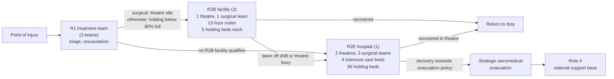

Not every finding rests on the same strength of evidence. Each lever therefore carries a label saying what its evidence supports. A label attaches to a particular claim, so a lever whose diagnosis is measured may still have a remedy that is untested.

| Label | Meaning |
|---|---|
| **Measured** | The effect is established. Direction and approximate size are both supported; where the effect is a paired difference, it survives Holm's adjustment across every comparison of its experiment at a family-wise level of 5% ([Methods: Interval Methods](Methods.md#interval-methods)). |
| **Direction only** | The effect points the way expected and the mechanism is confirmed, but its size is not established. |
| **Unresolved** | The available compute could not separate the effect from random variation, including a paired difference whose interval excludes zero but which fails Holm's adjustment. Figures are bounds, not estimates. |
| **Untested** | The simulation cannot evaluate the option as presently built. |

Two readings of the results paper govern every statement below. Where two intervals overlap the simulation has not established a difference, and the gap between the two averages should not be acted on. And the interval describes how precisely an average is known, not how much one campaign varies: the campaigns themselves spread many times more widely than the average is uncertain, so a system sized against the average under-provides for the campaign that arrives ([Results: scenario totals](Results.md#comparative-scenario-analysis)).

---

## Findings

<small>[Return to Top](#contents)</small>

Nine findings follow, in the order a planner meets them: whether the system keeps pace, the two constraints that decide the outcome at high intensity, the forward evacuation axis, the beds behind surgery, the pressure that moves when surgery is added, R2B, the levers the evidence settles, and the two assumptions that most qualify the rest. A figure is a mean over 30 campaigns of 360 days, at moderate intensity (Falklands-scale casualty rates, the shipped configuration) or high intensity (Okinawa-scale); every figure links the section of the [results paper](Results.md) it comes from, and the notes at the end of the paper hold the qualifications a finding rests on.

### Finding 1: The System Keeps Pace at Moderate Intensity and Not at High

**The shipped health system keeps pace with a moderate-intensity campaign, but with degraded care,[note 1](#notes) and does not keep pace with a high-intensity one.** At moderate intensity the queues settle over a 360-day campaign and about <!-- GEN cell:scenario_totals::Died of wounds/run::Moderate intensity::dp0 -->21<!-- /GEN --> casualties die of wounds. The surgical queue settles low, but the R2E holding beds do not: about <!-- GEN cell:scenario_queue::R2E holding beds::Moderate intensity mean queue::dp0 -->24<!-- /GEN --> casualties wait at any time for one of the 30 beds. At high intensity wounded in action rise <!-- GEN cell:scenario_totals::Wounded in action/run::Ratio::sig2 -->3.6×<!-- /GEN --> and deaths of wounds reach about <!-- GEN cell:scenario_totals::Died of wounds/run::High intensity::dp0 -->569<!-- /GEN -->. Two parts of the system fall behind and never recover: the R2E surgical teams, with about <!-- GEN cell:scenario_queue::R2E operating theatre::High intensity mean queue::dp0 -->73<!-- /GEN --> casualties waiting and about <!-- GEN cell:scenario_totals::Time to first incision (hours)::High intensity::dp0 -->71<!-- /GEN --> hours to first incision, and the critical-care seats on the strategic airlift, whose backlog grows all year. Every other part keeps pace ([Results: comparative scenario analysis](Results.md#comparative-scenario-analysis)). The table gives the level at which each pool settles over the closing 90 days, and the figure shows how each moves through the campaign.

| Measure | Moderate intensity | High intensity |
|---|---|---|
| [Wounded in action per campaign](Results.md#comparative-scenario-analysis) | <!-- GEN cell:scenario_totals::Wounded in action/run::Moderate intensity::sig3 -->2,300<!-- /GEN --> | <!-- GEN cell:scenario_totals::Wounded in action/run::High intensity::sig3 -->8,320<!-- /GEN --> |
| [Died of wounds per campaign](Results.md#comparative-scenario-analysis) | <!-- GEN cell:scenario_totals::Died of wounds/run::Moderate intensity::dp0 -->21<!-- /GEN --> | <!-- GEN cell:scenario_totals::Died of wounds/run::High intensity::dp0 -->569<!-- /GEN --> |
| [Casualties waiting for R2E surgery](Results.md#comparative-scenario-analysis) | <!-- GEN cell:scenario_queue::R2E operating theatre::Moderate intensity mean queue::dp1 -->1.0<!-- /GEN --> | <!-- GEN cell:scenario_queue::R2E operating theatre::High intensity mean queue::dp1 -->72.6<!-- /GEN --> |
| [Share of the campaign with no one waiting for R2E surgery](Results.md#queue-behaviour-over-the-campaign) | <!-- GEN cell:queue_clearance::R2E operating theatres::Moderate: queue empty::full -->85%<!-- /GEN --> | <!-- GEN cell:queue_clearance::R2E operating theatres::High: queue empty::full -->7%<!-- /GEN --> |
| [Hours from arrival to first incision](Results.md#comparative-scenario-analysis) | <!-- GEN cell:scenario_totals::Time to first incision (hours)::Moderate intensity::dp0 -->7<!-- /GEN --> | <!-- GEN cell:scenario_totals::Time to first incision (hours)::High intensity::dp0 -->71<!-- /GEN --> |
| [Casualties waiting for an R2E holding bed](Results.md#comparative-scenario-analysis) | <!-- GEN cell:scenario_queue::R2E holding beds::Moderate intensity mean queue::dp1 -->24.4<!-- /GEN --> | <!-- GEN cell:scenario_queue::R2E holding beds::High intensity mean queue::dp1 -->54.1<!-- /GEN --> |
| [Operated casualties in post-operative overflow](Results.md#comparative-scenario-analysis) | <!-- GEN cell:scenario_queue::R2E post-operative overflow census::Moderate intensity mean queue::dp1 -->5.7<!-- /GEN --> | <!-- GEN cell:scenario_queue::R2E post-operative overflow census::High intensity mean queue::dp1 -->19.8<!-- /GEN --> |
| [Casualties awaiting airlift without a bed](Results.md#comparative-scenario-analysis) | <!-- GEN cell:scenario_queue::R2E staging overflow census::Moderate intensity mean queue::dp0 -->32<!-- /GEN --> | <!-- GEN cell:scenario_queue::R2E staging overflow census::High intensity mean queue::dp0 -->2,516<!-- /GEN --> |
| [The same, over the campaign](Results.md#sustained-operations) | <!-- GEN cell:long_horizon_stability::R2E staging overflow census::Moderate intensity::full -->converged at 30.1<!-- /GEN --> | <!-- GEN cell:long_horizon_stability::R2E staging overflow census::High intensity::full -->**drifting, +11.2%/block**, 117.7 to 2,739.6<!-- /GEN --> |
| [Post-definitive intensive care given in a holding bed](Results.md#queue-behaviour-over-the-campaign) | <!-- GEN cell:degraded_care::Moderate intensity: Post-definitive care::Whole campaign::dp0 -->65%<!-- /GEN --> | <!-- GEN cell:degraded_care::High intensity: Post-definitive care::Whole campaign::dp0 -->89%<!-- /GEN --> |

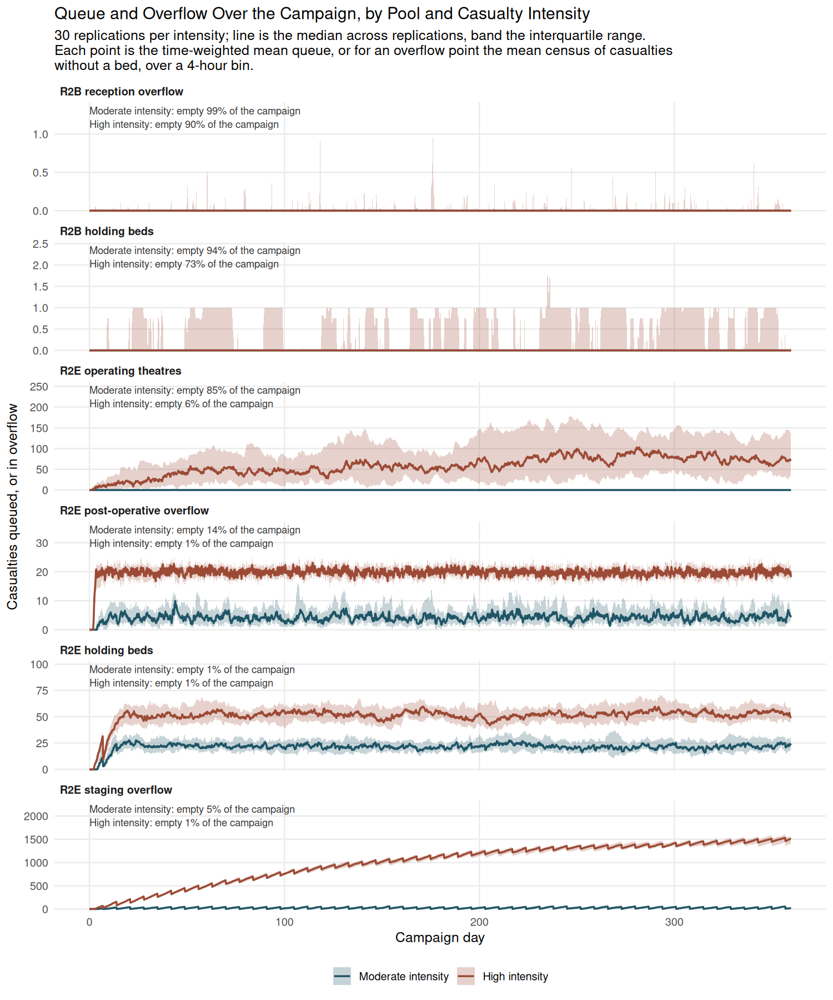

The queue of each R2B and R2E pool against campaign day, as the median across the 30 campaigns with an interquartile band, at each intensity, each panel annotated with the share of the campaign its queue stood empty.

### Finding 2: Surgical Team Hours at R2E Are the First Constraint

**Surgical team hours at R2E are the first constraint at high intensity, and the one that costs the most lives.** R2E has two operating theatres open around the clock but only three surgical teams on 12-hour shifts, so casualties wait for a team, not a theatre. At moderate intensity this barely matters: the theatres are in use <!-- GEN cell:ot_bed::R2E theatre occupancy (%)::2 theatres, 3 sections (shipped)::dp0 -->28<!-- /GEN -->% of the time, the queue is empty <!-- GEN cell:queue_clearance::R2E operating theatres::Moderate: queue empty::full -->85%<!-- /GEN --> of the campaign, and a casualty reaches first incision in about <!-- GEN cell:scenario_totals::Time to first incision (hours)::Moderate intensity::dp0 -->7<!-- /GEN --> hours. At high intensity the theatres are in use <!-- GEN cell:ot_bed_high::R2E theatre occupancy (%)::2 theatres, 3 sections (shipped)::dp0 -->76<!-- /GEN -->% of the time, about <!-- GEN cell:surgical_team_high::R2E theatre mean queue::R2E 3, R2B 1 (shipped)::dp0 -->73<!-- /GEN --> casualties are waiting at any time, and first incision takes about <!-- GEN cell:scenario_totals::Time to first incision (hours)::High intensity::dp0 -->71<!-- /GEN --> hours. Surgical capacity is the most effective lever measured. A fourth R2E team cuts the queue to about <!-- GEN cell:surgical_team_high::R2E theatre mean queue::R2E 4, R2B 1::dp0 -->10<!-- /GEN --> and prevents about <!-- GEN cell:surgical_team_paired_high::Died of wounds::R2E 4, R2B 1::abs_sig2 -->260<!-- /GEN --> deaths of wounds per campaign. A second team at each R2B prevents about <!-- GEN cell:surgical_team_paired_high::Died of wounds::R2E 3, R2B 2::abs_sig2 -->220<!-- /GEN -->, and both together about <!-- GEN cell:surgical_team_paired_high::Died of wounds::R2E 4, R2B 2::abs_sig1 -->300<!-- /GEN --> ([Results: surgical team establishment](Results.md#surgical-team-establishment)).[note 2](#notes)

| Option at high intensity | Casualties waiting for R2E surgery | Died of wounds per campaign | Change in deaths against the shipped teams |
|---|---|---|---|
| [Three R2E teams, one per R2B (shipped)](Results.md#surgical-team-establishment) | <!-- GEN cell:surgical_team_high::R2E theatre mean queue::R2E 3, R2B 1 (shipped)::dp1 -->72.6<!-- /GEN --> | <!-- GEN cell:surgical_team_high::Died of wounds::R2E 3, R2B 1 (shipped)::dp0 -->569<!-- /GEN --> | not applicable |
| [Four R2E teams](Results.md#surgical-team-establishment) | <!-- GEN cell:surgical_team_high::R2E theatre mean queue::R2E 4, R2B 1::dp1 -->9.8<!-- /GEN --> | <!-- GEN cell:surgical_team_high::Died of wounds::R2E 4, R2B 1::dp0 -->309<!-- /GEN --> | <!-- GEN cell:surgical_team_paired_high::Died of wounds::R2E 4, R2B 1::full -->−259.90 [−330.91, −188.89]<!-- /GEN --> |
| [Six R2E teams](Results.md#surgical-team-establishment) | <!-- GEN cell:surgical_team_high::R2E theatre mean queue::R2E 6, R2B 1::dp1 -->8.7<!-- /GEN --> | <!-- GEN cell:surgical_team_high::Died of wounds::R2E 6, R2B 1::dp0 -->308<!-- /GEN --> | <!-- GEN cell:surgical_team_paired_high::Died of wounds::R2E 6, R2B 1::full -->−261.00 [−330.32, −191.68]<!-- /GEN --> |
| [Two teams per R2B](Results.md#surgical-team-establishment) | <!-- GEN cell:surgical_team_high::R2E theatre mean queue::R2E 3, R2B 2::dp1 -->21.3<!-- /GEN --> | <!-- GEN cell:surgical_team_high::Died of wounds::R2E 3, R2B 2::dp0 -->346<!-- /GEN --> | <!-- GEN cell:surgical_team_paired_high::Died of wounds::R2E 3, R2B 2::full -->−222.30 [−290.65, −153.95]<!-- /GEN --> |
| [Four R2E teams and two per R2B](Results.md#surgical-team-establishment) | <!-- GEN cell:surgical_team_high::R2E theatre mean queue::R2E 4, R2B 2::dp1 -->4.0<!-- /GEN --> | <!-- GEN cell:surgical_team_high::Died of wounds::R2E 4, R2B 2::dp0 -->273<!-- /GEN --> | <!-- GEN cell:surgical_team_paired_high::Died of wounds::R2E 4, R2B 2::full -->−296.03 [−365.00, −227.06]<!-- /GEN --> |
| [Six R2E teams and a third theatre](Results.md#r2e-operating-theatre-establishment) | <!-- GEN cell:ot_bed_high::R2E theatre mean queue::3 theatres, 6 sections::dp1 -->1.2<!-- /GEN --> | <!-- GEN cell:ot_bed_high::Died of wounds::3 theatres, 6 sections::dp0 -->270<!-- /GEN --> | <!-- GEN cell:ot_bed_paired_high::Died of wounds::3 theatres, 6 sections::full -->−298.60 [−367.85, −229.35]<!-- /GEN --> |

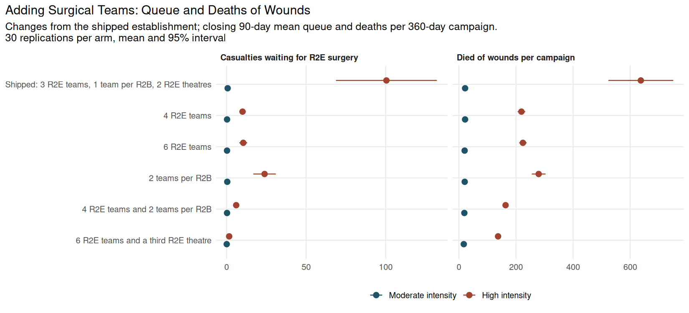

The casualties waiting for R2E surgery over the closing 90 days (left) and deaths of wounds per campaign (right) for each surgical team and theatre option at both intensities, each with its 95% interval.

### Finding 3: Critical-Care Airlift Is the Second Constraint

**Critical-care seats on the strategic airlift are the second constraint, and at high intensity only more of them, flown more often, keep up.** Each weekly C-17A sortie carries 90 places, 36 equipped for critical care and 54 standard. At moderate intensity critical-care demand is about <!-- GEN cell:airlift_collapse::Critical, 0%::Mean utilisation::full -->0.83<!-- /GEN --> of the critical places flown. The route keeps pace, but with little margin: it falls behind in <!-- GEN cell:airlift_collapse::Critical, 0%::Collapsed::full -->1 of 30<!-- /GEN --> campaigns, and in <!-- GEN cell:airlift_collapse::Critical, 15%::Collapsed::full -->7 of 30<!-- /GEN --> if 15% of sorties are lost ([Results: national support base and strategic airlift](Results.md#national-support-base-and-strategic-airlift)). At high intensity critical-care demand is <!-- GEN cell:airlift_collapse_high::Critical, 0%::Mean utilisation::full -->2.65<!-- /GEN --> times the critical places flown, while standard places fly part-empty. The critical-care backlog grows all year to about <!-- GEN cell:airlift_places_high::Critical airlift closing backlog::36/54, 7 days (shipped)::sig2 -->2,500<!-- /GEN --> casualties, and a critical casualty waits on average about <!-- GEN cell:airlift_places_high::Critical airlift mean wait (days)::36/54, 7 days (shipped)::sig2 -->110<!-- /GEN --> days for a seat.[note 3](#notes) Neither change alone fixes it. Configuring more of the 90 places for critical care while flying weekly leaves the route behind in every campaign. Flying every three days with the shipped 36 critical places leaves it behind in <!-- GEN cell:airlift_places_high::Critical airlift campaigns collapsed::36/54, 3 days::mean -->29<!-- /GEN --> of 30. Flying every three days with at least 45 of the 90 places configured for critical care keeps the route level in every campaign, cuts the critical wait to about <!-- GEN cell:airlift_places_high::Critical airlift mean wait (days)::45/45, 3 days::dp0 -->2<!-- /GEN --> days and prevents about <!-- GEN cell:airlift_places_paired_high::Died of wounds::45/45, 3 days::abs_dp0 -->176<!-- /GEN --> deaths of wounds per campaign. The price falls on the national support base, which then receives casualties sooner: its peak bed demand rises from about <!-- GEN cell:airlift_places_high::Role 4 peak census::36/54, 7 days (shipped)::sig2 -->280<!-- /GEN --> to about <!-- GEN cell:airlift_places_high::Role 4 peak census::45/45, 3 days::sig2 -->530<!-- /GEN --> ([Results: critical-care places per sortie](Results.md#critical-care-places-per-sortie)).

| Measure | Moderate, shipped weekly 36 of 90 | Moderate, 45 of 90 every three days | High, shipped weekly 36 of 90 | High, 45 of 90 every three days |
|---|---|---|---|---|
| [Campaigns in which the critical route falls behind](Results.md#critical-care-places-per-sortie) | <!-- GEN cell:airlift_places::Critical airlift campaigns collapsed::36/54, 7 days (shipped)::full -->1 of 30 [0%, 17%]<!-- /GEN --> | <!-- GEN cell:airlift_places::Critical airlift campaigns collapsed::45/45, 3 days::full -->0 of 30 [0%, 12%]<!-- /GEN --> | <!-- GEN cell:airlift_places_high::Critical airlift campaigns collapsed::36/54, 7 days (shipped)::full -->30 of 30 [88%, 100%]<!-- /GEN --> | <!-- GEN cell:airlift_places_high::Critical airlift campaigns collapsed::45/45, 3 days::full -->0 of 30 [0%, 12%]<!-- /GEN --> |
| [Mean wait for a critical place (days)](Results.md#critical-care-places-per-sortie) | <!-- GEN cell:airlift_places::Critical airlift mean wait (days)::36/54, 7 days (shipped)::dp1 -->5.7<!-- /GEN --> | <!-- GEN cell:airlift_places::Critical airlift mean wait (days)::45/45, 3 days::dp1 -->1.7<!-- /GEN --> | <!-- GEN cell:airlift_places_high::Critical airlift mean wait (days)::36/54, 7 days (shipped)::dp1 -->109.7<!-- /GEN --> | <!-- GEN cell:airlift_places_high::Critical airlift mean wait (days)::45/45, 3 days::dp1 -->2.2<!-- /GEN --> |
| [Died of wounds per campaign](Results.md#critical-care-places-per-sortie) | <!-- GEN cell:airlift_places::Died of wounds::36/54, 7 days (shipped)::dp0 -->21<!-- /GEN --> | <!-- GEN cell:airlift_places::Died of wounds::45/45, 3 days::dp0 -->19<!-- /GEN --> | <!-- GEN cell:airlift_places_high::Died of wounds::36/54, 7 days (shipped)::dp0 -->569<!-- /GEN --> | <!-- GEN cell:airlift_places_high::Died of wounds::45/45, 3 days::dp0 -->393<!-- /GEN --> |
| [Role 4 peak beds](Results.md#critical-care-places-per-sortie) | <!-- GEN cell:airlift_places::Role 4 peak census::36/54, 7 days (shipped)::dp0 -->209<!-- /GEN --> | <!-- GEN cell:airlift_places::Role 4 peak census::45/45, 3 days::dp0 -->240<!-- /GEN --> | <!-- GEN cell:airlift_places_high::Role 4 peak census::36/54, 7 days (shipped)::dp0 -->281<!-- /GEN --> | <!-- GEN cell:airlift_places_high::Role 4 peak census::45/45, 3 days::dp0 -->534<!-- /GEN --> |

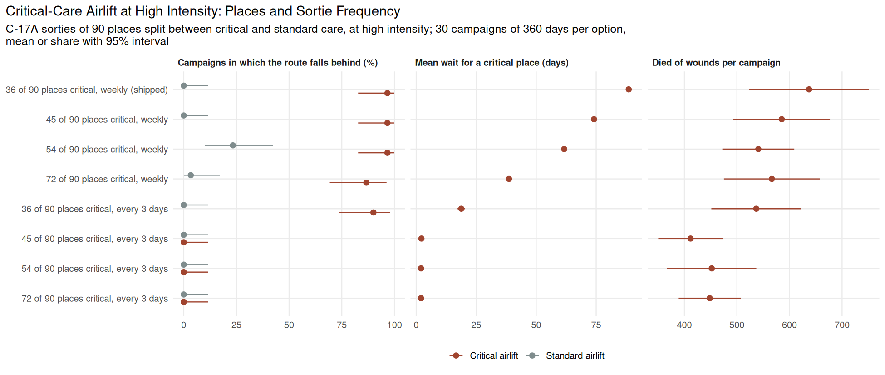

The share of campaigns in which each airlift route falls behind (left), the mean wait for a critical place (centre) and deaths of wounds per campaign (right) for the eight place and sortie interval options at high intensity, each with its 95% interval.

### Finding 4: Delaying Forward Evacuation Costs Lives That Capacity Further Back Cannot Recover

**Delaying forward evacuation costs lives that no capacity further back recovers.**[note 4](#notes) If casualties must be held at R1 before the move to Role 2, as on a contested route, any holding adds risk, and even short delays are measurable. At moderate intensity a six-hour delay raises deaths of wounds from about <!-- GEN cell:evac_delay::Died of wounds::No delay (shipped)::dp0 -->21<!-- /GEN --> to about <!-- GEN cell:evac_delay::Died of wounds::6 hours::dp0 -->34<!-- /GEN --> per campaign, and a one-day delay to about <!-- GEN cell:evac_delay::Died of wounds::1 day::dp0 -->73<!-- /GEN -->. At high intensity delays of three days or more raise them measurably, from about <!-- GEN cell:evac_delay_high::Died of wounds::No delay (shipped)::sig2 -->570<!-- /GEN --> to about <!-- GEN cell:evac_delay_high::Died of wounds::3 days::sig2 -->1,000<!-- /GEN --> at three days. Nearly all the extra deaths occur while casualties are held forward. The share of wounded who die rises to about <!-- GEN cell:evac_delay::Died of wounds per wounded in action (%)::30 days::dp0 -->46<!-- /GEN -->% at thirty days at moderate intensity and about <!-- GEN cell:evac_delay_high::Died of wounds per wounded in action (%)::30 days::dp0 -->44<!-- /GEN -->% at high. At high intensity some casualties who would otherwise have died later now die forward instead. Role 2 neither gains nor loses: every R2B and R2E queue still settles, and the surgical queue shortens slightly. The remedy is forward holding and prolonged care at R1, not more beds or surgeons further back. Every other finding assumes forward evacuation is uncontested ([Results: forward evacuation delay](Results.md#forward-evacuation-delay)).

| Delay at R1 | Moderate: died of wounds | Moderate: change against no delay | High: died of wounds | High: change against no delay |
|---|---|---|---|---|
| [None (shipped)](Results.md#forward-evacuation-delay) | <!-- GEN cell:evac_delay::Died of wounds::No delay (shipped)::dp0 -->21<!-- /GEN --> | not applicable | <!-- GEN cell:evac_delay_high::Died of wounds::No delay (shipped)::dp0 -->569<!-- /GEN --> | not applicable |
| [Six hours](Results.md#forward-evacuation-delay) | <!-- GEN cell:evac_delay::Died of wounds::6 hours::dp0 -->34<!-- /GEN --> | <!-- GEN cell:evac_delay_paired::Died of wounds::6 hours::full -->+13.17 [+7.43, +18.90]<!-- /GEN --> | <!-- GEN cell:evac_delay_high::Died of wounds::6 hours::dp0 -->622<!-- /GEN --> | <!-- GEN cell:evac_delay_paired_high::Died of wounds::6 hours::full -->+52.90 [−39.93, +145.73]<!-- /GEN --> |
| [One day](Results.md#forward-evacuation-delay) | <!-- GEN cell:evac_delay::Died of wounds::1 day::dp0 -->73<!-- /GEN --> | <!-- GEN cell:evac_delay_paired::Died of wounds::1 day::full -->+51.37 [+45.82, +56.91]<!-- /GEN --> | <!-- GEN cell:evac_delay_high::Died of wounds::1 day::dp0 -->725<!-- /GEN --> | <!-- GEN cell:evac_delay_paired_high::Died of wounds::1 day::full -->+156.77 [+49.16, +264.38]†<!-- /GEN --> |
| [Three days](Results.md#forward-evacuation-delay) | <!-- GEN cell:evac_delay::Died of wounds::3 days::dp0 -->172<!-- /GEN --> | <!-- GEN cell:evac_delay_paired::Died of wounds::3 days::full -->+150.33 [+141.35, +159.31]<!-- /GEN --> | <!-- GEN cell:evac_delay_high::Died of wounds::3 days::dp0 -->1,005<!-- /GEN --> | <!-- GEN cell:evac_delay_paired_high::Died of wounds::3 days::full -->+436.40 [+356.91, +515.89]<!-- /GEN --> |
| [Seven days](Results.md#forward-evacuation-delay) | <!-- GEN cell:evac_delay::Died of wounds::7 days::dp0 -->344<!-- /GEN --> | <!-- GEN cell:evac_delay_paired::Died of wounds::7 days::full -->+322.90 [+312.52, +333.28]<!-- /GEN --> | <!-- GEN cell:evac_delay_high::Died of wounds::7 days::dp0 -->1,561<!-- /GEN --> | <!-- GEN cell:evac_delay_paired_high::Died of wounds::7 days::full -->+992.53 [+879.54, +1105.53]<!-- /GEN --> |
| [Fourteen days](Results.md#forward-evacuation-delay) | <!-- GEN cell:evac_delay::Died of wounds::14 days::dp0 -->613<!-- /GEN --> | <!-- GEN cell:evac_delay_paired::Died of wounds::14 days::full -->+591.60 [+573.96, +609.24]<!-- /GEN --> | <!-- GEN cell:evac_delay_high::Died of wounds::14 days::dp0 -->2,398<!-- /GEN --> | <!-- GEN cell:evac_delay_paired_high::Died of wounds::14 days::full -->+1829.07 [+1730.05, +1928.08]<!-- /GEN --> |
| [Thirty days](Results.md#forward-evacuation-delay) | <!-- GEN cell:evac_delay::Died of wounds::30 days::dp0 -->1,073<!-- /GEN --> | <!-- GEN cell:evac_delay_paired::Died of wounds::30 days::full -->+1052.00 [+1014.43, +1089.57]<!-- /GEN --> | <!-- GEN cell:evac_delay_high::Died of wounds::30 days::dp0 -->3,635<!-- /GEN --> | <!-- GEN cell:evac_delay_paired_high::Died of wounds::30 days::full -->+3066.23 [+2956.86, +3175.60]<!-- /GEN --> |

A dagger marks a difference whose interval excludes zero but which fails Holm's adjustment for multiple comparisons.

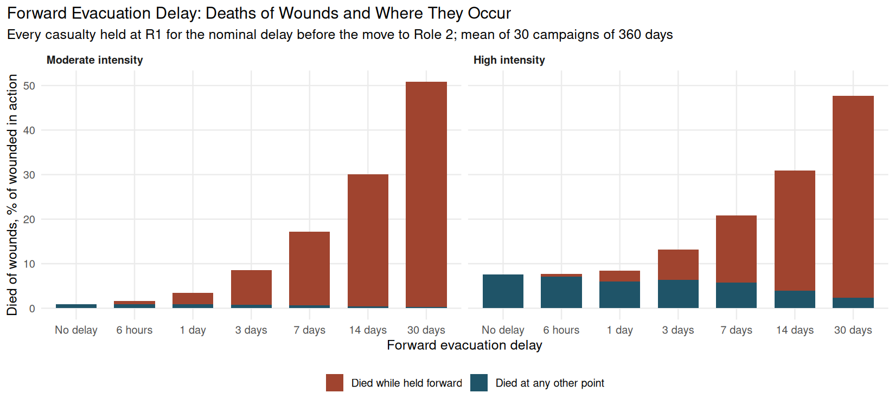

Deaths of wounds per campaign as a share of the wounded in action for each forward evacuation delay, at moderate intensity (left) and high intensity (right), divided into the deaths that occur while casualties are held forward and every other death of wounds.

### Finding 5: The R2E Beds Are Full, and the Cost Is Paid in Care

**The R2E beds are full at both intensities, and the shortfall is paid in a lower standard of care rather than in a queue for surgery.**[note 5](#notes) The 30 R2E holding beds are <!-- GEN cell:establishment::R2E hold occupancy (%)::30 beds (shipped)::dp1 -->99.6<!-- /GEN -->% occupied at moderate intensity and <!-- GEN cell:post_definitive_high::R2E holding occupancy (%)::ICU share 100% (shipped)::dp0 -->100<!-- /GEN -->% at high, and the four intensive care beds <!-- GEN cell:icu_bed::R2E ICU occupancy (%)::4 beds (shipped)::dp0 -->87<!-- /GEN -->% and <!-- GEN cell:icu_bed_high::R2E ICU occupancy (%)::4 beds (shipped)::dp0 -->98<!-- /GEN -->%. A casualty who finds no bed is cared for in a holding bed or in overflow rather than made to wait, so full beds never stop surgery. The cost falls on care: only <!-- GEN cell:icu_bed::Post-definitive ICU access (%)::4 beds (shipped)::dp0 -->35<!-- /GEN -->% of casualties owed intensive care after their definitive surgery receive it in an intensive care bed at moderate intensity, and <!-- GEN cell:icu_bed_high::Post-definitive ICU access (%)::4 beds (shipped)::dp0 -->11<!-- /GEN -->% at high. At moderate intensity, at any time, about <!-- GEN cell:icu_bed::R2E holding mean queue::4 beds (shipped)::dp0 -->24<!-- /GEN --> casualties are waiting for a holding bed and about <!-- GEN cell:icu_bed::R2E post-operative overflow census::4 beds (shipped)::dp0 -->6<!-- /GEN --> operated casualties are being cared for in overflow ([Results: R2E intensive care bed establishment](Results.md#r2e-intensive-care-bed-establishment)).

More beds improve care. Twelve intensive care beds raise intensive care after definitive surgery from <!-- GEN cell:icu_bed::Post-definitive ICU access (%)::4 beds (shipped)::dp0 -->35<!-- /GEN -->% to <!-- GEN cell:icu_bed::Post-definitive ICU access (%)::12 beds::dp0 -->79<!-- /GEN -->% and cut the operated casualties in overflow from about <!-- GEN cell:icu_bed::R2E post-operative overflow census::4 beds (shipped)::dp0 -->6<!-- /GEN --> to about <!-- GEN cell:icu_bed::R2E post-operative overflow census::12 beds::dp0 -->2<!-- /GEN -->. Fifteen more R2E holding beds shorten the holding queue from about <!-- GEN cell:establishment::R2E hold mean queue::30 beds (shipped)::dp0 -->24<!-- /GEN --> to about <!-- GEN cell:establishment::R2E hold mean queue::45 beds::dp0 -->19<!-- /GEN --> ([Results: R2E holding establishment](Results.md#r2e-holding-establishment)). Ten R2B holding beds per unit shorten it to about <!-- GEN cell:hold_threshold_beds::10::R2E hold mean queue::dp0 -->18<!-- /GEN -->, by keeping casualties forward longer ([Results: R2B holding capacity](Results.md#r2b-holding-capacity-and-evacuation-threshold)). The model expects better care to save lives, but too few to measure: twelve intensive care beds change deaths of wounds by <!-- GEN cell:icu_bed_paired::Died of wounds::12 beds::full -->−0.67 [−4.95, +3.62]<!-- /GEN --> per campaign. At high intensity even sixteen intensive care beds leave about <!-- GEN cell:icu_bed_high::R2E post-operative overflow census::16 beds::dp0 -->12<!-- /GEN --> operated casualties in overflow and raise intensive care after definitive surgery only to <!-- GEN cell:icu_bed_high::Post-definitive ICU access (%)::16 beds::dp0 -->47<!-- /GEN -->% ([Results: R2E intensive care bed establishment](Results.md#r2e-intensive-care-bed-establishment)).

| Option at moderate intensity | Waiting for an R2E holding bed | Operated casualties in overflow | Intensive care after definitive surgery in an intensive care bed (%) | Died of wounds per campaign |
|---|---|---|---|---|
| [Shipped establishment](Results.md#r2e-intensive-care-bed-establishment) | <!-- GEN cell:icu_bed::R2E holding mean queue::4 beds (shipped)::dp1 -->24.4<!-- /GEN --> | <!-- GEN cell:icu_bed::R2E post-operative overflow census::4 beds (shipped)::dp1 -->5.7<!-- /GEN --> | <!-- GEN cell:icu_bed::Post-definitive ICU access (%)::4 beds (shipped)::dp0 -->35<!-- /GEN --> | <!-- GEN cell:icu_bed::Died of wounds::4 beds (shipped)::dp1 -->21.2<!-- /GEN --> |
| [Twelve R2E intensive care beds](Results.md#r2e-intensive-care-bed-establishment) | <!-- GEN cell:icu_bed::R2E holding mean queue::12 beds::dp1 -->22.5<!-- /GEN --> | <!-- GEN cell:icu_bed::R2E post-operative overflow census::12 beds::dp1 -->1.9<!-- /GEN --> | <!-- GEN cell:icu_bed::Post-definitive ICU access (%)::12 beds::dp0 -->79<!-- /GEN --> | <!-- GEN cell:icu_bed::Died of wounds::12 beds::dp1 -->20.5<!-- /GEN --> |
| [Forty-five R2E holding beds](Results.md#r2e-holding-establishment) | <!-- GEN cell:establishment::R2E hold mean queue::45 beds::dp1 -->18.7<!-- /GEN --> | <!-- GEN cell:establishment::R2E post-operative overflow census::45 beds::dp1 -->4.8<!-- /GEN --> | <!-- GEN cell:establishment::Post-definitive ICU access (%)::45 beds::dp0 -->35<!-- /GEN --> | <!-- GEN cell:establishment::Died of wounds::45 beds::dp1 -->23.9<!-- /GEN --> |
| [Ten holding beds per R2B](Results.md#r2b-holding-capacity-and-evacuation-threshold) | <!-- GEN cell:hold_threshold_beds::10::R2E hold mean queue::dp1 -->17.6<!-- /GEN --> | <!-- GEN cell:hold_threshold_beds::10::R2E post-operative overflow census::dp1 -->4.8<!-- /GEN --> | not measured | <!-- GEN cell:hold_threshold_beds::10::Deaths of wounds::dp1 -->22.2<!-- /GEN --> |

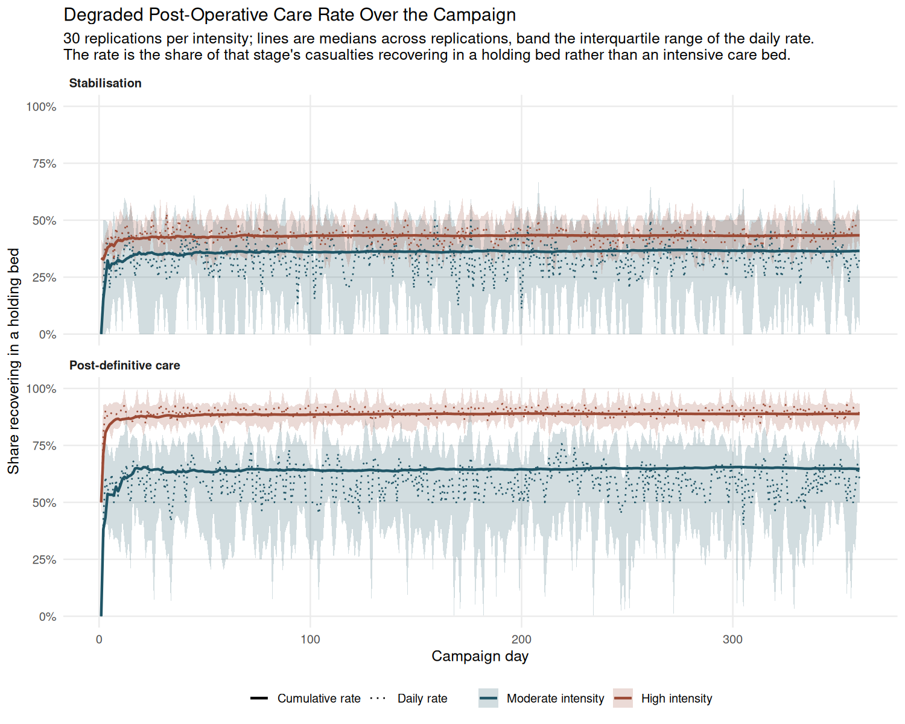

The share of casualties recovering in a holding bed or in overflow rather than in an intensive care bed against campaign day, stabilisation above and post-definitive care below, as a daily rate inside an interquartile band and as a running cumulative rate.

### Finding 6: Adding Surgery Moves the Pressure onto the Post-Operative Beds

**Adding surgical capacity at high intensity saves lives, but moves the pressure onto the post-operative beds behind it, and more intensive care beds, not more holding beds, take it back.**[note 6](#notes) More surgical teams and theatres treat casualties sooner and keep more of the surgery in theatre: casualties released to the national support base with their repair still outstanding fall from about <!-- GEN cell:ot_bed_high::Released with definitive repair outstanding::2 theatres, 3 sections (shipped)::sig3 -->1,990<!-- /GEN --> per campaign to about <!-- GEN cell:ot_bed_high::Released with definitive repair outstanding::3 theatres, 6 sections::sig2 -->750<!-- /GEN --> with six teams and three theatres. Those casualties now need post-operative care at R2E, whose beds are already full. With six teams and three theatres, the operated casualties in overflow rise from about <!-- GEN cell:ot_bed_high::R2E post-operative overflow census::2 theatres, 3 sections (shipped)::dp0 -->20<!-- /GEN --> to about <!-- GEN cell:ot_bed_high::R2E post-operative overflow census::3 theatres, 6 sections::dp0 -->24<!-- /GEN -->. With eight teams and four theatres they rise to about <!-- GEN cell:ot_bed_high::R2E post-operative overflow census::4 theatres, 8 sections::dp0 -->26<!-- /GEN -->, and the queue for a holding bed from about <!-- GEN cell:ot_bed_high::R2E holding mean queue::2 theatres, 3 sections (shipped)::dp0 -->54<!-- /GEN --> to about <!-- GEN cell:ot_bed_high::R2E holding mean queue::4 theatres, 8 sections::dp0 -->60<!-- /GEN -->. The intensive care beds stay about <!-- GEN cell:ot_bed_high::R2E ICU occupancy (%)::3 theatres, 6 sections::dp0 -->97<!-- /GEN -->% full whatever the surgical establishment. Deaths of wounds still fall, from about <!-- GEN cell:ot_bed_high::Died of wounds::2 theatres, 3 sections (shipped)::sig2 -->570<!-- /GEN --> to about <!-- GEN cell:ot_bed_high::Died of wounds::3 theatres, 6 sections::sig2 -->270<!-- /GEN -->, so the added surgery is worth having. But a planner adding surgical capacity at high intensity should plan the post-operative beds with it. At moderate intensity the shift does not occur measurably: the theatres already keep pace, only about <!-- GEN cell:ot_bed::Released with definitive repair outstanding::2 theatres, 3 sections (shipped)::sig2 -->130<!-- /GEN --> casualties per campaign are released with their repair outstanding, and the overflow changes by <!-- GEN cell:ot_bed_paired::R2E post-operative overflow census::4 theatres, 8 sections::full -->+0.41 [−0.24, +1.05]<!-- /GEN --> at eight teams and four theatres ([Results: R2E operating theatre establishment](Results.md#r2e-operating-theatre-establishment)).

The beds that take the pressure back are intensive care beds. With six teams and three theatres, twelve R2E intensive care beds take the operated casualties in overflow to about <!-- GEN cell:post_op_capacity::6 sections, 3 theatres, 12 ICU, 30 hold::R2E post-operative overflow census::dp0 -->18<!-- /GEN -->, below the shipped establishment's <!-- GEN cell:post_op_capacity::3 sections, 2 theatres, 4 ICU, 30 hold (shipped)::R2E post-operative overflow census::dp0 -->20<!-- /GEN -->, and raise intensive care after definitive surgery given in an intensive care bed from about <!-- GEN cell:post_op_capacity::6 sections, 3 theatres, 4 ICU, 30 hold::Post-definitive ICU access (%)::dp0 -->11<!-- /GEN -->% to about <!-- GEN cell:post_op_capacity::6 sections, 3 theatres, 12 ICU, 30 hold::Post-definitive ICU access (%)::dp0 -->35<!-- /GEN -->%; eight beds take the overflow only to about <!-- GEN cell:post_op_capacity::6 sections, 3 theatres, 8 ICU, 30 hold::R2E post-operative overflow census::dp0 -->22<!-- /GEN -->. Holding beds buy nothing at high intensity: at 90 holding beds the pool is still <!-- GEN cell:post_op_capacity::6 sections, 3 theatres, 4 ICU, 90 hold::R2E holding occupancy (%)::dp0 -->100<!-- /GEN -->% full and about <!-- GEN cell:post_op_capacity::6 sections, 3 theatres, 4 ICU, 90 hold::R2E holding mean queue::dp0 -->58<!-- /GEN --> casualties wait for a bed, as at 30. No bed count changes deaths of wounds measurably once the surgery is added: against six teams and three theatres alone, twelve intensive care beds at 60 holding beds change them by <!-- GEN cell:post_op_capacity_paired_surgery::6 sections, 3 theatres, 12 ICU, 60 hold::Died of wounds::full -->−10.00 [−25.50, +5.50]<!-- /GEN --> ([Results: surgery and post-operative beds together](Results.md#surgery-and-post-operative-beds-together)). The holding queue at high intensity moves with the evacuation policy instead, to about <!-- GEN cell:policy_establishment_high::15 d, 30 beds::R2E hold mean queue::dp0 -->31<!-- /GEN --> at a 15-day policy ([Results: high-intensity evacuation policy and holding establishment](Results.md#high-intensity-evacuation-policy-and-holding-establishment)).

| Option at high intensity | Waiting for R2E surgery | Released with repair outstanding | Operated casualties in overflow | Waiting for an R2E holding bed | Died of wounds per campaign |
|---|---|---|---|---|---|
| [Three teams, two theatres (shipped)](Results.md#r2e-operating-theatre-establishment) | <!-- GEN cell:ot_bed_high::R2E theatre mean queue::2 theatres, 3 sections (shipped)::dp1 -->72.6<!-- /GEN --> | <!-- GEN cell:ot_bed_high::Released with definitive repair outstanding::2 theatres, 3 sections (shipped)::dp0 -->1,986<!-- /GEN --> | <!-- GEN cell:ot_bed_high::R2E post-operative overflow census::2 theatres, 3 sections (shipped)::dp1 -->19.8<!-- /GEN --> | <!-- GEN cell:ot_bed_high::R2E holding mean queue::2 theatres, 3 sections (shipped)::dp1 -->54.1<!-- /GEN --> | <!-- GEN cell:ot_bed_high::Died of wounds::2 theatres, 3 sections (shipped)::dp0 -->569<!-- /GEN --> |
| [Six teams, two theatres](Results.md#r2e-operating-theatre-establishment) | <!-- GEN cell:ot_bed_high::R2E theatre mean queue::2 theatres, 6 sections::dp1 -->8.7<!-- /GEN --> | <!-- GEN cell:ot_bed_high::Released with definitive repair outstanding::2 theatres, 6 sections::dp0 -->1,544<!-- /GEN --> | <!-- GEN cell:ot_bed_high::R2E post-operative overflow census::2 theatres, 6 sections::dp1 -->22.0<!-- /GEN --> | <!-- GEN cell:ot_bed_high::R2E holding mean queue::2 theatres, 6 sections::dp1 -->56.1<!-- /GEN --> | <!-- GEN cell:ot_bed_high::Died of wounds::2 theatres, 6 sections::dp0 -->308<!-- /GEN --> |
| [Six teams, three theatres](Results.md#r2e-operating-theatre-establishment) | <!-- GEN cell:ot_bed_high::R2E theatre mean queue::3 theatres, 6 sections::dp1 -->1.2<!-- /GEN --> | <!-- GEN cell:ot_bed_high::Released with definitive repair outstanding::3 theatres, 6 sections::dp0 -->748<!-- /GEN --> | <!-- GEN cell:ot_bed_high::R2E post-operative overflow census::3 theatres, 6 sections::dp1 -->24.2<!-- /GEN --> | <!-- GEN cell:ot_bed_high::R2E holding mean queue::3 theatres, 6 sections::dp1 -->56.2<!-- /GEN --> | <!-- GEN cell:ot_bed_high::Died of wounds::3 theatres, 6 sections::dp0 -->270<!-- /GEN --> |
| [Eight teams, four theatres](Results.md#r2e-operating-theatre-establishment) | <!-- GEN cell:ot_bed_high::R2E theatre mean queue::4 theatres, 8 sections::dp1 -->0.4<!-- /GEN --> | <!-- GEN cell:ot_bed_high::Released with definitive repair outstanding::4 theatres, 8 sections::dp0 -->358<!-- /GEN --> | <!-- GEN cell:ot_bed_high::R2E post-operative overflow census::4 theatres, 8 sections::dp1 -->25.9<!-- /GEN --> | <!-- GEN cell:ot_bed_high::R2E holding mean queue::4 theatres, 8 sections::dp1 -->59.6<!-- /GEN --> | <!-- GEN cell:ot_bed_high::Died of wounds::4 theatres, 8 sections::dp0 -->265<!-- /GEN --> |
| [Six teams, three theatres, twelve intensive care beds](Results.md#surgery-and-post-operative-beds-together) | <!-- GEN cell:post_op_capacity_outcomes::6 sections, 3 theatres, 12 ICU, 30 hold::R2E theatre mean queue::dp1 -->1.1<!-- /GEN --> | <!-- GEN cell:post_op_capacity_outcomes::6 sections, 3 theatres, 12 ICU, 30 hold::Released with definitive repair outstanding::dp0 -->723<!-- /GEN --> | <!-- GEN cell:post_op_capacity::6 sections, 3 theatres, 12 ICU, 30 hold::R2E post-operative overflow census::dp1 -->18.0<!-- /GEN --> | <!-- GEN cell:post_op_capacity::6 sections, 3 theatres, 12 ICU, 30 hold::R2E holding mean queue::dp1 -->57.6<!-- /GEN --> | <!-- GEN cell:post_op_capacity_outcomes::6 sections, 3 theatres, 12 ICU, 30 hold::Died of wounds::dp0 -->268<!-- /GEN --> |

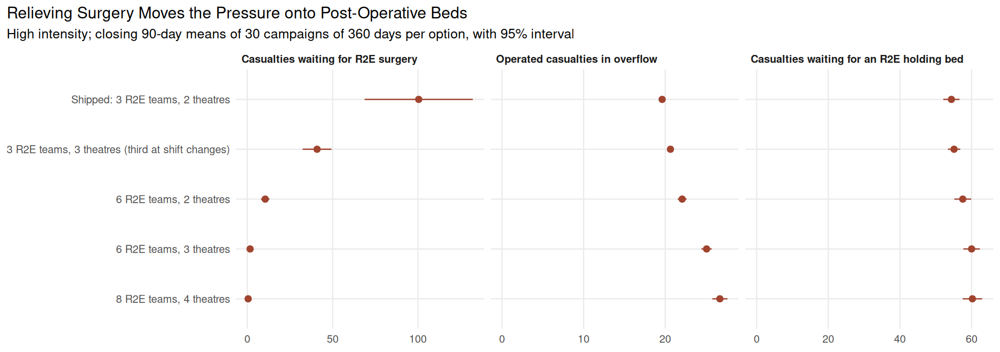

The casualties waiting for R2E surgery (left), the operated casualties in post-operative overflow (centre) and the casualties waiting for an R2E holding bed (right) over the closing 90 days for each surgical team and theatre establishment at high intensity, each with its 95% interval. A third theatre at the shipped three teams cannot be used, no more than two teams being on shift at once.

### Finding 7: R2B Sends Most of Its Surgery Rearward

**R2B sends most of its surgery rearward because each unit's single surgical team covers only half the day; a second team per unit keeps most of it forward and, at high intensity, saves lives.**[note 7](#notes) Each R2B unit has one theatre open around the clock but one surgical team on a 12-hour roster. Of the casualties requiring surgery who reach R2B at moderate intensity, about <!-- GEN cell:surgical_team::R2B surgeries::R2E 3, R2B 1 (shipped)::sig3 -->825<!-- /GEN --> per campaign are operated on there, while about <!-- GEN cell:surgical_team::Diverted, team off shift::R2E 3, R2B 1 (shipped)::sig2 -->1,200<!-- /GEN --> are sent on to R2E because the team is off shift and about <!-- GEN cell:surgical_team::Diverted, theatre busy::R2E 3, R2B 1 (shipped)::sig2 -->240<!-- /GEN --> because the theatre is busy. At high intensity about <!-- GEN cell:surgical_team_high::R2B surgeries::R2E 3, R2B 1 (shipped)::sig3 -->1,800<!-- /GEN --> are operated on at R2B, about <!-- GEN cell:surgical_team_high::Diverted, team off shift::R2E 3, R2B 1 (shipped)::sig3 -->3,830<!-- /GEN --> are sent on because the team is off shift and about <!-- GEN cell:surgical_team_high::Diverted, theatre busy::R2E 3, R2B 1 (shipped)::sig3 -->1,380<!-- /GEN --> because the theatre is busy. The shipped 60-minute pre-open window already holds about <!-- GEN cell:hold_window::Casualties held at R2B::Window 60 min::dp0 -->107<!-- /GEN --> casualties per campaign at R2B for a team about to come on shift, but leaves the off-shift diversions largely intact ([Results: R2B pre-open hold window](Results.md#r2b-pre-open-hold-window)). A second team per unit ends the off-shift diversions entirely and roughly doubles the surgery done forward: from about <!-- GEN cell:surgical_team::R2B surgeries::R2E 3, R2B 1 (shipped)::sig3 -->825<!-- /GEN --> to about <!-- GEN cell:surgical_team::R2B surgeries::R2E 3, R2B 2::sig3 -->1,570<!-- /GEN --> operations per campaign at moderate intensity, and from about <!-- GEN cell:surgical_team_high::R2B surgeries::R2E 3, R2B 1 (shipped)::sig3 -->1,800<!-- /GEN --> to about <!-- GEN cell:surgical_team_high::R2B surgeries::R2E 3, R2B 2::sig3 -->3,270<!-- /GEN --> at high. At high intensity that shortens the R2E surgical queue from about <!-- GEN cell:surgical_team_high::R2E theatre mean queue::R2E 3, R2B 1 (shipped)::dp0 -->73<!-- /GEN --> to about <!-- GEN cell:surgical_team_high::R2E theatre mean queue::R2E 3, R2B 2::dp0 -->21<!-- /GEN --> and prevents about <!-- GEN cell:surgical_team_paired_high::Died of wounds::R2E 3, R2B 2::abs_sig2 -->220<!-- /GEN --> deaths of wounds per campaign. At moderate intensity it changes deaths of wounds by <!-- GEN cell:surgical_team_paired::Died of wounds::R2E 3, R2B 2::full -->−1.40 [−5.46, +2.66]<!-- /GEN -->, too little to measure. With two teams the theatre becomes R2B's limit: diversions because it is busy roughly double, to about <!-- GEN cell:surgical_team::Diverted, theatre busy::R2E 3, R2B 2::sig2 -->510<!-- /GEN --> at moderate intensity and about <!-- GEN cell:surgical_team_high::Diverted, theatre busy::R2E 3, R2B 2::sig3 -->2,550<!-- /GEN --> at high, so a second R2B theatre is the next forward constraint ([Results: surgical team establishment](Results.md#surgical-team-establishment)).

| Option | Operated on at R2B | Sent on, team off shift | Sent on, theatre busy | First surgeries at R2E | Died of wounds per campaign | Change in deaths |
|---|---|---|---|---|---|---|
| [Moderate, one team per R2B (shipped)](Results.md#surgical-team-establishment) | <!-- GEN cell:surgical_team::R2B surgeries::R2E 3, R2B 1 (shipped)::dp0 -->825<!-- /GEN --> | <!-- GEN cell:surgical_team::Diverted, team off shift::R2E 3, R2B 1 (shipped)::dp0 -->1,202<!-- /GEN --> | <!-- GEN cell:surgical_team::Diverted, theatre busy::R2E 3, R2B 1 (shipped)::dp0 -->237<!-- /GEN --> | <!-- GEN cell:surgical_team::R2E first surgeries::R2E 3, R2B 1 (shipped)::dp0 -->1,816<!-- /GEN --> | <!-- GEN cell:surgical_team::Died of wounds::R2E 3, R2B 1 (shipped)::dp1 -->21.2<!-- /GEN --> | not applicable |
| [Moderate, two teams per R2B](Results.md#surgical-team-establishment) | <!-- GEN cell:surgical_team::R2B surgeries::R2E 3, R2B 2::dp0 -->1,574<!-- /GEN --> | <!-- GEN cell:surgical_team::Diverted, team off shift::R2E 3, R2B 2::dp0 -->0<!-- /GEN --> | <!-- GEN cell:surgical_team::Diverted, theatre busy::R2E 3, R2B 2::dp0 -->510<!-- /GEN --> | <!-- GEN cell:surgical_team::R2E first surgeries::R2E 3, R2B 2::dp0 -->1,390<!-- /GEN --> | <!-- GEN cell:surgical_team::Died of wounds::R2E 3, R2B 2::dp1 -->19.8<!-- /GEN --> | <!-- GEN cell:surgical_team_paired::Died of wounds::R2E 3, R2B 2::full -->−1.40 [−5.46, +2.66]<!-- /GEN --> |
| [High, one team per R2B (shipped)](Results.md#surgical-team-establishment) | <!-- GEN cell:surgical_team_high::R2B surgeries::R2E 3, R2B 1 (shipped)::dp0 -->1,795<!-- /GEN --> | <!-- GEN cell:surgical_team_high::Diverted, team off shift::R2E 3, R2B 1 (shipped)::dp0 -->3,826<!-- /GEN --> | <!-- GEN cell:surgical_team_high::Diverted, theatre busy::R2E 3, R2B 1 (shipped)::dp0 -->1,375<!-- /GEN --> | <!-- GEN cell:surgical_team_high::R2E first surgeries::R2E 3, R2B 1 (shipped)::dp0 -->6,159<!-- /GEN --> | <!-- GEN cell:surgical_team_high::Died of wounds::R2E 3, R2B 1 (shipped)::dp0 -->569<!-- /GEN --> | not applicable |
| [High, two teams per R2B](Results.md#surgical-team-establishment) | <!-- GEN cell:surgical_team_high::R2B surgeries::R2E 3, R2B 2::dp0 -->3,271<!-- /GEN --> | <!-- GEN cell:surgical_team_high::Diverted, team off shift::R2E 3, R2B 2::dp0 -->0<!-- /GEN --> | <!-- GEN cell:surgical_team_high::Diverted, theatre busy::R2E 3, R2B 2::dp0 -->2,552<!-- /GEN --> | <!-- GEN cell:surgical_team_high::R2E first surgeries::R2E 3, R2B 2::dp0 -->5,372<!-- /GEN --> | <!-- GEN cell:surgical_team_high::Died of wounds::R2E 3, R2B 2::dp0 -->346<!-- /GEN --> | <!-- GEN cell:surgical_team_paired_high::Died of wounds::R2E 3, R2B 2::full -->−222.30 [−290.65, −153.95]<!-- /GEN --> |

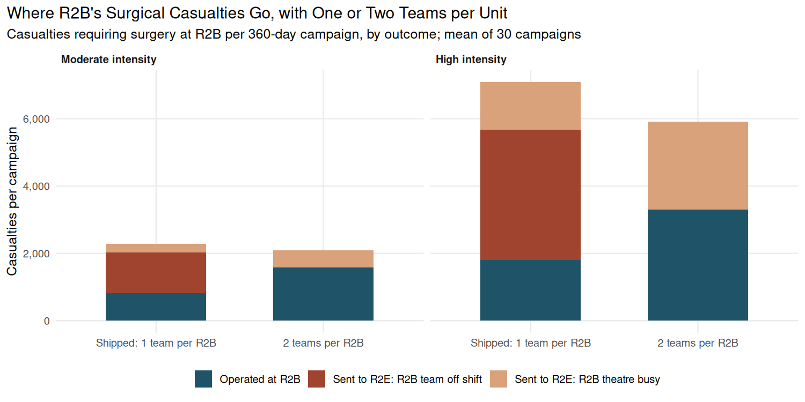

The casualties requiring surgery operated on at R2B and sent on to R2E because the team is off shift or the theatre is busy, per campaign, with one and two surgical teams per R2B unit at each intensity, on one scale.

### Finding 8: The Evacuation Policy, the Ambulance Fleet and Role 4

**Three further levers are settled by the evidence: the evacuation policy is a trade the planner chooses, the ambulance fleet is right at three (four at high intensity), and the national support base must be planned as a sustained load of beds.**

*Evacuation policy.* The theatre evacuation policy, how long a casualty may recover in theatre before strategic evacuation, is a command decision with a price at each setting. At moderate intensity a 30-day policy instead of the shipped 21 returns about <!-- GEN cell:policy_establishment_moderate_paired::30 d, 30 beds::Returns to duty::abs_sig1 -->300<!-- /GEN --> more casualties to duty per campaign (about <!-- GEN cell:policy_establishment_moderate::30 d, 30 beds::Returns to duty::sig3 -->2,360<!-- /GEN --> against <!-- GEN cell:policy_establishment_moderate::21 d, 30 beds::Returns to duty::sig3 -->2,060<!-- /GEN -->). It does so without a measurable change in deaths of wounds, and it lowers the peak demand on the national support base from about <!-- GEN cell:policy_establishment_moderate::21 d, 30 beds::Role 4 peak beds::dp0 -->209<!-- /GEN --> beds to about <!-- GEN cell:policy_establishment_moderate::30 d, 30 beds::Role 4 peak beds::dp0 -->195<!-- /GEN -->. The price is paid in the standard of care at R2E. The holding beds are already full, so the casualties kept longer in theatre wait for them: at the shipped 30 beds, the casualties waiting for a holding bed rise from about <!-- GEN cell:policy_establishment_moderate::21 d, 30 beds::R2E hold mean queue::dp0 -->24<!-- /GEN --> to about <!-- GEN cell:policy_establishment_moderate::30 d, 30 beds::R2E hold mean queue::dp0 -->43<!-- /GEN -->, and the operated casualties in overflow from about <!-- GEN cell:policy::R2E post-operative overflow census::21 d (shipped)::dp1 -->5.7<!-- /GEN --> to about <!-- GEN cell:policy::R2E post-operative overflow census::30 d::dp1 -->6.1<!-- /GEN -->. Intensive care after definitive surgery is unchanged at about <!-- GEN cell:policy::Post-definitive ICU access (%)::21 d (shipped)::dp0 -->35<!-- /GEN -->%. Sixty holding beds bring the holding queue at a 30-day policy back to about <!-- GEN cell:policy_establishment_moderate::30 d, 60 beds::R2E hold mean queue::dp0 -->24<!-- /GEN -->, the shipped level. Every combination tested, up to 30 days and 60 holding beds, still settles, so the longer policy is a trade between returns to duty and the standard of care rather than a risk to the system's stability ([Results: moderate-intensity evacuation policy and holding establishment](Results.md#moderate-intensity-evacuation-policy-and-holding-establishment)). At high intensity no combination of policy, holding beds and sortie interval tested keeps the R2E pools level, although a 30-day policy with 90 holding beds returns about <!-- GEN cell:policy_establishment_high_paired::30 d, 90 beds::Returns to duty::abs_sig2 -->580<!-- /GEN --> more casualties to duty ([Results: high-intensity evacuation policy and holding establishment](Results.md#high-intensity-evacuation-policy-and-holding-establishment)).[note 8](#notes)

| Policy and R2E holding beds, moderate intensity | Returns to duty | Waiting for an R2E holding bed | Operated casualties in overflow | Died of wounds per campaign | Role 4 peak beds |
|---|---|---|---|---|---|
| [21 days, 30 beds (shipped)](Results.md#moderate-intensity-evacuation-policy-and-holding-establishment) | <!-- GEN cell:policy_establishment_moderate::21 d, 30 beds::Returns to duty::dp0 -->2,062<!-- /GEN --> | <!-- GEN cell:policy_establishment_moderate::21 d, 30 beds::R2E hold mean queue::dp1 -->24.4<!-- /GEN --> | <!-- GEN cell:policy_establishment_moderate::21 d, 30 beds::R2E post-operative overflow census::dp1 -->5.7<!-- /GEN --> | <!-- GEN cell:policy_establishment_moderate::21 d, 30 beds::Died of wounds::dp1 -->21.2<!-- /GEN --> | <!-- GEN cell:policy_establishment_moderate::21 d, 30 beds::Role 4 peak beds::dp0 -->209<!-- /GEN --> |
| [30 days, 30 beds](Results.md#moderate-intensity-evacuation-policy-and-holding-establishment) | <!-- GEN cell:policy_establishment_moderate::30 d, 30 beds::Returns to duty::dp0 -->2,360<!-- /GEN --> | <!-- GEN cell:policy_establishment_moderate::30 d, 30 beds::R2E hold mean queue::dp1 -->43.3<!-- /GEN --> | <!-- GEN cell:policy_establishment_moderate::30 d, 30 beds::R2E post-operative overflow census::dp1 -->6.1<!-- /GEN --> | <!-- GEN cell:policy_establishment_moderate::30 d, 30 beds::Died of wounds::dp1 -->22.0<!-- /GEN --> | <!-- GEN cell:policy_establishment_moderate::30 d, 30 beds::Role 4 peak beds::dp0 -->195<!-- /GEN --> |
| [30 days, 60 beds](Results.md#moderate-intensity-evacuation-policy-and-holding-establishment) | <!-- GEN cell:policy_establishment_moderate::30 d, 60 beds::Returns to duty::dp0 -->2,328<!-- /GEN --> | <!-- GEN cell:policy_establishment_moderate::30 d, 60 beds::R2E hold mean queue::dp1 -->24.1<!-- /GEN --> | <!-- GEN cell:policy_establishment_moderate::30 d, 60 beds::R2E post-operative overflow census::dp1 -->4.7<!-- /GEN --> | <!-- GEN cell:policy_establishment_moderate::30 d, 60 beds::Died of wounds::dp1 -->21.1<!-- /GEN --> | <!-- GEN cell:policy_establishment_moderate::30 d, 60 beds::Role 4 peak beds::dp0 -->201<!-- /GEN --> |

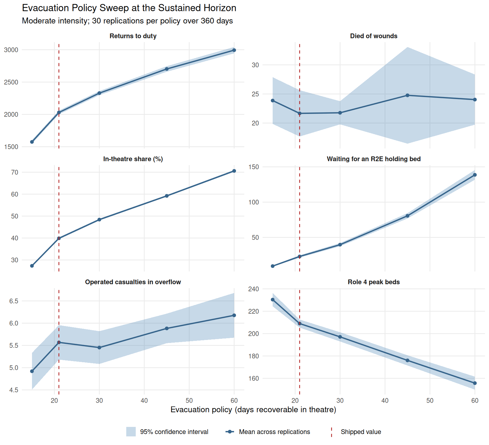

Six responses against the theatre evacuation policy at moderate intensity, at the shipped 30 R2E holding beds, each with its 95% interval; the dashed line marks the shipped 21 days.

*Ambulance fleet.* Three ambulances in the shared brigade pool carry the wounded from R1 to R2B, and on to R2E when no R2B can take them, at moderate intensity, with about <!-- GEN cell:transport::3 (current ambulance)::Ambulance mean queue::dp1 -->0.5<!-- /GEN --> casualties waiting for one. At high intensity three leave about <!-- GEN cell:transport_high::3 (current ambulance)::Ambulance mean queue::dp1 -->1.8<!-- /GEN --> waiting, and a fourth brings it to about <!-- GEN cell:transport_high::4 (current truck)::Ambulance mean queue::dp1 -->0.6<!-- /GEN --> ([Results: transport fleet size](Results.md#transport-fleet-size)). These are in addition to each R2B unit's own evacuation crew, which carries its casualties on to R2E, and to the R2E evacuation sections. Each R2B unit's own evacuation crew is in use <!-- GEN cell:transport_holders::R2B evacuation crews::Moderate intensity utilisation::dp0 -->14%<!-- /GEN --> of the time at moderate intensity and <!-- GEN cell:transport_holders::R2B evacuation crews::High intensity utilisation::dp0 -->42%<!-- /GEN --> at high, with casualties beginning to wait for it at high intensity (about <!-- GEN cell:transport_holders::R2B evacuation crews::High intensity mean queue::dp1 -->0.6<!-- /GEN -->). The four shared trucks, which carry the dead, are ample at both intensities. Some of these assets stand largely idle: the R2E evacuation sections are in use about <!-- GEN cell:transport_holders::R2E evacuation sections::High intensity utilisation::dp0 -->1%<!-- /GEN --> of the time and the trucks at most about <!-- GEN cell:transport_holders::HX2 40M fleet::High intensity utilisation::dp0 -->6%<!-- /GEN -->. That points to personnel who could be reallocated, though reallocation was not tested ([Results: transport fleet size](Results.md#transport-fleet-size)).

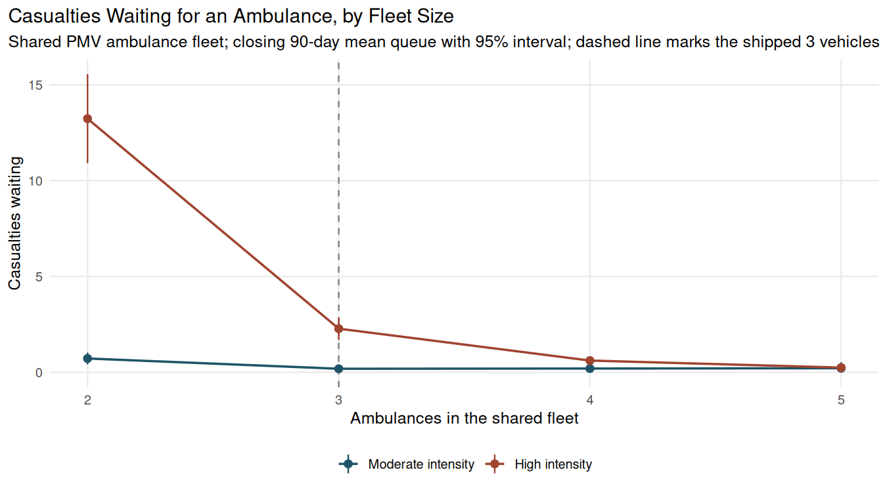

The casualties waiting for an ambulance over the closing 90 days against the size of the shared ambulance fleet, from two to five vehicles, at each intensity on one scale, each with its 95% interval and the shipped fleet marked.

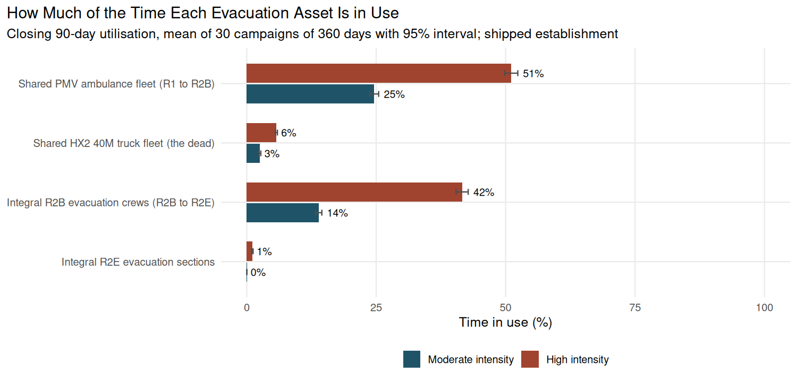

The share of time over the closing 90 days that each shared fleet and each integral evacuation element is in use at each intensity, with its 95% interval.

*Role 4.* At moderate intensity the airlift keeps pace, so what Role 4 receives is close to what it needs. Demand rises over the first two months and then holds level at about <!-- GEN cell:airlift_places_role4::Total, closing 90-day mean beds::36/54, 7 days (shipped)::sig2 -->150<!-- /GEN --> beds over the closing 90 days. About <!-- GEN cell:airlift_places_role4::Intensive care, closing 90-day mean beds::36/54, 7 days (shipped)::dp0 -->36<!-- /GEN --> of them are intensive care beds and <!-- GEN cell:airlift_places_role4::Holding, closing 90-day mean beds::36/54, 7 days (shipped)::dp0 -->115<!-- /GEN --> holding beds. About <!-- GEN cell:role4_backlog::Casualties awaiting airlift on day 360::Moderate intensity::dp0 -->32<!-- /GEN --> casualties are still awaiting airlift on day 360. They are flown out within about <!-- GEN cell:role4_backlog::Days after day 360 until the last is flown out::Moderate intensity::dp0 -->6<!-- /GEN --> days, and Role 4 empties about <!-- GEN cell:role4_backlog::Days after day 360 until the last bed empties::Moderate intensity::dp0 -->47<!-- /GEN --> days after the campaign ends ([Results: Role 4 bed demand](Results.md#role-4-bed-demand)). At high intensity Role 4's load is set by the airlift, not by the casualties. With the shipped weekly sortie Role 4 holds about <!-- GEN cell:airlift_places_role4_high::Total, closing 90-day mean beds::36/54, 7 days (shipped)::sig2 -->220<!-- /GEN --> beds, because that is all 36 critical-care places a week can deliver. About <!-- GEN cell:role4_backlog::Casualties awaiting airlift on day 360::High intensity::sig3 -->2,860<!-- /GEN --> casualties are still waiting on day 360, about <!-- GEN cell:role4_backlog::Of them, died awaiting airlift::High intensity::sig2 -->250<!-- /GEN --> of them die before they are flown out, and Role 4 does not empty until about <!-- GEN cell:role4_backlog::Days after day 360 until the last bed empties::High intensity::dp0 -->545<!-- /GEN --> days after the campaign ends.[note 9](#notes) With 45 critical-care places every three days the airlift keeps pace: Role 4 holds about <!-- GEN cell:airlift_places_role4_high::Total, closing 90-day mean beds::45/45, 3 days::sig2 -->460<!-- /GEN --> beds over the closing 90 days, <!-- GEN cell:airlift_places_role4_high::Intensive care, closing 90-day mean beds::45/45, 3 days::dp0 -->116<!-- /GEN --> of them intensive care, about <!-- GEN cell:airlift_places_role4_high::Casualties awaiting airlift on day 360::45/45, 3 days::dp0 -->62<!-- /GEN --> casualties are still waiting on day 360, and Role 4 empties about <!-- GEN cell:airlift_places_role4_high::Days after day 360 until the last bed empties::45/45, 3 days::dp0 -->46<!-- /GEN --> days after the campaign ends. The total load hardly differs: counting the beds filled after day 360, Role 4 provides about <!-- GEN cell:airlift_places_role4_high::Bed-days in all::36/54, 7 days (shipped)::sig3 -->152,000<!-- /GEN --> bed-days with the shipped airlift and about <!-- GEN cell:airlift_places_role4_high::Bed-days in all::45/45, 3 days::sig3 -->164,000<!-- /GEN --> with it fixed. The airlift decides whether that load arrives during the campaign or after it, not how large it is ([Results: critical-care places per sortie](Results.md#critical-care-places-per-sortie)).

| Role 4 load | Moderate, shipped weekly 36 of 90 | Moderate, 45 of 90 every three days | High, shipped weekly 36 of 90 | High, 45 of 90 every three days |
|---|---|---|---|---|
| [Beds over the closing 90 days](Results.md#critical-care-places-per-sortie) | <!-- GEN cell:airlift_places_role4::Total, closing 90-day mean beds::36/54, 7 days (shipped)::dp0 -->150<!-- /GEN --> | <!-- GEN cell:airlift_places_role4::Total, closing 90-day mean beds::45/45, 3 days::dp0 -->150<!-- /GEN --> | <!-- GEN cell:airlift_places_role4_high::Total, closing 90-day mean beds::36/54, 7 days (shipped)::dp0 -->220<!-- /GEN --> | <!-- GEN cell:airlift_places_role4_high::Total, closing 90-day mean beds::45/45, 3 days::dp0 -->459<!-- /GEN --> |
| [Of them, intensive care beds](Results.md#critical-care-places-per-sortie) | <!-- GEN cell:airlift_places_role4::Intensive care, closing 90-day mean beds::36/54, 7 days (shipped)::dp0 -->36<!-- /GEN --> | <!-- GEN cell:airlift_places_role4::Intensive care, closing 90-day mean beds::45/45, 3 days::dp0 -->35<!-- /GEN --> | <!-- GEN cell:airlift_places_role4_high::Intensive care, closing 90-day mean beds::36/54, 7 days (shipped)::dp0 -->44<!-- /GEN --> | <!-- GEN cell:airlift_places_role4_high::Intensive care, closing 90-day mean beds::45/45, 3 days::dp0 -->116<!-- /GEN --> |
| [Casualties awaiting airlift on day 360](Results.md#critical-care-places-per-sortie) | <!-- GEN cell:airlift_places_role4::Casualties awaiting airlift on day 360::36/54, 7 days (shipped)::dp0 -->32<!-- /GEN --> | <!-- GEN cell:airlift_places_role4::Casualties awaiting airlift on day 360::45/45, 3 days::dp0 -->23<!-- /GEN --> | <!-- GEN cell:airlift_places_role4_high::Casualties awaiting airlift on day 360::36/54, 7 days (shipped)::dp0 -->2,859<!-- /GEN --> | <!-- GEN cell:airlift_places_role4_high::Casualties awaiting airlift on day 360::45/45, 3 days::dp0 -->62<!-- /GEN --> |
| [Days after day 360 until Role 4 empties](Results.md#critical-care-places-per-sortie) | <!-- GEN cell:airlift_places_role4::Days after day 360 until the last bed empties::36/54, 7 days (shipped)::dp0 -->47<!-- /GEN --> | <!-- GEN cell:airlift_places_role4::Days after day 360 until the last bed empties::45/45, 3 days::dp0 -->43<!-- /GEN --> | <!-- GEN cell:airlift_places_role4_high::Days after day 360 until the last bed empties::36/54, 7 days (shipped)::dp0 -->545<!-- /GEN --> | <!-- GEN cell:airlift_places_role4_high::Days after day 360 until the last bed empties::45/45, 3 days::dp0 -->46<!-- /GEN --> |
| [Bed-days in all, during and after the campaign](Results.md#critical-care-places-per-sortie) | <!-- GEN cell:airlift_places_role4::Bed-days in all::36/54, 7 days (shipped)::sig3 -->52,900<!-- /GEN --> | <!-- GEN cell:airlift_places_role4::Bed-days in all::45/45, 3 days::sig3 -->52,700<!-- /GEN --> | <!-- GEN cell:airlift_places_role4_high::Bed-days in all::36/54, 7 days (shipped)::sig3 -->152,000<!-- /GEN --> | <!-- GEN cell:airlift_places_role4_high::Bed-days in all::45/45, 3 days::sig3 -->164,000<!-- /GEN --> |

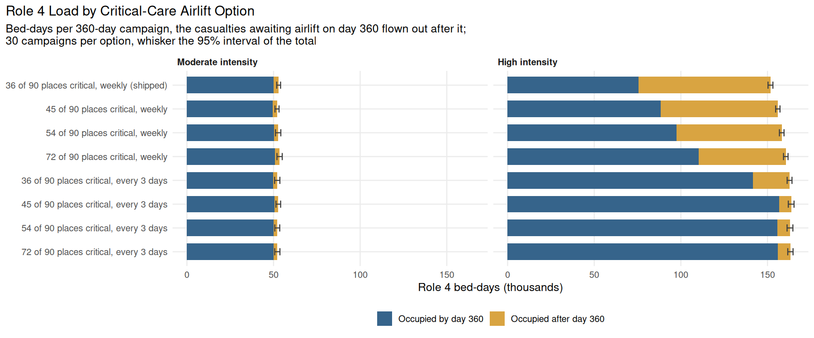

Mean Role 4 bed-days per 360-day campaign for each critical-care place and sortie interval option at each intensity, on one scale, divided into the bed-days occupied by day 360 and those occupied after it while the casualties still awaiting airlift are flown out.

### Finding 9: The Findings Hold When the Casualty Assumptions Are Relaxed

**The findings hold when the two most uncertain assumptions about the casualties are relaxed: how many are Priority 1, and how many need intensive care after surgery.**

*Priority 1 share.* The model assumes sixty-five per cent of wounded are Priority 1, an informed estimate well above the historical comparators. At 15% the R2E theatre queue at high intensity shortens from about <!-- GEN cell:triage_split_high::R2E theatre mean queue::P1 65% (shipped)::dp0 -->73<!-- /GEN --> casualties to about <!-- GEN cell:triage_split_high::R2E theatre mean queue::P1 15%::dp0 -->15<!-- /GEN --> but still does not clear, so surgical teams remain the first constraint at every share. The critical-care airlift backlog almost disappears, from about <!-- GEN cell:triage_split_high::Critical airlift backlog at the close::P1 65% (shipped)::sig3 -->3,020<!-- /GEN --> to about <!-- GEN cell:triage_split_high::Critical airlift backlog at the close::P1 15%::dp0 -->27<!-- /GEN -->, but the standard airlift then falls behind instead, the casualties awaiting airlift without a bed still growing (<!-- GEN cell:triage_split_high::R2E staging overflow, late-half classification::P1 15%::full -->**drifting, +11.6%/block**, 68.2 to 1,163.5<!-- /GEN -->): the airlift is short of places at every share, and acuity only decides which places. One requirement grows with a less acute force: more casualties stay in theatre to recover, so the casualties waiting for an R2E holding bed rise from about <!-- GEN cell:triage_split::R2E holding mean queue::P1 65% (shipped)::dp0 -->24<!-- /GEN --> to about <!-- GEN cell:triage_split::R2E holding mean queue::P1 15%::dp0 -->41<!-- /GEN --> at moderate intensity. Deaths of wounds fall with the share (<!-- GEN cell:triage_split::Treated-cohort died-of-wounds rate::P1 65% (shipped)::sig2 -->0.51%<!-- /GEN --> of treated casualties at sixty-five per cent, <!-- GEN cell:triage_split::Treated-cohort died-of-wounds rate::P1 15%::sig2 -->0.41%<!-- /GEN --> at 15%), so every mortality figure in this paper is a figure at the assumed acuity ([Results: Priority 1 triage share](Results.md#priority-1-triage-share)).

| Measure | Moderate, sixty-five per cent (shipped) | Moderate, fifteen per cent | High, sixty-five per cent (shipped) | High, fifteen per cent |
|---|---|---|---|---|
| [Casualties waiting for R2E surgery](Results.md#priority-1-triage-share) | <!-- GEN cell:triage_split::R2E theatre mean queue::P1 65% (shipped)::dp1 -->1.0<!-- /GEN --> | <!-- GEN cell:triage_split::R2E theatre mean queue::P1 15%::dp1 -->0.6<!-- /GEN --> | <!-- GEN cell:triage_split_high::R2E theatre mean queue::P1 65% (shipped)::dp1 -->72.6<!-- /GEN --> | <!-- GEN cell:triage_split_high::R2E theatre mean queue::P1 15%::dp1 -->15.3<!-- /GEN --> |
| [Critical airlift backlog at the close](Results.md#priority-1-triage-share) | <!-- GEN cell:triage_split::Critical airlift backlog at the close::P1 65% (shipped)::dp0 -->30<!-- /GEN --> | <!-- GEN cell:triage_split::Critical airlift backlog at the close::P1 15%::dp0 -->4<!-- /GEN --> | <!-- GEN cell:triage_split_high::Critical airlift backlog at the close::P1 65% (shipped)::dp0 -->3,022<!-- /GEN --> | <!-- GEN cell:triage_split_high::Critical airlift backlog at the close::P1 15%::dp0 -->27<!-- /GEN --> |
| [Casualties awaiting airlift without a bed](Results.md#priority-1-triage-share) | <!-- GEN cell:triage_split::R2E staging overflow census::P1 65% (shipped)::dp0 -->32<!-- /GEN --> | <!-- GEN cell:triage_split::R2E staging overflow census::P1 15%::dp0 -->18<!-- /GEN --> | <!-- GEN cell:triage_split_high::R2E staging overflow census::P1 65% (shipped)::dp0 -->2,516<!-- /GEN --> | <!-- GEN cell:triage_split_high::R2E staging overflow census::P1 15%::dp0 -->1,072<!-- /GEN --> |
| [Waiting for an R2E holding bed](Results.md#priority-1-triage-share) | <!-- GEN cell:triage_split::R2E holding mean queue::P1 65% (shipped)::dp1 -->24.4<!-- /GEN --> | <!-- GEN cell:triage_split::R2E holding mean queue::P1 15%::dp1 -->41.2<!-- /GEN --> | <!-- GEN cell:triage_split_high::R2E holding mean queue::P1 65% (shipped)::dp1 -->54.1<!-- /GEN --> | <!-- GEN cell:triage_split_high::R2E holding mean queue::P1 15%::dp1 -->117.6<!-- /GEN --> |
| [Treated-cohort died-of-wounds rate](Results.md#priority-1-triage-share) | <!-- GEN cell:triage_split::Treated-cohort died-of-wounds rate::P1 65% (shipped)::sig2 -->0.51%<!-- /GEN --> | <!-- GEN cell:triage_split::Treated-cohort died-of-wounds rate::P1 15%::sig2 -->0.41%<!-- /GEN --> | <!-- GEN cell:triage_split_high::Treated-cohort died-of-wounds rate::P1 65% (shipped)::sig2 -->5.7%<!-- /GEN --> | <!-- GEN cell:triage_split_high::Treated-cohort died-of-wounds rate::P1 15%::sig2 -->1.6%<!-- /GEN --> |

*Intensive care after surgery.* The model assumes every operated casualty needs intensive care after definitive surgery, an upper bound for which no adult source was found. If only a quarter do, at moderate intensity intensive care occupancy falls from <!-- GEN cell:post_definitive::R2E ICU occupancy (%)::ICU share 100% (shipped)::dp0 -->87<!-- /GEN -->% to <!-- GEN cell:post_definitive::R2E ICU occupancy (%)::ICU share 25%::dp0 -->68<!-- /GEN -->% and the share of those owed it who receive it rises from <!-- GEN cell:post_definitive::Post-definitive ICU access (%)::ICU share 100% (shipped)::dp0 -->35<!-- /GEN -->% to <!-- GEN cell:post_definitive::Post-definitive ICU access (%)::ICU share 25%::dp0 -->59<!-- /GEN -->%, part of what extra beds would achieve. At high intensity intensive care stays full (<!-- GEN cell:post_definitive_high::R2E ICU occupancy (%)::ICU share 25%::dp0 -->96<!-- /GEN -->% at a quarter) at every share. The holding beds are full at every share, so casualties moved off intensive care go to overflow rather than to a holding bed. No share changes deaths of wounds measurably ([Results: post-definitive intensive care share](Results.md#post-definitive-intensive-care-share)).

| Measure | Moderate, every operated casualty (shipped) | Moderate, a quarter | High, every operated casualty (shipped) | High, a quarter |
|---|---|---|---|---|
| [R2E intensive care occupancy (%)](Results.md#post-definitive-intensive-care-share) | <!-- GEN cell:post_definitive::R2E ICU occupancy (%)::ICU share 100% (shipped)::dp0 -->87<!-- /GEN --> | <!-- GEN cell:post_definitive::R2E ICU occupancy (%)::ICU share 25%::dp0 -->68<!-- /GEN --> | <!-- GEN cell:post_definitive_high::R2E ICU occupancy (%)::ICU share 100% (shipped)::dp0 -->98<!-- /GEN --> | <!-- GEN cell:post_definitive_high::R2E ICU occupancy (%)::ICU share 25%::dp0 -->96<!-- /GEN --> |
| [Intensive care after definitive surgery in an intensive care bed (%)](Results.md#post-definitive-intensive-care-share) | <!-- GEN cell:post_definitive::Post-definitive ICU access (%)::ICU share 100% (shipped)::dp0 -->35<!-- /GEN --> | <!-- GEN cell:post_definitive::Post-definitive ICU access (%)::ICU share 25%::dp0 -->59<!-- /GEN --> | <!-- GEN cell:post_definitive_high::Post-definitive ICU access (%)::ICU share 100% (shipped)::dp0 -->11<!-- /GEN --> | <!-- GEN cell:post_definitive_high::Post-definitive ICU access (%)::ICU share 25%::dp0 -->16<!-- /GEN --> |
| [R2E holding occupancy (%)](Results.md#post-definitive-intensive-care-share) | <!-- GEN cell:post_definitive::R2E holding occupancy (%)::ICU share 100% (shipped)::dp1 -->99.6<!-- /GEN --> | <!-- GEN cell:post_definitive::R2E holding occupancy (%)::ICU share 25%::dp1 -->99.5<!-- /GEN --> | <!-- GEN cell:post_definitive_high::R2E holding occupancy (%)::ICU share 100% (shipped)::dp1 -->100.0<!-- /GEN --> | <!-- GEN cell:post_definitive_high::R2E holding occupancy (%)::ICU share 25%::dp1 -->100.0<!-- /GEN --> |
| [Ward recoveries taken in overflow](Results.md#post-definitive-intensive-care-share) | <!-- GEN cell:post_definitive::Ward recoveries in overflow::ICU share 100% (shipped)::dp0 -->0<!-- /GEN --> | <!-- GEN cell:post_definitive::Ward recoveries in overflow::ICU share 25%::dp0 -->1,490<!-- /GEN --> | <!-- GEN cell:post_definitive_high::Ward recoveries in overflow::ICU share 100% (shipped)::dp0 -->0<!-- /GEN --> | <!-- GEN cell:post_definitive_high::Ward recoveries in overflow::ICU share 25%::dp0 -->3,628<!-- /GEN --> |
| [Change in deaths of wounds](Results.md#post-definitive-intensive-care-share) | not applicable | <!-- GEN cell:post_definitive_paired::Died of wounds::ICU share 25%::full -->+1.77 [−2.40, +5.93]<!-- /GEN --> | not applicable | <!-- GEN cell:post_definitive_paired_high::Died of wounds::ICU share 25%::full -->+38.50 [−49.02, +126.02]<!-- /GEN --> |

---

## Every Lever, and What the Evidence Supports

<small>[Return to Top](#contents)</small>

Each row of the table is one lever a planner controls, with the setting the evidence supports, what it costs in personnel and principal equipment, and the measurement at each intensity with its own evidence label. Costs are the team compositions and counts of the shipped establishment in the [system reference](../README.md#health-teams); a bed or vehicle is a count and a section is the team named. The figures are quoted from the section of the results paper linked in the row.

| Lever | Setting supported | Cost | Moderate intensity | High intensity |
|---|---|---|---|---|
| Surgical team coverage at R2B and R2E | Towards 24 hours | R2E surgical section: 1 anaesthetist, 2 surgeons, 4 nurses; R2B surgical section: 1 anaesthetist, 2 surgeons, 1 medic; no added theatre | Theatre utilisation <!-- GEN cell:load_shortfall::R2E operating theatres::Moderate: utilisation::mean -->28.1%<!-- /GEN --> ([Results](Results.md#demand-utilisation-and-shortfall-per-day)). **Measured** for the diagnosis; the means of sourcing the hours **untested**. | Theatre utilisation <!-- GEN cell:load_shortfall::R2E operating theatres::High: utilisation::mean -->75.9%<!-- /GEN -->, with a standing queue, a closing 90-day mean of <!-- GEN cell:surgical_team_high::R2E theatre mean queue::R2E 3, R2B 1 (shipped)::mean -->72.62<!-- /GEN --> casualties ([Results](Results.md#comparative-scenario-analysis)); teams are the limit ([Results](Results.md#comparative-scenario-analysis)). **Measured** for the diagnosis; the means of sourcing the hours **untested**. |
| R2B holding beds per unit | Five for the forward queue; ten where R2E holding is short | Five more beds per unit; a count of beds, staffing not modelled | Forward queue <!-- GEN cell:hold_threshold_beds::5 (shipped)::R2B hold mean queue::mean -->0.09<!-- /GEN --> at five beds and <!-- GEN cell:hold_threshold_beds::10::R2B hold mean queue::mean -->0.06<!-- /GEN --> at ten, with returns to duty <!-- GEN cell:hold_threshold_beds::5 (shipped)::Returns to duty::full -->2062 [2032, 2093]<!-- /GEN --> and <!-- GEN cell:hold_threshold_beds::10::Returns to duty::full -->2043 [2014, 2073]<!-- /GEN -->, while the R2E holding queue falls from <!-- GEN cell:hold_threshold_beds::5 (shipped)::R2E hold mean queue::full -->24.376 [22.591, 26.160]<!-- /GEN --> to <!-- GEN cell:hold_threshold_beds::10::R2E hold mean queue::full -->17.595 [16.366, 18.825]<!-- /GEN --> ([Results](Results.md#r2b-holding-capacity-and-evacuation-threshold)). **Measured**: no forward queue to relieve, and relief at R2E. | Forward queue <!-- GEN cell:hold_threshold_beds_high::5 (shipped)::R2B hold mean queue::mean -->0.34<!-- /GEN --> at five beds and <!-- GEN cell:hold_threshold_beds_high::10::R2B hold mean queue::mean -->0.41<!-- /GEN --> at ten, with returns to duty <!-- GEN cell:hold_threshold_beds_high::5 (shipped)::Returns to duty::full -->2862 [2824, 2900]<!-- /GEN --> and <!-- GEN cell:hold_threshold_beds_high::10::Returns to duty::full -->2839 [2807, 2871]<!-- /GEN --> ([Results](Results.md#r2b-holding-capacity-and-evacuation-threshold)). **Measured**: no forward queue to relieve. |
| R2B evacuation threshold | Not a remedy; it moves the queue, not the outcome | None; a command setting | One day loads the R2E holding queue to <!-- GEN cell:hold_threshold_threshold::1 day::R2E hold mean queue::mean -->26.460<!-- /GEN --> with returns to duty at <!-- GEN cell:hold_threshold_threshold::1 day::Returns to duty::full -->2055 [2022, 2088]<!-- /GEN --> against <!-- GEN cell:hold_threshold_threshold::Disabled (shipped)::Returns to duty::full -->2062 [2032, 2093]<!-- /GEN --> disabled ([Results](Results.md#r2b-holding-capacity-and-evacuation-threshold)). **Measured**. | A one-day threshold loads the R2E holding queue to <!-- GEN cell:hold_threshold_threshold_high::1 day::R2E hold mean queue::mean -->56.158<!-- /GEN --> ([Results](Results.md#r2b-holding-capacity-and-evacuation-threshold)). **Measured**. |
| R2B pre-open hold window | 60 minutes | None; a roster setting | <!-- GEN cell:hold_window::Casualties held at R2B::Window 60 min::mean -->106.57<!-- /GEN --> casualties held forward and off-shift diversions change by <!-- GEN cell:hold_window::Diverted, team off shift::Difference::mean -->−85.03<!-- /GEN --> ([Results](Results.md#r2b-pre-open-hold-window)). **Measured** forward; the downstream effect on R2E load is **unresolved**. | <!-- GEN cell:hold_window_high::Casualties held at R2B::Window 60 min::mean -->340.63<!-- /GEN --> casualties are held forward and off-shift diversions change by <!-- GEN cell:hold_window_high::Diverted, team off shift::Difference::mean -->−344.20<!-- /GEN --> ([Results](Results.md#r2b-pre-open-hold-window)). **Measured** forward; the downstream effect on R2E load is **unresolved**. |
| Ambulance fleet | Three; four at high intensity | One vehicle per step; a count of vehicles | Queue <!-- GEN cell:transport::1::Ambulance mean queue::mean -->7.6600<!-- /GEN --> at one vehicle, <!-- GEN cell:transport::3 (current ambulance)::Ambulance mean queue::mean -->0.4613<!-- /GEN --> at three ([Results](Results.md#transport-fleet-size)). **Measured**. | Queue <!-- GEN cell:transport_high::1::Ambulance mean queue::mean -->2080.6801<!-- /GEN --> at one vehicle, <!-- GEN cell:transport_high::3 (current ambulance)::Ambulance mean queue::mean -->1.7600<!-- /GEN --> at three ([Results](Results.md#transport-fleet-size)). **Measured**. |
| Truck fleet | Four | One vehicle per step; a count of vehicles | Queue <!-- GEN cell:transport::4 (current truck)::Truck mean queue::mean -->0.0008<!-- /GEN --> at four ([Results](Results.md#transport-fleet-size)). **Measured**. | Queue <!-- GEN cell:transport_high::4 (current truck)::Truck mean queue::mean -->0.0002<!-- /GEN --> at four ([Results](Results.md#transport-fleet-size)). **Measured**. |
| Idle transport and evacuation elements | Candidates for reallocating personnel | Frees personnel rather than costing them | R2E evacuation sections in use <!-- GEN cell:transport_holders::R2E evacuation sections::Moderate intensity utilisation::mean -->0.0%<!-- /GEN --> of the time, the HX2 40M fleet <!-- GEN cell:transport_holders::HX2 40M fleet::Moderate intensity utilisation::mean -->2.5%<!-- /GEN --> ([Results](Results.md#transport-fleet-size)). Utilisation **measured**; reallocation **untested**. | R2E evacuation sections in use <!-- GEN cell:transport_holders::R2E evacuation sections::High intensity utilisation::mean -->1.1%<!-- /GEN --> of the time, the HX2 40M fleet <!-- GEN cell:transport_holders::HX2 40M fleet::High intensity utilisation::mean -->5.7%<!-- /GEN --> ([Results](Results.md#transport-fleet-size)). Utilisation **measured**; reallocation **untested**. |
| Forward post-operative intensive care holding | Not supported; do not apply under sustained saturation | None added; uses R2B intensive care beds already established | Post-operative overflow <!-- GEN cell:forward_hold::Off (current)::R2E post-operative overflow census::mean -->5.72<!-- /GEN --> with none held forward and <!-- GEN cell:forward_hold::240 min::R2E post-operative overflow census::mean -->5.10<!-- /GEN --> at a 240-minute window ([Results](Results.md#forward-holding-of-post-operative-intensive-care)). **Unresolved**: no change separable from none. | Overflow <!-- GEN cell:forward_hold_high::Off (current)::R2E post-operative overflow census::mean -->19.79<!-- /GEN --> with none held forward and <!-- GEN cell:forward_hold_high::240 min + capacity::R2E post-operative overflow census::mean -->17.43<!-- /GEN --> with a 240-minute window and the capacity trigger, while deaths of wounds per run are <!-- GEN cell:forward_hold_high::Off (current)::Died of wounds per run::full -->568.60 [500.55, 636.65]<!-- /GEN --> with none held forward, <!-- GEN cell:forward_hold_high::240 min::Died of wounds per run::full -->573.00 [493.77, 652.23]<!-- /GEN --> at a 240-minute window and <!-- GEN cell:forward_hold_high::Capacity only::Died of wounds per run::full -->614.50 [565.71, 663.29]<!-- /GEN --> with the capacity trigger alone ([Results](Results.md#forward-holding-of-post-operative-intensive-care)). **Unresolved**: the arms move in no consistent direction, the intervals overlapping. |
| Intensive care rationing gate | Retain; its mortality effect is unresolved at both intensities | None; a rule applied to the R2E intensive care beds | R2E intensive care utilisation <!-- GEN cell:icu_gate::R2E ICU utilisation (%)::Without the rule::mean -->85.9<!-- /GEN -->% without the gate and <!-- GEN cell:icu_gate::R2E ICU utilisation (%)::With the rule::mean -->86.8<!-- /GEN -->% with it ([Results](Results.md#post-operative-intensive-care-gate)). Load and mortality **unresolved**, the difference in utilisation failing Holm's adjustment. | Deaths of wounds per run differ by <!-- GEN cell:icu_gate_high::Died of wounds per run::Paired difference::full -->−29.33 [−138.46, +79.79]<!-- /GEN --> with the gate ([Results](Results.md#post-operative-intensive-care-gate)). **Unresolved**. |
| Theatre evacuation policy | 30 days at moderate intensity, read as a trade | None; a command decision traded against lift and Role 4 beds | Returns to duty rise from <!-- GEN cell:policy::Returns to duty::21 d (shipped)::mean -->2062.4<!-- /GEN --> at 21 days to <!-- GEN cell:policy::Returns to duty::30 d::mean -->2360.5<!-- /GEN --> at 30, with post-definitive intensive care access <!-- GEN cell:policy::Post-definitive ICU access (%)::21 d (shipped)::mean -->35.2<!-- /GEN -->% and <!-- GEN cell:policy::Post-definitive ICU access (%)::30 d::mean -->35.6<!-- /GEN -->% ([Results](Results.md#evacuation-policy)), and the pools hold at every policy to 30 days in the moderate-intensity grid ([Results](Results.md#moderate-intensity-evacuation-policy-and-holding-establishment)). **Measured**. | Measured only jointly with the holding establishment, in the grid below ([Results](Results.md#high-intensity-evacuation-policy-and-holding-establishment)). **Measured** jointly. |
| R2E holding beds | Shipped 30 | Fifteen to thirty more beds; a count of beds, staffing not modelled | Holding queue <!-- GEN cell:establishment::R2E hold mean queue::30 beds (shipped)::mean -->24.38<!-- /GEN --> at 30 beds and <!-- GEN cell:establishment::R2E hold mean queue::45 beds::mean -->18.71<!-- /GEN --> at 45 ([Results](Results.md#r2e-holding-establishment)), the pool holding at every establishment and policy in the moderate-intensity grid ([Results](Results.md#moderate-intensity-evacuation-policy-and-holding-establishment)). **Measured**. | Measured only jointly with the evacuation policy, in the grid below ([Results](Results.md#high-intensity-evacuation-policy-and-holding-establishment)). **Measured** jointly. |
| Evacuation policy and holding beds together | Moderate: 30 days at the shipped 30 beds; high: no setting holds the R2E pools | Up to 90 holding beds with a policy change | The largest policy holding the R2E pools is <!-- GEN cell:policy_grid_largest_moderate::30::Largest policy holding the R2E pools::full -->30 d<!-- /GEN --> at 30 beds, returning <!-- GEN cell:policy_grid_largest_moderate::30::Paired gain over 21 d and 30 beds::full -->+298.1 [+248.7, +347.5]<!-- /GEN --> more casualties to duty, and at that policy the added beds change returns to duty by <!-- GEN cell:policy_grid_largest_moderate::45::Gain of the added beds at that policy::full -->−13.8 [−66.7, +39.1]<!-- /GEN --> at 45 beds and <!-- GEN cell:policy_grid_largest_moderate::60::Gain of the added beds at that policy::full -->−32.3 [−90.5, +25.9]<!-- /GEN --> at 60 ([Results](Results.md#moderate-intensity-evacuation-policy-and-holding-establishment)). **Measured**. | The shipped cell is classified <!-- GEN cell:policy_establishment_high_stability::21 d, 30 beds::R2E pools across the cell::full -->at least one growing<!-- /GEN -->, the staging overflow growing in <!-- GEN cell:policy_establishment_high_stability::21 d, 30 beds::Staging overflow not growing::full -->0 of 30<!-- /GEN --> replications not growing, and no cell holds ([Results](Results.md#high-intensity-evacuation-policy-and-holding-establishment)). The three-day interval with the 21-day policy and 60 beds cleared the holding queue to <!-- GEN cell:interval_grid_high::3 d interval, 21 d policy, 60 beds::R2E hold mean queue::mean -->42.6<!-- /GEN --> and was classified <!-- GEN cell:interval_grid_high::3 d interval, 21 d policy, 60 beds::Pools::full -->at least one growing<!-- /GEN --> ([Results](Results.md#high-intensity-strategic-sortie-interval-by-policy-and-holding-establishment)). **Measured**. |
| Forward surgical saturation release | Two, the shipped threshold, where the national support base can absorb it | None at the forward theatre; moves an operation to the national support base | Theatre queue <!-- GEN cell:saturation::Theatre mean queue::0 (disabled)::mean -->1.58<!-- /GEN --> disabled and <!-- GEN cell:saturation::Theatre mean queue::2 (shipped)::mean -->0.97<!-- /GEN --> at two ([Results](Results.md#forward-surgical-saturation-release)). **Measured** for work moved; the queue change, which fails Holm's adjustment, and mortality **unresolved**. | Theatre queue <!-- GEN cell:saturation_high::Theatre mean queue::0 (disabled)::mean -->902.55<!-- /GEN --> disabled and <!-- GEN cell:saturation_high::Theatre mean queue::2 (shipped)::mean -->72.62<!-- /GEN --> at two, with <!-- GEN cell:saturation_high::Released with repair outstanding::2 (shipped)::mean -->1985.5<!-- /GEN --> casualties per campaign released with the repair outstanding, <!-- GEN cell:saturation_high::Released with repair outstanding::1::mean -->2026.2<!-- /GEN --> at a threshold of one and <!-- GEN cell:saturation_high::Released with repair outstanding::24::mean -->1729.0<!-- /GEN --> at 24, because the queue never falls below the threshold ([Results](Results.md#forward-surgical-saturation-release)). **Measured** for queue and work moved; mortality **unresolved**. |
| Strategic sortie interval | Seven days or shorter | Airlift sorties, not personnel; one sortie carries 90 casualties | Mean wait <!-- GEN cell:airlift_interval::Mean wait (days)::7 days (shipped)::mean -->4.90<!-- /GEN --> days at seven and <!-- GEN cell:airlift_interval::Mean wait (days)::14 days::mean -->41.63<!-- /GEN --> at fourteen ([Results](Results.md#national-support-base-and-strategic-airlift)). **Measured**. | Mean wait <!-- GEN cell:airlift_interval_high::Mean wait (days)::7 days (shipped)::mean -->53.69<!-- /GEN --> days at seven and <!-- GEN cell:airlift_interval_high::Mean wait (days)::3 days::mean -->15.55<!-- /GEN --> at three, and the share of R2E holding beds held by casualties awaiting airlift falls from <!-- GEN cell:airlift_interval_high::Share of R2E holding beds held by the evacuation wait::7 days (shipped)::mean -->8%<!-- /GEN --> at seven days to <!-- GEN cell:airlift_interval_high::Share of R2E holding beds held by the evacuation wait::3 days::mean -->2%<!-- /GEN --> at three ([Results](Results.md#national-support-base-and-strategic-airlift)). At three days with the 21-day policy and 30 beds the residual wait sits on the critical channel, at <!-- GEN cell:interval_grid_high_wait::3 d interval, 21 d policy, 30 beds::Mean wait, critical channel (days)::mean -->22.44<!-- /GEN --> days against <!-- GEN cell:interval_grid_high_wait::3 d interval, 21 d policy, 30 beds::Mean wait, standard channel (days)::mean -->1.51<!-- /GEN --> on the standard channel ([Results](Results.md#high-intensity-strategic-sortie-interval-by-policy-and-holding-establishment)). **Measured**. |
| Strategic sortie reliability | Losses of 10% or less | Airlift sorties, not personnel | The critical route collapses in <!-- GEN cell:airlift_collapse::Critical, 0%::Collapsed::full -->1 of 30<!-- /GEN --> campaigns with no loss and <!-- GEN cell:airlift_collapse::Critical, 15%::Collapsed::full -->7 of 30<!-- /GEN --> at 15%, its demand meeting the critical places flown in <!-- GEN cell:airlift_collapse::Critical, 15%::Demand at or above places flown::full -->11 of 30<!-- /GEN --> at 15% ([Results](Results.md#national-support-base-and-strategic-airlift)). **Measured**. | The critical route collapses in <!-- GEN cell:airlift_collapse_high::Critical, 0%::Collapsed::full -->30 of 30<!-- /GEN --> campaigns with no sortie loss, at a utilisation of <!-- GEN cell:airlift_collapse_high::Critical, 0%::Mean utilisation::mean -->2.65<!-- /GEN -->, and the mean wait rises from <!-- GEN cell:airlift_reliability_high::Mean wait (days)::0%::mean -->53.69<!-- /GEN --> days with none lost to <!-- GEN cell:airlift_reliability_high::Mean wait (days)::40%::mean -->80.98<!-- /GEN --> at 40% lost ([Results](Results.md#national-support-base-and-strategic-airlift)). **Measured**. |
| Critical-care places per sortie | 45 of the 90 places for critical care, flown every three days, at high intensity; the shipped 36 weekly at moderate | More than twice the sorties, each with a critical-care team for the added stretcher places; no added airframe type | The critical route collapses in <!-- GEN cell:airlift_places::Critical airlift campaigns collapsed::36/54, 7 days (shipped)::full -->1 of 30 [0%, 17%]<!-- /GEN --> campaigns at the shipped split, and 45 critical places every three days changes deaths of wounds by <!-- GEN cell:airlift_places_paired::Died of wounds::45/45, 3 days::full -->−1.70 [−6.35, +2.95]<!-- /GEN --> ([Results](Results.md#critical-care-places-per-sortie)). **Measured**. | Reconfiguration or a shorter interval alone leaves the critical route collapsed (<!-- GEN cell:airlift_places_high::Critical airlift campaigns collapsed::72/18, 7 days::full -->30 of 30 [88%, 100%]<!-- /GEN --> at 72 places weekly, <!-- GEN cell:airlift_places_high::Critical airlift campaigns collapsed::36/54, 3 days::full -->29 of 30 [83%, 100%]<!-- /GEN --> at 36 every three days); 45 every three days settles it (<!-- GEN cell:airlift_places_high::Critical airlift campaigns collapsed::45/45, 3 days::full -->0 of 30 [0%, 12%]<!-- /GEN -->) and changes deaths of wounds by <!-- GEN cell:airlift_places_paired_high::Died of wounds::45/45, 3 days::full -->−175.77 [−275.12, −76.41]<!-- /GEN --> ([Results](Results.md#critical-care-places-per-sortie)). **Measured**. |
| National support base bed demand | Plan it as a sustained load of the evacuation pipeline, not a casualty estimate | Not a lever; the demand the national support base must meet | Closing 90-day census <!-- GEN cell:role4_census_ward::Total, closing 90-day mean beds::Moderate intensity::mean -->150.38<!-- /GEN --> beds; <!-- GEN cell:role4_levers_policy::Role 4 closing 90-day mean beds::21 d (shipped)::mean -->121.8<!-- /GEN --> at the shipped policy against <!-- GEN cell:role4_levers_policy::Role 4 closing 90-day mean beds::30 d::mean -->113.1<!-- /GEN --> at 30 days ([Results](Results.md#role-4-bed-demand)). **Measured**. | Closing 90-day census <!-- GEN cell:role4_census_ward::Total, closing 90-day mean beds::High intensity::mean -->219.86<!-- /GEN --> beds ([Results](Results.md#role-4-bed-demand)). **Measured**. |
| Casualty surge event response | Policies to recover holding capacity | None; a stress test, remedies not yet specified | Event casualties die of wounds at <!-- GEN cell:casualty_surge::Died-of-wounds rate, event casualties::Events injected::mean -->2.41%<!-- /GEN --> against <!-- GEN cell:casualty_surge::Died-of-wounds rate, ordinary casualties::Events injected::mean -->1.31%<!-- /GEN --> for ordinary casualties ([Results](Results.md#casualty-surge-events)). Cost **measured**; remedies **untested**. | Event casualties die of wounds at <!-- GEN cell:casualty_surge_high::Died-of-wounds rate, event casualties::Events injected::mean -->16.12%<!-- /GEN --> against <!-- GEN cell:casualty_surge_high::Died-of-wounds rate, ordinary casualties::Events injected::mean -->14.23%<!-- /GEN --> for ordinary casualties ([Results](Results.md#casualty-surge-events)). Cost **measured**; remedies **untested**. |
| Casualty surge event size | Planning for larger incidents than the configured range | None; a stress test | The R2E theatre queue is the first pool to rise, peaking at <!-- GEN cell:casualty_surge_size::None::Peak R2E theatre queue::full -->33.7 ± 6.3<!-- /GEN --> with no events, <!-- GEN cell:casualty_surge_size::20::Peak R2E theatre queue::full -->39.7 ± 9.8<!-- /GEN --> at 20 casualties per event and <!-- GEN cell:casualty_surge_size::40::Peak R2E theatre queue::full -->57.9 ± 6.1<!-- /GEN --> at 40, while the post-operative overflow moves from <!-- GEN cell:casualty_surge_size::None::Peak R2E post-operative overflow census::full -->27.1 ± 0.8<!-- /GEN --> to <!-- GEN cell:casualty_surge_size::40::Peak R2E post-operative overflow census::full -->30.6 ± 0.5<!-- /GEN -->; the theatre queue reached <!-- GEN cell:casualty_surge_size::180::Peak R2E theatre queue::full -->2134.1 ± 217.2<!-- /GEN --> at 180 casualties ([Results](Results.md#casualty-surge-event-size)). Cost **measured**; remedies **untested**; the size range is **informed estimate**. | At 20 casualties per event the peak post-operative overflow was <!-- GEN cell:casualty_surge_size_high::20::Peak R2E post-operative overflow census::full -->31.5 ± 0.6<!-- /GEN -->, against <!-- GEN cell:casualty_surge_size_high::None::Peak R2E post-operative overflow census::full -->31.9 ± 0.5<!-- /GEN --> with no events ([Results](Results.md#casualty-surge-event-size)). Cost **measured**; remedies **untested**. |
| Surgical section count at R2B and R2E | A second R2B section per unit; a fourth R2E section at high intensity | R2E surgical section: 1 anaesthetist, 2 surgeons, 4 nurses; R2B surgical section: 1 anaesthetist, 2 surgeons, 1 medic | At moderate intensity the shipped establishment is already <!-- GEN cell:surgical_team::R2E theatre queue, late-half classification::R2E 3, R2B 1 (shipped)::full -->converged at 0.90<!-- /GEN --> ([Results](Results.md#surgical-team-establishment)). **Measured**. | The R2E theatre queue shortfall per day falls from <!-- GEN cell:surgical_team_high::R2E theatre queue shortfall per day::R2E 3, R2B 1 (shipped)::full -->0.014 [−0.151, 0.179]<!-- /GEN --> at the shipped establishment to <!-- GEN cell:surgical_team_high::R2E theatre queue shortfall per day::R2E 4, R2B 1::full -->0.003 [−0.016, 0.022]<!-- /GEN --> with a fourth R2E section and <!-- GEN cell:surgical_team_high::R2E theatre queue shortfall per day::R2E 4, R2B 2::full -->−0.007 [−0.017, 0.003]<!-- /GEN --> with a fourth R2E section and a second R2B section, the queue settling in every arm, from <!-- GEN cell:surgical_team_high::R2E theatre mean queue::R2E 3, R2B 1 (shipped)::mean -->72.62<!-- /GEN --> casualties at the shipped establishment to <!-- GEN cell:surgical_team_high::R2E theatre mean queue::R2E 4, R2B 1::mean -->9.82<!-- /GEN --> with a fourth R2E section, a second R2B section per unit alone changing deaths of wounds by <!-- GEN cell:surgical_team_paired_high::Died of wounds::R2E 3, R2B 2::full -->−222.30 [−290.65, −153.95]<!-- /GEN -->, and deaths of wounds changing by <!-- GEN cell:surgical_team_paired_high::Died of wounds::R2E 4, R2B 1::full -->−259.90 [−330.91, −188.89]<!-- /GEN --> ([Results](Results.md#surgical-team-establishment)). **Measured**. |
| R2E operating theatre count | A third theatre where three R2E sections share a shift; none at the shipped establishment | One theatre and its equipment, staffed by the surgical sections already fielded | Theatres are in use <!-- GEN cell:ot_bed::R2E theatre occupancy (%)::2 theatres, 3 sections (shipped)::mean -->28.1<!-- /GEN --> per cent of the time at the shipped establishment, and no added theatre resolves a change in deaths of wounds (<!-- GEN cell:ot_bed_paired::Died of wounds::3 theatres, 3 sections::full -->+1.07 [−5.00, +7.13]<!-- /GEN --> at three sections, <!-- GEN cell:ot_bed_paired::Died of wounds::3 theatres, 6 sections against 2 theatres, 6 sections::full -->+0.80 [−2.15, +3.75]<!-- /GEN --> at six) ([Results](Results.md#r2e-operating-theatre-establishment)). **Measured**. | At the shipped three sections a third theatre resolves no change in the queue (<!-- GEN cell:ot_bed_paired_high::R2E theatre mean queue::3 theatres, 3 sections::full -->−23.72 [−48.04, +0.60]<!-- /GEN -->); at six sections it shortens the queue by <!-- GEN cell:ot_bed_paired_high::R2E theatre mean queue::3 theatres, 6 sections against 2 theatres, 6 sections::full -->−7.46 [−9.23, −5.68]<!-- /GEN --> and changes deaths of wounds by <!-- GEN cell:ot_bed_paired_high::Died of wounds::3 theatres, 6 sections against 2 theatres, 6 sections::full -->−37.60 [−52.42, −22.78]<!-- /GEN --> ([Results](Results.md#r2e-operating-theatre-establishment)). **Measured**. |
| R2E intensive care beds | Twelve where care quality is the aim; no count is a remedy for a pool that is not falling behind | Beds as a count; the model attaches no staff to the beds, an R2E intensive care section being 1 intensivist and 4 nurses | Twelve beds take post-definitive care in an intensive care bed from <!-- GEN cell:icu_bed::Post-definitive ICU access (%)::4 beds (shipped)::mean -->35.2<!-- /GEN --> to <!-- GEN cell:icu_bed::Post-definitive ICU access (%)::12 beds::mean -->78.6<!-- /GEN --> percent with no resolved change in deaths of wounds (<!-- GEN cell:icu_bed_paired::Died of wounds::12 beds::full -->−0.67 [−4.95, +3.62]<!-- /GEN -->) ([Results](Results.md#r2e-intensive-care-bed-establishment)). **Measured** for the care pathway; outcomes **unresolved**. | Sixteen beds take the post-operative overflow from <!-- GEN cell:icu_bed_high::R2E post-operative overflow census::4 beds (shipped)::mean -->19.79<!-- /GEN --> to <!-- GEN cell:icu_bed_high::R2E post-operative overflow census::16 beds::mean -->11.66<!-- /GEN -->, settled at every count, and the paired differences in deaths of wounds do not move consistently with the count, <!-- GEN cell:icu_bed_paired_high::Died of wounds::6 beds::full -->+23.80 [−67.86, +115.46]<!-- /GEN --> at six beds and <!-- GEN cell:icu_bed_paired_high::Died of wounds::16 beds::full -->+49.17 [−57.08, +155.41]<!-- /GEN --> at sixteen ([Results](Results.md#r2e-intensive-care-bed-establishment)). **Measured** for the pathway; outcomes **unresolved**. |
| R2E intensive care and holding beds behind added surgery | Twelve intensive care beds with six R2E sections and three theatres; holding beds at the shipped 30 | Beds as a count; the model attaches no staff to the beds | Not measured: the theatres keep pace and the shift onto the beds does not occur measurably ([Results](Results.md#r2e-operating-theatre-establishment)). **Untested**. | Twelve intensive care beds change the overflow by <!-- GEN cell:post_op_capacity_paired_surgery::6 sections, 3 theatres, 12 ICU, 30 hold::R2E post-operative overflow census::full -->−6.22 [−6.93, −5.51]<!-- /GEN --> against six sections and three theatres alone, and 90 holding beds change the holding queue by <!-- GEN cell:post_op_capacity_paired_surgery::6 sections, 3 theatres, 4 ICU, 90 hold::R2E holding mean queue::full -->+2.14 [−0.73, +5.01]<!-- /GEN --> ([Results](Results.md#surgery-and-post-operative-beds-together)). **Measured** for the pathway; deaths of wounds **unresolved**. |
| Casualty acuity (the Priority 1 share of the triage split) | Not a lever; the assumption every establishment above is sized against | None; a planning assumption, set at sixty-five per cent on informed estimate | At a share of fifteen per cent against sixty-five per cent the critical airlift backlog changes by <!-- GEN cell:triage_split_paired::Critical airlift backlog at the close::P1 15%::full -->−25.5 [−35.0, −16.0]<!-- /GEN -->, the R2E holding queue by <!-- GEN cell:triage_split_paired::R2E holding mean queue::P1 15%::full -->+16.81 [+14.19, +19.43]<!-- /GEN --> and returns to duty by <!-- GEN cell:triage_split_paired::Returns to duty::P1 15%::full -->+565.4 [+510.9, +619.8]<!-- /GEN --> ([Results](Results.md#priority-1-triage-share)). **Measured**. | Deaths of wounds per run fall from <!-- GEN cell:triage_split_high::Died of wounds::P1 65% (shipped)::mean -->568.60<!-- /GEN --> to <!-- GEN cell:triage_split_high::Died of wounds::P1 15%::mean -->167.57<!-- /GEN --> and the R2E theatre queue from <!-- GEN cell:triage_split_high::R2E theatre mean queue::P1 65% (shipped)::mean -->72.62<!-- /GEN --> to <!-- GEN cell:triage_split_high::R2E theatre mean queue::P1 15%::mean -->15.31<!-- /GEN -->, while the R2E holding queue rises from <!-- GEN cell:triage_split_high::R2E holding mean queue::P1 65% (shipped)::mean -->54.06<!-- /GEN --> to <!-- GEN cell:triage_split_high::R2E holding mean queue::P1 15%::mean -->117.62<!-- /GEN --> and the staging overflow drifts at every share ([Results](Results.md#priority-1-triage-share)). **Measured**. |
| Intensive care need after the definitive repair (the share of operated casualties owed it) | Not a lever; the clinical assumption the intensive care establishment is sized against | None; a planning assumption, set at one as an upper bound with no adult source | At a share of a quarter against one, R2E intensive care occupancy changes by <!-- GEN cell:post_definitive_paired::R2E ICU occupancy (%)::ICU share 25%::full -->−19.1 [−20.6, −17.5]<!-- /GEN --> percentage points, post-operative care in a holding bed by <!-- GEN cell:post_definitive_paired::Post-operative care in a holding bed (%)::ICU share 25%::full -->−11.5 [−12.2, −10.8]<!-- /GEN --> and deaths of wounds by <!-- GEN cell:post_definitive_paired::Died of wounds::ICU share 25%::full -->+1.77 [−2.40, +5.93]<!-- /GEN --> ([Results](Results.md#post-definitive-intensive-care-share)). **Measured** for the care pathway; outcomes **unresolved**. | Intensive care occupancy stays at <!-- GEN cell:post_definitive_high::R2E ICU occupancy (%)::ICU share 25%::mean -->95.6<!-- /GEN -->% at a quarter against <!-- GEN cell:post_definitive_high::R2E ICU occupancy (%)::ICU share 100% (shipped)::mean -->97.5<!-- /GEN -->% at one, nearly every ward recovery is taken in overflow and deaths of wounds change by <!-- GEN cell:post_definitive_paired_high::Died of wounds::ICU share 25%::full -->+38.50 [−49.02, +126.02]<!-- /GEN --> ([Results](Results.md#post-definitive-intensive-care-share)). **Measured** for the care pathway; outcomes **unresolved**. |
| Forward evacuation delay (a contested axis) | Not a lever; the condition every establishment above assumes away, forward evacuation being uncontested in the shipped configuration | None; a condition of the operating environment, whose remedy is forward holding and prolonged care rather than a Role 2 establishment | Deaths of wounds change by <!-- GEN cell:evac_delay_paired::Died of wounds::6 hours::full -->+13.17 [+7.43, +18.90]<!-- /GEN --> at a six-hour delay and <!-- GEN cell:evac_delay_paired::Died of wounds::30 days::full -->+1052.00 [+1014.43, +1089.57]<!-- /GEN --> at thirty days, nearly all of them while held forward, with every R2B and R2E pool settled at every delay ([Results](Results.md#forward-evacuation-delay)). **Measured**; the prolonged-care risk behind it is **informed estimate**. | Deaths of wounds change by <!-- GEN cell:evac_delay_paired_high::Died of wounds::6 hours::full -->+52.90 [−39.93, +145.73]<!-- /GEN --> at six hours and <!-- GEN cell:evac_delay_paired_high::Died of wounds::3 days::full -->+436.40 [+356.91, +515.89]<!-- /GEN --> at three days, while the R2E theatre queue changes by <!-- GEN cell:evac_delay_paired_high::R2E theatre mean queue::30 days::full -->−6.70 [−37.65, +24.25]<!-- /GEN --> at thirty days and the staging overflow drifts at every delay ([Results](Results.md#forward-evacuation-delay)). **Measured**; the prolonged-care risk behind it is **informed estimate**. |

---

## Recommendations in Priority Order

<small>[Return to Top](#contents)</small>

**Recommendations are split by whether the remedy is measured, and ranked within each group by how directly the measured effect improves the health outcome of the force.** Act now holds the levers whose effect is measured and resolved against a comparator. Test first holds the levers whose diagnosis is measured but whose remedy is untested or whose effect on outcomes is unresolved. Within a group a lever that moves returns to duty, deaths of wounds or access to intensive care ranks above one that moves only a queue, and a lever addressing the principal constraint ranks above one better measured but acting where the system is not failing. The findings above carry the measurements; each recommendation states what to do, the evidence label it carries, and what the findings leave for the planner to decide.

### Act Now

#### 1. Add Surgical Sections at R2E and R2B, and a Third Theatre Beyond a Fourth R2E Section

**Surgical team hours are the capacity to add, at both R2B and R2E, and at high intensity an added section at either changes deaths of wounds by more than any other lever measured.** **Evidence for the diagnosis: measured. Evidence for the effect of added sections: measured, and resolved for deaths of wounds at high intensity. Evidence for the best means of sourcing the hours: untested.**

The diagnosis and the effect of each added section are [finding 2](#finding-2-surgical-team-hours-at-r2e-are-the-first-constraint) and [finding 7](#finding-7-r2b-sends-most-of-its-surgery-rearward): a fourth R2E section and a second section per R2B unit each prevent a few hundred deaths of wounds per campaign at high intensity, and beyond a fourth R2E section a third theatre is needed for a third section on each shift. Prehospital transport to a surgical facility within 60 minutes was among the interventions associated with the fall in case fatality across the Afghanistan and Iraq conflicts [[8]](#references), so a casualty who travels further to reach a surgeon because none is rostered is a clinical cost rather than an administrative one. Whether the hours are a standing establishment or a surge measure depends on the intensity planned for: at high intensity the R2E theatre queue stands empty for <!-- GEN cell:queue_clearance::R2E operating theatres::High: queue empty::full -->7%<!-- /GEN --> of the campaign, so the hours must be permanently established, while at moderate intensity it stands empty for <!-- GEN cell:queue_clearance::R2E operating theatres::Moderate: queue empty::full -->85%<!-- /GEN --> and the hours can be held as a capability brought to bear on the heavy day ([Results: queue behaviour over the campaign](Results.md#queue-behaviour-over-the-campaign)). Extending coverage needs no additional principal equipment, but it does need provision in the operational viability period, the organisational design and the workforce model, and extending the rostered teams' hours and fielding additional teams deliver coverage at different costs in personnel, sustainment and clinical risk, a question the simulation does not answer. The added sections move the pressure onto the post-operative beds, and at high intensity twelve R2E intensive care beds take it back where more holding beds do not ([finding 6](#finding-6-adding-surgery-moves-the-pressure-onto-the-post-operative-beds)), so the beds belong in the same plan as the sections; a second R2B theatre is the next forward constraint and is untested ([Research Agenda](#research-agenda)).

#### 2. Fly More Critical-Care Airlift Places More Often at High Intensity

**Strategic airlift is limited by its critical-care places, and at high intensity only more of them, flown more often, settle it.** **Evidence for the diagnosis: measured. Evidence for the remedy: measured; at moderate intensity no airlift arm resolves a change in deaths of wounds.**

The diagnosis and the remedy are [finding 3](#finding-3-critical-care-airlift-is-the-second-constraint): at high intensity forty-five of the 90 places configured for critical care and flown every three days keep the critical route level, where either change alone does not. The critical wait is set by the places flown rather than by the beds that hold the casualty meanwhile: at high intensity sixteen R2E intensive care beds leave the critical-route wait at <!-- GEN cell:icu_bed_high::Critical-route evacuation wait (days)::16 beds::dp0 -->111<!-- /GEN --> days against <!-- GEN cell:icu_bed_high::Critical-route evacuation wait (days)::4 beds (shipped)::dp0 -->110<!-- /GEN --> at the shipped four ([Results: R2E intensive care bed establishment](Results.md#r2e-intensive-care-bed-establishment)). How far a real sortie can be reconfigured is not stated by an open-access source, so a planner should confirm the critical-care configuration of the airframe, and the critical-care teams to crew it, before relying on it ([note 3](#notes)). The faster lift is paid for in the national support base's beds ([finding 8](#finding-8-the-evacuation-policy-the-ambulance-fleet-and-role-4)).

#### 3. Hold the Evacuation Policy as a Decision and Keep the Sorties Weekly and Reliable

**The theatre evacuation policy is a command decision with a price at each setting, and at moderate intensity the shipped establishment carries a 30-day policy without saturating, at the price of a longer wait for a holding bed.** Doctrine names it the theatre patient return policy, a command decision balancing each casualty's needs against keeping enough treatment and evacuation capacity available to the force [[6]](#references) (para. 1.55), so [finding 8](#finding-8-the-evacuation-policy-the-ambulance-fleet-and-role-4) gives the price of each setting rather than a single answer: a longer policy returns more casualties to duty and lowers the demand on the national support base, and pays for it in casualties waiting for an R2E holding bed. The one in-theatre figure in the historical record of return to duty ([system reference](../README.md#return-to-duty)) sits at the shipped 21 days, which retains <!-- GEN cell:policy::In-theatre share (%)::21 d (shipped)::dp0 -->40<!-- /GEN -->% of casualties in theatre, while a 30-day policy retains <!-- GEN cell:policy::In-theatre share (%)::30 d::dp0 -->49<!-- /GEN -->% ([Results: evacuation policy](Results.md#evacuation-policy)); retention above that figure is not evidence against a 30-day policy, but the returns to duty it buys rest on uncalibrated recovery factors ([note 8](#notes)). Whether a 45 or 60-day policy holds the pools at moderate intensity is not tested, the grid stopping at 30 days. **Evidence: measured.**

**The sortie schedule is a measured lever: fly at least weekly, and protect the sorties from loss.** Lengthening the interval lengthens the wait, from <!-- GEN cell:airlift_interval::Mean wait (days)::7 days (shipped)::dp1 -->4.9<!-- /GEN --> days at seven to <!-- GEN cell:airlift_interval::Mean wait (days)::14 days::dp1 -->41.6<!-- /GEN --> at fourteen, and the share of R2E holding beds held by casualties awaiting airlift from <!-- GEN cell:airlift_interval::Share of R2E holding beds held by the evacuation wait::7 days (shipped)::mean -->10%<!-- /GEN --> to <!-- GEN cell:airlift_interval::Share of R2E holding beds held by the evacuation wait::14 days::mean -->34%<!-- /GEN -->, so a lever that delays a sortie propagates into the beds; the loss of sorties is priced in [finding 3](#finding-3-critical-care-airlift-is-the-second-constraint) ([Results: national support base and strategic airlift](Results.md#national-support-base-and-strategic-airlift)). **Evidence: measured.**

**Plan the national support base as a sustained load of beds and surgery, derived from the evacuation pipeline rather than from a casualty estimate.** [Finding 8](#finding-8-the-evacuation-policy-the-ambulance-fleet-and-role-4) gives the beds. The base also owes surgery: about <!-- GEN cell:role4_operations::Operations owed by casualties admitted during the campaign::Moderate intensity::sig3 -->1,220<!-- /GEN --> operations per campaign at moderate intensity and <!-- GEN cell:role4_operations::Operations owed by casualties admitted during the campaign::High intensity::sig3 -->2,050<!-- /GEN --> at high, debridements the largest share, and about <!-- GEN cell:role4_operations::Operations owed on the busiest day::Moderate intensity::dp0 -->21<!-- /GEN --> and <!-- GEN cell:role4_operations::Operations owed on the busiest day::High intensity::dp0 -->28<!-- /GEN --> on the busiest day ([Results: Role 4 bed demand](Results.md#role-4-bed-demand)), so the base is sized in operating theatres as well as beds. **Evidence: measured.**

#### 4. Size the Medical Evacuation Fleet at Three Ambulances, Four at High Intensity, and Four Trucks

**Three ambulances carry the inter-echelon load between R1, R2B and R2E at moderate intensity, and four at high.** The queue and the fourth vehicle's effect are in [finding 8](#finding-8-the-evacuation-policy-the-ambulance-fleet-and-role-4), with the idle R2E evacuation sections and trucks that point to personnel who could be reallocated, a reallocation that is untested. These are the ambulances that move casualties between echelons, not those integral to the combat force that move casualties from the point of injury to R1. **Evidence: measured.**

### Test First

#### 5. Keep Five R2B Holding Beds for the Forward Queue, and Test Ten Where R2E Holding Is Short

**R2B holding no longer limits the forward system, but more R2B beds relieve the R2E holding beds behind it.** The R2B holding queue carries <!-- GEN cell:scenario_queue::R2B holding beds::Moderate intensity mean queue::mean -->0.090<!-- /GEN --> casualties waiting at moderate intensity against <!-- GEN cell:scenario_queue::R2E operating theatre::Moderate intensity mean queue::mean -->0.967<!-- /GEN --> at the R2E theatres ([Results: comparative scenario analysis](Results.md#comparative-scenario-analysis)), a casualty finding no forward bed being placed in reception overflow rather than queued. Raising the establishment from five to ten beds per unit leaves the forward queue at <!-- GEN cell:hold_threshold_beds::10::R2B hold mean queue::full -->0.06 [0.00, 0.11]<!-- /GEN --> against <!-- GEN cell:hold_threshold_beds::5 (shipped)::R2B hold mean queue::full -->0.09 [0.05, 0.13]<!-- /GEN -->, with returns to duty <!-- GEN cell:hold_threshold_beds::5 (shipped)::Returns to duty::full -->2062 [2032, 2093]<!-- /GEN --> at five beds and <!-- GEN cell:hold_threshold_beds::10::Returns to duty::full -->2043 [2014, 2073]<!-- /GEN --> at ten ([Results: R2B holding capacity and evacuation threshold](Results.md#r2b-holding-capacity-and-evacuation-threshold)). The beds act rearward instead: at ten beds per unit the R2E holding queue is <!-- GEN cell:hold_threshold_beds::10::R2E hold mean queue::full -->17.595 [16.366, 18.825]<!-- /GEN --> against <!-- GEN cell:hold_threshold_beds::5 (shipped)::R2E hold mean queue::full -->24.376 [22.591, 26.160]<!-- /GEN --> and the post-operative overflow <!-- GEN cell:hold_threshold_beds::10::R2E post-operative overflow census::mean -->4.83<!-- /GEN --> against <!-- GEN cell:hold_threshold_beds::5 (shipped)::R2E post-operative overflow census::mean -->5.72<!-- /GEN -->, more relief than fifteen added R2E holding beds give, whose queue is <!-- GEN cell:establishment::R2E hold mean queue::45 beds::mean -->18.71<!-- /GEN --> at 45 ([Results: R2E holding establishment](Results.md#r2e-holding-establishment)); at high intensity the R2E holding queue is <!-- GEN cell:hold_threshold_beds_high::10::R2E hold mean queue::full -->49.845 [47.875, 51.816]<!-- /GEN --> at ten R2B beds against <!-- GEN cell:hold_threshold_beds_high::5 (shipped)::R2E hold mean queue::full -->54.064 [52.007, 56.122]<!-- /GEN --> ([Results: R2B holding capacity and evacuation threshold](Results.md#r2b-holding-capacity-and-evacuation-threshold)). The R2B beds are a count, their staffing not modelled, which is why the lever is tested first rather than acted on. A one-day evacuation threshold moves casualties rearward early and loads the R2E holding queue to <!-- GEN cell:hold_threshold_threshold::1 day::R2E hold mean queue::mean -->26.460<!-- /GEN -->, without a resolved change in returns to duty. **Evidence: measured for the queues; the staffing of the added beds untested.**

#### 6. Hold Casualties at R2B for a Team About to Return

**A 60-minute pre-open window keeps a meaningful number of casualties forward, cuts diversions caused by the team being off shift and raises R2B surgery, and whether it reduces the surgical load reaching R2E is not established.** The window held <!-- GEN cell:hold_window::Casualties held at R2B::Window 60 min::mean -->106.57<!-- /GEN --> casualties per campaign at R2B against none with a zero window, off-shift diversions changed by <!-- GEN cell:hold_window::Diverted, team off shift::Difference::full -->−85.03 [−120.67, −49.40]<!-- /GEN --> and R2B surgeries by <!-- GEN cell:hold_window::R2B surgeries::Difference::full -->+49.57 [+32.67, +66.47]<!-- /GEN -->, all three intervals clear of zero ([Results: R2B pre-open hold window](Results.md#r2b-pre-open-hold-window)). R2E first surgeries changed by <!-- GEN cell:hold_window::R2E first surgeries::Difference::full -->−18.00 [−75.22, +39.22]<!-- /GEN -->, an interval wide enough to contain both no change and a substantial fall, and the replications needed to settle it are in [Effects the Simulation Could Not Resolve](#effects-the-simulation-could-not-resolve). Mortality is unchanged between the arms within the resolution available, which is an absence of evidence rather than evidence of safety. **Evidence: measured on casualties held, diversions avoided and R2B surgeries gained; unresolved on R2E load and mortality.**

#### 7. Use the Forward Surgical Saturation Release Only Where the Base Can Absorb It

**Releasing casualties to strategic evacuation with the definitive repair outstanding, once the forward theatre queue reaches a threshold, cuts the R2E theatre queue and moves the operation to the national support base.** The theatre queue falls from <!-- GEN cell:saturation::Theatre mean queue::0 (disabled)::full -->1.58 [0.97, 2.19]<!-- /GEN --> with the release disabled to <!-- GEN cell:saturation::Theatre mean queue::2 (shipped)::full -->0.97 [0.63, 1.31]<!-- /GEN --> at the shipped threshold of two, and the cost is paid elsewhere: <!-- GEN cell:saturation::Released with repair outstanding::2 (shipped)::mean -->131.0<!-- /GEN --> casualties per campaign reach the base unrepaired and the base owes <!-- GEN cell:saturation::Role 4 operations owed::2 (shipped)::mean -->1216.3<!-- /GEN --> operations against <!-- GEN cell:saturation::Role 4 operations owed::0 (disabled)::mean -->1077.2<!-- /GEN --> without the release ([Results: forward surgical saturation release](Results.md#forward-surgical-saturation-release)). Post-definitive intensive care access moves from <!-- GEN cell:saturation::Post-definitive ICU access (%)::0 (disabled)::mean -->34.7<!-- /GEN -->% to <!-- GEN cell:saturation::Post-definitive ICU access (%)::2 (shipped)::mean -->35.2<!-- /GEN -->%. The relief decays smoothly as the threshold rises, so the choice is where on a continuum to sit, and no threshold's difference in deaths of wounds against the disabled release is resolved. The lever trades a forward queue for work the simulation reports but does not constrain at the national support base, so whether it is worth using depends on a capacity the model does not represent. Under high intensity the lever relieves the theatre queue much more, from <!-- GEN cell:saturation_high::Theatre mean queue::0 (disabled)::mean -->902.55<!-- /GEN --> with the release disabled to <!-- GEN cell:saturation_high::Theatre mean queue::2 (shipped)::mean -->72.62<!-- /GEN --> at the shipped threshold, but it is insensitive to the threshold because the queue never falls below it: <!-- GEN cell:saturation_high::Released with repair outstanding::2 (shipped)::mean -->1985.5<!-- /GEN --> casualties per campaign are released with the repair outstanding at a threshold of two, <!-- GEN cell:saturation_high::Released with repair outstanding::1::mean -->2026.2<!-- /GEN --> at one and <!-- GEN cell:saturation_high::Released with repair outstanding::24::mean -->1729.0<!-- /GEN --> at 24, and the base owes <!-- GEN cell:saturation_high::Role 4 operations owed::2 (shipped)::mean -->2049.9<!-- /GEN --> operations against <!-- GEN cell:saturation_high::Role 4 operations owed::0 (disabled)::mean -->1308.8<!-- /GEN --> without the release ([Results: forward surgical saturation release](Results.md#forward-surgical-saturation-release)). Choosing the threshold therefore buys nothing at high intensity, and the decision is whether to release at all. Added surgical capacity takes much of this work back into theatre: at high intensity the releases with the repair outstanding change by <!-- GEN cell:surgical_team_paired_high::Released with repair outstanding::R2E 4, R2B 2::full -->−1020.9 [−1094.9, −946.8]<!-- /GEN --> with a fourth R2E section and a second R2B section, and by <!-- GEN cell:ot_bed_paired_high::Released with definitive repair outstanding::3 theatres, 6 sections::full -->−1237.1 [−1298.7, −1175.5]<!-- /GEN --> at three theatres and six sections ([Results: surgical team establishment](Results.md#surgical-team-establishment); [Results: R2E operating theatre establishment](Results.md#r2e-operating-theatre-establishment)), so the release and the sections answer the same forward shortfall, the one paid for at the base and the other in theatre ([recommendation 1](#1-add-surgical-sections-at-r2e-and-r2b-and-a-third-theatre-beyond-a-fourth-r2e-section)). **Evidence: measured for the releases and the work moved at both intensities and for the queue at high intensity; unresolved for the queue at moderate intensity, whose paired change fails Holm's adjustment, and for mortality at both.**

#### 8. Raise R2E Intensive Care Beds Only Where Care Quality Is the Aim, Not Where the Pool Is Saturated

**More R2E intensive care beds move post-operative and post-definitive care out of holding beds and overflow, but no count changes an outcome the model resolves.** **Evidence for the care pathway: measured. Evidence for outcomes: unresolved.**

At moderate intensity the shipped four beds take <!-- GEN cell:icu_bed::Post-definitive ICU access (%)::4 beds (shipped)::mean -->35.2<!-- /GEN --> percent of post-definitive care and leave <!-- GEN cell:icu_bed::Post-operative care in a holding bed (%)::4 beds (shipped)::mean -->36.5<!-- /GEN --> percent of post-operative care in a holding bed, against <!-- GEN cell:icu_bed::Post-definitive ICU access (%)::12 beds::mean -->78.6<!-- /GEN --> and <!-- GEN cell:icu_bed::Post-operative care in a holding bed (%)::12 beds::mean -->13.6<!-- /GEN --> percent at twelve beds ([Results: R2E intensive care bed establishment](Results.md#r2e-intensive-care-bed-establishment)). The paired differences in deaths of wounds and returns to duty at twelve beds were <!-- GEN cell:icu_bed_paired::Died of wounds::12 beds::full -->−0.67 [−4.95, +3.62]<!-- /GEN --> and <!-- GEN cell:icu_bed_paired::Returns to duty::12 beds::full -->−17.3 [−60.1, +25.6]<!-- /GEN -->, so the model does not resolve a gain in outcome from the move, which rests on a holding-bed penalty taken from civilian surgery rather than measured in a battlefield population ([note 5](#notes)). Twelve beds at the shipped three sections of four nurses is <!-- GEN cell:icu_bed::Nurses per ICU bed at three sections::12 beds::mean -->1.00<!-- /GEN --> nurse per bed against <!-- GEN cell:icu_bed::Nurses per ICU bed at three sections::4 beds (shipped)::mean -->3.00<!-- /GEN --> at the shipped establishment, a staffing cost the model does not charge. At high intensity sixteen beds take the post-operative overflow from <!-- GEN cell:icu_bed_high::R2E post-operative overflow census::4 beds (shipped)::mean -->19.79<!-- /GEN --> to <!-- GEN cell:icu_bed_high::R2E post-operative overflow census::16 beds::mean -->11.66<!-- /GEN --> casualties, and the paired difference in deaths of wounds moves without a consistent direction across the counts, <!-- GEN cell:icu_bed_paired_high::Died of wounds::6 beds::full -->+23.80 [−67.86, +115.46]<!-- /GEN --> at six beds and <!-- GEN cell:icu_bed_paired_high::Died of wounds::16 beds::full -->+49.17 [−57.08, +155.41]<!-- /GEN --> at sixteen, the arms drawing different casualty streams.

Every figure in this recommendation was measured at the upper bound that every operated casualty needs intensive care after the definitive repair, for which no adult source was found (README Further Development L46). How far the recommendation holds below that bound is set out in [finding 9](#finding-9-the-findings-hold-when-the-casualty-assumptions-are-relaxed).

### Planning for Moderate Intensity

**Planning against moderate intensity, the shipped system keeps pace, so act on the policy, airlift and fleet recommendations, hold the surgical hours as a capability brought to bear on the heavy day, and decide how much degraded care to accept.** Every queue settles ([finding 1](#finding-1-the-system-keeps-pace-at-moderate-intensity-and-not-at-high)), but the R2E beds run full and most post-definitive intensive care is given outside an intensive care bed ([finding 5](#finding-5-the-r2e-beds-are-full-and-the-cost-is-paid-in-care)); more beds buy care rather than lives the model can measure. A second R2B surgical section per unit keeps most surgery forward ([finding 7](#finding-7-r2b-sends-most-of-its-surgery-rearward)), and a 30-day evacuation policy is a trade the shipped establishment can carry ([finding 8](#finding-8-the-evacuation-policy-the-ambulance-fleet-and-role-4)). **Evidence: measured for the pathway and for the diversions the second R2B section removes; unresolved for outcomes.**

### Planning for High Intensity

**Planning against high intensity, add surgical sections at R2E and R2B and the R2E intensive care beds behind them, and fly more critical-care airlift places more often; no establishment of beds or evacuation policy settles the system while the airlift falls behind.** The surgical teams and the critical-care airlift are the two constraints that decide the outcome ([finding 2](#finding-2-surgical-team-hours-at-r2e-are-the-first-constraint), [finding 3](#finding-3-critical-care-airlift-is-the-second-constraint)), adding surgery moves the pressure onto the post-operative beds ([finding 6](#finding-6-adding-surgery-moves-the-pressure-onto-the-post-operative-beds)), and the national support base receives its load during the campaign only if the airlift keeps pace ([finding 8](#finding-8-the-evacuation-policy-the-ambulance-fleet-and-role-4)). Forward holding is the lever to withhold, no forward arm resolving a change in deaths of wounds. Every high-intensity mortality figure describes a force that adds neither surgical nor airlift capacity over the year ([Limitations](#limitations)). **Evidence: measured for the surgical sections, the airlift shortfall and its remedy.**

### What Resourcing Alone Does Not Fix, and What Is Not Supported

**Forward holding is not supported on the present evidence.** Holding operated casualties forward at R2B does not measurably relieve R2E intensive care at moderate intensity: forward utilisation rises across the windows because the policy is being applied, while the post-operative overflow at R2E is not separable from the arm with none held forward ([Results: forward holding](Results.md#forward-holding-of-post-operative-intensive-care)). At high intensity no forward arm resolves a change in deaths of wounds per run, and the arms move in no consistent direction: <!-- GEN cell:forward_hold_high::Off (current)::Died of wounds per run::full -->568.60 [500.55, 636.65]<!-- /GEN --> with none held forward, <!-- GEN cell:forward_hold_high::240 min::Died of wounds per run::full -->573.00 [493.77, 652.23]<!-- /GEN --> at a 240-minute window, <!-- GEN cell:forward_hold_high::1,440 min::Died of wounds per run::full -->573.03 [504.20, 641.86]<!-- /GEN --> at 1,440 minutes and <!-- GEN cell:forward_hold_high::Capacity only::Died of wounds per run::full -->614.50 [565.71, 663.29]<!-- /GEN --> with the capacity trigger alone, every interval overlapping ([Results: forward holding](Results.md#forward-holding-of-post-operative-intensive-care)). **Evidence: unresolved at both intensities.** Enlarging the R2E holding pool alone is a different matter: the residual queue of <!-- GEN cell:establishment::R2E hold mean queue::30 beds (shipped)::mean -->24.38<!-- /GEN --> at 30 beds is <!-- GEN cell:establishment::R2E hold mean queue::45 beds::mean -->18.71<!-- /GEN --> at 45 ([Results: R2E holding establishment](Results.md#r2e-holding-establishment)), a settled queue at both, so the beds buy a shorter wait for a holding bed rather than stability. **Evidence: measured.**

**Do not apply forward holding under sustained saturation, and treat the rationing gate as unresolved.** At high intensity the rationing gate changes deaths of wounds by <!-- GEN cell:icu_gate_high::Died of wounds per run::Paired difference::full -->−29.33 [−138.46, +79.79]<!-- /GEN --> per run, an interval that contains zero ([Results: post-operative intensive care gate](Results.md#post-operative-intensive-care-gate)), and forward holding resolves no change. Both effects arise partly from the relative mortality penalties the model applies to a casualty held outside a full intensive care bed (`r2b_icu_penalty` and `hold_bed_penalty`), which are taken from civilian studies rather than measured in a battlefield population ([system reference](../README.md#died-of-wounds)), so their direction is set inside the model rather than discovered by it. **Evidence: unresolved, and set partly inside the model.**

**Three conditions are properties of the design, not of any resource level.** First, the intensive care rationing gate leaves R2E intensive care utilisation at <!-- GEN cell:icu_gate::R2E ICU utilisation (%)::Without the rule::mean -->85.9<!-- /GEN -->% without it and <!-- GEN cell:icu_gate::R2E ICU utilisation (%)::With the rule::mean -->86.8<!-- /GEN -->% with it, a difference that does not survive Holm's adjustment, and at moderate intensity its mortality cost is not established ([Results: post-operative intensive care gate](Results.md#post-operative-intensive-care-gate)). The casualties recovering in a holding bed and in an intensive care bed die at rates the pathway counts do not separate, <!-- GEN cell:icu_gate_pathways::Holding bed::Rate::mean -->0.37%<!-- /GEN --> against <!-- GEN cell:icu_gate_pathways::Intensive care bed::Rate::mean -->0.45%<!-- /GEN -->, the holding-bed rate resting on a handful of deaths, and any difference the model shows between them is built into it rather than discovered by it. At high intensity the order inverts, <!-- GEN cell:icu_gate_pathways_high::Holding bed::Rate::mean -->0.56%<!-- /GEN --> in a holding bed against <!-- GEN cell:icu_gate_pathways_high::Intensive care bed::Rate::mean -->5.65%<!-- /GEN --> in an intensive care bed, consistent with the sickest casualties taking the intensive care beds ([Results: post-operative intensive care gate](Results.md#post-operative-intensive-care-gate)). Second, a casualty surge event degrades care without exposing a new constraint: event casualties die of wounds at <!-- GEN cell:casualty_surge::Died-of-wounds rate, event casualties::Events injected::mean -->2.41%<!-- /GEN --> against <!-- GEN cell:casualty_surge::Died-of-wounds rate, ordinary casualties::Events injected::mean -->1.31%<!-- /GEN --> for ordinary casualties in the same campaigns, and the events also raise the ordinary rate from <!-- GEN cell:casualty_surge::Died-of-wounds rate, ordinary casualties::No events injected::mean -->0.39%<!-- /GEN --> to <!-- GEN cell:casualty_surge::Died-of-wounds rate, ordinary casualties::Events injected::mean -->1.31%<!-- /GEN --> ([Results: casualty surge events](Results.md#casualty-surge-events)). The theatre is the first pool to move: the peak R2E theatre queue rises from <!-- GEN cell:casualty_surge_size::None::Peak R2E theatre queue::full -->33.7 ± 6.3<!-- /GEN --> with no events to <!-- GEN cell:casualty_surge_size::20::Peak R2E theatre queue::full -->39.7 ± 9.8<!-- /GEN --> at 20 casualties per event and <!-- GEN cell:casualty_surge_size::40::Peak R2E theatre queue::full -->57.9 ± 6.1<!-- /GEN --> at 40, while the post-operative overflow moves from <!-- GEN cell:casualty_surge_size::None::Peak R2E post-operative overflow census::full -->27.1 ± 0.8<!-- /GEN --> to <!-- GEN cell:casualty_surge_size::40::Peak R2E post-operative overflow census::full -->30.6 ± 0.5<!-- /GEN --> ([Results: casualty surge event size](Results.md#casualty-surge-event-size)). Policies to recover holding capacity during an event are untested. Third, the high-intensity airlift backlog drifts without a level, so no establishment drawn from a high-intensity closing-window figure of it is a steady-state sizing ([Results: sustained operations](Results.md#sustained-operations)).

---

## Effects the Simulation Could Not Resolve

<small>[Return to Top](#contents)</small>

**Several effects could not be separated from random variation within the compute available, and are unmeasured rather than small.** A comparison is resolved where its interval excludes zero and it survives Holm's adjustment across every comparison of its experiment ([Methods: Interval Methods](Methods.md#interval-methods)); it is then read as a measured effect where its lever is discussed and does not appear here, while one whose interval excludes zero but which fails the adjustment stays here with its adjusted $p$-value. The distinction decides whether acting on them is sound. The table gives each paired difference with its interval, its Holm-adjusted $p$-value, the half-width the experiment sought, and the replications that half-width would need, regenerated from the tracked paired differences ([Results: resolution of paired differences](Results.md#resolution-of-paired-differences)).

<!-- GEN resolution -->
| Comparison | Paired difference | Holm-adjusted p | Half-width sought | Replications needed |
|---|---|---|---|---|
| Hold window, R2E first surgeries | −18.00 [−75.22, +39.22] | 1.000 | 2.0 | 22,554 |
| Hold window, R2E theatre entry deferred | −1.97 [−17.60, +13.66] | 1.000 | 1.0 | 6,732 |
| Hold window, diverted for a busy theatre | +22.40 [+1.70, +43.10] | 0.175 | 2.0 | 2,953 |
| Hold window, died of wounds | +1.90 [−2.11, +5.91] | 1.000 | 0.5 | 1,771 |
| Intensive care gate, died of wounds | −0.20 [−5.03, +4.63] | 1.000 | 0.5 | 2,570 |
| Policy 15 days against 21, died of wounds | +0.77 [−3.65, +5.18] | 1.000 | 1.0 | 537 |
| Policy 45 days against 21, died of wounds | −1.70 [−6.29, +2.89] | 1.000 | 1.0 | 581 |
| Policy 60 days against 21, died of wounds | −1.20 [−6.07, +3.67] | 1.000 | 1.0 | 653 |
| Saturation release at 2, died of wounds | −2.33 [−9.73, +5.06] | 1.000 | 1.0 | 1,506 |
| Saturation release at 2, returns to duty | +13.67 [−34.40, +61.74] | 1.000 | 10.0 | 637 |
| Saturation release at 2, R2E theatre queue | −0.61 [−1.22, −0.01] | 1.000 | 1.0 | 11 |
| Intensive care gate, intensive care utilisation (percentage points) | +0.93 [−0.12, +1.98] | 0.649 | 2.0 | 8 |
| Intensive care gate, died of wounds, high intensity | −29.33 [−138.46, +79.79] | 1.000 | 0.5 | 1,312,369 |
| Second R2B section, died of wounds | −1.40 [−5.46, +2.66] | 1.000 | 1.0 | 455 |
| Fourth R2E section, died of wounds | +4.63 [−6.22, +15.48] | 1.000 | 1.0 | 3,245 |
| Third theatre at three sections, R2E theatre queue | −0.43 [−0.79, −0.06] | 1.000 | 1.0 | 4 |
| Third theatre at three sections, died of wounds | +1.07 [−5.00, +7.13] | 1.000 | 1.0 | 1,015 |
| Third theatre at six sections, died of wounds | +0.80 [−2.15, +3.75] | 1.000 | 1.0 | 240 |
| Third theatre at three sections, R2E theatre queue, high intensity | −23.72 [−48.04, +0.60] | 1.000 | 1.0 | 16,294 |
| Third theatre at three sections, died of wounds, high intensity | −79.07 [−135.37, −22.76] | 0.249 | 1.0 | 87,344 |
| Twelve intensive care beds, died of wounds | −0.67 [−4.95, +3.62] | 1.000 | 1.0 | 506 |
| Twelve intensive care beds, returns to duty | −17.27 [−60.11, +25.58] | 1.000 | 10.0 | 506 |
| Six intensive care beds, died of wounds, high intensity | +23.80 [−67.86, +115.46] | 1.000 | 1.0 | 231,484 |
| Sixteen intensive care beds, died of wounds, high intensity | +49.17 [−57.08, +155.41] | 1.000 | 1.0 | 310,988 |
| Priority 1 share of 30%, died of wounds | −5.33 [−10.09, −0.58] | 0.468 | 1.0 | 623 |
| Post-definitive share of a quarter, died of wounds | +1.77 [−2.40, +5.93] | 1.000 | 1.0 | 478 |
| Post-definitive share of a quarter, died of wounds, high intensity | +38.50 [−49.02, +126.02] | 1.000 | 1.0 | 211,036 |
| 45 critical places every three days, died of wounds | −1.70 [−6.35, +2.95] | 1.000 | 1.0 | 595 |
| Six-hour evacuation delay, died of wounds, high intensity | +52.90 [−39.93, +145.73] | 1.000 | 1.0 | 237,397 |
| One-day evacuation delay, died of wounds, high intensity | +156.77 [+49.16, +264.38] | 0.237 | 1.0 | 319,045 |
| Thirty-day evacuation delay, R2E theatre queue, high intensity | −6.70 [−37.65, +24.25] | 1.000 | 1.0 | 26,389 |
<!-- /GEN -->

Three kinds of limit separate them. The hold window's downstream effects on R2E load are limited by the stream divergence between its arms, which grows with the campaign length, so lengthening the campaign did not resolve them and the replication counts above are far beyond what any horizon change buys. The mortality differences of the intensive care gate, the evacuation policy and the saturation release are limited by the rarity of the event: deaths of wounds at moderate intensity are rare enough that no realistic number of replications would separate two groups of a few dozen casualties, so answering them needs a different measure of harm. At high intensity the open mortality differences are limited by spread rather than rarity: deaths of wounds run to hundreds per campaign, but the arms draw different casualty streams, so each difference carries the full variation between campaigns and needs replications in the hundreds of thousands, and the null control in [Limitations](#limitations) shows how large a difference that variation alone produces. Forward holding was measured as independent arms rather than as paired differences, so it has no row here; its arms overlap at both intensities ([Results: forward holding](Results.md#forward-holding-of-post-operative-intensive-care)).

---

## Research Agenda

<small>[Return to Top](#contents)</small>

**The development priorities follow from the levers the simulation cannot yet evaluate or resolve.** Each item below names the decision it would unblock.

| Priority | Development | Decision it unblocks |
|---|---|---|
| 1 | Cost surgical sections, and the third theatre a third section on each shift needs, in personnel and sustainment | Whether the sections that shorten the high-intensity standing queue, and the theatre beyond a fourth section, are affordable |
| 2 | Test a second R2B theatre alongside the second R2B section | Whether the forward theatre, once a second section makes it the limit, keeps the casualties it now diverts |
| 3 | Model a critical casualty's deterioration while awaiting airlift, and confirm how far a sortie can be configured for critical care | How many deaths the wait causes, and whether the critical-care places the settled high-intensity arms fly are available |
| 4 | Re-run the unresolved experiments at the replication counts the resolution table states | The hold window's effect on R2E load, and the cost of rationing and of the release |
| 5 | Sweep the R2B diversion thresholds across their range | Where to strike the trade between waiting forward and transferring load rearward |
| 6 | Test policies for recovering holding capacity during a casualty surge event, and the triggers for applying them | How to relieve the reversal of the intensive care and holding pathways under surge |
| 7 | Casualty severity conditioning of surgery durations | Whether theatre contention is understated on the heavy days it is measured on |
| 8 | A global screen with common random numbers and a design sized to the replication noise, and a sizing of the R2E establishment against the level its queues reach under a defined surge | Whether parameters interact in ways the one-lever sweeps cannot detect, and whether an informed estimate not yet swept could move a finding ([system reference](../README.md#further-development)) |
| 9 | Model clinicians individually rather than as whole teams ([system reference](../README.md#further-development)) | Whether team-level seizure overstates the scarcity of surgical and intensive care staff, and which role binds first |
| 10 | Source the risk of prolonged care forward and the delay distribution of a contested axis, and model the release of held casualties in windows and the forward holding they need | How large the forward loss on a contested axis is, and what holding and prolonged-care capability at R1 recovers it |

Alongside these, the simulated system's design and calibration would benefit from structured review by clinical and health planning subject matter experts. The parameters governing intensive care rationing and post-operative risk are informed estimates rather than measured values, and expert calibration would do more to improve confidence in the mortality findings than additional computation.

---

## Limitations

<small>[Return to Top](#contents)</small>

Six limitations bear on how the recommendations above should be read.

**The simulation is verified but not validated.** It behaves as its specification describes, which is a separate question from whether that specification represents the real trauma system well [[9]](#references). Verification is reported in [Annex A of the results paper](Results.md#annex-a-model-verification-of-one-seed-42-campaign). The treated-cohort died-of-wounds rates are reported in [Results](Results.md#treated-cohort-mortality) at each anchor's horizon and at 360 days: the shipped configuration's rate is <!-- GEN cell:dow_calibration::Shipped default::Rate at the anchor's horizon::full -->0.421% [0.350%, 0.492%]<!-- /GEN --> at the 30 days its Ajax Bay anchor describes and <!-- GEN cell:dow_calibration::Shipped default::Rate at 360 days::full -->0.541% [0.453%, 0.629%]<!-- /GEN --> at 360 days, because under a model in which every hour of delay carries risk a longer campaign accumulates more of it. Every lever above is a lever inside the simulation, and holds only as far as the simulation does.

**Compute time limited what could be measured.** The effects in the resolution table are unresolved for that reason, for the rarity of the event, or because they fail the Holm adjustment that guards against reading one chance difference in twenty as real, and the replication counts that would settle them are stated there. This constrains the precision of the findings rather than their direction, and it bears hardest on mortality, which is the rarest quantity the simulation reports.

**Comparisons between two configurations are not controlled.** Changing a setting alters the sequence of random draws, so the two arms of a comparison generate different casualty streams and cannot be matched campaign for campaign; their responses are uncorrelated within replication ([Methods: Pairing Arms on a Control Seed](Methods.md#pairing-arms-on-a-control-seed)). The effect is a loss of precision rather than a bias, which is why several comparisons are unresolved at the replication counts used. The theatre sweep carries a null control that shows its size: at three sections a third theatre cannot be used, two sections on shift never outnumbering three theatres, yet that arm changes deaths of wounds at high intensity by <!-- GEN cell:ot_bed_paired_high::Died of wounds::3 theatres, 3 sections::full -->−79.07 [−135.37, −22.76]†<!-- /GEN -->, larger than the resolved <!-- GEN cell:ot_bed_paired_high::Died of wounds::3 theatres, 6 sections against 2 theatres, 6 sections::full -->−37.60 [−52.42, −22.78]<!-- /GEN --> for a third theatre at six sections ([Results: R2E operating theatre establishment](Results.md#r2e-operating-theatre-establishment)). A single high-intensity mortality difference of that order is therefore read against the divergence of the casualty streams, and the paper rests its mortality recommendations on differences that survive Holm's adjustment and move consistently across the arms of a sweep. The casualty intensity comparison is unaffected, its arms differing by design rather than by a small perturbation.

**The high-intensity airlift figures measure a backlog still growing, not a level.** The sustained-horizon measurement shows the casualties awaiting airlift still growing at the end of a year, and at moderate intensity possibly rising slowly, a classification its interval only just supports ([Results: sustained operations](Results.md#sustained-operations)), so no airlift figure is a steady-state figure. Nothing recommended here depends on that level, the conclusion drawn being that the backlog does not clear. The high-intensity theatre queue, by contrast, settles at a standing level.

**High intensity is a projection of a force that does not adapt.** The establishment, the surgical roster and the weekly airlift stay as configured however far demand outruns them, with no expectant category, no surgical reinforcement and no airlift added (README Further Development L45). The surgical and evacuation queues therefore keep building, deaths of wounds per day are classified <!-- GEN cell:long_horizon_stability::Deaths of wounds per day::High intensity::full -->**drifting, +5.1%/block**, 0.5 to 2.2<!-- /GEN -->, and the treated-cohort rate is <!-- GEN cell:dow_calibration::High intensity::Rate at the anchor's horizon::full -->2.905% [2.681%, 3.128%]<!-- /GEN --> at the 82 days of the Okinawa anchor against <!-- GEN cell:dow_calibration::High intensity::Rate at 360 days::full -->5.692% [5.088%, 6.295%]<!-- /GEN --> at 360 days ([Results: treated-cohort mortality](Results.md#treated-cohort-mortality); [sustained operations](Results.md#sustained-operations)). A high-intensity mortality figure is the cost of a year without adapting, not the expected outcome of a high-intensity campaign; the surgical section, operating theatre and sortie interval sweeps measure what three forms of adaptation buy ([Results: surgical team establishment](Results.md#surgical-team-establishment); [Results: R2E operating theatre establishment](Results.md#r2e-operating-theatre-establishment); [Results](Results.md#high-intensity-strategic-sortie-interval-by-policy-and-holding-establishment)).

**The risk of waiting for airlift is understated.** A critical casualty awaiting a seat is held in a holding bed, or in overflow when none is free, at the death rate of post-operative intensive care, for however long the wait lasts. At high intensity those waits run to months, and a Priority 1 surgical casualty held that long would in reality deteriorate or need further surgery, so the deaths of wounds the airlift shortfall causes in the model are a floor: <!-- GEN cell:scenario_totals::Died of wounds/run::High intensity::mean -->568.60<!-- /GEN --> per run at high intensity against <!-- GEN cell:scenario_totals::Died of wounds/run::Moderate intensity::mean -->21.17<!-- /GEN --> at moderate ([Results](Results.md#comparative-scenario-analysis)). No open source gives the hazard of that situation.

Two narrower caveats apply. Clinical teams are taken whole rather than by individual clinician, so team utilisation overstates scarcity where a procedure needs only part of a team; and one pool of R2E holding beds carries both in-theatre recovery and the strategic evacuation wait, so those queue figures combine two demands. The model's gaps are catalogued in the system reference [[7]](#references).

---

## Conclusion

<small>[Return to Top](#contents)</small>

This paper set out to identify options for improving the land-based trauma system, to establish whether that system keeps pace as casualty intensity rises and where it fails first, and to state what the evidence supports for each lever a planner controls.

**The shipped system copes at moderate intensity with degraded care and fails at high intensity, where R2E surgical teams and critical-care airlift are the major constraints.** At moderate intensity every queue settles, but the R2E beds run full and most intensive care after definitive surgery is given outside an intensive care bed ([finding 1](#finding-1-the-system-keeps-pace-at-moderate-intensity-and-not-at-high), [finding 5](#finding-5-the-r2e-beds-are-full-and-the-cost-is-paid-in-care)). At high intensity wounded in action rise <!-- GEN cell:scenario_totals::Wounded in action/run::Ratio::sig2 -->3.6×<!-- /GEN -->, a standing queue of about <!-- GEN cell:scenario_queue::R2E operating theatre::High intensity mean queue::dp0 -->73<!-- /GEN --> casualties forms for the R2E surgical teams, and the critical-care airlift falls behind all year ([Results: comparative scenario analysis](Results.md#comparative-scenario-analysis)). The surgical constraint is team hours rather than theatre space, and the airlift constraint is the critical-care places, which the standard places cannot substitute for ([finding 2](#finding-2-surgical-team-hours-at-r2e-are-the-first-constraint), [finding 3](#finding-3-critical-care-airlift-is-the-second-constraint)).

**The recommendations are split by whether the remedy is measured.** Act now: add surgical sections, a fourth R2E section and a second R2B section per unit, with a third R2E theatre where three sections share a shift, and plan twelve R2E intensive care beds with them at high intensity, since added surgery moves the pressure onto the post-operative beds and more holding beds do not relieve it; fly 45 of the 90 airlift places for critical care every three days at high intensity; hold the evacuation policy as a command decision, read from its price, keep the sorties at least weekly and protected from loss, and size the national support base in operating theatres as well as beds; and keep three ambulances, four at high intensity, and four trucks. Test first: ten R2B holding beds per unit, which relieve R2E holding though the forward queue needs none; the pre-open window; the forward surgical saturation release, which the added sections partly replace; and intensive care beds beyond those, which improve care without a resolved effect on deaths of wounds. Do not deliver post-operative intensive care forward under sustained saturation, no forward holding arm resolving a change in deaths of wounds. Every recommendation assumes forward evacuation is uncontested; a contested axis adds deaths forward that no Role 2 establishment recovers ([finding 4](#finding-4-delaying-forward-evacuation-costs-lives-that-capacity-further-back-cannot-recover)).

**Further research would be worthwhile, and in three directions.** The most valuable is pricing the surgical sections, and the theatre and post-operative beds they bring with them, in sustainment as well as personnel, the lever table stating only personnel and principal equipment. The second is the critical casualty in transit: the deterioration of a casualty awaiting airlift, how far a sortie can be configured for critical care, and the prolonged care a contested forward axis would need, each resting on an informed estimate. The third is structured expert review of the simulated system's design and calibration, which would do more for confidence in the mortality findings than any amount of additional computation.

---

## Notes

<small>[Return to Top](#contents)</small>

1. Keeping pace is not the same as delivering the intended care. The R2E intensive care and holding beds run full at both intensities, so a casualty who finds no bed recovers in a holding bed or in overflow instead: <!-- GEN cell:degraded_care::Moderate intensity: Post-definitive care::Whole campaign::dp0 -->65%<!-- /GEN --> of casualties owed intensive care after their definitive surgery receive it in a holding bed at moderate intensity, and <!-- GEN cell:degraded_care::High intensity: Post-definitive care::Whole campaign::dp0 -->89%<!-- /GEN --> at high ([Results: queue behaviour over the campaign](Results.md#queue-behaviour-over-the-campaign)). This cost is paid in care quality rather than in a queue, and is discussed under [finding 5](#finding-5-the-r2e-beds-are-full-and-the-cost-is-paid-in-care).
2. Beyond a fourth R2E team the theatres become the limit: with six teams, a third theatre cuts the queue from about <!-- GEN cell:ot_bed_high::R2E theatre mean queue::2 theatres, 6 sections::dp0 -->9<!-- /GEN --> to about <!-- GEN cell:ot_bed_high::R2E theatre mean queue::3 theatres, 6 sections::dp0 -->1<!-- /GEN --> and prevents a further <!-- GEN cell:ot_bed_paired_high::Died of wounds::3 theatres, 6 sections against 2 theatres, 6 sections::abs_dp0 -->38<!-- /GEN --> deaths ([Results: R2E operating theatre establishment](Results.md#r2e-operating-theatre-establishment)). How the added hours are found, by longer shifts or more teams, is a separate decision the model does not answer. At moderate intensity no added team changes deaths of wounds measurably.
3. The model holds a critical casualty awaiting a seat at the post-operative intensive care death rate, however long the wait. In reality a casualty held for months would deteriorate or need further surgery, so the deaths the wait causes are a floor. Whether a C-17A can be configured with 45 critical-care places, and crewed for them, is not confirmed by an open-access source ([system reference, L44](../README.md#further-development)).
4. A held casualty is assumed to carry the same risk as one just treated at R1, an informed estimate with no open-access source ([system reference, L47](../README.md#further-development)). The figures establish that the loss grows with the delay and falls forward, not its exact size. At high intensity the six-hour difference is not resolved, and the one-day difference fails the correction for multiple comparisons.
5. A casualty recovering after surgery in a holding bed, in transit or in overflow carries a higher death rate than one in an R2E intensive care bed (a multiplier of 1.64, an adjusted odds ratio from civilian high-risk surgery for intensive care reached after initial ward care rather than directly from theatre, cited in the [system reference](../README.md#died-of-wounds)). Deaths after surgery are a small share of all deaths of wounds, so the difference extra beds make is real in the model but smaller than the variation between campaigns; resolving it would take about <!-- GEN cell:resolution::Twelve intensive care beds, died of wounds::Replications needed::sig1 -->500<!-- /GEN --> campaigns rather than 30 ([Results: resolution of paired differences](Results.md#resolution-of-paired-differences)).
6. At six teams with two theatres, and at eight teams with four, the queue for a holding bed was still slowly rising at the end of the campaign; the other options settled. So was it at 90 holding beds with eight or twelve intensive care beds behind six teams and three theatres. The returns to duty gained, about <!-- GEN cell:ot_bed_paired_high::Returns to duty::4 theatres, 8 sections::sig1 -->+100<!-- /GEN --> per campaign with eight teams and four theatres, are small beside the change in deaths ([Results: R2E operating theatre establishment](Results.md#r2e-operating-theatre-establishment)).
7. A casualty is sent on from R2B when its team is off shift or its theatre is busy, so R2B never builds a queue, and its shortfall shows only as casualties sent rearward. A second R2B theatre was not tested. The five R2B holding beds per unit have no forward queue to relieve.
8. The returns to duty a longer policy buys rest on the model's recovery-to-duty factors, which are not calibrated beyond the shipped policy ([system reference, L23](../README.md#further-development)). The one historical figure for in-theatre retention sits at the shipped 21 days.
9. The load after day 360 assumes sorties continue at the campaign's interval and split and that no further casualties arrive. It counts the backlog against Role 4 only once each casualty is flown out.

---

## Annex A. Element-by-Element Adequacy

<small>[Return to Top](#contents)</small>

**Adequacy is a verdict for each element at each intensity, and the shipped establishment fails differently at the two.** Health planning sizes medical support against an assessed casualty load at each role, and the casualty estimates for large scale combat operations exceed the loads current establishments were built for [[1]](#references) [[2]](#references). The matrix below gives each element a verdict and the evidence behind it, produced from the tracked measurements so that a verdict cannot differ from its evidence. The criteria are stated in the [methods paper](Methods.md#adequacy-verdict-criteria). An adequate element has no sustained backlog and some headroom, which is not the same as no casualty waiting. Role 4 carries no verdict because the model sets the demand placed on the national support base and gives it no capacity.

<!-- GEN adequacy_matrix -->
| Element | Moderate intensity | High intensity |
|---|---|---|
| R1 | **Adequate**: longest R1 staff queue 0.00 | **Adequate**: longest R1 staff queue 0.00 |
| Shared transport fleets | **Marginal**: used 24.6%, mean queue 0.46 | **Inadequate**: used 51.1%, mean queue 1.76 |
| Integral evacuation elements | **Adequate**: used 13.9%, mean queue 0.12 | **Marginal**: used 41.6%, mean queue 0.62 |
| R2B surgery | **Inadequate**: 63.5% of casualties requiring surgery routed past, theatres used 10.1% | **Inadequate**: 74.3% of casualties requiring surgery routed past, theatres used 22.6% |
| R2B holding | **Adequate**: queue settled, used 79.1%, queue empty 94.0% | **Adequate**: queue settled, used 81.3%, queue empty 74.8% |
| R2E theatres and surgical teams | **Adequate**: queue settled, used 28.1%, queue empty 84.9% | **Marginal**: queue settled, used 75.9%, queue empty 7.8% |
| R2E intensive care | **Marginal**: overflow settled, used 86.8%, overflow empty 14.4% | **Marginal**: overflow settled, used 97.5%, overflow empty 0.6% |
| R2E holding | **Marginal**: queue settled, used 99.6%, queue empty 1.3% | **Marginal**: queue settled, used 100.0%, queue empty 0.7% |
| Strategic airlift | **Marginal**: backlog drifting, +4.3%/block, uplift 0.00 sortie streams, below the 0.1 floor, late-half mean 39.4 awaiting a sortie | **Inadequate**: backlog drifting, +11.6%/block, late-half mean 2171.2 awaiting a sortie |
| Role 4 | **Not assessed**: demand only, peak census 209 beds | **Not assessed**: demand only, peak census 281 beds |
<!-- /GEN -->

Where an element is inadequate, the table below estimates the uplift that would close its shortfall and gives the sweep evidence that bears on it.

<!-- GEN adequacy_sizing -->
| Case | Shortfall per day | Delivered per day | Estimated uplift | Sweep evidence |
|---|---|---|---|---|
| R2B surgery, moderate intensity | 4.00 | 2.29 | 174.4% of today's output | Measured: casualties routed past per run fall from 1,438 to 510 with a second section per unit |
| Shared transport fleets, high intensity | not a growing backlog | not applicable | 4 ambulances | Measured: ambulance queue 1.76 at three vehicles and 0.59 at four |
| R2B surgery, high intensity | 14.45 | 4.99 | 289.7% of today's output | Measured: casualties routed past per run fall from 5,201 to 2,552 with a second section per unit |
| Strategic airlift, high intensity | 8.41 | 12.86 | 0.7 extra sortie streams of one sortie per interval | Measured: in the sortie interval, policy and holding grid 0 of 12 cells hold the R2E pools |
<!-- /GEN -->

---

## References

<small>[Return to Top](#contents)</small>

<!-- REFERENCES START -->

[1] Remondelli, M. H., Remick, K. N., Shackelford, S. A., Gurney, J. M., Pamplin, J. C., Polk, T. M., Potter, B. K., & Holt, D. B. (2023). Casualty care implications of large-scale combat operations. *Journal of Trauma and Acute Care Surgery*, *95*(2S), S180–S184. Retrieved 27 Aug 26, from https://pmc.ncbi.nlm.nih.gov/articles/PMC10389308/

[2] Fandre, M. (2020). Medical changes needed for large-scale combat operations: observations from Mission Command Training Program warfighter exercises. *Military Review*. Retrieved 27 Aug 26, from https://www.armyupress.army.mil/Journals/Military-Review/English-Edition-Archives/May-June-2020/Fandre-Medical-Changes/

[3] Blood, C. G., Zouris, J. M., & Rotblatt, D. (1997). *Using the Ground Forces Casualty Forecasting System (FORECAS) to Project Casualty Sustainment* (NHRC Report No. 97-39). Naval Health Research Center. Retrieved 21 Oct 26, from https://archive.org/details/DTIC_ADA339487

[4] Battlefield Casualty Handling project. (2026). *Measured Results of a Replicated Simulation of the Land-Based Trauma System*. Retrieved 03 Oct 26, from https://github.com/natosys/Battlefield-Casualty-Handling/blob/main/docs/Results.md

[5] Battlefield Casualty Handling project. (2026). *Experimental Design and Statistical Method for a Replicated Simulation of the Land-Based Trauma System*. Retrieved 06 Sep 26, from https://github.com/natosys/Battlefield-Casualty-Handling/blob/main/docs/Methods.md

[6] NATO Standardization Office. (2019). *AJP-4.10 Allied Joint Doctrine for Medical Support* (Edition C, Version 1). NATO Standardization Office. Retrieved 27 Aug 26, from https://www.coemed.org/files/stanags/01_AJP/AJP-4.10_EDC_V1_E_2228.pdf

[7] Battlefield Casualty Handling project. (2026). *Battlefield Casualty Handling*. Retrieved 07 Sep 26, from https://github.com/natosys/Battlefield-Casualty-Handling/blob/main/README.md

[8] Howard, J. T., Kotwal, R. S., Stern, C. A., Janak, J. C., Mazuchowski, E. L., Butler, F. K., Stockinger, Z. T., Holcomb, B. R., Bono, R. C., & Smith, D. J. (2019). Use of combat casualty care data to assess the US military trauma system during the Afghanistan and Iraq conflicts, 2001-2017. *JAMA Surgery*, *154*(7), 600–608. Retrieved 21 Oct 26, from https://pmc.ncbi.nlm.nih.gov/articles/PMC6583837/

[9] Sargent, R. G. (2010). Verification and validation of simulation models. In *Proceedings of the 2010 Winter Simulation Conference* (pp. 166–183). IEEE. Retrieved 27 Aug 26, from https://www.informs-sim.org/wsc10papers/016.pdf

<!-- REFERENCES END -->
