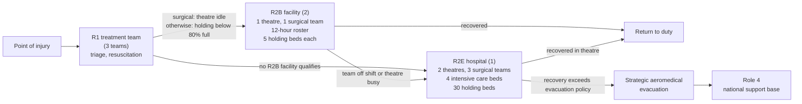

# Surgical Hours, Not Operating Theatres: Sizing the Land-Based Trauma System for Large Scale Combat Operations

## Abstract

<small>[Return to Top](#contents)</small>

**Background**

Casualty estimation is critical to the planning and design of the land-based trauma system deployed to support operations. Recent conflicts have produced lower casualty rates than those previously observed, or those expected in future large scale combat operations [[1]](#references), so a health system sized against recent experience is likely to not be adequate to handle the casualties of these more intense war fighting scenarios [[2]](#references).

**Objective**

To identify options to improve the land-based trauma system, to establish where that system fails as casualty intensity rises, and to state what the evidence supports for each lever a planner controls.

**Methods**

A discrete event simulation of a brigade force with aligned health assets was run at two casualty intensities derived from the FORECAS projection study [[3]](#references), a moderate intensity calibrated to the Falklands 1982 campaign and a high intensity calibrated to Okinawa 1945. Each lever the model can vary was then varied in a replicated experiment of 30 campaigns of 360 days. This paper reads those measurements as planning options. Every figure is quoted from the results paper [[4]](#references) and every experimental design is stated in the methods paper [[5]](#references).

**Results**

Wounded in action rise <!-- GEN cell:load_demand::Wounded in action/run::Ratio::mean -->3.61×<!-- /GEN --> from moderate to high intensity and first surgeries <!-- GEN cell:load_demand::R2B and R2E first surgeries/run::Ratio::mean -->3.01×<!-- /GEN -->. The R2E holding beds are full at both intensities, <!-- GEN cell:load_shortfall::R2E holding beds::Moderate: utilisation::mean -->99.6%<!-- /GEN --> and <!-- GEN cell:load_shortfall::R2E holding beds::High: utilisation::mean -->100.0%<!-- /GEN --> used, and the intensive care beds <!-- GEN cell:load_shortfall::R2E intensive care::Moderate: utilisation::mean -->86.8%<!-- /GEN --> and <!-- GEN cell:load_shortfall::R2E intensive care::High: utilisation::mean -->97.5%<!-- /GEN -->, and a casualty who finds no bed is cared for in overflow rather than queued ([Results](Results.md#demand-utilisation-and-shortfall-per-day)). At high intensity the R2E theatre queue settles at a standing queue of <!-- GEN cell:scenario_queue::R2E operating theatre::High intensity mean queue::mean -->72.616<!-- /GEN --> casualties, and a fourth R2E surgical section takes it to <!-- GEN cell:surgical_team_high::R2E theatre mean queue::R2E 4, R2B 1::mean -->9.82<!-- /GEN --> and deaths of wounds from <!-- GEN cell:surgical_team_high::Died of wounds::R2E 3, R2B 1 (shipped)::mean -->568.60<!-- /GEN --> to <!-- GEN cell:surgical_team_high::Died of wounds::R2E 4, R2B 1::mean -->308.70<!-- /GEN --> per run ([Results](Results.md#surgical-team-establishment)); the strategic evacuation backlog does not settle, growing by <!-- GEN cell:load_shortfall::Strategic evacuation backlog::High: shortfall per day::mean -->8.410<!-- /GEN --> a day ([Results](Results.md#demand-utilisation-and-shortfall-per-day)). The airlift backlog is the critical-care seats: demand on them is <!-- GEN cell:airlift_collapse_high::Critical, 0%::Mean utilisation::mean -->2.65<!-- /GEN --> times the places flown at high intensity and <!-- GEN cell:airlift_collapse::Critical, 0%::Mean utilisation::mean -->0.83<!-- /GEN --> at moderate, while the standard seats fly largely empty ([Results](Results.md#national-support-base-and-strategic-airlift)). At moderate intensity the shipped establishment largely holds: the airlift backlog grows slowly, by <!-- GEN cell:load_shortfall::Strategic evacuation backlog::Moderate: shortfall per day::mean -->0.057<!-- /GEN --> a day, and R2B surgery exports demand, routed past for <!-- GEN cell:adequacy_sizing::R2B surgery, moderate intensity::Shortfall per day::mean -->4.00<!-- /GEN --> casualties a day against <!-- GEN cell:adequacy_sizing::R2B surgery, moderate intensity::Delivered per day::mean -->2.29<!-- /GEN --> operations performed ([Results](Results.md#surgical-team-establishment)). Every combination of evacuation policy to 30 days and holding beds to 60 tested at moderate intensity holds the R2E pools, and 30 days at the shipped 30 beds returns <!-- GEN cell:policy_grid_largest_moderate::30::Paired gain over 21 d and 30 beds::full -->+298.1 [+248.7, +347.5]<!-- /GEN --> more casualties to duty ([Results](Results.md#moderate-intensity-evacuation-policy-and-holding-establishment)). At high intensity no combination of policy, holding beds and sortie interval tested holds them, the staging overflow growing in every one ([Results](Results.md#high-intensity-evacuation-policy-and-holding-establishment)).

**Conclusion**

The evidence supports acting now on the theatre evacuation policy, which can be lengthened to 30 days at the shipped establishment for moderate intensity, on the critical-care places the strategic airlift carries, and on the evacuation fleet. Surgical team hours, R2B holding beds, the pre-open hold window, the forward surgical saturation release and R2E intensive care beds are to be tested first, because their remedy is untested or their effect on outcomes unresolved. Moderate intensity needs margin in a few elements and a second forward surgical section. At high intensity the binding constraints are surgical hours at R2E, whose standing queue a fourth section shortens and with it the deaths of wounds, and critical-care airlift, and no establishment of beds or evacuation policy tested settles the system while the airlift backlog grows. Delivering post-operative intensive care forward is not supported, no forward holding arm resolving a change in deaths of wounds at high intensity and the arms moving in no consistent direction.

## Contents

<small>[Return to Top](#contents)</small>

<!-- TOC START -->
- [Abstract](#abstract)
- [Contents](#contents)
- [Introduction](#introduction)
- [The System and the Evidence Labels](#the-system-and-the-evidence-labels)
- [Where the Trauma System Fails First](#where-the-trauma-system-fails-first)
- [Is the System Adequate?](#is-the-system-adequate)
- [Every Lever, and What the Evidence Supports](#every-lever-and-what-the-evidence-supports)
- [Recommendations in Priority Order](#recommendations-in-priority-order)
  - [Act Now](#act-now)
    - [1. Hold the Evacuation Policy as a Decision and Configure the Airlift for Critical Care](#1-hold-the-evacuation-policy-as-a-decision-and-configure-the-airlift-for-critical-care)
    - [2. Size the Medical Evacuation Fleet at Three Ambulances, Four at High Intensity, and Four Trucks](#2-size-the-medical-evacuation-fleet-at-three-ambulances-four-at-high-intensity-and-four-trucks)
  - [Test First](#test-first)
    - [3. Extend Surgical Team Coverage Towards 24 Hours](#3-extend-surgical-team-coverage-towards-24-hours)
    - [4. Keep R2B Holding at Five Beds, the Forward Queue Being Clear](#4-keep-r2b-holding-at-five-beds-the-forward-queue-being-clear)
    - [5. Hold Casualties at R2B for a Team About to Return](#5-hold-casualties-at-r2b-for-a-team-about-to-return)
    - [6. Use the Forward Surgical Saturation Release Only Where the Base Can Absorb It](#6-use-the-forward-surgical-saturation-release-only-where-the-base-can-absorb-it)
    - [7. Raise R2E Intensive Care Beds Only Where Care Quality Is the Aim, Not Where the Pool Is Saturated](#7-raise-r2e-intensive-care-beds-only-where-care-quality-is-the-aim-not-where-the-pool-is-saturated)
  - [Planning for Moderate Intensity](#planning-for-moderate-intensity)
  - [Planning for High Intensity](#planning-for-high-intensity)
  - [Whether the Recommendations Hold at a Lower Priority 1 Share](#whether-the-recommendations-hold-at-a-lower-priority-1-share)
  - [What Resourcing Alone Does Not Fix, and What Is Not Supported](#what-resourcing-alone-does-not-fix-and-what-is-not-supported)
- [Effects the Simulation Could Not Resolve](#effects-the-simulation-could-not-resolve)
- [Research Agenda](#research-agenda)
- [Limitations](#limitations)
- [Conclusion](#conclusion)
- [References](#references)
<!-- TOC END -->

---

## Introduction

<small>[Return to Top](#contents)</small>

A planner designing a deployed health system faces a single problem with many parts: the system has to be sized before its deployment to support a campaign, against a casualty load nobody can know in advance. Optimising it means trading one part of the system against another, more surgical capacity against more holding beds, more evacuation lift against more in-theatre recovery, with a fixed establishment and a finite lift to move it.

Casualty volumes expected in large scale combat operations exceed those the deployed health systems of the past two decades were built around [[1]](#references), and planning assumptions carried forward from those operations understate both the volume and the acuity a peer fight would produce [[2]](#references). An establishment drawn from the last campaign is a baseline that may not transfer.

This paper reads the measurements of the results paper [[4]](#references) as planning options and states no measurement of its own. Every figure it quotes is regenerated from the tracked evidence, is tagged with the section of the results paper it comes from, and cannot differ from it. The experimental designs, the interval method and the replication counts are in the methods paper [[5]](#references). The first part below locates where the system fails as casualty intensity rises. The second gives a verdict on each element at each intensity and sizes the uplift where it is inadequate. The third sets every lever the simulation can evaluate in one table, with its cost and, for each intensity, its measurement and evidence label. The fourth turns the table into recommendations, split into those to act on now and those to test first, with a summary for planning against each intensity. The fifth states the effects the simulation could not resolve, and the sixth the research that would resolve them.

---

## The System and the Evidence Labels

<small>[Return to Top](#contents)</small>

The simulation is a discrete event model in which each casualty moves rearward through the echelons of allied medical support doctrine [[6]](#references): Role 1 (R1) primary care, R2B damage control surgery and short-term holding, R2E definitive surgery, intensive care and in-theatre recovery, and strategic aeromedical evacuation to a Role 4 national support base. The establishment is a combat brigade served by three R1 treatment teams, two R2B facilities and one R2E hospital. The system is described in full in the system reference [[7]](#references).

Not every finding rests on the same strength of evidence. Each lever therefore carries a label saying what its evidence supports. A label attaches to a particular claim, so a lever whose diagnosis is measured may still have a remedy that is untested.

| Label | Meaning |
|---|---|
| **Measured** | The effect is established. Direction and approximate size are both supported; where the effect is a paired difference, it survives Holm's adjustment across every comparison of its experiment at a family-wise level of 5% ([Methods: Interval Methods](Methods.md#interval-methods)). |
| **Direction only** | The effect points the way expected and the mechanism is confirmed, but its size is not established. |
| **Unresolved** | The available compute could not separate the effect from random variation, including a paired difference whose interval excludes zero but which fails Holm's adjustment. Figures are bounds, not estimates. |
| **Untested** | The simulation cannot evaluate the option as presently built. |

Two readings of the results paper govern every statement below. Where two intervals overlap the simulation has not established a difference, and the gap between the two averages should not be acted on. And the interval describes how precisely an average is known, not how much one campaign varies: the campaigns themselves spread many times more widely than the average is uncertain, so a system sized against the average under-provides for the campaign that arrives ([Results: scenario totals](Results.md#comparative-scenario-analysis)).

---

## Where the Trauma System Fails First

<small>[Return to Top](#contents)</small>

**As casualty intensity rises the R2E beds fill, a standing queue forms for the surgical teams, and the critical-care airlift falls behind.** Wounded in action rise <!-- GEN cell:load_demand::Wounded in action/run::Ratio::mean -->3.61×<!-- /GEN --> from moderate to high intensity and the first surgeries performed at R2B and R2E <!-- GEN cell:load_demand::R2B and R2E first surgeries/run::Ratio::mean -->3.01×<!-- /GEN -->, a floor on the rise in surgical demand because saturated theatres cap the operations performed ([Results: demand, utilisation and shortfall per day](Results.md#demand-utilisation-and-shortfall-per-day)). Over the closing 90 days the R2E theatres are in use <!-- GEN cell:load_shortfall::R2E operating theatres::Moderate: utilisation::full -->28.1% [26.8%, 29.5%]<!-- /GEN --> of the time at moderate intensity and <!-- GEN cell:load_shortfall::R2E operating theatres::High: utilisation::mean -->75.9%<!-- /GEN --> at high, the holding beds <!-- GEN cell:load_shortfall::R2E holding beds::Moderate: utilisation::full -->99.6% [99.4%, 99.7%]<!-- /GEN --> and <!-- GEN cell:load_shortfall::R2E holding beds::High: utilisation::mean -->100.0%<!-- /GEN -->, and the intensive care beds <!-- GEN cell:load_shortfall::R2E intensive care::Moderate: utilisation::full -->86.8% [86.0%, 87.6%]<!-- /GEN --> and <!-- GEN cell:load_shortfall::R2E intensive care::High: utilisation::mean -->97.5%<!-- /GEN -->. The beds do not fall behind, because a casualty who finds none free is cared for in overflow: the holding queue grows by <!-- GEN cell:load_shortfall::R2E holding beds::High: shortfall per day::full -->0.002 [−0.022, 0.027]<!-- /GEN --> casualties a day at high intensity and the post-operative overflow by <!-- GEN cell:load_shortfall::R2E post-operative overflow::High: shortfall per day::full -->−0.001 [−0.004, 0.002]<!-- /GEN -->, both intervals containing zero. Nor does the theatre queue, whose growth of <!-- GEN cell:load_shortfall::R2E operating theatres::High: shortfall per day::full -->0.014 [−0.151, 0.179]<!-- /GEN --> casualties a day also contains zero, but it settles with a casualty almost always waiting. What falls behind is the casualties awaiting airlift, the staging overflow growing by <!-- GEN cell:load_shortfall::R2E staging overflow::High: shortfall per day::full -->7.692 [7.514, 7.871]<!-- /GEN -->. A full bed pool is not a failing one, but every casualty in overflow is receiving a lesser standard of care, so the beds' shortfall is paid in care quality rather than in a queue. A ratio of closing-window queues between the intensities, such as <!-- GEN cell:scenario_queue::R2E operating theatre::Ratio::full -->75.09×<!-- /GEN --> for the theatres, measures how much longer the standing queue is at high intensity, not a rate at which it grows ([Results: comparative scenario analysis](Results.md#comparative-scenario-analysis)). **Evidence: measured.**

**Surgical team scheduling is the principal constraint.** A casualty takes an operating theatre before taking one of the surgical teams that staff it, so a theatre stands occupied while the casualty inside it waits for a team. The theatres are available around the clock and the teams work 12-hour shifts. Adding theatres would therefore not relieve a queue that measures a wait for people. The R2E theatre queue at moderate intensity averages <!-- GEN cell:scenario_queue::R2E operating theatre::Moderate intensity mean queue::mean -->0.967<!-- /GEN --> casualties, so the establishment is not comfortably adequate even at the lower rate ([Results: comparative scenario analysis](Results.md#comparative-scenario-analysis)). In the verified seed-42 campaign the single second-shift section carried the whole night-time surgical load and was busier and queued longer than the first-shift sections ([Results: Annex A](Results.md#annex-a-model-verification-of-one-seed-42-campaign)). **Evidence: measured.**

**The same shortfall takes a different form at each intensity.** At high intensity the R2E theatre queue stands empty for <!-- GEN cell:queue_clearance::R2E operating theatres::High: queue empty::mean -->7%<!-- /GEN --> of the campaign and its longest unbroken run above zero, in days with the interquartile range, is <!-- GEN cell:queue_clearance::R2E operating theatres::High: longest run above zero (days)::full -->132.4 (65.8–167.8)<!-- /GEN --> days; at moderate intensity it stands empty for <!-- GEN cell:queue_clearance::R2E operating theatres::Moderate: queue empty::mean -->85%<!-- /GEN --> and its longest run is <!-- GEN cell:queue_clearance::R2E operating theatres::Moderate: longest run above zero (days)::full -->4.3 (3.4–5.9)<!-- /GEN --> days ([Results: queue behaviour over the campaign](Results.md#queue-behaviour-over-the-campaign)). A queue that clears is a surge problem, answered by capability brought to bear on the heavy day and stood down afterwards. A queue that never clears is an establishment problem, and no surge capability reaches it because there is no trough to surge into. Surgical hours are therefore a standing measure at high intensity and a surge measure at moderate, and a force sized for one is not sized for the other. **Evidence: measured.**

**At high intensity the theatre queue settles at a standing level and the airlift backlog has none.** Over a 360-day campaign the R2E theatre queue is classified as <!-- GEN cell:long_horizon_stability::R2E operating theatre queue::High intensity::full -->converged at 71.0<!-- /GEN --> (a level, or for a drifting response the drift per 30-day block, then the first and last block means), while the staging overflow is classified <!-- GEN cell:long_horizon_stability::R2E staging overflow census::High intensity::full -->**drifting, +11.2%/block**, 117.7 to 2,739.6<!-- /GEN --> and the strategic evacuation backlog <!-- GEN cell:long_horizon_stability::Strategic evacuation backlog::High intensity::full -->**drifting, +11.6%/block**, 137.5 to 2,927.6<!-- /GEN -->, and the holding queue and the post-operative overflow converge. At moderate intensity the theatre and holding queues converge, while the post-operative overflow, the staging overflow and the airlift backlog drift slowly (<!-- GEN cell:long_horizon_stability::R2E post-operative overflow census::Moderate intensity::full -->converged at 5.54<!-- /GEN -->, <!-- GEN cell:long_horizon_stability::R2E staging overflow census::Moderate intensity::full -->converged at 30.1<!-- /GEN --> and <!-- GEN cell:long_horizon_stability::Strategic evacuation backlog::Moderate intensity::full -->**drifting, +4.3%/block**, 26.1 to 44.6<!-- /GEN -->) ([Results: sustained operations](Results.md#sustained-operations)). A high-intensity airlift figure is therefore a point on a growing backlog, and a moderate-intensity one a level still rising slowly at the end of a year. **Evidence: measured.**

**Intensive care is rationed rather than queued.** When R2E intensive care is full the simulation places an operated casualty in a holding bed, or in overflow when the holding beds are full too, and defers other casualties' surgery until a bed is free, so the shortfall appears as casualties receiving a lesser standard of care rather than as a queue. Over the closing 90 days a mean of <!-- GEN cell:scenario_queue::R2E post-operative overflow census::Moderate intensity mean queue::mean -->5.724<!-- /GEN --> operated casualties are cared for in post-operative overflow at moderate intensity and <!-- GEN cell:scenario_queue::R2E post-operative overflow census::High intensity mean queue::mean -->19.794<!-- /GEN --> at high, and the share of post-definitive care delivered in a holding bed is <!-- GEN cell:degraded_care::High intensity: Post-definitive care::Whole campaign::mean -->88.8%<!-- /GEN --> at high intensity against <!-- GEN cell:degraded_care::Moderate intensity: Post-definitive care::Whole campaign::mean -->65.0%<!-- /GEN --> at moderate ([Results: queue behaviour over the campaign](Results.md#queue-behaviour-over-the-campaign)). A rate that is a standing condition from the first week is answered only by the establishment, not by a reserve brought forward on particular days. **Evidence: measured.**

**A zero R2B theatre queue signals a shortfall being exported, not spare capacity.** The routing policy moves a casualty requiring surgery to R2E whenever the R2B theatre is occupied or its team is off shift beyond the pre-open window, so no queue can form there ([Results: comparative scenario analysis](Results.md#comparative-scenario-analysis)). Any measure of whether R2B is adequately resourced has to count what was sent rearward, not what waited.

---

## Is the System Adequate?

<small>[Return to Top](#contents)</small>

**Adequacy is a verdict for each element at each intensity, and the shipped establishment fails differently at the two.** Health planning sizes medical support against an assessed casualty load at each role, and the casualty estimates for large scale combat operations exceed the loads current establishments were built for [[1]](#references) [[2]](#references). The matrix below gives each element a verdict and the evidence behind it, produced from the tracked measurements so that a verdict cannot differ from its evidence. The criteria are stated in the [methods paper](Methods.md#adequacy-verdict-criteria). An adequate element has no sustained backlog and some headroom, which is not the same as no casualty waiting. Role 4 carries no verdict because the model sets the demand placed on the national support base and gives it no capacity.

<!-- GEN adequacy_matrix -->
| Element | Moderate intensity | High intensity |
|---|---|---|
| R1 | **Adequate**: longest R1 staff queue 0.00 | **Adequate**: longest R1 staff queue 0.00 |
| Shared transport fleets | **Marginal**: used 24.6%, mean queue 0.46 | **Inadequate**: used 51.1%, mean queue 1.76 |
| Integral evacuation elements | **Adequate**: used 13.9%, mean queue 0.12 | **Marginal**: used 41.6%, mean queue 0.62 |
| R2B surgery | **Inadequate**: 63.5% of casualties requiring surgery routed past, theatres used 10.1% | **Inadequate**: 74.3% of casualties requiring surgery routed past, theatres used 22.6% |
| R2B holding | **Adequate**: queue settled, used 79.1%, queue empty 94.0% | **Adequate**: queue settled, used 81.3%, queue empty 74.8% |
| R2E theatres and surgical teams | **Adequate**: queue settled, used 28.1%, queue empty 84.9% | **Marginal**: queue settled, used 75.9%, queue empty 7.8% |
| R2E intensive care | **Marginal**: overflow settled, used 86.8%, overflow empty 14.4% | **Marginal**: overflow settled, used 97.5%, overflow empty 0.6% |
| R2E holding | **Marginal**: queue settled, used 99.6%, queue empty 1.3% | **Marginal**: queue settled, used 100.0%, queue empty 0.7% |
| Strategic airlift | **Inadequate**: backlog drifting, +4.3%/block, late-half mean 39.4 awaiting a sortie | **Inadequate**: backlog drifting, +11.6%/block, late-half mean 2171.2 awaiting a sortie |
| Role 4 | **Not assessed**: demand only, peak census 209 beds | **Not assessed**: demand only, peak census 281 beds |
<!-- /GEN -->

**At moderate intensity the shipped establishment largely holds, except where it exports demand and where the airlift backlog rises slowly.** The theatre and holding queues and the post-operative overflow settle, though the holding and intensive care beds run nearly full, while the airlift backlog drifts upwards (the post-operative overflow <!-- GEN cell:long_horizon_stability::R2E post-operative overflow census::Moderate intensity::full -->converged at 5.54<!-- /GEN -->, the backlog <!-- GEN cell:long_horizon_stability::Strategic evacuation backlog::Moderate intensity::full -->**drifting, +4.3%/block**, 26.1 to 44.6<!-- /GEN -->) ([Results: sustained operations](Results.md#sustained-operations)), and the critical-care airlift seats carry <!-- GEN cell:airlift_collapse::Critical, 0%::Mean utilisation::mean -->0.83<!-- /GEN --> of their places, too little headroom to absorb a heavy week. R2B surgery is the exception. The routing policy sends a casualty rearward when the theatre is busy or its team is off shift, so the forward theatre never queues, and its shortfall appears as <!-- GEN cell:adequacy_sizing::R2B surgery, moderate intensity::Shortfall per day::mean -->4.00<!-- /GEN --> casualties a day routed past it against <!-- GEN cell:adequacy_sizing::R2B surgery, moderate intensity::Delivered per day::mean -->2.29<!-- /GEN --> operations performed there ([Results: demand, utilisation and shortfall per day](Results.md#demand-utilisation-and-shortfall-per-day)). A second surgical section per unit narrows the gap but does not close it: <!-- GEN cell:adequacy_sizing::R2B surgery, moderate intensity::Sweep evidence::full -->Measured: casualties routed past per run fall from 1,438 to 510 with a second section per unit<!-- /GEN --> ([Results: surgical team establishment](Results.md#surgical-team-establishment)). **Evidence: measured.**

**At high intensity R2B surgery and the strategic airlift are inadequate and the R2E theatres marginal, and the airlift is the one no lever tested recovers.** The R2E theatre queue does not grow but stands at <!-- GEN cell:scenario_queue::R2E operating theatre::High intensity mean queue::mean -->72.616<!-- /GEN --> casualties, empty <!-- GEN cell:queue_clearance::R2E operating theatres::High: queue empty::mean -->7%<!-- /GEN --> of the campaign, and the section sweep prices that standing queue: a fourth R2E section takes it to <!-- GEN cell:surgical_team_high::R2E theatre mean queue::R2E 4, R2B 1::mean -->9.82<!-- /GEN --> and deaths of wounds from <!-- GEN cell:surgical_team_high::Died of wounds::R2E 3, R2B 1 (shipped)::mean -->568.60<!-- /GEN --> to <!-- GEN cell:surgical_team_high::Died of wounds::R2E 4, R2B 1::mean -->308.70<!-- /GEN --> per run ([Results: surgical team establishment](Results.md#surgical-team-establishment)). The strategic evacuation backlog grows by <!-- GEN cell:adequacy_sizing::Strategic airlift, high intensity::Shortfall per day::mean -->8.41<!-- /GEN --> casualties a day against a sortie stream carrying <!-- GEN cell:adequacy_sizing::Strategic airlift, high intensity::Delivered per day::mean -->12.86<!-- /GEN --> a day, which prices at <!-- GEN cell:adequacy_sizing::Strategic airlift, high intensity::Estimated uplift::full -->0.7 extra sortie streams of one sortie per interval<!-- /GEN --> if every place were usable; the backlog is the critical-care seats, so the estimate understates the uplift in critical-care places, while the standard places fly part-empty ([Results: national support base and strategic airlift](Results.md#national-support-base-and-strategic-airlift)). **Evidence: measured.**

**The airlift shortfall is not recovered by the levers tested.** <!-- GEN cell:adequacy_sizing::Strategic airlift, high intensity::Sweep evidence::full -->Measured: in the sortie interval, policy and holding grid 0 of 12 cells hold the R2E pools<!-- /GEN -->, the staging overflow growing in every cell crossing the sortie interval, the evacuation policy and the holding establishment ([Results](Results.md#high-intensity-strategic-sortie-interval-by-policy-and-holding-establishment)). Even at a three-day interval the critical channel waits <!-- GEN cell:interval_grid_high_wait::3 d interval, 21 d policy, 30 beds::Mean wait, critical channel (days)::mean -->22.44<!-- /GEN --> days against <!-- GEN cell:interval_grid_high_wait::3 d interval, 21 d policy, 30 beds::Mean wait, standard channel (days)::mean -->1.51<!-- /GEN --> on the standard channel, so more frequent sorties of the same configuration add standard places that are not needed. **Evidence: measured; no setting tested recovers the airlift.**

<!-- GEN adequacy_sizing -->
| Case | Shortfall per day | Delivered per day | Estimated uplift | Sweep evidence |
|---|---|---|---|---|
| R2B surgery, moderate intensity | 4.00 | 2.29 | 174.4% of today's output | Measured: casualties routed past per run fall from 1,438 to 510 with a second section per unit |
| Strategic airlift, moderate intensity | 0.06 | 12.86 | 0.0 extra sortie streams of one sortie per interval | Measured: in the sortie interval, policy and holding grid 0 of 12 cells hold the R2E pools |
| Shared transport fleets, high intensity | not a growing backlog | not applicable | 4 ambulances | Measured: ambulance queue 1.76 at three vehicles and 0.59 at four |
| R2B surgery, high intensity | 14.45 | 4.99 | 289.7% of today's output | Measured: casualties routed past per run fall from 5,201 to 2,552 with a second section per unit |
| Strategic airlift, high intensity | 8.41 | 12.86 | 0.7 extra sortie streams of one sortie per interval | Measured: in the sortie interval, policy and holding grid 0 of 12 cells hold the R2E pools |
<!-- /GEN -->

**Planning for moderate intensity needs margin in a few elements and a second forward surgical section; planning for high intensity needs surgical hours and critical-care airlift that the levers tested do not supply.** A force sized for moderate intensity needs no uplift of the R2E theatres or holding beds, can lengthen its evacuation policy to 30 days without adding beds, should hold margin at the intensive care beds and the critical-care airlift seats, the beds running nearly full and the backlog behind the seats rising slowly, and should field a second surgical section per R2B unit if the routing gap matters. A force that must be sustained at high intensity can shorten the standing theatre queue, and the deaths of wounds that go with it, with a fourth R2E surgical section, but finds no combination of evacuation policy, holding beds and sortie interval that holds the R2E pools, because the staging overflow grows wherever the critical-care places are not added ([Results](Results.md#high-intensity-strategic-sortie-interval-by-policy-and-holding-establishment)). **Evidence: measured for the pools swept.**

---

## Every Lever, and What the Evidence Supports

<small>[Return to Top](#contents)</small>

Each row of the table is one lever a planner controls, with the setting the evidence supports, what it costs in personnel and principal equipment, and the measurement at each intensity with its own evidence label. Costs are the team compositions and counts of the shipped establishment in the [system reference](../README.md#health-teams); a bed or vehicle is a count and a section is the team named. The figures are quoted from the section of the results paper linked in the row.

| Lever | Setting supported | Cost | Moderate intensity | High intensity |
|---|---|---|---|---|
| Surgical team coverage at R2B and R2E | Towards 24 hours | R2E surgical section: 1 anaesthetist, 2 surgeons, 4 nurses; R2B surgical section: 1 anaesthetist, 2 surgeons, 1 medic; no added theatre | Theatre utilisation <!-- GEN cell:load_shortfall::R2E operating theatres::Moderate: utilisation::mean -->28.1%<!-- /GEN --> ([Results](Results.md#demand-utilisation-and-shortfall-per-day)). **Measured** for the diagnosis; the means of sourcing the hours **untested**. | Theatre utilisation <!-- GEN cell:load_shortfall::R2E operating theatres::High: utilisation::mean -->75.9%<!-- /GEN -->, with a standing queue of <!-- GEN cell:scenario_queue::R2E operating theatre::High intensity mean queue::mean -->72.616<!-- /GEN --> casualties ([Results](Results.md#comparative-scenario-analysis)); teams are the limit ([Results](Results.md#comparative-scenario-analysis)). **Measured** for the diagnosis; the means of sourcing the hours **untested**. |
| R2B holding beds per unit | Five, the shipped count | Five more beds per unit; a count of beds, staffing not modelled | Forward queue <!-- GEN cell:hold_threshold_beds::5 (shipped)::R2B hold mean queue::mean -->0.09<!-- /GEN --> at five beds and <!-- GEN cell:hold_threshold_beds::10::R2B hold mean queue::mean -->0.06<!-- /GEN --> at ten, with returns to duty <!-- GEN cell:hold_threshold_beds::5 (shipped)::Returns to duty::full -->2062 [2032, 2093]<!-- /GEN --> and <!-- GEN cell:hold_threshold_beds::10::Returns to duty::full -->2043 [2014, 2073]<!-- /GEN --> ([Results](Results.md#r2b-holding-capacity-and-evacuation-threshold)). **Measured**: no forward queue to relieve. | Forward queue <!-- GEN cell:hold_threshold_beds_high::5 (shipped)::R2B hold mean queue::mean -->0.34<!-- /GEN --> at five beds and <!-- GEN cell:hold_threshold_beds_high::10::R2B hold mean queue::mean -->0.41<!-- /GEN --> at ten, with returns to duty <!-- GEN cell:hold_threshold_beds_high::5 (shipped)::Returns to duty::full -->2862 [2824, 2900]<!-- /GEN --> and <!-- GEN cell:hold_threshold_beds_high::10::Returns to duty::full -->2839 [2807, 2871]<!-- /GEN --> ([Results](Results.md#r2b-holding-capacity-and-evacuation-threshold)). **Measured**: no forward queue to relieve. |
| R2B evacuation threshold | Not a remedy; it moves the queue, not the outcome | None; a command setting | One day loads the R2E holding queue to <!-- GEN cell:hold_threshold_threshold::1 day::R2E hold mean queue::mean -->26.460<!-- /GEN --> with returns to duty at <!-- GEN cell:hold_threshold_threshold::1 day::Returns to duty::full -->2055 [2022, 2088]<!-- /GEN --> against <!-- GEN cell:hold_threshold_threshold::Disabled (shipped)::Returns to duty::full -->2062 [2032, 2093]<!-- /GEN --> disabled ([Results](Results.md#r2b-holding-capacity-and-evacuation-threshold)). **Measured**. | A one-day threshold loads the R2E holding queue to <!-- GEN cell:hold_threshold_threshold_high::1 day::R2E hold mean queue::mean -->56.158<!-- /GEN --> ([Results](Results.md#r2b-holding-capacity-and-evacuation-threshold)). **Measured**. |
| R2B pre-open hold window | 60 minutes | None; a roster setting | <!-- GEN cell:hold_window::Casualties held at R2B::Window 60 min::mean -->106.57<!-- /GEN --> casualties held forward and off-shift diversions change by <!-- GEN cell:hold_window::Diverted, team off shift::Difference::mean -->−85.03<!-- /GEN --> ([Results](Results.md#r2b-pre-open-hold-window)). **Measured** forward; the downstream effect on R2E load is **unresolved**. | <!-- GEN cell:hold_window_high::Casualties held at R2B::Window 60 min::mean -->340.63<!-- /GEN --> casualties are held forward and off-shift diversions change by <!-- GEN cell:hold_window_high::Diverted, team off shift::Difference::mean -->−344.20<!-- /GEN --> ([Results](Results.md#r2b-pre-open-hold-window)). **Measured** forward; the downstream effect on R2E load is **unresolved**. |
| Ambulance fleet | Three; four at high intensity | One vehicle per step; a count of vehicles | Queue <!-- GEN cell:transport::1::Ambulance mean queue::mean -->7.6600<!-- /GEN --> at one vehicle, <!-- GEN cell:transport::3 (current ambulance)::Ambulance mean queue::mean -->0.4613<!-- /GEN --> at three ([Results](Results.md#transport-fleet-size)). **Measured**. | Queue <!-- GEN cell:transport_high::1::Ambulance mean queue::mean -->2080.6801<!-- /GEN --> at one vehicle, <!-- GEN cell:transport_high::3 (current ambulance)::Ambulance mean queue::mean -->1.7600<!-- /GEN --> at three ([Results](Results.md#transport-fleet-size)). **Measured**. |
| Truck fleet | Four | One vehicle per step; a count of vehicles | Queue <!-- GEN cell:transport::4 (current truck)::Truck mean queue::mean -->0.0008<!-- /GEN --> at four ([Results](Results.md#transport-fleet-size)). **Measured**. | Queue <!-- GEN cell:transport_high::4 (current truck)::Truck mean queue::mean -->0.0002<!-- /GEN --> at four ([Results](Results.md#transport-fleet-size)). **Measured**. |
| Idle transport and evacuation elements | Candidates for reallocating personnel | Frees personnel rather than costing them | R2E evacuation sections in use <!-- GEN cell:transport_holders::R2E evacuation sections::Moderate intensity utilisation::mean -->0.0%<!-- /GEN --> of the time, the HX2 40M fleet <!-- GEN cell:transport_holders::HX2 40M fleet::Moderate intensity utilisation::mean -->2.5%<!-- /GEN --> ([Results](Results.md#transport-fleet-size)). Utilisation **measured**; reallocation **untested**. | R2E evacuation sections in use <!-- GEN cell:transport_holders::R2E evacuation sections::High intensity utilisation::mean -->1.1%<!-- /GEN --> of the time, the HX2 40M fleet <!-- GEN cell:transport_holders::HX2 40M fleet::High intensity utilisation::mean -->5.7%<!-- /GEN --> ([Results](Results.md#transport-fleet-size)). Utilisation **measured**; reallocation **untested**. |
| Forward post-operative intensive care holding | Not supported; do not apply under sustained saturation | None added; uses R2B intensive care beds already established | Post-operative overflow <!-- GEN cell:forward_hold::Off (current)::R2E post-operative overflow census::mean -->5.72<!-- /GEN --> with none held forward and <!-- GEN cell:forward_hold::240 min::R2E post-operative overflow census::mean -->5.10<!-- /GEN --> at a 240-minute window ([Results](Results.md#forward-holding-of-post-operative-intensive-care)). **Unresolved**: no change separable from none. | Overflow <!-- GEN cell:forward_hold_high::Off (current)::R2E post-operative overflow census::mean -->19.79<!-- /GEN --> with none held forward and <!-- GEN cell:forward_hold_high::240 min + capacity::R2E post-operative overflow census::mean -->17.43<!-- /GEN --> with a 240-minute window and the capacity trigger, while deaths of wounds per run are <!-- GEN cell:forward_hold_high::Off (current)::Died of wounds per run::full -->568.60 [500.55, 636.65]<!-- /GEN --> with none held forward, <!-- GEN cell:forward_hold_high::240 min::Died of wounds per run::full -->573.00 [493.77, 652.23]<!-- /GEN --> at a 240-minute window and <!-- GEN cell:forward_hold_high::Capacity only::Died of wounds per run::full -->614.50 [565.71, 663.29]<!-- /GEN --> with the capacity trigger alone ([Results](Results.md#forward-holding-of-post-operative-intensive-care)). **Unresolved**: the arms move in no consistent direction, the intervals overlapping. |
| Intensive care rationing gate | Retain; its mortality effect is unresolved at both intensities | None; a rule applied to the R2E intensive care beds | R2E intensive care utilisation <!-- GEN cell:icu_gate::R2E ICU utilisation (%)::Without the rule::mean -->85.9<!-- /GEN -->% without the gate and <!-- GEN cell:icu_gate::R2E ICU utilisation (%)::With the rule::mean -->86.8<!-- /GEN -->% with it ([Results](Results.md#post-operative-intensive-care-gate)). Load **measured**; mortality **unresolved**. | Deaths of wounds per run differ by <!-- GEN cell:icu_gate_high::Died of wounds per run::Paired difference::full -->−29.33 [−138.46, +79.79]<!-- /GEN --> with the gate ([Results](Results.md#post-operative-intensive-care-gate)). **Unresolved**. |
| Theatre evacuation policy | 30 days at moderate intensity, read as a trade | None; a command decision traded against lift and Role 4 beds | Returns to duty rise from <!-- GEN cell:policy::Returns to duty::21 d (shipped)::mean -->2062.4<!-- /GEN --> at 21 days to <!-- GEN cell:policy::Returns to duty::30 d::mean -->2360.5<!-- /GEN --> at 30, with post-definitive intensive care access <!-- GEN cell:policy::Post-definitive ICU access (%)::21 d (shipped)::mean -->35.2<!-- /GEN -->% and <!-- GEN cell:policy::Post-definitive ICU access (%)::30 d::mean -->35.6<!-- /GEN -->% ([Results](Results.md#evacuation-policy)), and the pools hold at every policy to 30 days in the moderate-intensity grid ([Results](Results.md#moderate-intensity-evacuation-policy-and-holding-establishment)). **Measured**. | Measured only jointly with the holding establishment, in the grid below ([Results](Results.md#high-intensity-evacuation-policy-and-holding-establishment)). **Measured** jointly. |
| R2E holding beds | Shipped 30 | Fifteen to thirty more beds; a count of beds, staffing not modelled | Holding queue <!-- GEN cell:establishment::R2E hold mean queue::30 beds (shipped)::mean -->24.38<!-- /GEN --> at 30 beds and <!-- GEN cell:establishment::R2E hold mean queue::45 beds::mean -->18.71<!-- /GEN --> at 45 ([Results](Results.md#r2e-holding-establishment)), the pool holding at every establishment and policy in the moderate-intensity grid ([Results](Results.md#moderate-intensity-evacuation-policy-and-holding-establishment)). **Measured**. | Measured only jointly with the evacuation policy, in the grid below ([Results](Results.md#high-intensity-evacuation-policy-and-holding-establishment)). **Measured** jointly. |
| Evacuation policy and holding beds together | Moderate: 30 days at the shipped 30 beds; high: no setting holds the R2E pools | Up to 90 holding beds with a policy change | The largest policy holding the R2E pools is <!-- GEN cell:policy_grid_largest_moderate::30::Largest policy holding the R2E pools::full -->30 d<!-- /GEN --> at 30 beds, returning <!-- GEN cell:policy_grid_largest_moderate::30::Paired gain over 21 d and 30 beds::full -->+298.1 [+248.7, +347.5]<!-- /GEN --> more casualties to duty, and added beds buy <!-- GEN cell:policy_grid_largest_moderate::45::Gain per added bed::full -->+19.0<!-- /GEN --> and <!-- GEN cell:policy_grid_largest_moderate::60::Gain per added bed::full -->+8.9<!-- /GEN --> per bed at 45 and 60 ([Results](Results.md#moderate-intensity-evacuation-policy-and-holding-establishment)). **Measured**. | The shipped cell is classified <!-- GEN cell:policy_establishment_high_stability::21 d, 30 beds::R2E pools across the cell::full -->at least one growing<!-- /GEN -->, the staging overflow growing in <!-- GEN cell:policy_establishment_high_stability::21 d, 30 beds::Staging overflow not growing::full -->0 of 30<!-- /GEN --> replications not growing, and no cell holds ([Results](Results.md#high-intensity-evacuation-policy-and-holding-establishment)). The three-day interval with the 21-day policy and 60 beds cleared the holding queue to <!-- GEN cell:interval_grid_high::3 d interval, 21 d policy, 60 beds::R2E hold mean queue::mean -->42.6<!-- /GEN --> and was classified <!-- GEN cell:interval_grid_high::3 d interval, 21 d policy, 60 beds::Pools::full -->at least one growing<!-- /GEN --> ([Results](Results.md#high-intensity-strategic-sortie-interval-by-policy-and-holding-establishment)). **Measured**. |
| Forward surgical saturation release | Two, the shipped threshold, where the national support base can absorb it | None at the forward theatre; moves an operation to the national support base | Theatre queue <!-- GEN cell:saturation::Theatre mean queue::0 (disabled)::mean -->1.58<!-- /GEN --> disabled and <!-- GEN cell:saturation::Theatre mean queue::2 (shipped)::mean -->0.97<!-- /GEN --> at two ([Results](Results.md#forward-surgical-saturation-release)). **Measured** for queue and work moved; mortality **unresolved**. | Theatre queue <!-- GEN cell:saturation_high::Theatre mean queue::0 (disabled)::mean -->902.55<!-- /GEN --> disabled and <!-- GEN cell:saturation_high::Theatre mean queue::2 (shipped)::mean -->72.62<!-- /GEN --> at two, with <!-- GEN cell:saturation_high::Released with repair outstanding::2 (shipped)::mean -->1985.5<!-- /GEN --> casualties per campaign released with the repair outstanding, <!-- GEN cell:saturation_high::Released with repair outstanding::1::mean -->2026.2<!-- /GEN --> at a threshold of one and <!-- GEN cell:saturation_high::Released with repair outstanding::24::mean -->1729.0<!-- /GEN --> at 24, because the queue never falls below the threshold ([Results](Results.md#forward-surgical-saturation-release)). **Measured** for queue and work moved; mortality **unresolved**. |
| Strategic sortie interval | Seven days or shorter | Airlift sorties, not personnel; one sortie carries 90 casualties | Mean wait <!-- GEN cell:airlift_interval::Mean wait (days)::7 days (shipped)::mean -->4.90<!-- /GEN --> days at seven and <!-- GEN cell:airlift_interval::Mean wait (days)::14 days::mean -->41.63<!-- /GEN --> at fourteen ([Results](Results.md#national-support-base-and-strategic-airlift)). **Measured**. | Mean wait <!-- GEN cell:airlift_interval_high::Mean wait (days)::7 days (shipped)::mean -->53.69<!-- /GEN --> days at seven and <!-- GEN cell:airlift_interval_high::Mean wait (days)::3 days::mean -->15.55<!-- /GEN --> at three, and the share of R2E holding beds held by casualties awaiting airlift falls from <!-- GEN cell:airlift_interval_high::Share of R2E holding beds held by the evacuation wait::7 days (shipped)::mean -->8%<!-- /GEN --> at seven days to <!-- GEN cell:airlift_interval_high::Share of R2E holding beds held by the evacuation wait::3 days::mean -->2%<!-- /GEN --> at three ([Results](Results.md#national-support-base-and-strategic-airlift)). At three days with the 21-day policy and 30 beds the residual wait sits on the critical channel, at <!-- GEN cell:interval_grid_high_wait::3 d interval, 21 d policy, 30 beds::Mean wait, critical channel (days)::mean -->22.44<!-- /GEN --> days against <!-- GEN cell:interval_grid_high_wait::3 d interval, 21 d policy, 30 beds::Mean wait, standard channel (days)::mean -->1.51<!-- /GEN --> on the standard channel ([Results](Results.md#high-intensity-strategic-sortie-interval-by-policy-and-holding-establishment)). **Measured**. |
| Strategic sortie reliability | Losses of 10% or less | Airlift sorties, not personnel | The critical route collapses in <!-- GEN cell:airlift_collapse::Critical, 0%::Collapsed::full -->1 of 30<!-- /GEN --> campaigns with no loss and <!-- GEN cell:airlift_collapse::Critical, 15%::Collapsed::full -->7 of 30<!-- /GEN --> at 15%, its demand meeting the critical places flown in <!-- GEN cell:airlift_collapse::Critical, 15%::Demand at or above places flown::full -->11 of 30<!-- /GEN --> at 15% ([Results](Results.md#national-support-base-and-strategic-airlift)). **Measured**. | The critical route collapses in <!-- GEN cell:airlift_collapse_high::Critical, 0%::Collapsed::full -->30 of 30<!-- /GEN --> campaigns with no sortie loss, at a utilisation of <!-- GEN cell:airlift_collapse_high::Critical, 0%::Mean utilisation::mean -->2.65<!-- /GEN -->, and the mean wait rises from <!-- GEN cell:airlift_reliability_high::Mean wait (days)::0%::mean -->53.69<!-- /GEN --> days with none lost to <!-- GEN cell:airlift_reliability_high::Mean wait (days)::40%::mean -->80.98<!-- /GEN --> at 40% lost ([Results](Results.md#national-support-base-and-strategic-airlift)). **Measured**. |
| National support base bed demand | Plan it as a sustained load of the evacuation pipeline, not a casualty estimate | Not a lever; the demand the national support base must meet | Closing 90-day census <!-- GEN cell:role4_census_ward::Total, closing 90-day mean beds::Moderate intensity::mean -->150.38<!-- /GEN --> beds; <!-- GEN cell:role4_levers_policy::Role 4 closing 90-day mean beds::21 d (shipped)::mean -->121.8<!-- /GEN --> at the shipped policy against <!-- GEN cell:role4_levers_policy::Role 4 closing 90-day mean beds::30 d::mean -->113.1<!-- /GEN --> at 30 days ([Results](Results.md#role-4-bed-demand)). **Measured**. | Closing 90-day census <!-- GEN cell:role4_census_ward::Total, closing 90-day mean beds::High intensity::mean -->219.86<!-- /GEN --> beds ([Results](Results.md#role-4-bed-demand)). **Measured**. |
| Casualty surge event response | Policies to recover holding capacity | None; a stress test, remedies not yet specified | Event casualties die of wounds at <!-- GEN cell:casualty_surge::Died-of-wounds rate, event casualties::Events injected::mean -->2.41%<!-- /GEN --> against <!-- GEN cell:casualty_surge::Died-of-wounds rate, ordinary casualties::Events injected::mean -->1.31%<!-- /GEN --> for ordinary casualties ([Results](Results.md#casualty-surge-events)). Cost **measured**; remedies **untested**. | Event casualties die of wounds at <!-- GEN cell:casualty_surge_high::Died-of-wounds rate, event casualties::Events injected::mean -->16.12%<!-- /GEN --> ([Results](Results.md#casualty-surge-events)). Cost **measured**; remedies **untested**. |
| Casualty surge event size | Planning for larger incidents than the configured range | None; a stress test | The R2E theatre queue is the first pool to rise, peaking at <!-- GEN cell:casualty_surge_size::None::Peak R2E theatre queue::full -->33.7 ± 6.3<!-- /GEN --> with no events, <!-- GEN cell:casualty_surge_size::20::Peak R2E theatre queue::full -->39.7 ± 9.8<!-- /GEN --> at 20 casualties per event and <!-- GEN cell:casualty_surge_size::40::Peak R2E theatre queue::full -->57.9 ± 6.1<!-- /GEN --> at 40, while the post-operative overflow moves from <!-- GEN cell:casualty_surge_size::None::Peak R2E post-operative overflow census::full -->27.1 ± 0.8<!-- /GEN --> to <!-- GEN cell:casualty_surge_size::40::Peak R2E post-operative overflow census::full -->30.6 ± 0.5<!-- /GEN -->; the theatre queue reached <!-- GEN cell:casualty_surge_size::180::Peak R2E theatre queue::full -->2134.1 ± 217.2<!-- /GEN --> at 180 casualties ([Results](Results.md#casualty-surge-event-size)). Cost **measured**; remedies **untested**; the size range is **informed estimate**. | At 20 casualties per event the peak post-operative overflow was <!-- GEN cell:casualty_surge_size_high::20::Peak R2E post-operative overflow census::full -->31.5 ± 0.6<!-- /GEN -->, against <!-- GEN cell:casualty_surge_size_high::None::Peak R2E post-operative overflow census::full -->31.9 ± 0.5<!-- /GEN --> with no events ([Results](Results.md#casualty-surge-event-size)). Cost **measured**; remedies **untested**. |
| Surgical section count at R2B and R2E | A second R2B section per unit; a fourth R2E section at high intensity | R2E surgical section: 1 anaesthetist, 2 surgeons, 4 nurses; R2B surgical section: 1 anaesthetist, 2 surgeons, 1 medic | At moderate intensity the shipped establishment is already <!-- GEN cell:surgical_team::R2E theatre queue, late-half classification::R2E 3, R2B 1 (shipped)::full -->converged at 0.90<!-- /GEN --> ([Results](Results.md#surgical-team-establishment)). **Measured**. | The R2E theatre queue shortfall per day falls from <!-- GEN cell:surgical_team_high::R2E theatre queue shortfall per day::R2E 3, R2B 1 (shipped)::full -->0.014 [−0.151, 0.179]<!-- /GEN --> at the shipped establishment to <!-- GEN cell:surgical_team_high::R2E theatre queue shortfall per day::R2E 4, R2B 1::full -->0.003 [−0.016, 0.022]<!-- /GEN --> with a fourth R2E section and <!-- GEN cell:surgical_team_high::R2E theatre queue shortfall per day::R2E 4, R2B 2::full -->−0.007 [−0.017, 0.003]<!-- /GEN --> with a fourth R2E section and a second R2B section, the queue settling in every arm, from <!-- GEN cell:surgical_team_high::R2E theatre mean queue::R2E 3, R2B 1 (shipped)::mean -->72.62<!-- /GEN --> casualties at the shipped establishment to <!-- GEN cell:surgical_team_high::R2E theatre mean queue::R2E 4, R2B 1::mean -->9.82<!-- /GEN --> with a fourth R2E section, and deaths of wounds changing by <!-- GEN cell:surgical_team_paired_high::Died of wounds::R2E 4, R2B 1::full -->−259.90 [−330.91, −188.89]<!-- /GEN --> ([Results](Results.md#surgical-team-establishment)). **Measured**. |
| R2E intensive care beds | Twelve where care quality is the aim; no count is a remedy for a pool that is not falling behind | Beds as a count; the model attaches no staff to the beds, an R2E intensive care section being 1 intensivist and 4 nurses | Twelve beds take post-definitive care in an intensive care bed from <!-- GEN cell:icu_bed::Post-definitive ICU access (%)::4 beds (shipped)::mean -->35.2<!-- /GEN --> to <!-- GEN cell:icu_bed::Post-definitive ICU access (%)::12 beds::mean -->78.6<!-- /GEN --> percent with no resolved change in deaths of wounds (<!-- GEN cell:icu_bed_paired::Died of wounds::12 beds::full -->−0.67 [−4.95, +3.62]<!-- /GEN -->) ([Results](Results.md#r2e-intensive-care-bed-establishment)). **Measured** for the care pathway; outcomes **unresolved**. | Sixteen beds take the post-operative overflow from <!-- GEN cell:icu_bed_high::R2E post-operative overflow census::4 beds (shipped)::mean -->19.79<!-- /GEN --> to <!-- GEN cell:icu_bed_high::R2E post-operative overflow census::16 beds::mean -->11.66<!-- /GEN -->, settled at every count, and the paired differences in deaths of wounds do not move consistently with the count, <!-- GEN cell:icu_bed_paired_high::Died of wounds::6 beds::full -->+23.80 [−67.86, +115.46]<!-- /GEN --> at six beds and <!-- GEN cell:icu_bed_paired_high::Died of wounds::16 beds::full -->+49.17 [−57.08, +155.41]<!-- /GEN --> at sixteen ([Results](Results.md#r2e-intensive-care-bed-establishment)). **Measured** for the pathway; outcomes **unresolved**. |
| Casualty acuity (the Priority 1 share of the triage split) | Not a lever; the assumption every establishment above is sized against | None; a planning assumption, set at sixty-five per cent on informed estimate | At a share of fifteen per cent against sixty-five per cent the critical airlift backlog changes by <!-- GEN cell:triage_split_paired::Critical airlift backlog at the close::P1 15%::full -->−25.5 [−35.0, −16.0]<!-- /GEN -->, the R2E holding queue by <!-- GEN cell:triage_split_paired::R2E holding mean queue::P1 15%::full -->+16.81 [+14.19, +19.43]<!-- /GEN --> and returns to duty by <!-- GEN cell:triage_split_paired::Returns to duty::P1 15%::full -->+565.4 [+510.9, +619.8]<!-- /GEN -->, and the slow drift of the overflow behind the beds is absent below the shipped share ([Results](Results.md#priority-1-triage-share)). **Measured**. | Deaths of wounds per run fall from <!-- GEN cell:triage_split_high::Died of wounds::P1 65% (shipped)::mean -->568.60<!-- /GEN --> to <!-- GEN cell:triage_split_high::Died of wounds::P1 15%::mean -->167.57<!-- /GEN --> and the R2E theatre queue from <!-- GEN cell:triage_split_high::R2E theatre mean queue::P1 65% (shipped)::mean -->72.62<!-- /GEN --> to <!-- GEN cell:triage_split_high::R2E theatre mean queue::P1 15%::mean -->15.31<!-- /GEN -->, while the R2E holding queue rises from <!-- GEN cell:triage_split_high::R2E holding mean queue::P1 65% (shipped)::mean -->54.06<!-- /GEN --> to <!-- GEN cell:triage_split_high::R2E holding mean queue::P1 15%::mean -->117.62<!-- /GEN --> and the staging overflow drifts at every share ([Results](Results.md#priority-1-triage-share)). **Measured**. |

---

## Recommendations in Priority Order

<small>[Return to Top](#contents)</small>

**Recommendations are split by whether the remedy is measured, and ranked within each group by how directly the measured effect improves the health outcome of the force.** Act now holds the levers whose effect is measured and resolved against a comparator. Test first holds the levers whose diagnosis is measured but whose remedy is untested or whose effect on outcomes is unresolved. Within a group a lever that moves returns to duty, deaths of wounds or access to intensive care ranks above one that moves only a queue, and a lever addressing the principal constraint ranks above one better measured but acting where the system is not failing.

### Act Now

#### 1. Hold the Evacuation Policy as a Decision and Configure the Airlift for Critical Care
**The theatre evacuation policy is a command decision with a price at each setting, and at moderate intensity the shipped establishment carries a 30-day policy without saturating.** Doctrine names it the theatre patient return policy, a command decision balancing each casualty's needs against keeping enough treatment and evacuation capacity available to the force [[6]](#references) (para. 1.55), so the table gives the price of each setting rather than a single answer. Returns to duty, deaths of wounds, the realised in-theatre share, R2E occupancy, post-definitive intensive care access, the casualties never evacuated by the horizon and the Role 4 peak beds are measured for each policy ([Results: evacuation policy](Results.md#evacuation-policy)).

<!-- GEN policy_trade -->
| Response | 15 d | 21 d (shipped) | 30 d | 45 d | 60 d |
|---|---|---|---|---|---|
| Returns to duty | 1560.3 [1535.6, 1585.1] | 2062.4 [2031.8, 2093.0] | 2360.5 [2318.5, 2402.5] | 2673.6 [2642.7, 2704.6] | 3039.8 [2997.9, 3081.7] |
| Died of wounds | 21.93 [19.39, 24.47] | 21.17 [17.55, 24.79] | 22.03 [18.14, 25.93] | 19.47 [17.17, 21.76] | 19.97 [17.28, 22.65] |
| In-theatre share (%) | 27.1 [26.6, 27.5] | 40.2 [39.8, 40.7] | 49.0 [48.4, 49.5] | 59.3 [58.8, 59.8] | 71.1 [70.7, 71.5] |
| R2E hold occupancy (%) | 96.5 [96.0, 97.1] | 99.6 [99.4, 99.7] | 99.9 [99.9, 100.0] | 100.0 [100.0, 100.0] | 100.0 [100.0, 100.0] |
| R2E ICU occupancy (%) | 86.6 [86.1, 87.1] | 86.8 [86.0, 87.6] | 87.1 [85.9, 88.2] | 86.4 [85.6, 87.2] | 86.6 [85.8, 87.3] |
| Post-definitive ICU access (%) | 35.5 [34.7, 36.2] | 35.2 [34.6, 35.9] | 35.6 [34.7, 36.5] | 35.8 [35.1, 36.5] | 35.8 [35.0, 36.5] |
| Never evacuated by horizon | 41.8 [30.6, 53.0] | 36.3 [27.0, 45.6] | 39.1 [29.2, 49.0] | 19.6 [14.9, 24.4] | 13.2 [10.0, 16.4] |
| Role 4 peak beds | 229.9 [224.9, 234.9] | 209.2 [205.2, 213.2] | 194.6 [190.2, 199.0] | 176.4 [172.0, 180.8] | 155.1 [149.4, 160.8] |
<!-- /GEN -->

**Under the shipped configuration every policy to 30 days holds the R2E pools at every establishment tested, so more beds are not the price of a longer policy.** The largest policy holding the pools is <!-- GEN cell:policy_grid_largest_moderate::30::Largest policy holding the R2E pools::full -->30 d<!-- /GEN --> at 30 beds, <!-- GEN cell:policy_grid_largest_moderate::45::Largest policy holding the R2E pools::full -->30 d<!-- /GEN --> at 45 and <!-- GEN cell:policy_grid_largest_moderate::60::Largest policy holding the R2E pools::full -->30 d<!-- /GEN --> at 60, the longest the grid tests. Returns to duty rise by <!-- GEN cell:policy_grid_largest_moderate::30::Paired gain over 21 d and 30 beds::full -->+298.1 [+248.7, +347.5]<!-- /GEN --> over the shipped setting at 30 days and 30 beds and by <!-- GEN cell:policy_grid_largest_moderate::60::Paired gain over 21 d and 30 beds::full -->+265.8 [+226.3, +305.3]<!-- /GEN --> at 30 days and 60 beds ([Results](Results.md#moderate-intensity-evacuation-policy-and-holding-establishment)), so the added beds buy little; the holding queue rises with the policy and settles at a higher level rather than growing.

Reading the table at the shipped 30 beds without a preferred setting, returns to duty rise from <!-- GEN cell:policy::Returns to duty::15 d::mean -->1560.3<!-- /GEN --> at 15 days through <!-- GEN cell:policy::Returns to duty::21 d (shipped)::mean -->2062.4<!-- /GEN --> at 21 to <!-- GEN cell:policy::Returns to duty::30 d::mean -->2360.5<!-- /GEN --> at 30 and <!-- GEN cell:policy::Returns to duty::60 d::mean -->3039.8<!-- /GEN --> at 60, while the R2E holding beds are full from 21 days (<!-- GEN cell:policy::R2E hold occupancy (%)::21 d (shipped)::mean -->99.6<!-- /GEN -->% occupancy) and post-definitive intensive care access does not move (<!-- GEN cell:policy::Post-definitive ICU access (%)::21 d (shipped)::mean -->35.2<!-- /GEN -->% at 21 days, <!-- GEN cell:policy::Post-definitive ICU access (%)::60 d::mean -->35.8<!-- /GEN -->% at 60). Against the historical range of in-theatre retention the realised share is admissible only for 21 and 30 days, a 15-day policy retaining <!-- GEN cell:policy::In-theatre share (%)::15 d::mean -->27.1<!-- /GEN -->% and a 45-day policy <!-- GEN cell:policy::In-theatre share (%)::45 d::mean -->59.3<!-- /GEN -->%. Longer policies reduce the demand on the national support base, from <!-- GEN cell:policy::Role 4 peak beds::21 d (shipped)::mean -->209.2<!-- /GEN --> peak beds at 21 days to <!-- GEN cell:policy::Role 4 peak beds::60 d::mean -->155.1<!-- /GEN --> at 60, and no policy's difference in deaths of wounds against 21 days is resolved ([Results: resolution of paired differences](Results.md#resolution-of-paired-differences)). Whether a 45 or 60-day policy holds the pools at moderate intensity is not tested by the grid, which stops at 30 days. **Evidence: measured.**

**Strategic airlift is limited by its critical-care places, not by how many sorties fly.** A sortie carries a fixed split of critical-care and standard places, and demand falls almost entirely on the first: at the shipped schedule critical-care demand is <!-- GEN cell:airlift_collapse::Critical, 0%::Mean utilisation::mean -->0.83<!-- /GEN --> of the critical places flown at moderate intensity, against <!-- GEN cell:airlift_collapse::Standard, 0%::Mean utilisation::mean -->0.30<!-- /GEN --> of the standard places, and <!-- GEN cell:airlift_collapse_high::Critical, 0%::Mean utilisation::mean -->2.65<!-- /GEN --> times the critical places at high intensity ([Results: national support base and strategic airlift](Results.md#national-support-base-and-strategic-airlift)). The critical route collapses in <!-- GEN cell:airlift_collapse::Critical, 0%::Collapsed::full -->1 of 30<!-- /GEN --> moderate-intensity campaigns with no sortie lost, <!-- GEN cell:airlift_collapse::Critical, 15%::Collapsed::full -->7 of 30<!-- /GEN --> at 15% and <!-- GEN cell:airlift_collapse::Critical, 25%::Collapsed::full -->12 of 30<!-- /GEN --> at 25%, demand meeting the critical places flown in <!-- GEN cell:airlift_collapse::Critical, 15%::Demand at or above places flown::full -->11 of 30<!-- /GEN --> campaigns at 15%, while the standard route collapses at no loss tested. Lengthening the interval degrades the wait the same way: <!-- GEN cell:airlift_interval::Mean wait (days)::7 days (shipped)::mean -->4.90<!-- /GEN --> days at seven and <!-- GEN cell:airlift_interval::Mean wait (days)::14 days::mean -->41.63<!-- /GEN --> at fourteen. At high intensity a three-day interval shortens the mean wait from <!-- GEN cell:airlift_interval_high::Mean wait (days)::7 days (shipped)::mean -->53.69<!-- /GEN --> to <!-- GEN cell:airlift_interval_high::Mean wait (days)::3 days::mean -->15.55<!-- /GEN --> days but leaves the critical channel waiting <!-- GEN cell:interval_grid_high_wait::3 d interval, 21 d policy, 30 beds::Mean wait, critical channel (days)::mean -->22.44<!-- /GEN --> days against <!-- GEN cell:interval_grid_high_wait::3 d interval, 21 d policy, 30 beds::Mean wait, standard channel (days)::mean -->1.51<!-- /GEN --> on the standard channel ([Results](Results.md#high-intensity-strategic-sortie-interval-by-policy-and-holding-establishment)). The lever a planner needs is the share of each airframe configured for critical care, or more critical-care places per sortie, which the model does not yet sweep. A critical casualty waiting for a seat is held in a holding bed or in overflow at the post-operative intensive care death rate, so the deaths the wait causes in the model are a floor. **Evidence: measured for the airlift; the critical-place lever untested.**

**Demand on the national support base is a sustained level, not a terminal surge.** Over a 360-day campaign the Role 4 census rises to a plateau, with a peak of <!-- GEN cell:airlift_baseline::Role 4 peak occupancy (concurrent patients)::Moderate intensity::mean -->209.23<!-- /GEN --> concurrent patients at moderate intensity and <!-- GEN cell:airlift_baseline::Role 4 peak occupancy (concurrent patients)::High intensity::mean -->281.30<!-- /GEN --> at high, because sortie capacity caps what reaches the base ([Results: national support base and strategic airlift](Results.md#national-support-base-and-strategic-airlift)). A demand signal for the base should therefore be derived from the theatre's evacuation pipeline, in particular its sortie capacity, rather than from a casualty estimate, and phased as a sustained load. The wait also consumes clinical capacity: the evacuation wait holds <!-- GEN cell:airlift_baseline::Share of R2E holding beds held by the evacuation wait::Moderate intensity::mean -->10%<!-- /GEN --> of the R2E holding beds at moderate intensity and <!-- GEN cell:airlift_baseline::Share of R2E holding beds held by the evacuation wait::High intensity::mean -->8%<!-- /GEN --> at high, so a lever that delays a sortie propagates into intensive care. The census itself is measured in [Results: Role 4 bed demand](Results.md#role-4-bed-demand). Over the closing 90 days it averages <!-- GEN cell:role4_census_ward::Total, closing 90-day mean beds::Moderate intensity::mean -->150.38<!-- /GEN --> beds at moderate intensity and <!-- GEN cell:role4_census_ward::Total, closing 90-day mean beds::High intensity::mean -->219.86<!-- /GEN --> at high, of which the step-down ward carries <!-- GEN cell:role4_census_ward::Step-down ward phase, closing 90-day mean beds::Moderate intensity::mean -->114.64<!-- /GEN --> and <!-- GEN cell:role4_census_ward::Step-down ward phase, closing 90-day mean beds::High intensity::mean -->176.14<!-- /GEN -->, so a planner sizing the base for the intensive care phase alone would size it for a minority of the beds. Only the evacuation policy moves the census materially: the closing mean is <!-- GEN cell:role4_levers_policy::Role 4 closing 90-day mean beds::21 d (shipped)::mean -->121.8<!-- /GEN --> at the shipped 21 days and <!-- GEN cell:role4_levers_policy::Role 4 closing 90-day mean beds::30 d::mean -->113.1<!-- /GEN --> at 30, which is the base's side of the same trade the policy makes forward. The R2E holding establishment leaves it within its interval, and the saturation release moves the operations the base owes rather than its beds. **Evidence: measured.**

#### 2. Size the Medical Evacuation Fleet at Three Ambulances, Four at High Intensity, and Four Trucks

**Three ambulances carry the inter-echelon load between R1, R2B and R2E at moderate intensity, and four at high.** The ambulance queue collapses between one and two vehicles and flattens from three, from <!-- GEN cell:transport::1::Ambulance mean queue::mean -->7.6600<!-- /GEN --> at one to <!-- GEN cell:transport::2::Ambulance mean queue::mean -->1.5242<!-- /GEN --> at two and <!-- GEN cell:transport::3 (current ambulance)::Ambulance mean queue::mean -->0.4613<!-- /GEN --> at three, and nothing is bought beyond the third vehicle ([Results: transport fleet size](Results.md#transport-fleet-size)). At high intensity one vehicle queues at <!-- GEN cell:transport_high::1::Ambulance mean queue::mean -->2080.6801<!-- /GEN --> and three at <!-- GEN cell:transport_high::3 (current ambulance)::Ambulance mean queue::mean -->1.7600<!-- /GEN -->, a queue the adequacy criteria rate inadequate, and a fourth ambulance takes it to <!-- GEN cell:transport_high::4 (current truck)::Ambulance mean queue::mean -->0.5873<!-- /GEN -->, so a force planning against high intensity fields four ([Results: transport fleet size](Results.md#transport-fleet-size)). Some of the transport capacity stands largely idle, which points to personnel that could be reallocated though the reallocation is untested: the R2E evacuation sections, which are integral to the facility, are in use <!-- GEN cell:transport_holders::R2E evacuation sections::Moderate intensity utilisation::mean -->0.0%<!-- /GEN --> of the time at moderate intensity and <!-- GEN cell:transport_holders::R2E evacuation sections::High intensity utilisation::mean -->1.1%<!-- /GEN --> at high, and the shared HX2 40M truck fleet <!-- GEN cell:transport_holders::HX2 40M fleet::Moderate intensity utilisation::mean -->2.5%<!-- /GEN --> and <!-- GEN cell:transport_holders::HX2 40M fleet::High intensity utilisation::mean -->5.7%<!-- /GEN --> ([Results: transport fleet size](Results.md#transport-fleet-size)). These are the ambulances that move casualties between echelons, not those integral to the combat force that move casualties from the point of injury to R1. **Evidence: measured.**

### Test First

#### 3. Extend Surgical Team Coverage Towards 24 Hours

**Surgical team hours are the capacity to add, at both R2B and R2E, and the theatres to use them already exist.** **Evidence for the diagnosis: measured. Evidence for the effect of added sections: measured. Evidence for the best means of sourcing the hours: untested.**

At R2B each of the two facilities fields one surgical team on a 12-hour shift against a theatre available around the clock, so for half of each day the theatre stands ready with nobody rostered to operate in it. In the verified seed-42 campaign most casualties diverted from R2B to R2E were diverted because the team was off shift rather than because the theatre was busy ([Results: Annex A](Results.md#annex-a-model-verification-of-one-seed-42-campaign)). Prehospital transport to a surgical facility within 60 minutes was among the interventions associated with the fall in case fatality across the Afghanistan and Iraq conflicts [[8]](#references), so a casualty who travels further to reach a surgeon because none is rostered is a clinical cost rather than an administrative one. Extending coverage needs no additional principal equipment. It does need provision in the operational viability period, the organisational design and the workforce model, which are the instruments through which the hours would have to be found.

Whether the hours are a standing establishment or a surge measure depends on the intensity planned for. At high intensity the hours must be permanently established, because the queue has almost no trough; at moderate intensity they can be held as a capability brought to bear on the heavy day. The surgical section sweep prices the addition in sections ([Results: surgical team establishment](Results.md#surgical-team-establishment)). At high intensity the R2E theatre queue shortfall per day was <!-- GEN cell:surgical_team_high::R2E theatre queue shortfall per day::R2E 3, R2B 1 (shipped)::full -->0.014 [−0.151, 0.179]<!-- /GEN --> at the shipped establishment, <!-- GEN cell:surgical_team_high::R2E theatre queue shortfall per day::R2E 4, R2B 1::full -->0.003 [−0.016, 0.022]<!-- /GEN --> with a fourth R2E section and <!-- GEN cell:surgical_team_high::R2E theatre queue shortfall per day::R2E 6, R2B 1::full -->0.006 [−0.009, 0.022]<!-- /GEN --> with a sixth, every arm converging, so the sections act on the level of the standing queue rather than on its growth: a fourth R2E section takes the mean queue from <!-- GEN cell:surgical_team_high::R2E theatre mean queue::R2E 3, R2B 1 (shipped)::mean -->72.62<!-- /GEN --> to <!-- GEN cell:surgical_team_high::R2E theatre mean queue::R2E 4, R2B 1::mean -->9.82<!-- /GEN --> casualties; with a second R2B section as well it leaves <!-- GEN cell:surgical_team_high::R2E theatre queue shortfall per day::R2E 4, R2B 2::full -->−0.007 [−0.017, 0.003]<!-- /GEN --> per day, and the paired difference in deaths of wounds for the fourth R2E section was <!-- GEN cell:surgical_team_paired_high::Died of wounds::R2E 4, R2B 1::full -->−259.90 [−330.91, −188.89]<!-- /GEN -->. A second R2B section removed the cases diverted for a closed section (<!-- GEN cell:surgical_team::Diverted, team off shift::R2E 3, R2B 2::full -->0.0 [0.0, 0.0]<!-- /GEN --> at moderate intensity, against <!-- GEN cell:surgical_team::Diverted, team off shift::R2E 3, R2B 1 (shipped)::full -->1201.5 [1178.8, 1224.3]<!-- /GEN --> at the shipped establishment) and the paired difference in deaths of wounds at moderate intensity was <!-- GEN cell:surgical_team_paired::Died of wounds::R2E 3, R2B 2::full -->−1.40 [−5.46, +2.66]<!-- /GEN -->. How to source the sections is a separate question that the simulation does not answer, since extending the rostered teams' hours and fielding additional teams deliver coverage at different costs in personnel, sustainment and clinical risk.

#### 4. Keep R2B Holding at Five Beds, the Forward Queue Being Clear

**R2B holding no longer limits the forward system, so neither more beds nor an evacuation threshold has a queue to relieve.** The R2B holding queue carries <!-- GEN cell:scenario_queue::R2B holding beds::Moderate intensity mean queue::mean -->0.090<!-- /GEN --> casualties waiting at moderate intensity against <!-- GEN cell:scenario_queue::R2E operating theatre::Moderate intensity mean queue::mean -->0.967<!-- /GEN --> at the R2E theatres ([Results: comparative scenario analysis](Results.md#comparative-scenario-analysis)), a casualty finding no forward bed being placed in reception overflow rather than queued. Raising the establishment from five to ten beds per unit leaves the forward queue at <!-- GEN cell:hold_threshold_beds::10::R2B hold mean queue::full -->0.06 [0.00, 0.11]<!-- /GEN --> against <!-- GEN cell:hold_threshold_beds::5 (shipped)::R2B hold mean queue::full -->0.09 [0.05, 0.13]<!-- /GEN -->, with returns to duty <!-- GEN cell:hold_threshold_beds::5 (shipped)::Returns to duty::full -->2062 [2032, 2093]<!-- /GEN --> at five beds and <!-- GEN cell:hold_threshold_beds::10::Returns to duty::full -->2043 [2014, 2073]<!-- /GEN --> at ten ([Results: R2B holding capacity and evacuation threshold](Results.md#r2b-holding-capacity-and-evacuation-threshold)). A one-day evacuation threshold moves casualties rearward early and loads the R2E holding queue to <!-- GEN cell:hold_threshold_threshold::1 day::R2E hold mean queue::mean -->26.460<!-- /GEN -->, without a resolved change in returns to duty. **Evidence: measured.**

#### 5. Hold Casualties at R2B for a Team About to Return

**A 60-minute pre-open window keeps a meaningful number of casualties forward, cuts diversions caused by the team being off shift and raises R2B surgery, and whether it reduces the surgical load reaching R2E is not established.** The window held <!-- GEN cell:hold_window::Casualties held at R2B::Window 60 min::mean -->106.57<!-- /GEN --> casualties per campaign at R2B against none with a zero window, off-shift diversions changed by <!-- GEN cell:hold_window::Diverted, team off shift::Difference::full -->−85.03 [−120.67, −49.40]<!-- /GEN --> and R2B surgeries by <!-- GEN cell:hold_window::R2B surgeries::Difference::full -->+49.57 [+32.67, +66.47]<!-- /GEN -->, all three intervals clear of zero ([Results: R2B pre-open hold window](Results.md#r2b-pre-open-hold-window)). R2E first surgeries changed by <!-- GEN cell:hold_window::R2E first surgeries::Difference::full -->−18.00 [−75.22, +39.22]<!-- /GEN -->, an interval wide enough to contain both no change and a substantial fall, and the replications needed to settle it are in [Effects the Simulation Could Not Resolve](#effects-the-simulation-could-not-resolve). Mortality is unchanged between the arms within the resolution available, which is an absence of evidence rather than evidence of safety. **Evidence: measured on casualties held, diversions avoided and R2B surgeries gained; unresolved on R2E load and mortality.**

#### 6. Use the Forward Surgical Saturation Release Only Where the Base Can Absorb It

**Releasing casualties to strategic evacuation with the definitive repair outstanding, once the forward theatre queue reaches a threshold, cuts the R2E theatre queue and moves the operation to the national support base.** The theatre queue falls from <!-- GEN cell:saturation::Theatre mean queue::0 (disabled)::full -->1.58 [0.97, 2.19]<!-- /GEN --> with the release disabled to <!-- GEN cell:saturation::Theatre mean queue::2 (shipped)::full -->0.97 [0.63, 1.31]<!-- /GEN --> at the shipped threshold of two, and the cost is paid elsewhere: <!-- GEN cell:saturation::Released with repair outstanding::2 (shipped)::mean -->131.0<!-- /GEN --> casualties per campaign reach the base unrepaired and the base owes <!-- GEN cell:saturation::Role 4 operations owed::2 (shipped)::mean -->1216.3<!-- /GEN --> operations against <!-- GEN cell:saturation::Role 4 operations owed::0 (disabled)::mean -->1077.2<!-- /GEN --> without the release ([Results: forward surgical saturation release](Results.md#forward-surgical-saturation-release)). Post-definitive intensive care access moves from <!-- GEN cell:saturation::Post-definitive ICU access (%)::0 (disabled)::mean -->34.7<!-- /GEN -->% to <!-- GEN cell:saturation::Post-definitive ICU access (%)::2 (shipped)::mean -->35.2<!-- /GEN -->%. The relief decays smoothly as the threshold rises, so the choice is where on a continuum to sit, and no threshold's difference in deaths of wounds against the disabled release is resolved. The lever trades a forward queue for work the simulation reports but does not constrain at the national support base, so whether it is worth using depends on a capacity the model does not represent. Under high intensity the lever relieves the theatre queue much more, from <!-- GEN cell:saturation_high::Theatre mean queue::0 (disabled)::mean -->902.55<!-- /GEN --> with the release disabled to <!-- GEN cell:saturation_high::Theatre mean queue::2 (shipped)::mean -->72.62<!-- /GEN --> at the shipped threshold, but it is insensitive to the threshold because the queue never falls below it: <!-- GEN cell:saturation_high::Released with repair outstanding::2 (shipped)::mean -->1985.5<!-- /GEN --> casualties per campaign are released with the repair outstanding at a threshold of two, <!-- GEN cell:saturation_high::Released with repair outstanding::1::mean -->2026.2<!-- /GEN --> at one and <!-- GEN cell:saturation_high::Released with repair outstanding::24::mean -->1729.0<!-- /GEN --> at 24, and the base owes <!-- GEN cell:saturation_high::Role 4 operations owed::2 (shipped)::mean -->2049.9<!-- /GEN --> operations against <!-- GEN cell:saturation_high::Role 4 operations owed::0 (disabled)::mean -->1308.8<!-- /GEN --> without the release ([Results: forward surgical saturation release](Results.md#forward-surgical-saturation-release)). Choosing the threshold therefore buys nothing at high intensity, and the decision is whether to release at all. **Evidence: measured for the queue, the releases and the work moved; unresolved for mortality at both intensities.**

#### 7. Raise R2E Intensive Care Beds Only Where Care Quality Is the Aim, Not Where the Pool Is Saturated

**More R2E intensive care beds move post-operative and post-definitive care out of holding beds and overflow, but no count changes an outcome the model resolves.** **Evidence for the care pathway: measured. Evidence for outcomes: unresolved.**

At moderate intensity the shipped four beds take <!-- GEN cell:icu_bed::Post-definitive ICU access (%)::4 beds (shipped)::mean -->35.2<!-- /GEN --> percent of post-definitive care and leave <!-- GEN cell:icu_bed::Post-operative care in a holding bed (%)::4 beds (shipped)::mean -->36.5<!-- /GEN --> percent of post-operative care in a holding bed, against <!-- GEN cell:icu_bed::Post-definitive ICU access (%)::12 beds::mean -->78.6<!-- /GEN --> and <!-- GEN cell:icu_bed::Post-operative care in a holding bed (%)::12 beds::mean -->13.6<!-- /GEN --> percent at twelve beds ([Results: R2E intensive care bed establishment](Results.md#r2e-intensive-care-bed-establishment)). The paired differences in deaths of wounds and returns to duty at twelve beds were <!-- GEN cell:icu_bed_paired::Died of wounds::12 beds::full -->−0.67 [−4.95, +3.62]<!-- /GEN --> and <!-- GEN cell:icu_bed_paired::Returns to duty::12 beds::full -->−17.3 [−60.1, +25.6]<!-- /GEN -->, so the model does not resolve a gain in outcome from the move, which rests on an informed-estimate holding-bed penalty rather than on a measured one. Twelve beds at the shipped three sections of four nurses is <!-- GEN cell:icu_bed::Nurses per ICU bed at three sections::12 beds::mean -->1.00<!-- /GEN --> nurse per bed against <!-- GEN cell:icu_bed::Nurses per ICU bed at three sections::4 beds (shipped)::mean -->3.00<!-- /GEN --> at the shipped establishment, a staffing cost the model does not charge. At high intensity sixteen beds take the post-operative overflow from <!-- GEN cell:icu_bed_high::R2E post-operative overflow census::4 beds (shipped)::mean -->19.79<!-- /GEN --> to <!-- GEN cell:icu_bed_high::R2E post-operative overflow census::16 beds::mean -->11.66<!-- /GEN --> casualties, and the paired difference in deaths of wounds moves without a consistent direction across the counts, <!-- GEN cell:icu_bed_paired_high::Died of wounds::6 beds::full -->+23.80 [−67.86, +115.46]<!-- /GEN --> at six beds and <!-- GEN cell:icu_bed_paired_high::Died of wounds::16 beds::full -->+49.17 [−57.08, +155.41]<!-- /GEN --> at sixteen, the arms drawing different casualty streams.

### Planning for Moderate Intensity

**Planning against moderate intensity, act on the policy, airlift and fleet recommendations and hold the surgical hours as a capability brought to bear on the heavy day.** At moderate intensity the R2E theatre queue stands empty for <!-- GEN cell:queue_clearance::R2E operating theatres::Moderate: queue empty::mean -->85%<!-- /GEN --> of the campaign, so the shortfall is a surge problem, and the shipped establishment is already <!-- GEN cell:surgical_team::R2E theatre queue, late-half classification::R2E 3, R2B 1 (shipped)::full -->converged at 0.90<!-- /GEN --> ([Results: surgical team establishment](Results.md#surgical-team-establishment)). A second R2B surgical section per unit removes the cases diverted for a closed section (<!-- GEN cell:surgical_team::Diverted, team off shift::R2E 3, R2B 2::full -->0.0 [0.0, 0.0]<!-- /GEN --> against <!-- GEN cell:surgical_team::Diverted, team off shift::R2E 3, R2B 1 (shipped)::full -->1201.5 [1178.8, 1224.3]<!-- /GEN --> per run), a 30-day evacuation policy at the shipped 30 beds returns <!-- GEN cell:policy_grid_largest_moderate::30::Paired gain over 21 d and 30 beds::full -->+298.1 [+248.7, +347.5]<!-- /GEN --> more casualties to duty with the R2E pools held ([Results](Results.md#moderate-intensity-evacuation-policy-and-holding-establishment)), and twelve intensive care beds raise post-definitive care in an intensive care bed from <!-- GEN cell:icu_bed::Post-definitive ICU access (%)::4 beds (shipped)::mean -->35.2<!-- /GEN -->% to <!-- GEN cell:icu_bed::Post-definitive ICU access (%)::12 beds::mean -->78.6<!-- /GEN -->%, with outcomes unresolved ([Results: R2E intensive care bed establishment](Results.md#r2e-intensive-care-bed-establishment)). **Evidence: measured for the pathway, unresolved for outcomes.**

### Planning for High Intensity

**Planning against high intensity, add R2E surgical hours and critical-care airlift places; no establishment of beds or evacuation policy settles the system while the airlift backlog grows.** The R2E theatre queue stands empty for <!-- GEN cell:queue_clearance::R2E operating theatres::High: queue empty::mean -->7%<!-- /GEN --> of the campaign and is classified <!-- GEN cell:long_horizon_stability::R2E operating theatre queue::High intensity::full -->converged at 71.0<!-- /GEN --> ([Results: sustained operations](Results.md#sustained-operations)), and a fourth R2E section shortens it to <!-- GEN cell:surgical_team_high::R2E theatre mean queue::R2E 4, R2B 1::mean -->9.82<!-- /GEN --> casualties, with deaths of wounds changing by <!-- GEN cell:surgical_team_paired_high::Died of wounds::R2E 4, R2B 1::full -->−259.90 [−330.91, −188.89]<!-- /GEN --> per run ([Results: surgical team establishment](Results.md#surgical-team-establishment)). The critical-care airlift collapses in <!-- GEN cell:airlift_collapse_high::Critical, 0%::Collapsed::full -->30 of 30<!-- /GEN --> campaigns with no sortie lost ([Results: national support base and strategic airlift](Results.md#national-support-base-and-strategic-airlift)), and a shorter interval does not recover it. Forward holding is the lever to withhold, no forward arm resolving a change in deaths of wounds; the rationing gate's effect is unresolved, at <!-- GEN cell:icu_gate_high::Died of wounds per run::Paired difference::full -->−29.33 [−138.46, +79.79]<!-- /GEN --> deaths of wounds per run ([Results: the post-operative intensive care gate](Results.md#post-operative-intensive-care-gate)). Every high-intensity mortality figure here describes a force that adds neither surgical nor airlift capacity over the year ([Limitations](#limitations)). **Evidence: measured.**

### Whether the Recommendations Hold at a Lower Priority 1 Share

**The surgical and intensive care recommendations hold across the Priority 1 shares swept, the airlift recommendation holds in amount but not in kind, and the holding establishment is the one requirement a lower share raises.** The shipped share of sixty-five per cent is an informed estimate well above the comparators the system reference cites, and every capacity finding above was measured at it. Lowering it to fifteen per cent at high intensity shortens the R2E theatre queue from <!-- GEN cell:triage_split_high::R2E theatre mean queue::P1 65% (shipped)::mean -->72.62<!-- /GEN --> to <!-- GEN cell:triage_split_high::R2E theatre mean queue::P1 15%::mean -->15.31<!-- /GEN --> casualties without clearing it, and leaves the post-operative overflow at <!-- GEN cell:triage_split_high::R2E post-operative overflow census::P1 15%::mean -->17.50<!-- /GEN --> against <!-- GEN cell:triage_split_high::R2E post-operative overflow census::P1 65% (shipped)::mean -->19.79<!-- /GEN -->, so surgical hours and intensive care remain the forward constraints at every share; at moderate intensity the theatre queue stays below one casualty at every share. A second R2B section remains worth testing, the diversions for a closed section changing by only <!-- GEN cell:triage_split_paired::Diverted from R2B, team off shift::P1 15%::full -->−136.6 [−174.2, −99.1]<!-- /GEN --> at moderate intensity. The airlift is different in kind: at fifteen per cent the critical backlog falls from <!-- GEN cell:triage_split_high::Critical airlift backlog at the close::P1 65% (shipped)::mean -->3022.2<!-- /GEN --> to <!-- GEN cell:triage_split_high::Critical airlift backlog at the close::P1 15%::mean -->26.9<!-- /GEN --> while the staging overflow still drifts, at <!-- GEN cell:triage_split_high::R2E staging overflow, late-half classification::P1 15%::full -->**drifting, +11.6%/block**, 68.2 to 1,163.5<!-- /GEN -->, so at high intensity the sortie stream falls short at every share and only which places bind moves with acuity. Configuring the airframe for critical care is therefore the remedy at the shipped share alone, and the number of places is the remedy at every share. The R2E holding queue moves the other way, from <!-- GEN cell:triage_split::R2E holding mean queue::P1 65% (shipped)::mean -->24.38<!-- /GEN --> to <!-- GEN cell:triage_split::R2E holding mean queue::P1 15%::mean -->41.18<!-- /GEN --> at moderate intensity and from <!-- GEN cell:triage_split_high::R2E holding mean queue::P1 65% (shipped)::mean -->54.06<!-- /GEN --> to <!-- GEN cell:triage_split_high::R2E holding mean queue::P1 15%::mean -->117.62<!-- /GEN --> at high, because a less acute force retains more casualties in theatre to convalesce, so a holding establishment sized at the shipped share under-provides for a less acute campaign. The ambulance fleet was not measured in this sweep. Deaths of wounds also scale with the assumption: the treated-cohort rate at moderate intensity is <!-- GEN cell:triage_split::Treated-cohort died-of-wounds rate::P1 65% (shipped)::full -->0.514% [0.428%, 0.600%]<!-- /GEN --> at the shipped share and <!-- GEN cell:triage_split::Treated-cohort died-of-wounds rate::P1 15%::full -->0.407% [0.297%, 0.517%]<!-- /GEN --> at fifteen per cent, so a mortality figure in this paper is a figure at the shipped acuity ([Results: Priority 1 triage share](Results.md#priority-1-triage-share)). **Evidence: measured.**

### What Resourcing Alone Does Not Fix, and What Is Not Supported

**Forward holding is not supported on the present evidence.** Holding operated casualties forward at R2B does not measurably relieve R2E intensive care at moderate intensity: forward utilisation rises across the windows because the policy is being applied, while the post-operative overflow at R2E is not separable from the arm with none held forward ([Results: forward holding](Results.md#forward-holding-of-post-operative-intensive-care)). At high intensity no forward arm resolves a change in deaths of wounds per run, and the arms move in no consistent direction: <!-- GEN cell:forward_hold_high::Off (current)::Died of wounds per run::full -->568.60 [500.55, 636.65]<!-- /GEN --> with none held forward, <!-- GEN cell:forward_hold_high::240 min::Died of wounds per run::full -->573.00 [493.77, 652.23]<!-- /GEN --> at a 240-minute window, <!-- GEN cell:forward_hold_high::1,440 min::Died of wounds per run::full -->573.03 [504.20, 641.86]<!-- /GEN --> at 1,440 minutes and <!-- GEN cell:forward_hold_high::Capacity only::Died of wounds per run::full -->614.50 [565.71, 663.29]<!-- /GEN --> with the capacity trigger alone, every interval overlapping ([Results: forward holding](Results.md#forward-holding-of-post-operative-intensive-care)). **Evidence: unresolved at both intensities.** Enlarging the R2E holding pool alone is a different matter: the residual queue of <!-- GEN cell:establishment::R2E hold mean queue::30 beds (shipped)::mean -->24.38<!-- /GEN --> at 30 beds is <!-- GEN cell:establishment::R2E hold mean queue::45 beds::mean -->18.71<!-- /GEN --> at 45 ([Results: R2E holding establishment](Results.md#r2e-holding-establishment)), a settled queue at both, so the beds buy a shorter wait for a holding bed rather than stability. **Evidence: measured.**

**Do not apply forward holding under sustained saturation, and treat the rationing gate as unresolved.** At high intensity the rationing gate changes deaths of wounds by <!-- GEN cell:icu_gate_high::Died of wounds per run::Paired difference::full -->−29.33 [−138.46, +79.79]<!-- /GEN --> per run, an interval that contains zero ([Results: post-operative intensive care gate](Results.md#post-operative-intensive-care-gate)), and forward holding resolves no change. Both effects arise partly from the relative mortality penalties the model applies to a casualty held outside a full intensive care bed (`r2b_icu_penalty` and `r2e_postop_hold_penalty`), which are informed estimates, so their direction is set inside the model rather than discovered by it. **Evidence: unresolved, and set partly inside the model.**

**Three conditions are properties of the design, not of any resource level.** First, the intensive care rationing gate relieves load, from <!-- GEN cell:icu_gate::R2E ICU utilisation (%)::Without the rule::mean -->85.9<!-- /GEN -->% utilisation without it to <!-- GEN cell:icu_gate::R2E ICU utilisation (%)::With the rule::mean -->86.8<!-- /GEN -->% with it, and at moderate intensity its mortality cost is not established ([Results: post-operative intensive care gate](Results.md#post-operative-intensive-care-gate)). The casualties recovering in a holding bed and in an intensive care bed die at rates the pathway counts do not separate, <!-- GEN cell:icu_gate_pathways::Holding bed::Rate::mean -->0.37%<!-- /GEN --> against <!-- GEN cell:icu_gate_pathways::Intensive care bed::Rate::mean -->0.45%<!-- /GEN -->, the holding-bed rate resting on a handful of deaths, and any difference the model shows between them is built into it rather than discovered by it. Second, a casualty surge event degrades care without exposing a new constraint: event casualties die of wounds at <!-- GEN cell:casualty_surge::Died-of-wounds rate, event casualties::Events injected::mean -->2.41%<!-- /GEN --> against <!-- GEN cell:casualty_surge::Died-of-wounds rate, ordinary casualties::Events injected::mean -->1.31%<!-- /GEN --> for ordinary casualties in the same campaigns, and the events also raise the ordinary rate from <!-- GEN cell:casualty_surge::Died-of-wounds rate, ordinary casualties::No events injected::mean -->0.39%<!-- /GEN --> to <!-- GEN cell:casualty_surge::Died-of-wounds rate, ordinary casualties::Events injected::mean -->1.31%<!-- /GEN --> ([Results: casualty surge events](Results.md#casualty-surge-events)). The theatre is the first pool to move: the peak R2E theatre queue rises from <!-- GEN cell:casualty_surge_size::None::Peak R2E theatre queue::full -->33.7 ± 6.3<!-- /GEN --> with no events to <!-- GEN cell:casualty_surge_size::20::Peak R2E theatre queue::full -->39.7 ± 9.8<!-- /GEN --> at 20 casualties per event and <!-- GEN cell:casualty_surge_size::40::Peak R2E theatre queue::full -->57.9 ± 6.1<!-- /GEN --> at 40, while the post-operative overflow moves from <!-- GEN cell:casualty_surge_size::None::Peak R2E post-operative overflow census::full -->27.1 ± 0.8<!-- /GEN --> to <!-- GEN cell:casualty_surge_size::40::Peak R2E post-operative overflow census::full -->30.6 ± 0.5<!-- /GEN --> ([Results: casualty surge event size](Results.md#casualty-surge-event-size)). Policies to recover holding capacity during an event are untested. Third, the high-intensity airlift backlog drifts without a level, so no establishment drawn from a high-intensity closing-window figure of it is a steady-state sizing ([Results: sustained operations](Results.md#sustained-operations)).

---

## Effects the Simulation Could Not Resolve

<small>[Return to Top](#contents)</small>

**Several effects could not be separated from random variation within the compute available, and are unmeasured rather than small.** A comparison is resolved where its interval excludes zero and it survives Holm's adjustment across every comparison of its experiment ([Methods: Interval Methods](Methods.md#interval-methods)); it is then read as a measured effect where its lever is discussed and does not appear here, while one whose interval excludes zero but which fails the adjustment stays here with its adjusted $p$-value. The distinction decides whether acting on them is sound. The table gives each paired difference with its interval, its Holm-adjusted $p$-value, the half-width the experiment sought, and the replications that half-width would need, regenerated from the tracked paired differences ([Results: resolution of paired differences](Results.md#resolution-of-paired-differences)).

<!-- GEN resolution -->
| Comparison | Paired difference | Holm-adjusted p | Half-width sought | Replications needed |
|---|---|---|---|---|
| Hold window, R2E first surgeries | −18.00 [−75.22, +39.22] | 1.000 | 2.0 | 22,554 |
| Hold window, R2E theatre entry deferred | −1.97 [−17.60, +13.66] | 1.000 | 1.0 | 6,732 |
| Hold window, diverted for a busy theatre | +22.40 [+1.70, +43.10] | 0.175 | 2.0 | 2,953 |
| Hold window, died of wounds | +1.90 [−2.11, +5.91] | 1.000 | 0.5 | 1,771 |
| Intensive care gate, died of wounds | −0.20 [−5.03, +4.63] | 1.000 | 0.5 | 2,570 |
| Policy 15 days against 21, died of wounds | +0.77 [−3.65, +5.18] | 1.000 | 1.0 | 537 |
| Policy 45 days against 21, died of wounds | −1.70 [−6.29, +2.89] | 1.000 | 1.0 | 581 |
| Policy 60 days against 21, died of wounds | −1.20 [−6.07, +3.67] | 1.000 | 1.0 | 653 |
| Saturation release at 2, died of wounds | −2.33 [−9.73, +5.06] | 1.000 | 1.0 | 1,506 |
| Saturation release at 2, returns to duty | +13.67 [−34.40, +61.74] | 1.000 | 10.0 | 637 |
<!-- /GEN -->

Three kinds of limit separate them. The hold window's downstream effects on R2E load are limited by the stream divergence between its arms, which grows with the campaign length, so lengthening the campaign did not resolve them and the replication counts above are far beyond what any horizon change buys. The mortality differences of the intensive care gate, the evacuation policy and the saturation release are limited by the rarity of the event: deaths of wounds at moderate intensity are rare enough that no realistic number of replications would separate two groups of a few dozen casualties, so answering them needs a different measure of harm. Forward holding is limited by the spread of the R2E queue across replications, and needs a test at high intensity as well as more replications.

---

## Research Agenda

<small>[Return to Top](#contents)</small>

**The development priorities follow from the levers the simulation cannot yet evaluate or resolve.** Each item below names the decision it would unblock.

| Priority | Development | Decision it unblocks |
|---|---|---|
| 1 | Cost surgical sections in personnel and sustainment, and sweep the R2E theatre count beside the section count | Whether the sections that shorten the high-intensity standing queue are affordable, and whether a third theatre is then needed |
| 2 | Sweep the critical-care places per sortie beside the sortie interval at both intensities, and model a critical casualty's deterioration while awaiting airlift | Whether configuring the airlift for critical care stabilises the casualties awaiting evacuation, the binding constraint at high intensity and the thin margin at moderate, and how many deaths the wait causes |
| 3 | Re-run the unresolved experiments at the replication counts the resolution table states | The hold window's effect on R2E load, and the cost of rationing and of the release |
| 4 | Sweep the R2B diversion thresholds across their range | Where to strike the trade between waiting forward and transferring load rearward |
| 5 | Test policies for recovering holding capacity during a casualty surge event, and the triggers for applying them | How to relieve the reversal of the intensive care and holding pathways under surge |
| 6 | Casualty severity conditioning of surgery durations | Whether theatre contention is understated on the heavy days it is measured on |
| 7 | A global screen with common random numbers and a design sized to the replication noise, and a sizing of the R2E establishment against the level its queues reach under a defined surge | Whether parameters interact in ways the one-lever sweeps cannot detect, and whether an informed estimate not yet swept could move a finding ([system reference](../README.md#further-development)) |
| 8 | Model clinicians individually rather than as whole teams ([system reference](../README.md#further-development)) | Whether team-level seizure overstates the scarcity of surgical and intensive care staff, and which role binds first |

Alongside these, the simulated system's design and calibration would benefit from structured review by clinical and health planning subject matter experts. The parameters governing intensive care rationing and post-operative risk are informed estimates rather than measured values, and expert calibration would do more to improve confidence in the mortality findings than additional computation.

---

## Limitations

<small>[Return to Top](#contents)</small>

Five limitations bear on how the recommendations above should be read.

**The simulation is verified but not validated.** It behaves as its specification describes, which is a separate question from whether that specification represents the real trauma system well [[9]](#references). Verification is reported in [Annex A of the results paper](Results.md#annex-a-model-verification-of-one-seed-42-campaign). The treated-cohort died-of-wounds rates are reported in [Results](Results.md#treated-cohort-mortality) at each anchor's horizon and at 360 days: the shipped configuration's rate is <!-- GEN cell:dow_calibration::Shipped default::Rate at the anchor's horizon::full -->0.421% [0.350%, 0.492%]<!-- /GEN --> at the 30 days its Ajax Bay anchor describes and <!-- GEN cell:dow_calibration::Shipped default::Rate at 360 days::full -->0.541% [0.453%, 0.629%]<!-- /GEN --> at 360 days, because under a model in which every hour of delay carries risk a longer campaign accumulates more of it. Every lever above is a lever inside the simulation, and holds only as far as the simulation does.

**Compute time limited what could be measured.** The effects in the resolution table are unresolved for that reason, for the rarity of the event, or because they fail the Holm adjustment that guards against reading one chance difference in twenty as real, and the replication counts that would settle them are stated there. This constrains the precision of the findings rather than their direction, and it bears hardest on mortality, which is the rarest quantity the simulation reports.

**Comparisons between two configurations are not controlled.** Changing a setting alters the sequence of random draws, so the two arms of a comparison generate different casualty streams and cannot be matched campaign for campaign; their responses are uncorrelated within replication ([Methods: Pairing Arms on a Control Seed](Methods.md#pairing-arms-on-a-control-seed)). The effect is a loss of precision rather than a bias, which is why several comparisons are unresolved at the replication counts used. The casualty intensity comparison is unaffected, its arms differing by design rather than by a small perturbation.

**The high-intensity airlift figures measure a backlog still growing, not a level.** The sustained-horizon measurement shows the casualties awaiting airlift still growing at the end of a year, and at moderate intensity rising slowly ([Results: sustained operations](Results.md#sustained-operations)), so no airlift figure is a steady-state figure. Nothing recommended here depends on that level, the conclusion drawn being that the backlog does not clear. The high-intensity theatre queue, by contrast, settles at a standing level.

**High intensity is a projection of a force that does not adapt.** The establishment, the surgical roster and the weekly airlift stay as configured however far demand outruns them, with no expectant category, no surgical reinforcement and no airlift added (README Further Development L45). The surgical and evacuation queues therefore keep building, deaths of wounds per day are classified <!-- GEN cell:long_horizon_stability::Deaths of wounds per day::High intensity::full -->**drifting, +5.1%/block**, 0.5 to 2.2<!-- /GEN -->, and the treated-cohort rate is <!-- GEN cell:dow_calibration::High intensity::Rate at the anchor's horizon::full -->2.905% [2.681%, 3.128%]<!-- /GEN --> at the 82 days of the Okinawa anchor against <!-- GEN cell:dow_calibration::High intensity::Rate at 360 days::full -->5.692% [5.088%, 6.295%]<!-- /GEN --> at 360 days ([Results: treated-cohort mortality](Results.md#treated-cohort-mortality); [sustained operations](Results.md#sustained-operations)). A high-intensity mortality figure is the cost of a year without adapting, not the expected outcome of a high-intensity campaign; the surgical section and sortie interval sweeps measure what two forms of adaptation buy ([Results: surgical team establishment](Results.md#surgical-team-establishment)).

**The risk of waiting for airlift is understated.** A critical casualty awaiting a seat is held in a holding bed, or in overflow when none is free, at the death rate of post-operative intensive care, for however long the wait lasts. At high intensity those waits run to months, and a Priority 1 surgical casualty held that long would in reality deteriorate or need further surgery, so the deaths of wounds the airlift shortfall causes in the model are a floor: <!-- GEN cell:scenario_totals::Died of wounds/run::High intensity::mean -->568.60<!-- /GEN --> per run at high intensity against <!-- GEN cell:scenario_totals::Died of wounds/run::Moderate intensity::mean -->21.17<!-- /GEN --> at moderate ([Results](Results.md#comparative-scenario-analysis)). No open source gives the hazard of that situation.

Two narrower caveats apply. Clinical teams are taken whole rather than by individual clinician, so team utilisation overstates scarcity where a procedure needs only part of a team; and one pool of R2E holding beds carries both in-theatre recovery and the strategic evacuation wait, so those queue figures combine two demands. The model's gaps are catalogued in the system reference [[7]](#references).

---

## Conclusion

<small>[Return to Top](#contents)</small>

This paper set out to identify options for improving the land-based trauma system, to establish where that system fails first as casualty intensity rises, and to state what the evidence supports for each lever a planner controls.

**The system does not scale from moderate to high casualty intensity: the R2E beds fill, a standing queue forms for the surgical teams, and the critical-care airlift falls behind.** Wounded in action rise <!-- GEN cell:load_demand::Wounded in action/run::Ratio::mean -->3.61×<!-- /GEN --> and first surgeries <!-- GEN cell:load_demand::R2B and R2E first surgeries/run::Ratio::mean -->3.01×<!-- /GEN -->, after which the R2E holding and intensive care beds run full and the theatre queue stands at <!-- GEN cell:scenario_queue::R2E operating theatre::High intensity mean queue::mean -->72.616<!-- /GEN --> casualties ([Results: demand, utilisation and shortfall per day](Results.md#demand-utilisation-and-shortfall-per-day)). The theatre constraint is surgical team scheduling rather than theatre space, and it takes a different form at each intensity: at high intensity the theatre queue stands empty for <!-- GEN cell:queue_clearance::R2E operating theatres::High: queue empty::mean -->7%<!-- /GEN --> of the campaign, and a fourth R2E section takes deaths of wounds from <!-- GEN cell:surgical_team_high::Died of wounds::R2E 3, R2B 1 (shipped)::mean -->568.60<!-- /GEN --> to <!-- GEN cell:surgical_team_high::Died of wounds::R2E 4, R2B 1::mean -->308.70<!-- /GEN --> per run ([Results: surgical team establishment](Results.md#surgical-team-establishment)), while at moderate intensity it clears for <!-- GEN cell:queue_clearance::R2E operating theatres::Moderate: queue empty::mean -->85%<!-- /GEN --> of it ([Results: queue behaviour over the campaign](Results.md#queue-behaviour-over-the-campaign)). The airlift constraint is the critical-care places, which the standard places cannot substitute for.

**The recommendations are split by whether the remedy is measured.** Act now: hold the evacuation policy as a decision and read its price from the trade table, the largest policy holding the R2E pools at moderate intensity being <!-- GEN cell:policy_grid_largest_moderate::30::Largest policy holding the R2E pools::full -->30 d<!-- /GEN --> at the shipped 30 beds ([Results](Results.md#moderate-intensity-evacuation-policy-and-holding-establishment)); configure the strategic airlift for critical care, whose places collapse in <!-- GEN cell:airlift_collapse::Critical, 0%::Collapsed::full -->1 of 30<!-- /GEN --> moderate-intensity campaigns with no sortie lost and <!-- GEN cell:airlift_collapse_high::Critical, 0%::Collapsed::full -->30 of 30<!-- /GEN --> at high intensity while the standard places fly part-empty ([Results: national support base and strategic airlift](Results.md#national-support-base-and-strategic-airlift)); keep three ambulances, four at high intensity, and four trucks, noting that the R2E evacuation sections and the truck fleet stand largely idle. Test first: surgical team coverage towards 24 hours, a fourth R2E section shortening the high-intensity theatre queue and a second R2B section per unit removing the off-shift diversions, because the means of sourcing the hours is untested; the pre-open window, which keeps <!-- GEN cell:hold_window::Casualties held at R2B::Window 60 min::mean -->106.57<!-- /GEN --> casualties forward per campaign without a resolved effect on R2E load ([Results: R2B pre-open hold window](Results.md#r2b-pre-open-hold-window)); the forward surgical saturation release; and intensive care beds, which improve the care pathway without a resolved outcome effect. R2B holding beds have no forward queue to relieve. Do not deliver post-operative intensive care forward under sustained saturation: at high intensity no forward holding arm resolved a change in deaths of wounds, which ran at <!-- GEN cell:forward_hold_high::Off (current)::Died of wounds per run::mean -->568.60<!-- /GEN --> with none held forward, <!-- GEN cell:forward_hold_high::120 min::Died of wounds per run::mean -->530.53<!-- /GEN --> at a 120-minute window and <!-- GEN cell:forward_hold_high::240 min + capacity::Died of wounds per run::mean -->615.83<!-- /GEN --> with a 240-minute window and the capacity trigger, with overlapping intervals and partly through informed-estimate penalties ([Results: forward holding](Results.md#forward-holding-of-post-operative-intensive-care)); the rationing gate's effect is unresolved at <!-- GEN cell:icu_gate_high::Died of wounds per run::Paired difference::mean -->−29.33<!-- /GEN --> ([Results: post-operative intensive care gate](Results.md#post-operative-intensive-care-gate)). Enlarging the R2E holding pool shortens the wait for a holding bed but is not needed for stability at moderate intensity.

**Further research would be worthwhile, and in three directions.** The most valuable is pricing the surgical section establishment against the holding capacity lever in sustainment as well as personnel, the lever table stating only personnel and principal equipment. The second is the lift of critical casualties, the share of each airframe configured for critical care being the lever the model does not yet sweep, and which carried the residual wait at a three-day sortie interval (<!-- GEN cell:interval_grid_high_wait::3 d interval, 21 d policy, 30 beds::Mean wait, critical channel (days)::mean -->22.44<!-- /GEN --> days against <!-- GEN cell:interval_grid_high_wait::3 d interval, 21 d policy, 30 beds::Mean wait, standard channel (days)::mean -->1.51<!-- /GEN --> on the standard channel, [Results](Results.md#high-intensity-strategic-sortie-interval-by-policy-and-holding-establishment)), together with the repeated analysis of the effects the resolution table leaves open. The third is structured expert review of the simulated system's design and calibration, which would do more for confidence in the mortality findings than any amount of additional computation.

---

## References

<small>[Return to Top](#contents)</small>

<!-- REFERENCES START -->

[1] Remondelli, M. H., Remick, K. N., Shackelford, S. A., Gurney, J. M., Pamplin, J. C., Polk, T. M., Potter, B. K., & Holt, D. B. (2023). Casualty care implications of large-scale combat operations. *Journal of Trauma and Acute Care Surgery*, *95*(2S), S180–S184. Retrieved 27 Aug 26, from https://pmc.ncbi.nlm.nih.gov/articles/PMC10389308/

[2] Fandre, M. (2020). Medical changes needed for large-scale combat operations: observations from Mission Command Training Program warfighter exercises. *Military Review*. Retrieved 27 Aug 26, from https://www.armyupress.army.mil/Journals/Military-Review/English-Edition-Archives/May-June-2020/Fandre-Medical-Changes/

[3] Blood, C. G., Zouris, J. M., & Rotblatt, D. (1997). *Using the Ground Forces Casualty Forecasting System (FORECAS) to Project Casualty Sustainment* (NHRC Report No. 97-39). Naval Health Research Center. Retrieved 21 Oct 26, from https://archive.org/details/DTIC_ADA339487

[4] Battlefield Casualty Handling project. (2026). *Measured Results of a Replicated Simulation of the Land-Based Trauma System*. Retrieved 03 Oct 26, from https://github.com/natosys/Battlefield-Casualty-Handling/blob/main/docs/Results.md

[5] Battlefield Casualty Handling project. (2026). *Experimental Design and Statistical Method for a Replicated Simulation of the Land-Based Trauma System*. Retrieved 06 Sep 26, from https://github.com/natosys/Battlefield-Casualty-Handling/blob/main/docs/Methods.md

[6] NATO Standardization Office. (2019). *AJP-4.10 Allied Joint Doctrine for Medical Support* (Edition C, Version 1). NATO Standardization Office. Retrieved 27 Aug 26, from https://www.coemed.org/files/stanags/01_AJP/AJP-4.10_EDC_V1_E_2228.pdf

[7] Battlefield Casualty Handling project. (2026). *Battlefield Casualty Handling*. Retrieved 07 Sep 26, from https://github.com/natosys/Battlefield-Casualty-Handling/blob/main/README.md

[8] Howard, J. T., Kotwal, R. S., Stern, C. A., Janak, J. C., Mazuchowski, E. L., Butler, F. K., Stockinger, Z. T., Holcomb, B. R., Bono, R. C., & Smith, D. J. (2019). Use of combat casualty care data to assess the US military trauma system during the Afghanistan and Iraq conflicts, 2001-2017. *JAMA Surgery*, *154*(7), 600–608. Retrieved 21 Oct 26, from https://pmc.ncbi.nlm.nih.gov/articles/PMC6583837/

[9] Sargent, R. G. (2010). Verification and validation of simulation models. In *Proceedings of the 2010 Winter Simulation Conference* (pp. 166–183). IEEE. Retrieved 27 Aug 26, from https://www.informs-sim.org/wsc10papers/016.pdf

<!-- REFERENCES END -->
