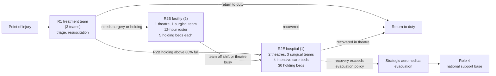

# Surgical Hours, Not Operating Theatres: Sizing the Land-Based Trauma System for Large Scale Combat Operations

## Abstract

<small>[Return to Top](#contents)</small>

**Background**

Casualty estimation is critical to the planning and design of the land-based trauma system deployed to support operations. Recent conflicts have produced lower casualty rates than those previously observed, or those expected in future large scale combat operations [[1]](#references), so a health system sized against recent experience is likely to not be adequate to handle the casualties of these more intense war fighting scenarios [[2]](#references).

**Objective**

To identify options to improve the land-based trauma system, to establish where that system fails as casualty intensity rises, and to state what the evidence supports for each lever a planner controls.

**Methods**

A discrete event simulation of a brigade force with aligned health assets was run at two casualty intensities derived from the FORECAS projection study [[3]](#references), a moderate intensity calibrated to the Falklands 1982 campaign and a high intensity calibrated to Okinawa 1945. Each lever the model can vary was then varied in a replicated experiment of 30 campaigns of 360 days. This paper reads those measurements as planning options. Every figure is quoted from the results paper [[4]](#references) and every experimental design is stated in the methods paper [[5]](#references).

**Results**

Wounded in action rise <!-- GEN cell:load_demand::Wounded in action/run::Ratio::mean -->3.57×<!-- /GEN --> from moderate to high intensity and first surgeries <!-- GEN cell:load_demand::R2B and R2E first surgeries/run::Ratio::mean -->2.23×<!-- /GEN -->, while the Role 2 Enhanced (R2E) operating theatres, holding beds and intensive care beds go from <!-- GEN cell:load_shortfall::R2E operating theatres::Moderate: utilisation::mean -->49.8%<!-- /GEN -->, <!-- GEN cell:load_shortfall::R2E holding beds::Moderate: utilisation::mean -->44.8%<!-- /GEN --> and <!-- GEN cell:load_shortfall::R2E intensive care::Moderate: utilisation::mean -->87.8%<!-- /GEN --> utilisation to <!-- GEN cell:load_shortfall::R2E operating theatres::High: utilisation::mean -->100.0%<!-- /GEN --> in all three, and the theatre queue then grows by <!-- GEN cell:load_shortfall::R2E operating theatres::High: shortfall per day::mean -->1.629<!-- /GEN --> casualties a day and the intensive care queue by <!-- GEN cell:load_shortfall::R2E intensive care::High: shortfall per day::mean -->4.954<!-- /GEN --> ([Results](Results.md#demand-utilisation-and-shortfall-per-day)). The principal constraint is surgical team scheduling: a casualty occupies a theatre while waiting for a rostered team, and the teams work 12-hour shifts against theatres available around the clock. At high intensity the R2E theatre queue stands empty for <!-- GEN cell:queue_clearance::R2E operating theatres::High: queue empty::mean -->0%<!-- /GEN --> of the campaign and is still growing when it ends, while at moderate intensity it stands empty for <!-- GEN cell:queue_clearance::R2E operating theatres::Moderate: queue empty::mean -->64%<!-- /GEN --> ([Results](Results.md#queue-behaviour-over-the-campaign)). At moderate intensity the shipped establishment holds except where it exports demand: R2B surgery is routed past for <!-- GEN cell:adequacy_sizing::R2B surgery, moderate intensity::Shortfall per day::mean -->3.33<!-- /GEN --> casualties a day against <!-- GEN cell:adequacy_sizing::R2B surgery, moderate intensity::Delivered per day::mean -->2.00<!-- /GEN --> operations performed, and a second surgical section per unit narrows but does not close the gap ([Results](Results.md#surgical-team-establishment)). The evacuation policy is a trade priced by the holding establishment: at the shipped 30 beds the largest policy that holds both R2E pools in every replication is <!-- GEN cell:policy_grid_largest_moderate::30::Largest policy holding both pools in every replication::full -->21 d<!-- /GEN -->, at 45 beds it is <!-- GEN cell:policy_grid_largest_moderate::45::Largest policy holding both pools in every replication::full -->27 d<!-- /GEN --> and at 60 beds <!-- GEN cell:policy_grid_largest_moderate::60::Largest policy holding both pools in every replication::full -->30 d<!-- /GEN -->, which return <!-- GEN cell:policy_grid_largest_moderate::45::Paired gain over 21 d and 30 beds::full -->+246.2 [+200.4, +291.9]<!-- /GEN --> and <!-- GEN cell:policy_grid_largest_moderate::60::Paired gain over 21 d and 30 beds::full -->+424.4 [+383.9, +465.0]<!-- /GEN --> more casualties to duty ([Results](Results.md#moderate-intensity-evacuation-policy-and-holding-establishment)). Strategic evacuation absorbs the loss of up to 5% of sorties without cost but not much more ([Results](Results.md#national-support-base-and-strategic-airlift)). At high intensity the three R2E pools, R2B surgery and the strategic airlift are inadequate, the sections swept still leaving a theatre shortfall of <!-- GEN cell:adequacy_sizing::R2E theatres and surgical teams, high intensity::Shortfall per day::mean -->1.63<!-- /GEN --> casualties a day at the shipped establishment, and no combination of sortie interval, evacuation policy and holding establishment held both R2E pools in any replication, the residual wait at a three-day interval sitting on the critical channel ([Results](Results.md#high-intensity-strategic-sortie-interval-by-policy-and-holding-establishment)). Several effects could not be separated from random variation, and the replications each would need are stated.

**Conclusion**

The evidence supports acting now on the theatre evacuation policy and the R2E holding establishment together, read as a trade with a price at each setting, and on the strategic airlift schedule and the evacuation fleet. Surgical team hours, R2B holding beds, the pre-open hold window, the forward surgical saturation release and R2E intensive care beds are to be tested first, because their remedy is untested or their effect on outcomes unresolved. Moderate intensity needs margin in a few elements and a second forward surgical section; no establishment tested settles the high-intensity R2E pools, so high intensity has no number to buy. Delivering post-operative intensive care forward is not supported, and enlarging the R2E holding pool pays only together with a longer evacuation policy. Under sustained saturation forward holding and the intensive care rationing gate each increased deaths of wounds in the model, which at high intensity mixes a heavier casualty load with an older standard of care.

## Contents

<small>[Return to Top](#contents)</small>

<!-- TOC START -->
- [Abstract](#abstract)
- [Contents](#contents)
- [Introduction](#introduction)
- [The System and the Evidence Labels](#the-system-and-the-evidence-labels)
- [Where the Trauma System Fails First](#where-the-trauma-system-fails-first)
- [Is the System Adequate?](#is-the-system-adequate)
- [Every Lever, and What the Evidence Supports](#every-lever-and-what-the-evidence-supports)
- [Recommendations in Priority Order](#recommendations-in-priority-order)
  - [Act Now](#act-now)
    - [1. Hold the Evacuation Policy as a Decision and Protect the Strategic Airlift](#1-hold-the-evacuation-policy-as-a-decision-and-protect-the-strategic-airlift)
    - [2. Size the Medical Evacuation Fleet at Three Ambulances and Four Trucks](#2-size-the-medical-evacuation-fleet-at-three-ambulances-and-four-trucks)
  - [Test First](#test-first)
    - [3. Extend Surgical Team Coverage Towards 24 Hours](#3-extend-surgical-team-coverage-towards-24-hours)
    - [4. Increase R2B Holding Capacity Only to Clear the Forward Queue](#4-increase-r2b-holding-capacity-only-to-clear-the-forward-queue)
    - [5. Hold Casualties at R2B for a Team About to Return](#5-hold-casualties-at-r2b-for-a-team-about-to-return)
    - [6. Use the Forward Surgical Saturation Release Only Where the Base Can Absorb It](#6-use-the-forward-surgical-saturation-release-only-where-the-base-can-absorb-it)
    - [7. Raise R2E Intensive Care Beds Only Where Care Quality Is the Aim, Not Where the Pool Is Saturated](#7-raise-r2e-intensive-care-beds-only-where-care-quality-is-the-aim-not-where-the-pool-is-saturated)
  - [Planning for Moderate Intensity](#planning-for-moderate-intensity)
  - [Planning for High Intensity](#planning-for-high-intensity)
  - [What Resourcing Alone Does Not Fix, and What Is Not Supported](#what-resourcing-alone-does-not-fix-and-what-is-not-supported)
- [Effects the Simulation Could Not Resolve](#effects-the-simulation-could-not-resolve)
- [Research Agenda](#research-agenda)
- [Limitations](#limitations)
- [Conclusion](#conclusion)
- [References](#references)
<!-- TOC END -->

---

## Introduction

<small>[Return to Top](#contents)</small>

A planner designing a deployed health system faces a single problem with many parts: the system has to be sized before its deployment to support a campaign, against a casualty load nobody can know in advance. Optimising it means trading one part of the system against another, more surgical capacity against more holding beds, more evacuation lift against more in-theatre recovery, with a fixed establishment and a finite lift to move it.

Casualty volumes expected in large scale combat operations exceed those the deployed health systems of the past two decades were built around [[1]](#references), and planning assumptions carried forward from those operations understate both the volume and the acuity a peer fight would produce [[2]](#references). An establishment drawn from the last campaign is a baseline that may not transfer.

This paper reads the measurements of the results paper [[4]](#references) as planning options and states no measurement of its own. Every figure it quotes is regenerated from the tracked evidence, is tagged with the section of the results paper it comes from, and cannot differ from it. The experimental designs, the interval method and the replication counts are in the methods paper [[5]](#references). The first part below locates where the system fails as casualty intensity rises. The second gives a verdict on each element at each intensity and sizes the uplift where it is inadequate. The third sets every lever the simulation can evaluate in one table, with its cost and, for each intensity, its measurement and evidence label. The fourth turns the table into recommendations, split into those to act on now and those to test first, with a summary for planning against each intensity. The fifth states the effects the simulation could not resolve, and the sixth the research that would resolve them.

---

## The System and the Evidence Labels

<small>[Return to Top](#contents)</small>

The simulation is a discrete event model in which each casualty moves rearward through the echelons of allied medical support doctrine [[6]](#references): Role 1 (R1) primary care, R2B damage control surgery and short-term holding, R2E definitive surgery, intensive care and in-theatre recovery, and strategic aeromedical evacuation to a Role 4 national support base. The establishment is a combat brigade served by three R1 treatment teams, two R2B facilities and one R2E hospital. The system is described in full in the system reference [[7]](#references).

Not every finding rests on the same strength of evidence. Each lever therefore carries a label saying what its evidence supports. A label attaches to a particular claim, so a lever whose diagnosis is measured may still have a remedy that is untested.

| Label | Meaning |
|---|---|
| **Measured** | The effect is established. Direction and approximate size are both supported. |
| **Direction only** | The effect points the way expected and the mechanism is confirmed, but its size is not established. |
| **Unresolved** | The available compute could not separate the effect from random variation. Figures are bounds, not estimates. |
| **Untested** | The simulation cannot evaluate the option as presently built. |

Two readings of the results paper govern every statement below. Where two intervals overlap the simulation has not established a difference, and the gap between the two averages should not be acted on. And the interval describes how precisely an average is known, not how much one campaign varies: the campaigns themselves spread many times more widely than the average is uncertain, so a system sized against the average under-provides for the campaign that arrives ([Results: scenario totals](Results.md#comparative-scenario-analysis)).

---

## Where the Trauma System Fails First

<small>[Return to Top](#contents)</small>

**The three R2E pools saturate together as casualty intensity rises, and the establishment is already under strain at moderate intensity.** Wounded in action rise <!-- GEN cell:load_demand::Wounded in action/run::Ratio::mean -->3.57×<!-- /GEN --> from moderate to high intensity and the first surgeries performed at R2B and R2E <!-- GEN cell:load_demand::R2B and R2E first surgeries/run::Ratio::mean -->2.23×<!-- /GEN -->, a floor on the rise in surgical demand because saturated theatres cap the operations performed ([Results: demand, utilisation and shortfall per day](Results.md#demand-utilisation-and-shortfall-per-day)). Over the closing 90 days the R2E theatres are in use <!-- GEN cell:load_shortfall::R2E operating theatres::Moderate: utilisation::full -->49.8% [45.9%, 53.8%]<!-- /GEN --> of the time at moderate intensity and <!-- GEN cell:load_shortfall::R2E operating theatres::High: utilisation::mean -->100.0%<!-- /GEN --> at high, the holding beds <!-- GEN cell:load_shortfall::R2E holding beds::Moderate: utilisation::full -->44.8% [42.6%, 46.9%]<!-- /GEN --> and <!-- GEN cell:load_shortfall::R2E holding beds::High: utilisation::mean -->100.0%<!-- /GEN -->, and the intensive care beds <!-- GEN cell:load_shortfall::R2E intensive care::Moderate: utilisation::full -->87.8% [86.8%, 88.9%]<!-- /GEN --> and <!-- GEN cell:load_shortfall::R2E intensive care::High: utilisation::mean -->100.0%<!-- /GEN -->. At high intensity each pool also falls behind at a steady rate, the theatre queue growing by <!-- GEN cell:load_shortfall::R2E operating theatres::High: shortfall per day::full -->1.629 [1.505, 1.753]<!-- /GEN --> casualties a day, the holding bed queue by <!-- GEN cell:load_shortfall::R2E holding beds::High: shortfall per day::full -->1.459 [1.408, 1.511]<!-- /GEN -->, the intensive care queue by <!-- GEN cell:load_shortfall::R2E intensive care::High: shortfall per day::full -->4.954 [4.905, 5.002]<!-- /GEN --> and the strategic evacuation backlog by <!-- GEN cell:load_shortfall::Strategic evacuation backlog::High: shortfall per day::full -->5.550 [5.499, 5.601]<!-- /GEN -->, which estimates the throughput each is short by. The three pools fall behind together, the signature of three stages of one pathway rather than three independent constraints, so relieving one without the others moves the wait rather than removing it. A ratio of closing-window queues between the intensities, such as <!-- GEN cell:scenario_queue::R2E operating theatre::Ratio::mean -->118.46×<!-- /GEN --> for the theatres, is not used to size anything because the high-intensity queue is still growing, so the ratio depends on the length of the campaign ([Results: comparative scenario analysis](Results.md#comparative-scenario-analysis)). **Evidence: measured.**

**Surgical team scheduling is the principal constraint.** A casualty takes an operating theatre before taking one of the surgical teams that staff it, so a theatre stands occupied while the casualty inside it waits for a team. The theatres are available around the clock and the teams work 12-hour shifts. Adding theatres would therefore not relieve a queue that measures a wait for people. The R2E theatre queue at moderate intensity averages <!-- GEN cell:scenario_queue::R2E operating theatre::Moderate intensity mean queue::mean -->4.384<!-- /GEN --> casualties, so the establishment is not comfortably adequate even at the lower rate ([Results: comparative scenario analysis](Results.md#comparative-scenario-analysis)). In the verified seed-42 campaign the single second-shift section carried the whole night-time surgical load and was busier and queued longer than the first-shift sections ([Results: Annex A](Results.md#annex-a-model-verification-of-one-seed-42-campaign)). **Evidence: measured.**

**The same shortfall takes a different form at each intensity.** At high intensity the R2E theatre queue stands empty for <!-- GEN cell:queue_clearance::R2E operating theatres::High: queue empty::mean -->0%<!-- /GEN --> of the campaign and its longest unbroken run above zero, in days with the interquartile range, is <!-- GEN cell:queue_clearance::R2E operating theatres::High: longest run above zero (days)::full -->356.7 (345.4–358.9)<!-- /GEN --> days; at moderate intensity it stands empty for <!-- GEN cell:queue_clearance::R2E operating theatres::Moderate: queue empty::mean -->64%<!-- /GEN --> and its longest run is <!-- GEN cell:queue_clearance::R2E operating theatres::Moderate: longest run above zero (days)::full -->13.1 (11.2–15.5)<!-- /GEN --> days ([Results: queue behaviour over the campaign](Results.md#queue-behaviour-over-the-campaign)). A queue that clears is a surge problem, answered by capability brought to bear on the heavy day and stood down afterwards. A queue that never clears is an establishment problem, and no surge capability reaches it because there is no trough to surge into. Surgical hours are therefore a standing measure at high intensity and a surge measure at moderate, and a force sized for one is not sized for the other. **Evidence: measured.**

**At high intensity the R2E queues have no level to be sized against.** Over a 360-day campaign the R2E theatre queue is classified as <!-- GEN cell:long_horizon_stability::R2E operating theatre queue::High intensity::full -->**drifting, +11.7%/block**, 36.9 to 573.6<!-- /GEN --> (the drift per 30-day block, then the first and last block means), and the holding, intensive care and strategic evacuation backlogs drift the same way, while no response at moderate intensity shows a trend its own interval can separate from zero ([Results: sustained operations](Results.md#sustained-operations)). The moderate-intensity result is an absence of detectable trend rather than a demonstration of a level. A high-intensity queue figure is therefore a point on a growing backlog, and the finding that the queue does not clear is firmer for it. **Evidence: measured.**

**Intensive care is rationed rather than queued.** When R2E intensive care is full the simulation gives some casualties a holding bed instead and defers others' surgery until a bed is free, so the shortfall appears as casualties receiving a lesser standard of care rather than as a queue. At high intensity the share of post-definitive care delivered in a holding bed reaches 100% in the median campaign from day <!-- GEN cell:degraded_care::High intensity: Post-definitive care::First day the median daily rate reaches 100%::mean -->3<!-- /GEN -->, and over the whole campaign it is <!-- GEN cell:degraded_care::High intensity: Post-definitive care::Whole campaign::mean -->99.8%<!-- /GEN --> against <!-- GEN cell:degraded_care::Moderate intensity: Post-definitive care::Whole campaign::mean -->68.3%<!-- /GEN --> at moderate intensity ([Results: queue behaviour over the campaign](Results.md#queue-behaviour-over-the-campaign)). A rate that is a standing condition from the first week is answered only by the establishment, not by a reserve brought forward on particular days. **Evidence: measured.**

**A zero R2B theatre queue signals a shortfall being exported, not spare capacity.** The routing policy moves a casualty requiring surgery to R2E whenever the R2B theatre is occupied or its team is off shift beyond the pre-open window, so no queue can form there ([Results: comparative scenario analysis](Results.md#comparative-scenario-analysis)). Any measure of whether R2B is adequately resourced has to count what was sent rearward, not what waited.

---

## Is the System Adequate?

<small>[Return to Top](#contents)</small>

**Adequacy is a verdict for each element at each intensity, and the shipped establishment fails differently at the two.** Health planning sizes medical support against an assessed casualty load at each role, and the casualty estimates for large scale combat operations exceed the loads current establishments were built for [[1]](#references) [[2]](#references). The matrix below gives each element a verdict and the evidence behind it, produced from the tracked measurements so that a verdict cannot differ from its evidence. The criteria are stated in the [methods paper](Methods.md#adequacy-verdict-criteria). An adequate element has no sustained backlog and some headroom, which is not the same as no casualty waiting. Role 4 carries no verdict because the model sets the demand placed on the national support base and gives it no capacity.

<!-- GEN adequacy_matrix -->
| Element | Moderate intensity | High intensity |
|---|---|---|
| R1 | **Adequate**: longest R1 staff queue 0.00 | **Adequate**: longest R1 staff queue 0.00 |
| Shared transport fleets | **Marginal**: used 12.5%, mean queue 0.43 | **Adequate**: used 30.4%, mean queue 0.22 |
| Integral evacuation elements | **Adequate**: used 15.7%, mean queue 0.06 | **Marginal**: used 41.0%, mean queue 0.42 |
| R2B surgery | **Inadequate**: 62.5% of casualties requiring surgery routed past, theatres used 8.5% | **Inadequate**: 73.0% of casualties requiring surgery routed past, theatres used 18.7% |
| R2B holding | **Marginal**: queue settled, used 66.6%, queue empty 46.6% | **Marginal**: queue settled, used 70.6%, queue empty 4.4% |
| R2E theatres and surgical teams | **Adequate**: queue settled, used 49.8%, queue empty 65.4% | **Inadequate**: queue drifting, +11.7%/block, used 100.0%, queue empty 0.6% |
| R2E intensive care | **Marginal**: queue settled, used 87.8%, queue empty 62.8% | **Inadequate**: queue drifting, +13.0%/block, used 100.0%, queue empty 0.5% |
| R2E holding | **Adequate**: queue settled, used 44.8%, queue empty 92.0% | **Inadequate**: queue drifting, +9.3%/block, used 100.0%, queue empty 0.8% |
| Strategic airlift | **Marginal**: backlog settled, late-half mean 1.9 awaiting a sortie | **Inadequate**: backlog drifting, +12.4%/block, late-half mean 1347.2 awaiting a sortie |
| Role 4 | **Not assessed**: demand only, peak census 203 beds | **Not assessed**: demand only, peak census 216 beds |
<!-- /GEN -->

**At moderate intensity the shipped establishment holds, except where it exports demand.** No R2E pool is classified drifting, but the intensive care beds, the forward holding beds, the ambulance fleet and the strategic evacuation backlog run with too little headroom to absorb a heavy day. R2B surgery is the exception. The routing policy sends a casualty rearward when the theatre is busy or its team is off shift, so the forward theatre never queues, and its shortfall appears as <!-- GEN cell:adequacy_sizing::R2B surgery, moderate intensity::Shortfall per day::mean -->3.33<!-- /GEN --> casualties a day routed past it against <!-- GEN cell:adequacy_sizing::R2B surgery, moderate intensity::Delivered per day::mean -->2.00<!-- /GEN --> operations performed there ([Results: demand, utilisation and shortfall per day](Results.md#demand-utilisation-and-shortfall-per-day)). A second surgical section per unit narrows the gap but does not close it: <!-- GEN cell:adequacy_sizing::R2B surgery, moderate intensity::Sweep evidence::full -->Measured: casualties routed past per run fall from 1,199 to 414 with a second section per unit<!-- /GEN --> ([Results: surgical team establishment](Results.md#surgical-team-establishment)). **Evidence: measured.**

**At high intensity the three R2E pools, R2B surgery and the strategic airlift are inadequate, and the sizing estimates are lower bounds that the sweeps confirm are not enough.** Pricing each pool in isolation, the R2E theatre queue grows by <!-- GEN cell:adequacy_sizing::R2E theatres and surgical teams, high intensity::Shortfall per day::mean -->1.63<!-- /GEN --> casualties a day against <!-- GEN cell:adequacy_sizing::R2E theatres and surgical teams, high intensity::Delivered per day::mean -->9.82<!-- /GEN --> first surgeries delivered, which the estimate prices at <!-- GEN cell:adequacy_sizing::R2E theatres and surgical teams, high intensity::Estimated uplift::full -->16.6% of today's output, 0.5 extra sections<!-- /GEN -->. The measurement is larger: <!-- GEN cell:adequacy_sizing::R2E theatres and surgical teams, high intensity::Sweep evidence::full -->Measured: shortfall per day from 1.63 at 3 sections to 0.20 at 6; no tested count settles; line reaches zero near 6 sections<!-- /GEN -->. The intensive care beds behave the same way, with <!-- GEN cell:adequacy_sizing::R2E intensive care, high intensity::Sweep evidence::full -->Measured: shortfall per day from 4.95 at 4 beds to 4.59 at 16; no tested count settles; line reaches zero near 168 beds<!-- /GEN -->, an extrapolation far outside the tested range that states only that bed count is not the binding lever ([Results: surgical team establishment](Results.md#surgical-team-establishment), [Results: R2E intensive care bed establishment](Results.md#r2e-intensive-care-bed-establishment)). The pools are coupled, so relief at one lets casualties through to the next, and an estimate that prices a pool alone understates the uplift. **Evidence: measured.**

**Two inadequate cells are not recovered by the levers tested.** The R2E holding beds fall behind at <!-- GEN cell:adequacy_sizing::R2E holding, high intensity::Shortfall per day::mean -->1.46<!-- /GEN --> casualties a day and the strategic evacuation backlog grows at <!-- GEN cell:adequacy_sizing::Strategic airlift, high intensity::Shortfall per day::mean -->5.55<!-- /GEN --> a day, against a sortie stream that carries <!-- GEN cell:adequacy_sizing::Strategic airlift, high intensity::Delivered per day::mean -->12.86<!-- /GEN --> casualties a day. Pricing the airlift in isolation gives <!-- GEN cell:adequacy_sizing::Strategic airlift, high intensity::Estimated uplift::full -->0.4 extra sortie streams of one sortie per interval<!-- /GEN -->, and no bed count is estimated for the holding pool because the evidence holds no per-bed throughput ([Results: demand, utilisation and shortfall per day](Results.md#demand-utilisation-and-shortfall-per-day)). The sweeps price both cells above what the levers tested deliver: the best of the twelve cells that cross the sortie interval, the evacuation policy and the holding establishment held both R2E pools below the collapse threshold in <!-- GEN cell:interval_grid_high::3 d interval, 21 d policy, 60 beds::Both pools below threshold::full -->0 of 30<!-- /GEN --> replications at the three-day interval with the 21-day policy and 60 beds, and that cell left the intensive care queue at <!-- GEN cell:interval_grid_high::3 d interval, 21 d policy, 60 beds::R2E ICU mean queue::full -->445.3 [426.3, 464.2]<!-- /GEN --> ([Results](Results.md#high-intensity-strategic-sortie-interval-by-policy-and-holding-establishment)). **Evidence: measured; no setting tested recovers the pools.**

<!-- GEN adequacy_sizing -->
| Case | Shortfall per day | Delivered per day | Estimated uplift | Sweep evidence |
|---|---|---|---|---|
| R2B surgery, moderate intensity | 3.33 | 2.00 | 167.0% of today's output | Measured: casualties routed past per run fall from 1,199 to 414 with a second section per unit |
| R2B surgery, high intensity | 11.86 | 4.39 | 270.2% of today's output | Measured: casualties routed past per run fall from 4,268 to 2,134 with a second section per unit |
| R2E theatres and surgical teams, high intensity | 1.63 | 9.82 | 16.6% of today's output, 0.5 extra sections | Measured: shortfall per day from 1.63 at 3 sections to 0.20 at 6; no tested count settles; line reaches zero near 6 sections |
| R2E intensive care, high intensity | 4.95 | not measured per bed | not estimable from a per-bed throughput; see sweep | Measured: shortfall per day from 4.95 at 4 beds to 4.59 at 16; no tested count settles; line reaches zero near 168 beds |
| R2E holding, high intensity | 1.46 | not measured per bed | not estimable from a per-bed throughput | Measured: in the holding establishment by policy grid no cell holds both pools in every replication; the best of 20 cells does so in 0 of 30 |
| Strategic airlift, high intensity | 5.55 | 12.86 | 0.4 extra sortie streams of one sortie per interval | Measured: in the sortie interval, policy and holding grid no cell holds both pools in every replication; the best of 12 cells does so in 0 of 30 |
<!-- /GEN -->

**Planning for moderate intensity needs margin in a few elements and a second forward surgical section; planning for high intensity cannot be met from the pools measured.** A force sized for moderate intensity needs no uplift of the R2E theatres or holding beds at the shipped policy, should hold margin at the intensive care beds, the forward holding beds, the ambulance fleet and the airlift, which are marginal at that rate, and should field a second surgical section per R2B unit if the routing gap matters, since that closes most but not all of it. Fifteen more holding beds are worth buying only with a longer evacuation policy, which they make stable: <!-- GEN cell:policy_grid_largest_moderate::45::Largest policy holding both pools in every replication::full -->27 d<!-- /GEN --> at 45 beds against <!-- GEN cell:policy_grid_largest_moderate::30::Largest policy holding both pools in every replication::full -->21 d<!-- /GEN --> at 30 ([Results](Results.md#moderate-intensity-evacuation-policy-and-holding-establishment)). A force that must be sustained at high intensity finds no tested establishment that settles its R2E pools, so the sweeps give it no number to buy; the sortie interval, the evacuation policy and the holding establishment together left <!-- GEN cell:interval_grid_high::3 d interval, 21 d policy, 60 beds::Both pools below threshold::full -->0 of 30<!-- /GEN --> replications with both pools held at their best ([Results](Results.md#high-intensity-strategic-sortie-interval-by-policy-and-holding-establishment)). **Evidence: measured for the pools swept.**

---

## Every Lever, and What the Evidence Supports

<small>[Return to Top](#contents)</small>

Each row of the table is one lever a planner controls, with the setting the evidence supports, what it costs in personnel and principal equipment, and the measurement at each intensity with its own evidence label. Costs are the team compositions and counts of the shipped establishment in the [system reference](../README.md#health-teams); a bed or vehicle is a count and a section is the team named. The figures are quoted from the section of the results paper linked in the row.

| Lever | Setting supported | Cost | Moderate intensity | High intensity |
|---|---|---|---|---|
| Surgical team coverage at R2B and R2E | Towards 24 hours | R2E surgical section: 1 anaesthetist, 2 surgeons, 4 nurses; R2B surgical section: 1 anaesthetist, 2 surgeons, 1 medic; no added theatre | Theatre utilisation <!-- GEN cell:load_shortfall::R2E operating theatres::Moderate: utilisation::mean -->49.8%<!-- /GEN --> ([Results](Results.md#demand-utilisation-and-shortfall-per-day)). **Measured** for the diagnosis; the means of sourcing the hours **untested**. | Theatre utilisation <!-- GEN cell:load_shortfall::R2E operating theatres::High: utilisation::mean -->100.0%<!-- /GEN -->, with the queue growing by <!-- GEN cell:load_shortfall::R2E operating theatres::High: shortfall per day::mean -->1.629<!-- /GEN --> casualties a day ([Results](Results.md#demand-utilisation-and-shortfall-per-day)); teams are the limit ([Results](Results.md#comparative-scenario-analysis)). **Measured** for the diagnosis; the means of sourcing the hours **untested**. |
| R2B holding beds per unit | Ten, for the forward queue only | Five more beds per unit; a count of beds, staffing not modelled | Forward queue falls from <!-- GEN cell:hold_threshold_beds::5 (shipped)::R2B hold mean queue::mean -->4.84<!-- /GEN --> to <!-- GEN cell:hold_threshold_beds::10::R2B hold mean queue::mean -->0.32<!-- /GEN -->, while returns to duty stand at <!-- GEN cell:hold_threshold_beds::5 (shipped)::Returns to duty::full -->1673 [1647, 1700]<!-- /GEN --> and <!-- GEN cell:hold_threshold_beds::10::Returns to duty::full -->1670 [1648, 1692]<!-- /GEN --> ([Results](Results.md#r2b-holding-capacity-and-evacuation-threshold)). **Measured** for the queue; outcomes **unresolved**. | Forward queue falls from <!-- GEN cell:hold_threshold_beds_high::5 (shipped)::R2B hold mean queue::mean -->30.58<!-- /GEN --> to <!-- GEN cell:hold_threshold_beds_high::10::R2B hold mean queue::mean -->2.87<!-- /GEN -->, with returns to duty <!-- GEN cell:hold_threshold_beds_high::5 (shipped)::Returns to duty::full -->2840 [2806, 2874]<!-- /GEN --> and <!-- GEN cell:hold_threshold_beds_high::10::Returns to duty::full -->2814 [2786, 2842]<!-- /GEN --> ([Results](Results.md#r2b-holding-capacity-and-evacuation-threshold)). **Measured** for the queue; outcomes **unresolved**. |
| R2B evacuation threshold | Not a remedy; it moves the queue, not the outcome | None; a command setting | One day loads the R2E holding queue to <!-- GEN cell:hold_threshold_threshold::1 day::R2E hold mean queue::mean -->1.655<!-- /GEN --> with returns to duty at <!-- GEN cell:hold_threshold_threshold::1 day::Returns to duty::full -->1666 [1646, 1687]<!-- /GEN --> against <!-- GEN cell:hold_threshold_threshold::Disabled (shipped)::Returns to duty::full -->1673 [1647, 1700]<!-- /GEN --> disabled ([Results](Results.md#r2b-holding-capacity-and-evacuation-threshold)). **Measured**. | A one-day threshold loads the R2E holding queue to <!-- GEN cell:hold_threshold_threshold_high::1 day::R2E hold mean queue::mean -->615.346<!-- /GEN --> ([Results](Results.md#r2b-holding-capacity-and-evacuation-threshold)). **Measured**. |
| R2B pre-open hold window | 60 minutes | None; a roster setting | <!-- GEN cell:hold_window::Casualties held at R2B::Window 60 min::mean -->88.87<!-- /GEN --> casualties held forward and off-shift diversions change by <!-- GEN cell:hold_window::Diverted, team off shift::Difference::mean -->−64.00<!-- /GEN --> ([Results](Results.md#r2b-pre-open-hold-window)). **Measured** forward; the downstream effect on R2E load is **unresolved**. | <!-- GEN cell:hold_window_high::Casualties held at R2B::Window 60 min::mean -->267.87<!-- /GEN --> casualties are held forward and off-shift diversions change by <!-- GEN cell:hold_window_high::Diverted, team off shift::Difference::mean -->−240.50<!-- /GEN --> ([Results](Results.md#r2b-pre-open-hold-window)). **Measured** forward; the downstream effect on R2E load is **unresolved**. |
| Ambulance fleet | Three | One vehicle per step; a count of vehicles | Queue <!-- GEN cell:transport::1::Ambulance mean queue::mean -->1.2509<!-- /GEN --> at one vehicle, <!-- GEN cell:transport::3 (current ambulance)::Ambulance mean queue::mean -->0.4278<!-- /GEN --> at three ([Results](Results.md#transport-fleet-size)). **Measured**. | Queue <!-- GEN cell:transport_high::1::Ambulance mean queue::mean -->46.7132<!-- /GEN --> at one vehicle, <!-- GEN cell:transport_high::3 (current ambulance)::Ambulance mean queue::mean -->0.2188<!-- /GEN --> at three ([Results](Results.md#transport-fleet-size)). **Measured**. |
| Truck fleet | Four | One vehicle per step; a count of vehicles | Queue <!-- GEN cell:transport::4 (current truck)::Truck mean queue::mean -->0.0001<!-- /GEN --> at four ([Results](Results.md#transport-fleet-size)). **Measured**. | Queue <!-- GEN cell:transport_high::4 (current truck)::Truck mean queue::mean -->0.0002<!-- /GEN --> at four ([Results](Results.md#transport-fleet-size)). **Measured**. |
| Idle transport and evacuation elements | Candidates for reallocating personnel | Frees personnel rather than costing them | R2E evacuation sections in use <!-- GEN cell:transport_holders::R2E evacuation sections::Moderate intensity utilisation::mean -->0.0%<!-- /GEN --> of the time, the HX2 40M fleet <!-- GEN cell:transport_holders::HX2 40M fleet::Moderate intensity utilisation::mean -->2.5%<!-- /GEN --> ([Results](Results.md#transport-fleet-size)). Utilisation **measured**; reallocation **untested**. | R2E evacuation sections in use <!-- GEN cell:transport_holders::R2E evacuation sections::High intensity utilisation::mean -->0.4%<!-- /GEN --> of the time, the HX2 40M fleet <!-- GEN cell:transport_holders::HX2 40M fleet::High intensity utilisation::mean -->6.2%<!-- /GEN --> ([Results](Results.md#transport-fleet-size)). Utilisation **measured**; reallocation **untested**. |
| Forward post-operative intensive care holding | Not supported; do not apply under sustained saturation | None added; uses R2B intensive care beds already established | R2E intensive care queue <!-- GEN cell:forward_hold::Off (current)::R2E ICU mean queue::mean -->1.355<!-- /GEN --> with none held forward and <!-- GEN cell:forward_hold::240 min::R2E ICU mean queue::mean -->0.911<!-- /GEN --> at a 240-minute window ([Results](Results.md#forward-holding-of-post-operative-intensive-care)). **Unresolved**: no change in the queue is separable from none. | The queue is <!-- GEN cell:forward_hold_high::Off (current)::R2E ICU mean queue::mean -->1438.305<!-- /GEN --> with none held forward and <!-- GEN cell:forward_hold_high::240 min + capacity::R2E ICU mean queue::mean -->1426.679<!-- /GEN --> with a 240-minute window and the capacity trigger, while deaths of wounds per run rise from <!-- GEN cell:forward_hold_high::Off (current)::Died of wounds per run::full -->277.60 [272.10, 283.10]<!-- /GEN --> with none held forward to <!-- GEN cell:forward_hold_high::240 min::Died of wounds per run::full -->304.67 [297.44, 311.89]<!-- /GEN --> at a 240-minute window and <!-- GEN cell:forward_hold_high::Capacity only::Died of wounds per run::full -->337.57 [329.95, 345.19]<!-- /GEN --> with the capacity trigger alone ([Results](Results.md#forward-holding-of-post-operative-intensive-care)). **Measured** harm. |
| Intensive care rationing gate | Retain at moderate intensity; do not apply under sustained saturation | None; a rule applied to the R2E intensive care beds | R2E intensive care utilisation <!-- GEN cell:icu_gate::R2E ICU utilisation (%)::Without the rule::mean -->93.0<!-- /GEN -->% without the gate and <!-- GEN cell:icu_gate::R2E ICU utilisation (%)::With the rule::mean -->87.8<!-- /GEN -->% with it ([Results](Results.md#post-operative-intensive-care-gate)). Load **measured**; mortality **unresolved**. | Deaths of wounds per run differ by <!-- GEN cell:icu_gate_high::Died of wounds per run::Paired difference::full -->+13.67 [+3.72, +23.62]<!-- /GEN --> with the gate ([Results](Results.md#post-operative-intensive-care-gate)). **Measured** harm. |
| Theatre evacuation policy | 21 days, read as a trade | None; a command decision traded against lift and Role 4 beds | At 30 days post-definitive intensive care access is <!-- GEN cell:policy::Post-definitive ICU access (%)::30 d::mean -->3.4<!-- /GEN -->% against <!-- GEN cell:policy::Post-definitive ICU access (%)::21 d (shipped)::mean -->31.7<!-- /GEN -->%, and returns to duty rise from <!-- GEN cell:policy::Returns to duty::21 d (shipped)::mean -->1673.3<!-- /GEN --> to <!-- GEN cell:policy::Returns to duty::30 d::mean -->1875.3<!-- /GEN --> ([Results](Results.md#evacuation-policy)), and jointly with the holding beds in the moderate-intensity grid ([Results](Results.md#moderate-intensity-evacuation-policy-and-holding-establishment)). **Measured**. | Measured only jointly with the holding establishment, in the grid below ([Results](Results.md#high-intensity-evacuation-policy-and-holding-establishment)). **Measured** jointly. |
| R2E holding beds | Shipped 30 at the shipped policy; 45 or 60 only with a longer policy | Fifteen to thirty more beds; a count of beds, staffing not modelled | Holding queue <!-- GEN cell:establishment::R2E hold mean queue::30 beds (shipped)::mean -->0.08<!-- /GEN --> at 30 beds and <!-- GEN cell:establishment::R2E hold mean queue::45 beds::mean -->0.07<!-- /GEN --> at 45 ([Results](Results.md#r2e-holding-establishment)). **Measured** at the shipped policy, and jointly with the policy in the moderate-intensity grid ([Results](Results.md#moderate-intensity-evacuation-policy-and-holding-establishment)). | Measured only jointly with the evacuation policy, in the grid below ([Results](Results.md#high-intensity-evacuation-policy-and-holding-establishment)). **Measured** jointly. |
| Evacuation policy and holding beds together | Moderate: 21 days at 30 beds, 27 at 45, 30 at 60; high: no setting held both R2E pools | Up to 90 holding beds with a policy change | At 45 beds the largest policy holding both pools in every replication is <!-- GEN cell:policy_grid_largest_moderate::45::Largest policy holding both pools in every replication::full -->27 d<!-- /GEN --> and at 60 beds <!-- GEN cell:policy_grid_largest_moderate::60::Largest policy holding both pools in every replication::full -->30 d<!-- /GEN -->, buying <!-- GEN cell:policy_grid_largest_moderate::45::Gain per added bed::full -->+16.4<!-- /GEN --> and <!-- GEN cell:policy_grid_largest_moderate::60::Gain per added bed::full -->+14.1<!-- /GEN --> returns to duty per added bed ([Results](Results.md#moderate-intensity-evacuation-policy-and-holding-establishment)). **Measured**. | Replications holding both pools below the collapse threshold <!-- GEN cell:policy_establishment_high_stability::30 d, 90 beds::Both below threshold::full -->0 of 30<!-- /GEN --> at 30 days and 90 beds, where the holding queue was lowest at <!-- GEN cell:policy_establishment_high::30 d, 90 beds::R2E hold mean queue::mean -->381.9<!-- /GEN --> against <!-- GEN cell:policy_establishment_high::21 d, 30 beds::R2E hold mean queue::mean -->556.1<!-- /GEN --> at the shipped setting ([Results](Results.md#high-intensity-evacuation-policy-and-holding-establishment)). **Measured** across the grid; whether a larger establishment would hold both is **unresolved**. With the sortie interval crossed in, the three-day interval with the 21-day policy and 60 beds cleared the holding queue to <!-- GEN cell:interval_grid_high::3 d interval, 21 d policy, 60 beds::R2E hold mean queue::mean -->0.0<!-- /GEN --> but left the intensive care queue at <!-- GEN cell:interval_grid_high::3 d interval, 21 d policy, 60 beds::R2E ICU mean queue::mean -->445.3<!-- /GEN -->, and <!-- GEN cell:interval_grid_high::3 d interval, 21 d policy, 60 beds::Both pools below threshold::full -->0 of 30<!-- /GEN --> replications held both pools ([Results](Results.md#high-intensity-strategic-sortie-interval-by-policy-and-holding-establishment)). **Measured**. |
| Forward surgical saturation release | Eight, where the national support base can absorb it | None at the forward theatre; moves an operation to the national support base | Theatre queue <!-- GEN cell:saturation::Theatre mean queue::0 (disabled)::mean -->8.32<!-- /GEN --> disabled and <!-- GEN cell:saturation::Theatre mean queue::8 (shipped)::mean -->4.92<!-- /GEN --> at eight ([Results](Results.md#forward-surgical-saturation-release)). **Measured** for queue and work moved; mortality **unresolved**. | Theatre queue <!-- GEN cell:saturation_high::Theatre mean queue::0 (disabled)::mean -->1520.25<!-- /GEN --> disabled and <!-- GEN cell:saturation_high::Theatre mean queue::8 (shipped)::mean -->520.60<!-- /GEN --> at eight, with <!-- GEN cell:saturation_high::Released with repair outstanding::8 (shipped)::mean -->1466.2<!-- /GEN --> casualties per campaign released with the repair outstanding, <!-- GEN cell:saturation_high::Released with repair outstanding::1::mean -->1463.9<!-- /GEN --> at a threshold of one and <!-- GEN cell:saturation_high::Released with repair outstanding::24::mean -->1464.2<!-- /GEN --> at 24, because the queue never falls below the threshold ([Results](Results.md#forward-surgical-saturation-release)). **Measured** for queue and work moved; mortality **unresolved**. |
| Strategic sortie interval | Seven days or shorter | Airlift sorties, not personnel; one sortie carries 90 casualties | Mean wait <!-- GEN cell:airlift_interval::Mean wait (days)::7 days (shipped)::mean -->0.33<!-- /GEN --> days at seven and <!-- GEN cell:airlift_interval::Mean wait (days)::14 days::mean -->26.84<!-- /GEN --> at fourteen ([Results](Results.md#national-support-base-and-strategic-airlift)). **Measured**. | Mean wait <!-- GEN cell:airlift_interval_high::Mean wait (days)::7 days (shipped)::mean -->18.57<!-- /GEN --> days at seven and <!-- GEN cell:airlift_interval_high::Mean wait (days)::3 days::mean -->14.27<!-- /GEN --> at three, and the share of R2E holding beds held by casualties awaiting airlift falls from <!-- GEN cell:airlift_interval_high::Share of R2E holding beds held by the evacuation wait::7 days (shipped)::mean -->38%<!-- /GEN --> at seven days to <!-- GEN cell:airlift_interval_high::Share of R2E holding beds held by the evacuation wait::3 days::mean -->1%<!-- /GEN --> at three ([Results](Results.md#national-support-base-and-strategic-airlift)). At three days with the 21-day policy and 30 beds the residual wait sits on the critical channel, at <!-- GEN cell:interval_grid_high_wait::3 d interval, 21 d policy, 30 beds::Mean wait, critical channel (days)::mean -->21.27<!-- /GEN --> days against <!-- GEN cell:interval_grid_high_wait::3 d interval, 21 d policy, 30 beds::Mean wait, standard channel (days)::mean -->0.11<!-- /GEN --> on the standard channel ([Results](Results.md#high-intensity-strategic-sortie-interval-by-policy-and-holding-establishment)). **Measured**. |
| Strategic sortie reliability | Losses of 5% or less | Airlift sorties, not personnel | <!-- GEN cell:airlift_collapse::10%::Collapsed::mean -->2<!-- /GEN --> of 30 campaigns collapse at 10% loss ([Results](Results.md#national-support-base-and-strategic-airlift)). **Measured**. | <!-- GEN cell:airlift_collapse_high::0%::Collapsed::mean -->30<!-- /GEN --> of 30 campaigns collapse with no sortie loss, and the mean wait rises from <!-- GEN cell:airlift_reliability_high::Mean wait (days)::0%::mean -->18.57<!-- /GEN --> days with none lost to <!-- GEN cell:airlift_reliability_high::Mean wait (days)::40%::mean -->48.09<!-- /GEN --> at 40% lost ([Results](Results.md#national-support-base-and-strategic-airlift)). **Measured**. |
| National support base bed demand | Plan it as a sustained load of the evacuation pipeline, not a casualty estimate | Not a lever; the demand the national support base must meet | Closing 90-day census <!-- GEN cell:role4_census_ward::Total, closing 90-day mean beds::Moderate intensity::mean -->136.89<!-- /GEN --> beds; <!-- GEN cell:role4_levers_policy::Role 4 closing 90-day mean beds::21 d (shipped)::mean -->109.0<!-- /GEN --> at the shipped policy against <!-- GEN cell:role4_levers_policy::Role 4 closing 90-day mean beds::30 d::mean -->50.9<!-- /GEN --> at 30 days ([Results](Results.md#role-4-bed-demand)). **Measured**. | Closing 90-day census <!-- GEN cell:role4_census_ward::Total, closing 90-day mean beds::High intensity::mean -->179.53<!-- /GEN --> beds ([Results](Results.md#role-4-bed-demand)). **Measured**. |
| Casualty surge event response | Policies to recover holding capacity | None; a stress test, remedies not yet specified | Event casualties die of wounds at <!-- GEN cell:casualty_surge::Died-of-wounds rate, event casualties::Events injected::mean -->0.43%<!-- /GEN --> against <!-- GEN cell:casualty_surge::Died-of-wounds rate, ordinary casualties::Events injected::mean -->0.21%<!-- /GEN --> for ordinary casualties ([Results](Results.md#casualty-surge-events)). Cost **measured**; remedies **untested**. | Event casualties die of wounds at <!-- GEN cell:casualty_surge_high::Died-of-wounds rate, event casualties::Events injected::mean -->2.87%<!-- /GEN --> ([Results](Results.md#casualty-surge-events)). Cost **measured**; remedies **untested**. |
| Casualty surge event size | Planning for larger incidents than the configured range | None; a stress test | At 20 casualties per event the peak R2E intensive care queue was <!-- GEN cell:casualty_surge_size::20::Peak R2E intensive care queue::full -->143.6 ± 25.4<!-- /GEN -->, against <!-- GEN cell:casualty_surge_size::None::Peak R2E intensive care queue::full -->14.4 ± 3.1<!-- /GEN --> with no events and <!-- GEN cell:casualty_surge_size::10::Peak R2E intensive care queue::full -->33.4 ± 12.8<!-- /GEN --> at 10, while the R2E theatre queue stood at <!-- GEN cell:casualty_surge_size::10::Peak R2E theatre queue::full -->47.2 ± 9.2<!-- /GEN --> at 10 and did not move until about 40 (<!-- GEN cell:casualty_surge_size::40::Peak R2E theatre queue::full -->77.2 ± 10.5<!-- /GEN -->), so intensive care is the first pool to break; the theatre queue reached <!-- GEN cell:casualty_surge_size::180::Peak R2E theatre queue::full -->2556.0 ± 178.4<!-- /GEN --> at 180 casualties ([Results](Results.md#casualty-surge-event-size)). Cost **measured**; remedies **untested**; the size range is **informed estimate**. | At 20 casualties per event the peak R2E intensive care queue was <!-- GEN cell:casualty_surge_size_high::20::Peak R2E intensive care queue::full -->1697.5 ± 18.1<!-- /GEN -->, against <!-- GEN cell:casualty_surge_size_high::None::Peak R2E intensive care queue::full -->1665.7 ± 15.0<!-- /GEN --> with no events ([Results](Results.md#casualty-surge-event-size)). Cost **measured**; remedies **untested**. |
| Surgical section count at R2B and R2E | A second R2B section per unit; the R2E count does not settle the high-intensity queue | R2E surgical section: 1 anaesthetist, 2 surgeons, 4 nurses; R2B surgical section: 1 anaesthetist, 2 surgeons, 1 medic | At moderate intensity the shipped establishment is already <!-- GEN cell:surgical_team::R2E theatre queue, late-half classification::R2E 3, R2B 1 (shipped)::full -->converged at 3.27<!-- /GEN --> ([Results](Results.md#surgical-team-establishment)). **Measured**. | The R2E theatre queue shortfall per day falls from <!-- GEN cell:surgical_team_high::R2E theatre queue shortfall per day::R2E 3, R2B 1 (shipped)::full -->1.629 [1.505, 1.753]<!-- /GEN --> at the shipped establishment to <!-- GEN cell:surgical_team_high::R2E theatre queue shortfall per day::R2E 4, R2B 1::full -->0.820 [0.670, 0.970]<!-- /GEN --> with a fourth R2E section and <!-- GEN cell:surgical_team_high::R2E theatre queue shortfall per day::R2E 4, R2B 2::full -->0.115 [0.034, 0.195]<!-- /GEN --> with a fourth R2E section and a second R2B section, and the queue is still classified drifting in every arm ([Results](Results.md#surgical-team-establishment)). **Measured**. |
| R2E intensive care beds | Twelve at moderate intensity; no count swept is a remedy at high intensity | Beds as a count; the model attaches no staff to the beds, an R2E intensive care section being 1 intensivist and 4 nurses | Twelve beds take post-definitive care in an intensive care bed from <!-- GEN cell:icu_bed::Post-definitive ICU access (%)::4 beds (shipped)::mean -->31.7<!-- /GEN --> to <!-- GEN cell:icu_bed::Post-definitive ICU access (%)::12 beds::mean -->85.6<!-- /GEN --> percent with no resolved change in deaths of wounds (<!-- GEN cell:icu_bed_paired::Died of wounds::12 beds::full -->−0.33 [−1.95, +1.28]<!-- /GEN -->) ([Results](Results.md#r2e-intensive-care-bed-establishment)). **Measured** for the care pathway and the queues; outcomes **unresolved**. | The intensive care queue shortfall per day is <!-- GEN cell:icu_bed_high::R2E ICU queue shortfall per day::4 beds (shipped)::full -->4.954 [4.905, 5.002]<!-- /GEN --> at four beds and <!-- GEN cell:icu_bed_high::R2E ICU queue shortfall per day::16 beds::full -->4.589 [4.533, 4.645]<!-- /GEN --> at sixteen, and the queue is classified drifting throughout ([Results](Results.md#r2e-intensive-care-bed-establishment)). **Measured**. |

---

## Recommendations in Priority Order

<small>[Return to Top](#contents)</small>

**Recommendations are split by whether the remedy is measured, and ranked within each group by how directly the measured effect improves the health outcome of the force.** Act now holds the levers whose effect is measured and resolved against a comparator. Test first holds the levers whose diagnosis is measured but whose remedy is untested or whose effect on outcomes is unresolved. Within a group a lever that moves returns to duty, deaths of wounds or access to intensive care ranks above one that moves only a queue, and a lever addressing the principal constraint ranks above one better measured but acting where the system is not failing.

### Act Now

#### 1. Hold the Evacuation Policy as a Decision and Protect the Strategic Airlift
**The theatre evacuation policy is a command decision with a price at each setting, and the holding establishment sets how long a policy can be before the R2E pools saturate: 21 days at the shipped 30 beds, longer with more beds.** Doctrine treats the policy as a command decision balancing in-theatre retention against the lift available [[6]](#references), so the table gives the price of each setting rather than a single answer. Returns to duty, deaths of wounds, the realised in-theatre share, R2E occupancy, post-definitive intensive care access, the casualties never evacuated by the horizon and the Role 4 peak beds are measured for each policy ([Results: evacuation policy](Results.md#evacuation-policy)).

<!-- GEN policy_trade -->
| Response | 15 d | 21 d (shipped) | 30 d | 45 d | 60 d |
|---|---|---|---|---|---|
| Returns to duty | 1476.0 [1452.3, 1499.8] | 1673.3 [1647.0, 1699.6] | 1875.3 [1855.2, 1895.4] | 1814.4 [1788.8, 1840.0] | 1724.5 [1698.2, 1750.8] |
| Died of wounds | 9.87 [8.47, 11.26] | 10.67 [9.33, 12.00] | 12.10 [10.73, 13.47] | 11.83 [10.64, 13.03] | 13.43 [11.91, 14.96] |
| In-theatre share (%) | 5.2 [5.0, 5.4] | 12.2 [11.9, 12.5] | 29.8 [29.2, 30.4] | 66.7 [65.9, 67.6] | 87.1 [86.4, 87.7] |
| R2E hold occupancy (%) | 20.3 [19.0, 21.6] | 44.8 [42.6, 46.9] | 100.0 [100.0, 100.0] | 100.0 [100.0, 100.0] | 100.0 [100.0, 100.0] |
| R2E ICU occupancy (%) | 86.9 [85.7, 88.0] | 87.8 [86.8, 88.9] | 100.0 [100.0, 100.0] | 100.0 [100.0, 100.0] | 100.0 [100.0, 100.0] |
| Post-definitive ICU access (%) | 33.5 [31.7, 35.3] | 31.7 [30.6, 32.8] | 3.4 [2.8, 4.0] | 4.5 [3.8, 5.2] | 6.0 [4.8, 7.2] |
| Never evacuated by horizon | 2.9 [1.4, 4.5] | 1.5 [0.9, 2.1] | 440.8 [417.8, 463.8] | 367.8 [348.7, 387.0] | 157.9 [147.4, 168.4] |
| Role 4 peak beds | 198.4 [190.8, 205.9] | 202.6 [193.6, 211.7] | 101.7 [96.6, 106.7] | 30.2 [26.5, 33.8] | 15.2 [12.3, 18.1] |
<!-- /GEN -->

**Under the shipped configuration the 21-day setting is stable at 30 beds only, and more beds buy a longer policy.** At 24 days and 30 beds both R2E pools stayed below the collapse threshold in <!-- GEN cell:policy_establishment_moderate_stability::24 d, 30 beds::Both below threshold::full -->27 of 30<!-- /GEN --> replications and at 27 days and 30 beds in <!-- GEN cell:policy_establishment_moderate_stability::27 d, 30 beds::Both below threshold::full -->1 of 30<!-- /GEN -->, against <!-- GEN cell:policy_establishment_moderate_stability::27 d, 45 beds::Both below threshold::full -->30 of 30<!-- /GEN --> at 27 days and 45 beds and <!-- GEN cell:policy_establishment_moderate_stability::30 d, 60 beds::Both below threshold::full -->30 of 30<!-- /GEN --> at 30 days and 60 beds. Returns to duty rose by <!-- GEN cell:policy_establishment_moderate_paired::27 d, 45 beds::Returns to duty::full -->+246.2 [+200.4, +291.9]<!-- /GEN --> over the shipped setting at 27 days and 45 beds and by <!-- GEN cell:policy_establishment_moderate_paired::30 d, 60 beds::Returns to duty::full -->+424.4 [+383.9, +465.0]<!-- /GEN --> at 30 days and 60 beds, with Role 4 peak beds differing by <!-- GEN cell:policy_establishment_moderate_paired::27 d, 45 beds::Role 4 peak beds::full -->−21.0 [−32.6, −9.3]<!-- /GEN --> and <!-- GEN cell:policy_establishment_moderate_paired::30 d, 60 beds::Role 4 peak beds::full -->−19.4 [−33.7, −5.1]<!-- /GEN --> ([Results](Results.md#moderate-intensity-evacuation-policy-and-holding-establishment)). The price of the longer policy is the added beds; the gain per added bed is quoted in the lever table.

Reading the table at the shipped 30 beds without a preferred setting, returns to duty rise from <!-- GEN cell:policy::Returns to duty::15 d::mean -->1476.0<!-- /GEN --> at 15 days through <!-- GEN cell:policy::Returns to duty::21 d (shipped)::mean -->1673.3<!-- /GEN --> at 21 to <!-- GEN cell:policy::Returns to duty::30 d::mean -->1875.3<!-- /GEN --> at 30, and fall from there, while the R2E holding and intensive care pools stay unsaturated to 21 days and sit at full occupancy at 30 (<!-- GEN cell:policy::R2E hold occupancy (%)::30 d::mean -->100.0<!-- /GEN -->% holding occupancy), where post-definitive intensive care access falls from <!-- GEN cell:policy::Post-definitive ICU access (%)::21 d (shipped)::mean -->31.7<!-- /GEN -->% to <!-- GEN cell:policy::Post-definitive ICU access (%)::30 d::mean -->3.4<!-- /GEN -->% and <!-- GEN cell:policy::Never evacuated by horizon::30 d::mean -->440.8<!-- /GEN --> casualties per campaign are still waiting to be evacuated at the horizon against <!-- GEN cell:policy::Never evacuated by horizon::21 d (shipped)::mean -->1.5<!-- /GEN --> at 21 days. Against the historical range of in-theatre retention the realised share is admissible only for 21 and 30 days, a 15-day policy retaining <!-- GEN cell:policy::In-theatre share (%)::15 d::mean -->5.2<!-- /GEN -->% and a 45-day policy <!-- GEN cell:policy::In-theatre share (%)::45 d::mean -->66.7<!-- /GEN -->%. Longer policies reduce the demand on the national support base, from <!-- GEN cell:policy::Role 4 peak beds::21 d (shipped)::mean -->202.6<!-- /GEN --> peak beds at 21 days to <!-- GEN cell:policy::Role 4 peak beds::60 d::mean -->15.2<!-- /GEN --> at 60, and the 60-day policy changes deaths of wounds by <!-- GEN cell:resolved::Policy 60 days against 21, died of wounds::Paired difference::full -->+2.77 [+0.66, +4.87]<!-- /GEN --> per campaign against 21 days, an interval that excludes zero, while the 15-day and 45-day differences are not resolved ([Results: resolution of paired differences](Results.md#resolution-of-paired-differences)). At the shipped establishment the price of stability is therefore returns to duty forgone against the 30-day peak, and the price of a longer policy is a system that saturates before the benefit arrives; the holding establishment is what moves that boundary, the added beds buying <!-- GEN cell:policy_grid_largest_moderate::45::Gain per added bed::full -->+16.4<!-- /GEN --> and <!-- GEN cell:policy_grid_largest_moderate::60::Gain per added bed::full -->+14.1<!-- /GEN --> returns to duty per bed ([Results](Results.md#moderate-intensity-evacuation-policy-and-holding-establishment)). **Evidence: measured.**

**Strategic airlift is limited by how many sorties fly, and the shipped schedule sits near the edge of a cliff.** At the shipped seven-day interval the mean wait is <!-- GEN cell:airlift_interval::Mean wait (days)::7 days (shipped)::mean -->0.33<!-- /GEN --> days, and shortening the interval buys almost nothing because the wait is already near zero. Lengthening it does not degrade smoothly: at ten days the mean wait is <!-- GEN cell:airlift_interval::Mean wait (days)::10 days::mean -->9.30<!-- /GEN --> days and at fourteen <!-- GEN cell:airlift_interval::Mean wait (days)::14 days::mean -->26.84<!-- /GEN -->, because once the sorties flown fall below the evacuation decisions the backlog accumulates for the rest of the campaign ([Results: national support base and strategic airlift](Results.md#national-support-base-and-strategic-airlift)). Cancellation behaves the same way, and the two levers are close to interchangeable when measured by the sorties they leave flown, so a planner buys the number of sorties that fly over the campaign rather than frequency or reliability separately. The sortie loss the trauma system can absorb is also a cliff: no campaign collapses at 0% or 5% loss, and <!-- GEN cell:airlift_collapse::10%::Collapsed::full -->2 of 30<!-- /GEN --> collapse at 10%, rising to <!-- GEN cell:airlift_collapse::25%::Collapsed::full -->22 of 30<!-- /GEN --> at 25% ([Results: national support base and strategic airlift](Results.md#national-support-base-and-strategic-airlift)). The median campaign shows nothing wrong across most of that range, so a reader watching typical performance would not see the risk. Sortie frequency matters most under saturation, because the evacuation wait occupies clinical capacity: at high intensity a three-day interval cuts the share of R2E holding beds held by casualties awaiting airlift from <!-- GEN cell:airlift_interval_high::Share of R2E holding beds held by the evacuation wait::7 days (shipped)::mean -->38%<!-- /GEN --> at the shipped seven days to <!-- GEN cell:airlift_interval_high::Share of R2E holding beds held by the evacuation wait::3 days::mean -->1%<!-- /GEN -->, freeing those beds for recovery ([Results: national support base and strategic airlift](Results.md#national-support-base-and-strategic-airlift)). That does not recover the pools: with the 21-day policy and 60 beds the three-day interval cleared the holding queue to <!-- GEN cell:interval_grid_high::3 d interval, 21 d policy, 60 beds::R2E hold mean queue::mean -->0.0<!-- /GEN --> and left the intensive care queue at <!-- GEN cell:interval_grid_high::3 d interval, 21 d policy, 60 beds::R2E ICU mean queue::mean -->445.3<!-- /GEN -->, because the casualties still waiting are on the critical channel, which waited <!-- GEN cell:interval_grid_high_wait::3 d interval, 21 d policy, 60 beds::Mean wait, critical channel (days)::mean -->19.10<!-- /GEN --> days against <!-- GEN cell:interval_grid_high_wait::3 d interval, 21 d policy, 60 beds::Mean wait, standard channel (days)::mean -->0.02<!-- /GEN --> on the standard channel ([Results](Results.md#high-intensity-strategic-sortie-interval-by-policy-and-holding-establishment)). Whether any reliability is achievable is a question about airframes, weather and tasking that sits outside the simulation. **Evidence: measured.**

**Demand on the national support base is a sustained level, not a terminal surge.** Over a 360-day campaign the Role 4 census rises to a plateau, with a peak of <!-- GEN cell:airlift_baseline::Role 4 peak occupancy (concurrent patients)::Moderate intensity::mean -->202.63<!-- /GEN --> concurrent patients at moderate intensity and <!-- GEN cell:airlift_baseline::Role 4 peak occupancy (concurrent patients)::High intensity::mean -->215.77<!-- /GEN --> at high, because sortie capacity caps what reaches the base ([Results: national support base and strategic airlift](Results.md#national-support-base-and-strategic-airlift)). A demand signal for the base should therefore be derived from the theatre's evacuation pipeline, in particular its sortie capacity, rather than from a casualty estimate, and phased as a sustained load. The wait also consumes clinical capacity: the evacuation wait holds <!-- GEN cell:airlift_baseline::Share of R2E holding beds held by the evacuation wait::Moderate intensity::mean -->4%<!-- /GEN --> of the R2E holding beds at moderate intensity and <!-- GEN cell:airlift_baseline::Share of R2E holding beds held by the evacuation wait::High intensity::mean -->38%<!-- /GEN --> at high, so a lever that delays a sortie propagates into intensive care. The census itself is measured in [Results: Role 4 bed demand](Results.md#role-4-bed-demand). Over the closing 90 days it averages <!-- GEN cell:role4_census_ward::Total, closing 90-day mean beds::Moderate intensity::mean -->136.89<!-- /GEN --> beds at moderate intensity and <!-- GEN cell:role4_census_ward::Total, closing 90-day mean beds::High intensity::mean -->179.53<!-- /GEN --> at high, of which the step-down ward carries <!-- GEN cell:role4_census_ward::Step-down ward phase, closing 90-day mean beds::Moderate intensity::mean -->106.18<!-- /GEN --> and <!-- GEN cell:role4_census_ward::Step-down ward phase, closing 90-day mean beds::High intensity::mean -->139.56<!-- /GEN -->, so a planner sizing the base for the intensive care phase alone would size it for a minority of the beds. Only the evacuation policy moves the census materially: the closing mean is <!-- GEN cell:role4_levers_policy::Role 4 closing 90-day mean beds::21 d (shipped)::mean -->109.0<!-- /GEN --> at the shipped 21 days and <!-- GEN cell:role4_levers_policy::Role 4 closing 90-day mean beds::30 d::mean -->50.9<!-- /GEN --> at 30, which is the base's side of the same trade the policy makes forward. The R2E holding establishment leaves it within its interval, and the saturation release moves the operations the base owes rather than its beds. **Evidence: measured.**

#### 2. Size the Medical Evacuation Fleet at Three Ambulances and Four Trucks

**Three ambulances carry the inter-echelon load between R1, R2B and R2E, and two would carry it with a reduced margin.** The ambulance queue collapses between one and two vehicles and flattens from three, from <!-- GEN cell:transport::1::Ambulance mean queue::mean -->1.2509<!-- /GEN --> at one to <!-- GEN cell:transport::2::Ambulance mean queue::mean -->0.1427<!-- /GEN --> at two and <!-- GEN cell:transport::3 (current ambulance)::Ambulance mean queue::mean -->0.4278<!-- /GEN --> at three, and nothing is bought beyond the third vehicle ([Results: transport fleet size](Results.md#transport-fleet-size)). The margin survives at high intensity, where one vehicle queues at <!-- GEN cell:transport_high::1::Ambulance mean queue::mean -->46.7132<!-- /GEN --> and three at <!-- GEN cell:transport_high::3 (current ambulance)::Ambulance mean queue::mean -->0.2188<!-- /GEN -->, so the boundary between an inadequate and an adequate fleet does not move with casualty intensity. Some of the transport capacity stands largely idle, which points to personnel that could be reallocated though the reallocation is untested: the R2E evacuation sections, which are integral to the facility, are in use <!-- GEN cell:transport_holders::R2E evacuation sections::Moderate intensity utilisation::mean -->0.0%<!-- /GEN --> of the time at moderate intensity and <!-- GEN cell:transport_holders::R2E evacuation sections::High intensity utilisation::mean -->0.4%<!-- /GEN --> at high, and the shared HX2 40M truck fleet <!-- GEN cell:transport_holders::HX2 40M fleet::Moderate intensity utilisation::mean -->2.5%<!-- /GEN --> and <!-- GEN cell:transport_holders::HX2 40M fleet::High intensity utilisation::mean -->6.2%<!-- /GEN --> ([Results: transport fleet size](Results.md#transport-fleet-size)). These are the ambulances that move casualties between echelons, not those integral to the combat force that move casualties from the point of injury to R1. **Evidence: measured.**

### Test First

#### 3. Extend Surgical Team Coverage Towards 24 Hours

**Surgical team hours are the capacity to add, at both R2B and R2E, and the theatres to use them already exist.** **Evidence for the diagnosis: measured. Evidence for the effect of added sections: measured. Evidence for the best means of sourcing the hours: untested.**

At R2B each of the two facilities fields one surgical team on a 12-hour shift against a theatre available around the clock, so for half of each day the theatre stands ready with nobody rostered to operate in it. In the verified seed-42 campaign most casualties diverted from R2B to R2E were diverted because the team was off shift rather than because the theatre was busy ([Results: Annex A](Results.md#annex-a-model-verification-of-one-seed-42-campaign)). Time to surgery is among the strongest determinants of survival after severe battlefield injury [[8]](#references), so a casualty who travels further to reach a surgeon because none is rostered is a clinical cost rather than an administrative one. Extending coverage needs no additional principal equipment. It does need provision in the operational viability period, the organisational design and the workforce model, which are the instruments through which the hours would have to be found.

Whether the hours are a standing establishment or a surge measure depends on the intensity planned for. At high intensity the hours must be permanently established, because the queue has no trough; at moderate intensity they can be held as a capability brought to bear on the heavy day. The surgical section sweep prices the addition in sections ([Results: surgical team establishment](Results.md#surgical-team-establishment)). At high intensity the R2E theatre queue shortfall per day was <!-- GEN cell:surgical_team_high::R2E theatre queue shortfall per day::R2E 3, R2B 1 (shipped)::full -->1.629 [1.505, 1.753]<!-- /GEN --> at the shipped establishment, <!-- GEN cell:surgical_team_high::R2E theatre queue shortfall per day::R2E 4, R2B 1::full -->0.820 [0.670, 0.970]<!-- /GEN --> with a fourth R2E section and <!-- GEN cell:surgical_team_high::R2E theatre queue shortfall per day::R2E 6, R2B 1::full -->0.201 [0.165, 0.238]<!-- /GEN --> with a sixth, and no arm converged, so a fourth R2E section does not make the queue converge, and even with a second R2B section as well it leaves <!-- GEN cell:surgical_team_high::R2E theatre queue shortfall per day::R2E 4, R2B 2::full -->0.115 [0.034, 0.195]<!-- /GEN --> per day. A second R2B section removed the cases diverted for a closed section (<!-- GEN cell:surgical_team::Diverted, team off shift::R2E 3, R2B 2::full -->0.0 [0.0, 0.0]<!-- /GEN --> at moderate intensity, against <!-- GEN cell:surgical_team::Diverted, team off shift::R2E 3, R2B 1 (shipped)::full -->997.7 [972.0, 1023.4]<!-- /GEN --> at the shipped establishment) and the paired difference in deaths of wounds at moderate intensity was <!-- GEN cell:surgical_team_paired::Died of wounds::R2E 3, R2B 2::full -->−2.27 [−4.04, −0.49]<!-- /GEN -->. How to source the sections is a separate question that the simulation does not answer, since extending the rostered teams' hours and fielding additional teams deliver coverage at different costs in personnel, sustainment and clinical risk.

#### 4. Increase R2B Holding Capacity Only to Clear the Forward Queue

**R2B holding is a standing shortfall at both intensities, and beds are the cleaner remedy.** The R2B holding queue carries <!-- GEN cell:scenario_queue::R2B holding beds::Moderate intensity mean queue::mean -->4.836<!-- /GEN --> casualties waiting at moderate intensity, the largest queue any pool carries at moderate intensity, against <!-- GEN cell:scenario_queue::R2E operating theatre::Moderate intensity mean queue::mean -->4.384<!-- /GEN --> at the R2E theatres ([Results: comparative scenario analysis](Results.md#comparative-scenario-analysis)). Raising the establishment from five to ten beds per unit takes the forward queue from <!-- GEN cell:hold_threshold_beds::5 (shipped)::R2B hold mean queue::full -->4.84 [3.57, 6.11]<!-- /GEN --> to <!-- GEN cell:hold_threshold_beds::10::R2B hold mean queue::full -->0.32 [0.10, 0.53]<!-- /GEN --> without a resolved cost to the R2E pools behind it, but returns to duty are <!-- GEN cell:hold_threshold_beds::5 (shipped)::Returns to duty::full -->1673 [1647, 1700]<!-- /GEN --> at five beds and <!-- GEN cell:hold_threshold_beds::10::Returns to duty::full -->1670 [1648, 1692]<!-- /GEN --> at ten, so the purchase is relief of a forward queue and not a measured gain in outcome ([Results: R2B holding capacity and evacuation threshold](Results.md#r2b-holding-capacity-and-evacuation-threshold)). An evacuation threshold relieves the same queue by moving casualties rearward early: at one day it takes the forward queue to <!-- GEN cell:hold_threshold_threshold::1 day::R2B hold mean queue::mean -->0.01<!-- /GEN --> and loads the R2E holding queue to <!-- GEN cell:hold_threshold_threshold::1 day::R2E hold mean queue::mean -->1.655<!-- /GEN -->, again without a resolved change in returns to duty. A casualty needs the same convalescence wherever it is served, so neither lever changes how much recovery the system must deliver, only where it is delivered. Where the establishment can be grown, capacity is the cleaner purchase, because it adds no load to R2E. **Evidence: measured.**

#### 5. Hold Casualties at R2B for a Team About to Return

**A 60-minute pre-open window keeps a meaningful number of casualties forward, cuts diversions caused by the team being off shift and raises R2B surgery, and whether it reduces the surgical load reaching R2E is not established.** The window held <!-- GEN cell:hold_window::Casualties held at R2B::Window 60 min::mean -->88.87<!-- /GEN --> casualties per campaign at R2B against none with a zero window, off-shift diversions changed by <!-- GEN cell:hold_window::Diverted, team off shift::Difference::full -->−64.00 [−105.06, −22.94]<!-- /GEN --> and R2B surgeries by <!-- GEN cell:hold_window::R2B surgeries::Difference::full -->+53.67 [+31.17, +76.16]<!-- /GEN -->, all three intervals clear of zero ([Results: R2B pre-open hold window](Results.md#r2b-pre-open-hold-window)). R2E first surgeries changed by <!-- GEN cell:hold_window::R2E first surgeries::Difference::full -->−10.90 [−72.35, +50.55]<!-- /GEN -->, an interval wide enough to contain both no change and a substantial fall, and the replications needed to settle it are in [Effects the Simulation Could Not Resolve](#effects-the-simulation-could-not-resolve). Mortality is unchanged between the arms within the resolution available, which is an absence of evidence rather than evidence of safety. **Evidence: measured on casualties held, diversions avoided and R2B surgeries gained; unresolved on R2E load and mortality.**

#### 6. Use the Forward Surgical Saturation Release Only Where the Base Can Absorb It

**Releasing casualties to strategic evacuation with the definitive repair outstanding, once the forward theatre queue reaches a threshold, cuts the R2E theatre queue and moves the operation to the national support base.** The theatre queue falls from <!-- GEN cell:saturation::Theatre mean queue::0 (disabled)::full -->8.32 [5.23, 11.42]<!-- /GEN --> with the release disabled to <!-- GEN cell:saturation::Theatre mean queue::8 (shipped)::full -->4.92 [1.93, 7.91]<!-- /GEN --> at the shipped threshold of eight, and the cost is paid elsewhere: <!-- GEN cell:saturation::Released with repair outstanding::8 (shipped)::mean -->146.0<!-- /GEN --> casualties per campaign reach the base unrepaired and the base owes <!-- GEN cell:saturation::Role 4 operations owed::8 (shipped)::mean -->1141.1<!-- /GEN --> operations against <!-- GEN cell:saturation::Role 4 operations owed::0 (disabled)::mean -->931.4<!-- /GEN --> without the release ([Results: forward surgical saturation release](Results.md#forward-surgical-saturation-release)). Post-definitive intensive care access falls from <!-- GEN cell:saturation::Post-definitive ICU access (%)::0 (disabled)::mean -->34.8<!-- /GEN -->% to <!-- GEN cell:saturation::Post-definitive ICU access (%)::8 (shipped)::mean -->31.7<!-- /GEN -->%. The relief decays smoothly as the threshold rises, so the choice is where on a continuum to sit, and the one threshold that costs deaths is the most aggressive, at one casualty. The lever trades a forward queue for work the simulation reports but does not constrain at the national support base, so whether it is worth using depends on a capacity the model does not represent. Under high intensity the lever relieves the theatre queue much more, from <!-- GEN cell:saturation_high::Theatre mean queue::0 (disabled)::mean -->1520.25<!-- /GEN --> with the release disabled to <!-- GEN cell:saturation_high::Theatre mean queue::8 (shipped)::mean -->520.60<!-- /GEN --> at the shipped threshold, but it is insensitive to the threshold because the queue never falls below it: <!-- GEN cell:saturation_high::Released with repair outstanding::8 (shipped)::mean -->1466.2<!-- /GEN --> casualties per campaign are released with the repair outstanding at a threshold of eight, <!-- GEN cell:saturation_high::Released with repair outstanding::1::mean -->1463.9<!-- /GEN --> at one and <!-- GEN cell:saturation_high::Released with repair outstanding::24::mean -->1464.2<!-- /GEN --> at 24, and the base owes <!-- GEN cell:saturation_high::Role 4 operations owed::8 (shipped)::mean -->1394.3<!-- /GEN --> operations against <!-- GEN cell:saturation_high::Role 4 operations owed::0 (disabled)::mean -->1295.3<!-- /GEN --> without the release ([Results: forward surgical saturation release](Results.md#forward-surgical-saturation-release)). Choosing the threshold therefore buys nothing at high intensity, and the decision is whether to release at all. **Evidence: measured for the queue, the releases and the work moved; unresolved for mortality at both intensities.**

#### 7. Raise R2E Intensive Care Beds Only Where Care Quality Is the Aim, Not Where the Pool Is Saturated

**More R2E intensive care beds move post-operative and post-definitive care out of holding beds at moderate intensity, and do not make the high-intensity pool converge at any count swept.** **Evidence for the care pathway and the queues: measured. Evidence for outcomes: unresolved.**

At moderate intensity the shipped four beds take <!-- GEN cell:icu_bed::Post-definitive ICU access (%)::4 beds (shipped)::mean -->31.7<!-- /GEN --> percent of post-definitive care and leave <!-- GEN cell:icu_bed::Post-operative care in a holding bed (%)::4 beds (shipped)::mean -->50.2<!-- /GEN --> percent of post-operative care in a holding bed, against <!-- GEN cell:icu_bed::Post-definitive ICU access (%)::12 beds::mean -->85.6<!-- /GEN --> and <!-- GEN cell:icu_bed::Post-operative care in a holding bed (%)::12 beds::mean -->11.2<!-- /GEN --> percent at twelve beds ([Results: R2E intensive care bed establishment](Results.md#r2e-intensive-care-bed-establishment)). The paired differences in deaths of wounds and returns to duty at twelve beds were <!-- GEN cell:icu_bed_paired::Died of wounds::12 beds::full -->−0.33 [−1.95, +1.28]<!-- /GEN --> and <!-- GEN cell:icu_bed_paired::Returns to duty::12 beds::full -->+2.8 [−30.0, +35.7]<!-- /GEN -->, so the model does not resolve a gain in outcome from the move, which rests on an informed-estimate holding-bed penalty rather than on a measured one. Twelve beds at the shipped three sections of four nurses is <!-- GEN cell:icu_bed::Nurses per ICU bed at three sections::12 beds::mean -->1.00<!-- /GEN --> nurse per bed against <!-- GEN cell:icu_bed::Nurses per ICU bed at three sections::4 beds (shipped)::mean -->3.00<!-- /GEN --> at the shipped establishment, a staffing cost the model does not charge. At high intensity sixteen beds, four times the shipped establishment, leave the intensive care queue classified <!-- GEN cell:icu_bed_high::R2E ICU queue, late-half classification::16 beds::full -->**drifting, +14.7%/block**, 9.9 to 1,349.4<!-- /GEN --> and raise the R2E holding queue shortfall per day from <!-- GEN cell:icu_bed_high::R2E holding queue shortfall per day::4 beds (shipped)::full -->1.459 [1.408, 1.511]<!-- /GEN --> to <!-- GEN cell:icu_bed_high::R2E holding queue shortfall per day::16 beds::full -->2.013 [1.870, 2.155]<!-- /GEN -->, so the high-intensity case is not a bed-count problem within that range.

### Planning for Moderate Intensity

**Planning against moderate intensity, act on the policy, airlift and fleet recommendations and hold the surgical hours as a capability brought to bear on the heavy day.** At moderate intensity the R2E theatre queue stands empty for <!-- GEN cell:queue_clearance::R2E operating theatres::Moderate: queue empty::mean -->64%<!-- /GEN --> of the campaign, so the shortfall is a surge problem, and the shipped establishment is already <!-- GEN cell:surgical_team::R2E theatre queue, late-half classification::R2E 3, R2B 1 (shipped)::full -->converged at 3.27<!-- /GEN --> ([Results: surgical team establishment](Results.md#surgical-team-establishment)). A second R2B surgical section per unit removes the cases diverted for a closed section (<!-- GEN cell:surgical_team::Diverted, team off shift::R2E 3, R2B 2::full -->0.0 [0.0, 0.0]<!-- /GEN --> against <!-- GEN cell:surgical_team::Diverted, team off shift::R2E 3, R2B 1 (shipped)::full -->997.7 [972.0, 1023.4]<!-- /GEN --> per run), and fifteen more holding beds with a 27-day policy return <!-- GEN cell:policy_grid_largest_moderate::45::Paired gain over 21 d and 30 beds::full -->+246.2 [+200.4, +291.9]<!-- /GEN --> more casualties to duty with both R2E pools held in every replication ([Results](Results.md#moderate-intensity-evacuation-policy-and-holding-establishment)), and twelve intensive care beds raise post-definitive care in an intensive care bed from <!-- GEN cell:icu_bed::Post-definitive ICU access (%)::4 beds (shipped)::mean -->31.7<!-- /GEN -->% to <!-- GEN cell:icu_bed::Post-definitive ICU access (%)::12 beds::mean -->85.6<!-- /GEN -->%, with outcomes unresolved ([Results: R2E intensive care bed establishment](Results.md#r2e-intensive-care-bed-establishment)). **Evidence: measured for the pathway, unresolved for outcomes.**

### Planning for High Intensity

**Planning against high intensity, no tested establishment settles the R2E pools, so the recommendations that apply are the ones that avoid harm; a shorter airlift interval frees holding beds but does not recover the pools.** The R2E theatre queue stands empty for <!-- GEN cell:queue_clearance::R2E operating theatres::High: queue empty::mean -->0%<!-- /GEN --> of the campaign and is classified <!-- GEN cell:long_horizon_stability::R2E operating theatre queue::High intensity::full -->**drifting, +11.7%/block**, 36.9 to 573.6<!-- /GEN --> ([Results: sustained operations](Results.md#sustained-operations)), and the surgical sections swept leave it drifting in every arm, with a shortfall of <!-- GEN cell:surgical_team_high::R2E theatre queue shortfall per day::R2E 6, R2B 1::full -->0.201 [0.165, 0.238]<!-- /GEN --> per day at six sections ([Results: surgical team establishment](Results.md#surgical-team-establishment)). No intensive care bed count to sixteen makes that pool converge, the shortfall standing at <!-- GEN cell:icu_bed_high::R2E ICU queue shortfall per day::16 beds::full -->4.589 [4.533, 4.645]<!-- /GEN --> per day at sixteen ([Results: R2E intensive care bed establishment](Results.md#r2e-intensive-care-bed-establishment)). The strategic airlift offers no margin either, since <!-- GEN cell:airlift_collapse_high::0%::Collapsed::full -->30 of 30<!-- /GEN --> campaigns collapse with no sortie lost ([Results: national support base and strategic airlift](Results.md#national-support-base-and-strategic-airlift)), which leaves the shorter interval as the lever that frees holding beds, though the intensive care queue stands at <!-- GEN cell:interval_grid_high::3 d interval, 21 d policy, 60 beds::R2E ICU mean queue::mean -->445.3<!-- /GEN --> even with the three-day interval and 60 beds ([Results](Results.md#high-intensity-strategic-sortie-interval-by-policy-and-holding-establishment)). The levers that increase deaths of wounds at this intensity, forward holding and the rationing gate, are the ones to withhold, the gate adding <!-- GEN cell:icu_gate_high::Died of wounds per run::Paired difference::full -->+13.67 [+3.72, +23.62]<!-- /GEN --> deaths of wounds per run ([Results: the post-operative intensive care gate](Results.md#post-operative-intensive-care-gate)). That death figure is measured under the 1945-era care model; under the high-intensity casualty load and the shipped treatment model the deaths of wounds per run were <!-- GEN cell:scenario_totals::Died of wounds/run::High intensity, modern care::mean -->37.27<!-- /GEN --> ([Results](Results.md#comparative-scenario-analysis)), so it is not a figure for capacity alone. **Evidence: measured.**

### What Resourcing Alone Does Not Fix, and What Is Not Supported

**Forward holding is not supported on the present evidence.** Holding operated casualties forward at R2B does not measurably relieve R2E intensive care: forward utilisation rises steadily across the windows because the policy is being applied, while the R2E queue is not monotone and every interval overlaps the interval with no forward holding ([Results: forward holding](Results.md#forward-holding-of-post-operative-intensive-care)). Both surgical pathways are eligible, so the lever reaches every casualty operated on at R2B. At high intensity it also costs lives in the model: deaths of wounds per run were <!-- GEN cell:forward_hold_high::Off (current)::Died of wounds per run::full -->277.60 [272.10, 283.10]<!-- /GEN --> with none held forward, <!-- GEN cell:forward_hold_high::240 min::Died of wounds per run::full -->304.67 [297.44, 311.89]<!-- /GEN --> at a 240-minute window, <!-- GEN cell:forward_hold_high::1,440 min::Died of wounds per run::full -->333.40 [325.77, 341.03]<!-- /GEN --> at 1,440 minutes and <!-- GEN cell:forward_hold_high::Capacity only::Died of wounds per run::full -->337.57 [329.95, 345.19]<!-- /GEN --> with the capacity trigger alone, and no interval overlaps the arm with none held forward ([Results: forward holding](Results.md#forward-holding-of-post-operative-intensive-care)). **Evidence: unresolved across the whole range tested at moderate intensity; harm measured at high intensity.** Enlarging the R2E holding pool alone is a different matter: at the shipped policy the pool is not the binding constraint, the residual queue of <!-- GEN cell:establishment::R2E hold mean queue::30 beds (shipped)::mean -->0.08<!-- /GEN --> at 30 beds being <!-- GEN cell:establishment::R2E hold mean queue::45 beds::mean -->0.07<!-- /GEN --> at 45 ([Results: R2E holding establishment](Results.md#r2e-holding-establishment)), and it pays only together with a longer evacuation policy ([Results](Results.md#moderate-intensity-evacuation-policy-and-holding-establishment)). **Evidence: measured.**

**Do not apply forward holding or the intensive care rationing gate under sustained saturation.** At high intensity the rationing gate adds <!-- GEN cell:icu_gate_high::Died of wounds per run::Paired difference::full -->+13.67 [+3.72, +23.62]<!-- /GEN --> deaths of wounds per run, an interval that excludes zero, so a planner who treated either lever as neutral or unresolved would increase deaths of wounds ([Results: post-operative intensive care gate](Results.md#post-operative-intensive-care-gate)). Both effects arise partly from the relative mortality penalties the model applies to a casualty held outside a full intensive care bed (`r2b_icu_penalty` and `r2e_postop_hold_penalty`), which are informed estimates. The direction is therefore measured inside the model rather than discovered by it, and its size depends on those penalties. **Evidence: measured at high intensity, inside the model.**

**Three conditions are properties of the design, not of any resource level.** First, the intensive care rationing gate relieves load, from <!-- GEN cell:icu_gate::R2E ICU utilisation (%)::Without the rule::mean -->93.0<!-- /GEN -->% utilisation without it to <!-- GEN cell:icu_gate::R2E ICU utilisation (%)::With the rule::mean -->87.8<!-- /GEN -->% with it, and at moderate intensity its mortality cost is not established ([Results: post-operative intensive care gate](Results.md#post-operative-intensive-care-gate)). Casualties recovering in a holding bed die at a higher rate than those in an intensive care bed, <!-- GEN cell:icu_gate_pathways::Holding bed::Rate::mean -->0.18%<!-- /GEN --> against <!-- GEN cell:icu_gate_pathways::Intensive care bed::Rate::mean -->0.08%<!-- /GEN -->, but that difference is built into the model rather than discovered by it. Second, a casualty surge event degrades care without exposing a new constraint: event casualties die of wounds at <!-- GEN cell:casualty_surge::Died-of-wounds rate, event casualties::Events injected::mean -->0.43%<!-- /GEN --> against <!-- GEN cell:casualty_surge::Died-of-wounds rate, ordinary casualties::Events injected::mean -->0.21%<!-- /GEN --> for ordinary casualties in the same campaigns, and the events also raise the ordinary rate from <!-- GEN cell:casualty_surge::Died-of-wounds rate, ordinary casualties::No events injected::mean -->0.20%<!-- /GEN --> to <!-- GEN cell:casualty_surge::Died-of-wounds rate, ordinary casualties::Events injected::mean -->0.21%<!-- /GEN --> ([Results: casualty surge events](Results.md#casualty-surge-events)). Intensive care is the first pool to break: the peak R2E intensive care queue rises from <!-- GEN cell:casualty_surge_size::None::Peak R2E intensive care queue::full -->14.4 ± 3.1<!-- /GEN --> with no events to <!-- GEN cell:casualty_surge_size::10::Peak R2E intensive care queue::full -->33.4 ± 12.8<!-- /GEN --> at 10 casualties per event and <!-- GEN cell:casualty_surge_size::20::Peak R2E intensive care queue::full -->143.6 ± 25.4<!-- /GEN --> at 20, while the theatre queue does not move until about 40 casualties per event (<!-- GEN cell:casualty_surge_size::40::Peak R2E theatre queue::full -->77.2 ± 10.5<!-- /GEN -->) ([Results: casualty surge event size](Results.md#casualty-surge-event-size)). Policies to recover holding capacity during an event are untested. Third, the high-intensity backlog drifts without a level, so no establishment drawn from a high-intensity closing-window figure is a steady-state sizing ([Results: sustained operations](Results.md#sustained-operations)).

---

## Effects the Simulation Could Not Resolve

<small>[Return to Top](#contents)</small>

**Several effects could not be separated from random variation within the compute available, and are unmeasured rather than small.** A comparison whose interval excludes zero is resolved and is read as a measured effect where its lever is discussed, so it does not appear here. The distinction decides whether acting on them is sound. The table gives each paired difference with its interval, the half-width the experiment sought, and the replications that half-width would need, regenerated from the tracked paired differences ([Results: resolution of paired differences](Results.md#resolution-of-paired-differences)).

<!-- GEN resolution -->
| Comparison | Paired difference | Half-width sought | Replications needed |
|---|---|---|---|
| Hold window, R2E first surgeries | −10.90 [−72.35, +50.55] | 2.0 | 26,008 |
| Hold window, R2E theatre entry deferred | −2.90 [−20.63, +14.83] | 1.0 | 8,665 |
| Hold window, diverted for a busy theatre | +13.93 [−4.25, +32.11] | 2.0 | 2,277 |
| Hold window, died of wounds | −0.07 [−2.25, +2.11] | 0.5 | 524 |
| Intensive care gate, died of wounds | +0.10 [−1.71, +1.91] | 0.5 | 362 |
| Policy 15 days against 21, died of wounds | −0.80 [−2.54, +0.94] | 1.0 | 84 |
| Policy 45 days against 21, died of wounds | +1.17 [−0.81, +3.14] | 1.0 | 108 |
| Saturation release at 8, died of wounds | −0.07 [−1.72, +1.58] | 1.0 | 75 |
| Saturation release at 8, returns to duty | +2.37 [−35.97, +40.70] | 10.0 | 405 |
<!-- /GEN -->

Three kinds of limit separate them. The hold window's downstream effects on R2E load are limited by the stream divergence between its arms, which grows with the campaign length, so lengthening the campaign did not resolve them and the replication counts above are far beyond what any horizon change buys. The mortality differences of the intensive care gate, the evacuation policy and the saturation release are limited by the rarity of the event: deaths of wounds at moderate intensity are rare enough that no realistic number of replications would separate two groups of a few dozen casualties, so answering them needs a different measure of harm. Forward holding is limited by the spread of the R2E queue across replications, and needs a test at high intensity as well as more replications.

---

## Research Agenda

<small>[Return to Top](#contents)</small>

**The development priorities follow from the levers the simulation cannot yet evaluate or resolve.** Each item below names the decision it would unblock.

| Priority | Development | Decision it unblocks |
|---|---|---|
| 1 | Cost surgical sections in personnel and sustainment, and sweep the R2E theatre count beside the section count | Whether the sections that bring the high-intensity queue towards convergence are affordable, and whether a third theatre is then needed |
| 2 | Sweep the critical (intensive care) airlift capacity beside the sortie interval at high intensity, and add the intensive care establishment to the grid | Whether lifting critical casualties faster makes the high-intensity R2E pools stable, the sortie interval, policy and holding grid having left them saturated |
| 3 | Re-run the unresolved experiments at the replication counts the resolution table states | The hold window's effect on R2E load, and the cost of rationing and of the release |
| 4 | Sweep the R2B diversion thresholds across their range | Where to strike the trade between waiting forward and transferring load rearward |
| 5 | Test policies for recovering holding capacity during a casualty surge event, and the triggers for applying them | How to relieve the reversal of the intensive care and holding pathways under surge |
| 6 | Casualty severity conditioning of surgery durations | Whether theatre contention is understated on the heavy days it is measured on |
| 7 | A sustained-horizon sensitivity screen, and a sizing of the R2E establishment against the level its queues reach under a defined surge | Whether the leading parameters differ from those found at 30 days ([Results: sensitivity screens](Results.md#sensitivity-screens)) |
| 8 | Model clinicians individually rather than as whole teams ([system reference](../README.md#further-development)) | Whether team-level seizure overstates the scarcity of surgical and intensive care staff, and which role binds first |

Alongside these, the simulated system's design and calibration would benefit from structured review by clinical and health planning subject matter experts. The parameters governing intensive care rationing and post-operative risk are informed estimates rather than measured values, and expert calibration would do more to improve confidence in the mortality findings than additional computation.

---

## Limitations

<small>[Return to Top](#contents)</small>

Five limitations bear on how the recommendations above should be read.

**The simulation is verified but not validated.** It behaves as its specification describes, which is a separate question from whether that specification represents the real trauma system well [[9]](#references). Verification is reported in [Annex A of the results paper](Results.md#annex-a-model-verification-of-one-seed-42-campaign). The treated-cohort died-of-wounds rates at the sustained horizon are reported in [Results](Results.md#treated-cohort-mortality), where the shipped configuration's rate of <!-- GEN cell:dow_calibration::Shipped default::Treated-cohort died-of-wounds rate::full -->0.319% [0.284%, 0.354%]<!-- /GEN --> sits within the Ajax Bay bound its ceilings were fitted to at 30 days. Every lever above is a lever inside the simulation, and holds only as far as the simulation does.

**Compute time limited what could be measured.** The effects in the resolution table are unresolved for that reason or for the rarity of the event, and the replication counts that would settle them are stated there. This constrains the precision of the findings rather than their direction, and it bears hardest on mortality, which is the rarest quantity the simulation reports.

**Comparisons between two configurations are not perfectly controlled.** Changing a setting alters the sequence of random draws, so the two arms of a comparison generate different casualty streams and cannot be matched campaign for campaign. The effect is a loss of precision rather than a bias, which is why several comparisons are unresolved at the replication counts used. The casualty intensity comparison is unaffected, its arms differing by design rather than by a small perturbation.

**The high-intensity queue figures measure a backlog still growing, not a level.** The sustained-horizon measurement shows those queues still growing at the end of a year ([Results: sustained operations](Results.md#sustained-operations)), so no high-intensity R2E queue figure is a steady-state figure. Nothing recommended here depends on that level, the conclusion drawn from the queue being that it does not clear.

**The high-intensity mortality figures mix a heavier casualty load with an older standard of care.** The `high_intensity` profile changes the casualty generators and the mortality model together, the latter set to 1945-era care, so a mortality rise between the moderate and high columns is not an effect of capacity alone. Under the high-intensity casualty load and the shipped treatment model the deaths of wounds per run were <!-- GEN cell:scenario_totals::Died of wounds/run::High intensity, modern care::mean -->37.27<!-- /GEN --> and the share of wounded <!-- GEN cell:scenario_totals::Died of wounds, as share of wounded::High intensity, modern care::mean -->0.45%<!-- /GEN -->, against <!-- GEN cell:scenario_totals::Died of wounds/run::High intensity::mean -->277.60<!-- /GEN --> and <!-- GEN cell:scenario_totals::Died of wounds, as share of wounded::High intensity::mean -->3.32%<!-- /GEN --> under the 1945-era model and <!-- GEN cell:scenario_totals::Died of wounds/run::Moderate intensity::mean -->10.67<!-- /GEN --> and <!-- GEN cell:scenario_totals::Died of wounds, as share of wounded::Moderate intensity::mean -->0.45%<!-- /GEN --> at moderate intensity ([Results](Results.md#comparative-scenario-analysis)). The first comparison with the moderate column is the load alone and the comparison with the high-intensity column is the care era. The profile is isolating and not calibrated, and the lever experiments' high-intensity mortality responses were measured under the 1945-era model and have not been re-run under it, so every high-intensity death figure in this paper should be read with that in mind.

Two narrower caveats apply. Clinical teams are taken whole rather than by individual clinician, so team utilisation overstates scarcity where a procedure needs only part of a team; and one pool of R2E holding beds carries both in-theatre recovery and the strategic evacuation wait, so those queue figures combine two demands. The model's gaps are catalogued in the system reference [[7]](#references).

---

## Conclusion

<small>[Return to Top](#contents)</small>

This paper set out to identify options for improving the land-based trauma system, to establish where that system fails first as casualty intensity rises, and to state what the evidence supports for each lever a planner controls.

**The system does not scale from moderate to high casualty intensity, and the R2E pools saturate together.** Wounded in action rise <!-- GEN cell:load_demand::Wounded in action/run::Ratio::mean -->3.57×<!-- /GEN --> and first surgeries <!-- GEN cell:load_demand::R2B and R2E first surgeries/run::Ratio::mean -->2.23×<!-- /GEN -->, after which all three R2E pools run at <!-- GEN cell:load_shortfall::R2E operating theatres::High: utilisation::mean -->100.0%<!-- /GEN --> utilisation and the theatre queue grows by <!-- GEN cell:load_shortfall::R2E operating theatres::High: shortfall per day::mean -->1.629<!-- /GEN --> casualties a day ([Results: demand, utilisation and shortfall per day](Results.md#demand-utilisation-and-shortfall-per-day)). The constraint is surgical team scheduling rather than theatre space, and it is present at moderate intensity too. It takes a different form at each intensity: at high intensity the theatre queue stands empty for <!-- GEN cell:queue_clearance::R2E operating theatres::High: queue empty::mean -->0%<!-- /GEN --> of the campaign and is still growing at its end, while at moderate intensity it clears for <!-- GEN cell:queue_clearance::R2E operating theatres::Moderate: queue empty::mean -->64%<!-- /GEN --> of it ([Results: queue behaviour over the campaign](Results.md#queue-behaviour-over-the-campaign)).

**The recommendations are split by whether the remedy is measured.** Act now: hold the evacuation policy as a decision and read its price from the trade table together with the holding establishment, the largest policy that holds both R2E pools in every replication being <!-- GEN cell:policy_grid_largest_moderate::30::Largest policy holding both pools in every replication::full -->21 d<!-- /GEN --> at the shipped 30 beds, <!-- GEN cell:policy_grid_largest_moderate::45::Largest policy holding both pools in every replication::full -->27 d<!-- /GEN --> at 45 and <!-- GEN cell:policy_grid_largest_moderate::60::Largest policy holding both pools in every replication::full -->30 d<!-- /GEN --> at 60 ([Results](Results.md#moderate-intensity-evacuation-policy-and-holding-establishment)), and protect the strategic airlift, whose schedule sits near a cliff, with no campaign collapsing up to 5% sortie loss and <!-- GEN cell:airlift_collapse::10%::Collapsed::full -->2 of 30<!-- /GEN --> collapsing at 10% ([Results: national support base and strategic airlift](Results.md#national-support-base-and-strategic-airlift)); keep three ambulances and four trucks, noting that the R2E evacuation sections and the truck fleet stand largely idle. Test first: surgical team coverage towards 24 hours, beginning with a second R2B section per unit, because the means of sourcing the hours is untested and no section count tested makes the high-intensity R2E theatre queue converge; R2B holding beds, which clear the forward queue without a resolved gain in returns to duty; the pre-open window, which keeps <!-- GEN cell:hold_window::Casualties held at R2B::Window 60 min::mean -->88.87<!-- /GEN --> casualties forward per campaign without a resolved effect on R2E load ([Results: R2B pre-open hold window](Results.md#r2b-pre-open-hold-window)); the forward surgical saturation release; and intensive care beds, which improve the care pathway at moderate intensity without a resolved outcome effect. Do not deliver post-operative intensive care forward and do not apply the intensive care rationing gate under sustained saturation: at high intensity forward holding raised deaths of wounds from <!-- GEN cell:forward_hold_high::Off (current)::Died of wounds per run::mean -->277.60<!-- /GEN --> to between <!-- GEN cell:forward_hold_high::120 min::Died of wounds per run::mean -->300.87<!-- /GEN --> and <!-- GEN cell:forward_hold_high::Capacity only::Died of wounds per run::mean -->337.57<!-- /GEN --> per run and the gate by <!-- GEN cell:icu_gate_high::Died of wounds per run::Paired difference::mean -->+13.67<!-- /GEN -->, in the model and partly through informed-estimate penalties ([Results: forward holding](Results.md#forward-holding-of-post-operative-intensive-care) and [post-operative intensive care gate](Results.md#post-operative-intensive-care-gate)). Enlarge the R2E holding pool only together with a longer evacuation policy, and treat R2E intensive care beds as a care-quality option at moderate intensity and not as a remedy for high-intensity saturation.

**Further research would be worthwhile, and in three directions.** The most valuable is pricing the surgical section establishment against the holding capacity lever in sustainment as well as personnel, the lever table stating only personnel and principal equipment. The second is the lift of critical casualties, which carried the residual wait at a three-day sortie interval (<!-- GEN cell:interval_grid_high_wait::3 d interval, 21 d policy, 30 beds::Mean wait, critical channel (days)::mean -->21.27<!-- /GEN --> days against <!-- GEN cell:interval_grid_high_wait::3 d interval, 21 d policy, 30 beds::Mean wait, standard channel (days)::mean -->0.11<!-- /GEN --> on the standard channel, [Results](Results.md#high-intensity-strategic-sortie-interval-by-policy-and-holding-establishment)), together with the repeated analysis of the effects the resolution table leaves open. The third is structured expert review of the simulated system's design and calibration, which would do more for confidence in the mortality findings than any amount of additional computation.

---

## References

<small>[Return to Top](#contents)</small>

<!-- REFERENCES START -->

[1] Remondelli, M. H., Remick, K. N., Shackelford, S. A., Gurney, J. M., Pamplin, J. C., Polk, T. M., Potter, B. K., & Holt, D. B. (2023). Casualty care implications of large-scale combat operations. *Journal of Trauma and Acute Care Surgery*, *95*(2S), S180–S184. Retrieved 27 Aug 26, from https://pmc.ncbi.nlm.nih.gov/articles/PMC10389308/

[2] Fandre, M. (2020). Medical changes needed for large-scale combat operations: observations from Mission Command Training Program warfighter exercises. *Military Review*. Retrieved 27 Aug 26, from https://www.armyupress.army.mil/Journals/Military-Review/English-Edition-Archives/May-June-2020/Fandre-Medical-Changes/

[3] Blood, C. G., Zouris, J. M., & Rotblatt, D. (1998). *Using the Ground Forces Casualty System (FORECAS) to Project Casualty Sustainment*. Retrieved 20 Jul 25, from https://ia803103.us.archive.org/18/items/DTIC_ADA339487/DTIC_ADA339487_text.pdf

[4] Battlefield Casualty Handling project. (2026). *Measured Results of a Replicated Simulation of the Land-Based Trauma System*. Retrieved 03 Oct 26, from https://github.com/natosys/Battlefield-Casualty-Handling/blob/main/docs/Results.md

[5] Battlefield Casualty Handling project. (2026). *Experimental Design and Statistical Method for a Replicated Simulation of the Land-Based Trauma System*. Retrieved 06 Sep 26, from https://github.com/natosys/Battlefield-Casualty-Handling/blob/main/docs/Methods.md

[6] NATO Standardization Office. (2019). *AJP-4.10 Allied Joint Doctrine for Medical Support* (Edition C, Version 1). NATO Standardization Office. Retrieved 27 Aug 26, from https://www.coemed.org/files/stanags/01_AJP/AJP-4.10_EDC_V1_E_2228.pdf

[7] Battlefield Casualty Handling project. (2026). *Battlefield Casualty Handling*. Retrieved 07 Sep 26, from https://github.com/natosys/Battlefield-Casualty-Handling/blob/main/README.md

[8] Kotwal, R. S., Montgomery, H. R., Kotwal, B. M., Champion, H. R., Butler, F. K., Mabry, R. L., Cain, J. S., Blackbourne, L. H., Mechler, K. K., & Holcomb, J. B. (2011). Eliminating preventable death on the battlefield. *Archives of Surgery*, *146*(12), 1350–1358. Retrieved 27 Aug 26, from https://pmc.ncbi.nlm.nih.gov/articles/PMC5832013/

[9] Sargent, R. G. (2010). Verification and validation of simulation models. In *Proceedings of the 2010 Winter Simulation Conference* (pp. 166–183). IEEE. Retrieved 27 Aug 26, from https://www.informs-sim.org/wsc10papers/016.pdf

<!-- REFERENCES END -->
